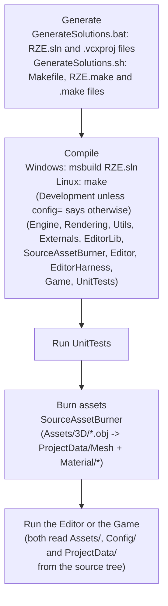

# Building & Running RZE

RZE builds on **Windows** (Visual Studio, DX11) and **Linux** (clang and GNU make, OpenGL 4.5). One Sharpmake
description generates both: Visual Studio solutions on Windows, Makefiles on Linux. The steps are the same on each;
only the tools differ.

## Prerequisites

| | Windows | Linux |
|---|---|---|
| Tools | Visual Studio 2026 with the C++ workload (the v145 toolset) and Windows SDK 10.0.26100, .NET 8 or later (for Sharpmake) | `sudo dnf install clang lld make dotnet-sdk-8.0` |
| Libraries | Committed under `ThirdParty\` (SDL3, assimp, Optick, DirectXTK) | `sudo dnf install SDL3-devel libshaderc-devel assimp-devel` |
| Graphics | Direct3D 11 | An OpenGL 4.5 core driver |

Linux is developed on Fedora 44 under KDE Plasma (Wayland), with an NVIDIA driver. On Windows, `Tools\RZEHub.exe`
(a GUI front-end, whose source isn't in this repo) expects the depot at `C:\dev\RZE`; nothing else does.

## The canonical build sequence



CI runs exactly this sequence on both platforms (`.github/workflows/Windows.yml` and `Linux.yml`, below). If these
docs and the CI files ever disagree, trust the CI files.

## Step by step

1. **Generate the projects.** Again after adding or removing any source file: the generated files aren't committed.
   - Windows: `RZE\GenerateSolutions.bat` runs `Tools\Sharpmake\Sharpmake.Application.exe`, producing `RZE.sln` and
     a `.vcxproj` per project under its `_project\` folder.
   - Linux: `RZE/GenerateSolutions.sh` runs the same Sharpmake with `dotnet`, producing `RZE/Makefile` (the build:
     every project's objects compile at once, then `RZE.make` links), `RZE/RZE.make` (the same build, one project
     after another) and a `.make` per project under its `_project/` folder.

   See [09-BuildSystem/Sharpmake-Project-Graph.md](../09-BuildSystem/Sharpmake-Project-Graph.md).

2. **Compile.** Output lands in `RZE/_build/<config>/` (`debug`, `development` or `retail`; see
   [Configurations](#configurations)).
   - Windows: `msbuild RZE.sln /property:Configuration=Development`, or pick the configuration once in Visual Studio,
     which remembers it. Warnings are errors (`/W3 /WX`).
   - Linux: `make -j$(nproc)` in `RZE/` builds Development, `config=debug` or `config=retail` the others, and
     `make Editor` one project. `RZE.make` on its own (`make -f RZE.make`) defaults to Debug, as Sharpmake writes it.
     Warnings are errors here too (`-Wall -Werror`). Executables have no extension (`_build/development/Editor`).
   - **Just the Game:** `RZE/BuildGame.bat` on Windows finds MSBuild through `vswhere` and builds
     `Game/_project/Game_Win64.vcxproj` as Development|x64. `RZE/BuildGame.sh` on Linux runs
     `make config=development -j$(nproc) Game`. The Editor's **Build Game** and **Launch Game** run whichever one
     belongs to the platform (see [Editor-Camera-And-Build-Launch.md](../07-Editor/Editor-Camera-And-Build-Launch.md)).

3. **Burn assets** (offline asset conditioning; see
   [05-AssetPipeline/Asset-Burning-Pipeline.md](../05-AssetPipeline/Asset-Burning-Pipeline.md))
   ```
   _build/<config>/SourceAssetBurner
   ```
   With no argument, this walks `Assets/3D/` and converts every `.obj` into RZE's binary `.meshasset` and
   `.materialasset` formats under `ProjectData/` (about 15 seconds on Windows, 4 on Linux). `ProjectData/` **isn't
   tracked in git**, so do this once after cloning, and again after pulling importer changes (for example the
   2026-10-10 change that stopped models being mirrored; see [World-Conventions.md](../02-Architecture/World-Conventions.md)).
   Linux's file system is case-sensitive, so a texture a model names in another case is found the way Windows would
   find it (`FileNames::FindIgnoringCase`).

4. **Where the executables find their data.** Nothing is copied into `_build`. The Editor, the Game and
   `SourceAssetBurner` all set `EDirectoryContext::Source` at start-up, so their relative paths (`Assets/`, `Config/`,
   `ProjectData/`, and `Logs/` for their logs) resolve against the **source tree**: the folder above `_build/`, or
   beside the executable when it isn't under `_build/`. Shader, asset, config and scene edits show up on the next
   launch, in either app. The other context, `EDirectoryContext::Runtime` (beside the executable), is kept for a
   future packaged game. See [Utils-Library-Reference.md](../06-Platform-And-Infrastructure/Utils-Library-Reference.md).

   A `Filepath` built during static initialisation resolves before `main` sets the context, so build paths when
   they're used, not in globals.

5. **Run.** `_build/<config>/Game` (`Game.exe`) or `_build/<config>/Editor` (`Editor.exe`), optionally with
   `-scene Sponza.scene` (a scene in `Assets/Scenes`).

## Configurations

| | Debug | Development | Retail |
|---|---|---|---|
| For | Stepping through code the optimizer rearranges | Everyday work and testing | The build that ships |
| Optimization, Linux | Off (`-O0`) | `-O2`, with frame pointers (`-fno-omit-frame-pointer`) | `-O3 -mavx2` |
| Optimization, Windows | Off, no inlining | On, any inlining (`/Ob2`) | Maximize speed, any inlining, AVX2 |
| Windows CRT | Debug (`/MDd`) | Release (`/MD`) | Release (`/MD`) |
| Symbols | ✓ | ✓ | ✓ |
| Asserts, logging, the Game's ImGui, `START_TIMED_BLOCK`, `RZE_DISABLE_OPTIMIZATION` | ✓ | ✓ | — (`RZE_RETAIL`) |
| Graphics validation (the D3D11 debug layer, a GL debug context) | On (`-gfxvalidation 0` turns it off) | Off (`-gfxvalidation` turns it on) | — |

- **Development is the default:** `make` in `RZE/`, both `run-rze` drivers, VS Code's default build task and its first
  launch configurations, and the Editor's Build Game and Launch Game. Use Debug when the debugger's view of an
  optimized function isn't enough, or wrap just that function in `RZE_DISABLE_OPTIMIZATION`
  ([Debug-Services-And-Logging.md](../06-Platform-And-Infrastructure/Debug-Services-And-Logging.md#reading-an-optimized-function-in-the-debugger)).
- **What each has** is decided in `Utils/Src/Utils/DebugUtils/DebugConfig.h` (Debug and Development have every
  debugging aid, Retail none), and the compiler settings in `Make/Sharpmake/BaseProject.sharpmake.cs`. Besides
  optimization and validation's default, the debug CRT's own checks (on the heap and in the standard library, which
  report through its hook) are all Debug has that Development doesn't: Development links the release CRT.
- **Formerly Release.** Development was called Release until 2026-11-08 (`7439d711`), and only had asserts from
  `139bfcb1`, the same day. Measurements in these pages that say "Release (now Development)" were taken in it before
  then.

## Unit tests

`_build/<config>/UnitTests` runs the unit tests ([doctest](https://github.com/doctest/doctest) 2.4.11, vendored in
`ThirdParty/Include/doctest/`). It exits non-zero if any fail; doctest's options apply (`--help`, `-tc="name*"` to
pick test cases, `-s` to show passing checks). It needs no display, so CI runs it headless on both platforms.

- **Project:** `UnitTests/` (`UnitTests.sharpmake.cs`). It links `EditorLib`, the Editor's code as a static library,
  and through it `Engine`, so tests can cover either. Generate again after adding a test file.
- **Layout:** `UnitTests/Src/Editor/`, `Src/Engine/` and `Src/Utils/` mirror the code under test. A `Linux` or `Windows` folder in them is built only on that platform, as in the code (e.g. `Src/Utils/Linux/ShellLinuxTests.cpp`). Shared helpers:
  - `TestComponents.h`: a test component with one property of each kind (`EditorOnly`, `Exclusive`, `ReadOnly`, computed), registered with `RegisterTestComponents()`.
  - `TestFolder.h`: `ScopedTestFolder`, a scratch folder beside the executable that's emptied at the start and removed at the end; and `RemoveEmptyFolders(folder)`, which removes a folder and the empty ones above it, up to the executable's, for tests that write where the editor keeps its own files (the trash, thumbnails).
  - `TestOperation.h`: an `AsyncOperation` a test can drive step by step.
- **What's covered:**
  - Editor: `UndoHistory` (steps, merging, the cap, the redo branch, `OnDropped`, the save point), `ParkedSubtree`, `GameObjectSnapshot` and the clipboard, `EditorSelection` and `InteractionTracker`; the file browser's listing and save names (`FolderListing`); thumbnails (`Thumbnails`, `ThumbnailQueue`) and `MeshFraming`; the status bar's `TaskTracker`; settings pages; `AssetFiles` and its commands (renames, the trash, and what goes to the Recycle Bin from where, with a stand-in for it).
  - Engine: `ComponentPropertyRegistry`, `GameScene` (including components loading and saving in the scene file's order), `HeadlessScene`, `AsyncOperationManager` and `JobScheduler` (lanes, budgets), `ResourceHandler` (shared loads, deferred destroys), `TextureFile` (PNG round trip, atomic writes), `TransformComponent`, lights, object and render scene bounds, `SceneChangeLog`, and `CubeMap` (each face renders what sampling the cube reads).
  - Utils: `BoundingBox`, `Frustum`, `Ray`, file and string helpers, `FileNames` (including names that differ only in case), `TypeNames`; on Linux, `Shell::MoveToRecycleBin` (the Trash spec, in a test `XDG_DATA_HOME`).
- **No running engine.** Tests build their own `GameScene` and `EditorContext`; `main` (`TestMain.cpp`) only does what tests rely on from start-up: `MainThreadDispatcher::Initialize()` and `RZE_Application::RegisterEngineComponents()`. Code that needs a window or the render engine (e.g. `CameraComponent::OnAddToScene`, finding objects through `RZE().GetActiveScene()`) can't be tested this way.
- **Asserts fail the test.** In Debug and Development, `Debug::SetAssertFailureHook` turns an engine assert into a failed check in the running test, with the assert's text, instead of a dialog (Windows) or a break into a debugger (Linux), so a run never waits for input. On Windows Debug builds it also catches the debug CRT's own reports.

## VS Code on Linux

`Tools/Linux/VSCode/RZE.code-workspace` (open the workspace, not the repository folder) builds, runs and debugs with
gdb: Ctrl+Shift+B builds Development, and F5 starts the Editor or the unit tests in Development or Debug, each building
its configuration first. Its IntelliSense reads `compile_commands.json` at the repository root, which
`Tools/Linux/GenerateCompileCommands.py` writes from the Makefiles (Development's flags unless told otherwise), so it
sees the build's own defines and include paths; the file is gitignored and the build task regenerates it. Setup is in
`Tools/Linux/VSCode/README.md`.

## Driving the running Editor

The `run-rze` skill (`.claude/skills/run-rze/`) builds, runs and drives the Editor for automated checks:
`driver.ps1` on Windows, `driver.py` on Linux. `driver.py launch --harness` and `driver.ps1 launch -Harness` run
**EditorHarness**, the Editor with a harness beside it that takes input, screenshots and state queries as JSON lines on
stdin, so the real cursor and focus are left alone. On Linux, `launch --harness --nested` runs the session off-screen,
in a KWin of its own, for smoke tests while the machine is in use. Both drivers put `RZE/Config/imgui.ini` back after
a session.
`.claude/WindowsChecks.md` lists the checks a Windows machine still has to run for changes made on Linux, and records
their results. See [EditorHarness-And-Drivers.md](../07-Editor/EditorHarness-And-Drivers.md).

## CI

Both run on pushes to any branch, on pull requests to `master` and `Sandbox`, and on demand, over `debug`,
`development` and `retail`. Pushes and pull requests that only change `Docs/`, Markdown files or `.claude/` don't
start them. GitHub reads a workflow from the commit that was pushed, so an older branch runs whatever workflow files it
has.

- **Matrix:** each configuration is its own job, and one failing doesn't cancel the others (`fail-fast: false`).
- **Superseded runs:** a newer push to the same branch or pull request cancels the run before it.
- **Time limit:** a hung job stops after 30 minutes on Linux, 60 on Windows.
- **Failures:** a failing unit test fails the job, and so does a source the burner can't import (it exits with 1), or
  an Editor that fails the smoke test (below).

| | `Windows.yml` | `Linux.yml` |
|---|---|---|
| Runner | `windows-2025-vs2026`: VS 2026 (v145) and the Windows SDK 10.0.26100 that `RZE.sharpmake.cs` targets. Named explicitly, so a move of `windows-latest` can't change the toolchain | `ubuntu-latest`, in a `fedora:44` container (Ubuntu has no SDL3 packages) |
| Setup | MSBuild, .NET 8 (pinned, as images drop SDKs after their end of support) | `dnf install` of the Linux prerequisites above |
| Generate | `GenerateSolutions.bat` | `GenerateSolutions.sh` |
| Build | `msbuild -m RZE/RZE.sln /p:Configuration=<config> /p:Platform=x64` | `make config=<config> -j$(nproc)` in `RZE/` |
| Then | `UnitTests.exe`, `SourceAssetBurner.exe`, the smoke test | `UnitTests`, `SourceAssetBurner`, the smoke test |
| Smoke test display | The runner's desktop (1024x720 client). No GPU: DX11 runs on the Microsoft Basic Render Driver (WARP) | `xvfb-run` with `SDL_VIDEO_DRIVER=x11` (1600x900 client), OpenGL 4.6 core from Mesa's llvmpipe |
| Archive | `RZE/_build/<config>` without `.lib`/`.pdb`/`.exp`/`.log`, with `RZE/Assets`, `Config`, `ProjectData` | the same, without `.a`/`.log` |

Only runs on `master` and `look-what-claude-can-do` upload an archive, one per configuration (about 350-400 MB each,
mostly `RZE/Assets`), kept for 14 days. The executables read their data from the source tree, so the archive keeps
that layout.

### Editor smoke test

`.github/scripts/editor_smoke.py` starts EditorHarness ([EditorHarness-And-Drivers.md](../07-Editor/EditorHarness-And-Drivers.md))
on `Sponza.scene` and talks to it over its JSON protocol. It fails the job if:

- the harness isn't ready, or the scene hasn't loaded, within 120 s;
- the scene open isn't the one asked for, lacks one of its objects (Camera, DirectionalLight, Sponza, Nyra, Nanosuit,
  NeckMechWalker, Tank), or shows unsaved changes;
- fewer than 10 frames follow the load (a hung render thread or main loop);
- the shot fails, or its PNG isn't the client area's size;
- the Editor doesn't exit with code 0 within 120 s of `quit`, which closes it as the close button does.

Errors and warnings the Editor logs don't fail it: each distinct line is listed once with its count, and annotated on
the run. Every run uploads `smoke-out` (`app.log`, the Editor's output, and `shot.png`, the frame) as an artifact, kept
for 14 days. On Linux a run takes about 60 s per configuration: software rendering draws Sponza at a frame every 2-3 s,
which is enough for a few frames, and the Editor takes about 20 s to shut down. A heavier scene, or one whose objects
change, needs `--expect` (and maybe `--timeout`) to match.

Run it locally the same way, after a build (it puts `RZE/Config/imgui.ini` back afterwards):

```bash
python3 .github/scripts/editor_smoke.py --config debug --out /tmp/smoke-out
```

It opens the Editor's window on your desktop. Options: `--scene`, `--expect` (the objects it must have), `--frames`,
`--timeout`, `--exit-timeout`.

## Key files

- `README.md`
- `RZE/GenerateSolutions.bat`, `RZE/GenerateSolutions.sh`, `RZE/BuildGame.bat`, `RZE/BuildGame.sh`
- `Utils/Src/Utils/Platform/Filepath.h/.cpp` (`EDirectoryContext`)
- `.github/workflows/Windows.yml`, `.github/workflows/Linux.yml`, `.github/scripts/editor_smoke.py`
- `.claude/skills/run-rze/`, `.claude/WindowsChecks.md`
