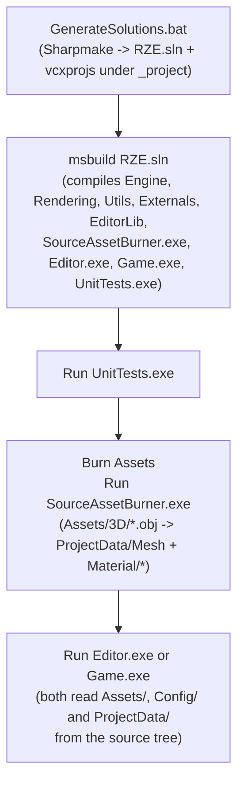

# Building & Running RZE

## Prerequisite: depot location

Per the repo README, the depot currently **must** be at `C:\dev\RZE` for `Tools\RZEHub.exe` to work correctly. This is a hard-coded assumption, not a configurable path.

## The canonical build sequence



This exact sequence is confirmed by `.github\workflows\Windows.yml` (the CI pipeline) and matches the manual steps in the README:

1. Run `Tools\RZEHub.exe`
2. Open and build the generated solution
3. Click **"Burn Assets"** in RZE Hub
4. Start the Editor or Game project (Game is the default)

RZEHub is a GUI front-end that (per its buttons' names) invokes `SourceAssetBurner.exe` for you rather than requiring the manual commands below. Its **"Asset Copy"** button ran `AssetCpy.bat`, which is gone, so it no longer works; nothing needs copying any more (below). The Hub's source isn't in this repo.

## Doing it manually (what each step actually runs)

1. **Generate the solution**
   ```
   RZE\GenerateSolutions.bat
   ```
   Runs `Tools\Sharpmake\Sharpmake.Application.exe "/sources('RZE.sharpmake.cs')"`, producing `RZE.sln` and per-project `.vcxproj` files under `RZE\_project\`. See [09-BuildSystem/Sharpmake-Project-Graph.md](../09-BuildSystem/Sharpmake-Project-Graph.md).

2. **Compile**
   ```
   msbuild RZE.sln /property:Configuration=Debug   (or Release)
   ```
   Or use `RZE\BuildGame.bat` to build just the Game quickly: it finds MSBuild through `vswhere`, so it works outside a Visual Studio developer prompt, and builds `Game\_project\Game_Win64.vcxproj` as Debug|x64. Output lands in `RZE\_build\<config>\`.

3. **Burn assets** (offline asset conditioning — see [05-AssetPipeline/Asset-Burning-Pipeline.md](../05-AssetPipeline/Asset-Burning-Pipeline.md) for what this actually does)
   ```
   _build\<config>\SourceAssetBurner.exe
   ```
   With no argument, this walks `Assets\3D\` and converts every `.obj` found into RZE's binary `.meshasset`/`.materialasset` formats under `ProjectData\` (about 15 seconds). `ProjectData\` **isn't tracked in git**, so do this once after cloning, and again after pulling importer changes (for example the 2026-10-10 change that stopped models being mirrored; see [World-Conventions.md](../02-Architecture/World-Conventions.md)).

4. **Where the executables find their data.** Nothing is copied into `_build`. The Editor, the Game and `SourceAssetBurner` all set `EDirectoryContext::Source` at start-up, so their relative paths (`Assets\`, `Config\`, `ProjectData\`, and `Logs\` for their logs) resolve against the **source tree**: the folder above `_build\`, or beside the executable when it isn't under `_build\`. Shader, asset, config and scene edits show up on the next launch, in either app. The other context, `EDirectoryContext::Runtime` (beside the executable), is kept for a future packaged game. See [Utils-Library-Reference.md](../06-Platform-And-Infrastructure/Utils-Library-Reference.md).

   A `Filepath` built during static initialisation resolves before `main` sets the context, so build paths when they're used, not in globals.

5. **Run**
   - Game (default): `_build\<config>\Game.exe`
   - Editor: the built Editor executable in the same output folder

## Unit tests

`_build\<config>\UnitTests.exe` runs the unit tests ([doctest](https://github.com/doctest/doctest) 2.4.11, vendored in `ThirdParty\Include\doctest\`). It exits non-zero if any fail; doctest's options apply (`--help`, `-tc="name*"` to pick test cases, `-s` to show passing checks).

- **Project:** `UnitTests\` (`UnitTests.sharpmake.cs`). It links `EditorLib`, the Editor's code as a static library, and through it `Engine`, so tests can cover either. Run `GenerateSolutions.bat` after adding a test file.
- **Layout:** `UnitTests\Src\Editor\`, `Src\Engine\` and `Src\Utils\` mirror the code under test. Shared helpers:
  - `TestComponents.h`: a test component with one property of each kind (`EditorOnly`, `Exclusive`, `ReadOnly`, computed), registered with `RegisterTestComponents()`.
  - `TestFolder.h`: `ScopedTestFolder`, a scratch folder beside the executable that's emptied at the start and removed at the end.
  - `TestOperation.h`: an `AsyncOperation` a test can drive step by step.
- **What's covered:**
  - Editor: `UndoHistory` (steps, merging, the cap, the redo branch, `OnDropped`, the save point), `ParkedSubtree`, `GameObjectSnapshot` and the clipboard, `EditorSelection` and `InteractionTracker`; the file browser's listing and save names (`FolderListing`); thumbnails (`Thumbnails`, `ThumbnailQueue`) and `MeshFraming`; the status bar's `TaskTracker`; settings pages.
  - Engine: `ComponentPropertyRegistry`, `GameScene`, `HeadlessScene`, `AsyncOperationManager` and `JobScheduler` (lanes, budgets), `ResourceHandler` (shared loads, deferred destroys), `TextureFile` (PNG round trip, atomic writes), `TransformComponent`, and object and render scene bounds.
  - Utils: `BoundingBox`.
- **No running engine.** Tests build their own `GameScene` and `EditorContext`; `main` (`TestMain.cpp`) only does what tests rely on from start-up: `MainThreadDispatcher::Initialize()` and `RZE_Application::RegisterEngineComponents()`. Code that needs a window or the render engine (e.g. `CameraComponent::OnAddToScene`, finding objects through `RZE().GetActiveScene()`) can't be tested this way.
- **Asserts fail the test.** In Debug, a CRT report hook turns an engine assert into a failed check in the running test, with the assert's text, instead of a dialog, so a run never waits for input.

## CI reference (`.github\workflows\Windows.yml`)

Runs on `windows-2019`, matrix over `debug`/`release`. Steps:

1. Set up MSBuild + .NET 5.0.100
2. Checkout
3. `cd RZE && GenerateSolutions.bat`
4. `msbuild RZE/RZE.sln /property:Configuration=<config>`
5. Run `UnitTests.exe` (a failing test fails the run)
6. Run `SourceAssetBurner.exe`
7. Archive `RZE/_build/<config>` (excluding `.lib`/`.pdb`/`.exp`/`.log`) together with `RZE/Assets`, `RZE/Config` and `RZE/ProjectData` as a build artifact. The executables read their data from the source tree, so the archive keeps that layout.

This is the single most authoritative source for "the correct build order" if these docs and the CI config ever diverge — trust the CI file.

## Key files

- `README.md`
- `GenerateSolutions.bat`, `BuildGame.bat`
- `Utils\Src\Utils\Platform\FilePath.h/.cpp` (`EDirectoryContext`)
- `.github\workflows\Windows.yml`
