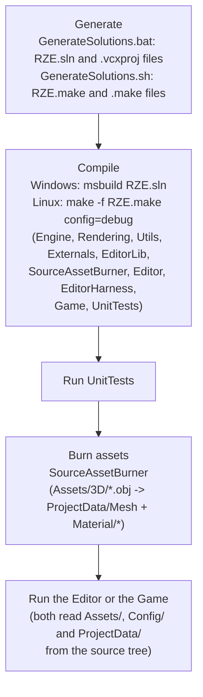

# Building & Running RZE

RZE builds on **Windows** (Visual Studio, DX11) and **Linux** (clang and GNU make, OpenGL 4.5). One Sharpmake
description generates both: Visual Studio solutions on Windows, Makefiles on Linux. The steps are the same on each;
only the tools differ.

## Prerequisites

| | Windows | Linux |
|---|---|---|
| Tools | Visual Studio with the C++ workload, .NET 6 or later (for Sharpmake) | `sudo dnf install clang lld make dotnet-sdk-8.0` |
| Libraries | Committed under `ThirdParty\` (SDL3, assimp, Optick, DirectXTK) | `sudo dnf install SDL3-devel libshaderc-devel assimp-devel` |
| Graphics | Direct3D 11 | An OpenGL 4.5 core driver |

Linux is developed on Fedora 44 under KDE Plasma (Wayland), with an NVIDIA driver. On Windows, `Tools\RZEHub.exe`
(a GUI front-end, whose source isn't in this repo) expects the depot at `C:\dev\RZE`; nothing else does.

## The canonical build sequence



CI runs exactly this sequence on both platforms (`.github/workflows/Windows.yml` and `Linux.yml`, below). If these
docs and the CI files ever disagree, trust the CI files.

## Step by step

1. **Generate the projects.** Again after adding or removing any source file: the generated files aren't committed.
   - Windows: `RZE\GenerateSolutions.bat` runs `Tools\Sharpmake\Sharpmake.Application.exe`, producing `RZE.sln` and
     a `.vcxproj` per project under its `_project\` folder.
   - Linux: `RZE/GenerateSolutions.sh` runs the same Sharpmake with `dotnet`, producing `RZE/RZE.make` and a `.make`
     per project under its `_project/` folder.

   See [09-BuildSystem/Sharpmake-Project-Graph.md](../09-BuildSystem/Sharpmake-Project-Graph.md).

2. **Compile.** Output lands in `RZE/_build/<config>/` (`debug`, `release` or `retail`).
   - Windows: `msbuild RZE.sln /property:Configuration=Debug`. Warnings are errors (`/W3 /WX`).
   - Linux: `make -f RZE.make config=debug -j$(nproc)` (or `release`, `retail`), or one project, e.g.
     `make -f RZE.make config=debug Editor`. Warnings are errors here too (`-Wall -Werror`). Executables have no
     extension (`_build/debug/Editor`).
   - **Just the Game:** `RZE/BuildGame.bat` on Windows finds MSBuild through `vswhere` and builds
     `Game/_project/Game_Win64.vcxproj` as Debug|x64. `RZE/BuildGame.sh` on Linux runs
     `make -f RZE.make config=debug Game`. The Editor's **Build Game** and **Launch Game** run whichever one belongs
     to the platform (see [Editor-Camera-And-Build-Launch.md](../07-Editor/Editor-Camera-And-Build-Launch.md)).

3. **Burn assets** (offline asset conditioning; see
   [05-AssetPipeline/Asset-Burning-Pipeline.md](../05-AssetPipeline/Asset-Burning-Pipeline.md))
   ```
   _build/<config>/SourceAssetBurner
   ```
   With no argument, this walks `Assets/3D/` and converts every `.obj` into RZE's binary `.meshasset` and
   `.materialasset` formats under `ProjectData/` (about 15 seconds on Windows, 4 on Linux). `ProjectData/` **isn't
   tracked in git**, so do this once after cloning, and again after pulling importer changes (for example the
   2026-10-10 change that stopped models being mirrored; see [World-Conventions.md](../02-Architecture/World-Conventions.md)).
   Linux's file system is case-sensitive, so a texture a model names in another case is found the way Windows would
   find it (`FileNames::FindIgnoringCase`).

4. **Where the executables find their data.** Nothing is copied into `_build`. The Editor, the Game and
   `SourceAssetBurner` all set `EDirectoryContext::Source` at start-up, so their relative paths (`Assets/`, `Config/`,
   `ProjectData/`, and `Logs/` for their logs) resolve against the **source tree**: the folder above `_build/`, or
   beside the executable when it isn't under `_build/`. Shader, asset, config and scene edits show up on the next
   launch, in either app. The other context, `EDirectoryContext::Runtime` (beside the executable), is kept for a
   future packaged game. See [Utils-Library-Reference.md](../06-Platform-And-Infrastructure/Utils-Library-Reference.md).

   A `Filepath` built during static initialisation resolves before `main` sets the context, so build paths when
   they're used, not in globals.

5. **Run.** `_build/<config>/Game` (`Game.exe`) or `_build/<config>/Editor` (`Editor.exe`), optionally with
   `-scene Sponza.scene` (a scene in `Assets/Scenes`).

## Unit tests

`_build/<config>/UnitTests` runs the unit tests ([doctest](https://github.com/doctest/doctest) 2.4.11, vendored in
`ThirdParty/Include/doctest/`). It exits non-zero if any fail; doctest's options apply (`--help`, `-tc="name*"` to
pick test cases, `-s` to show passing checks). It needs no display, so CI runs it headless on both platforms.

- **Project:** `UnitTests/` (`UnitTests.sharpmake.cs`). It links `EditorLib`, the Editor's code as a static library,
  and through it `Engine`, so tests can cover either. Generate again after adding a test file.
- **Layout:** `UnitTests/Src/Editor/`, `Src/Engine/` and `Src/Utils/` mirror the code under test. Shared helpers:
  - `TestComponents.h`: a test component with one property of each kind (`EditorOnly`, `Exclusive`, `ReadOnly`, computed), registered with `RegisterTestComponents()`.
  - `TestFolder.h`: `ScopedTestFolder`, a scratch folder beside the executable that's emptied at the start and removed at the end.
  - `TestOperation.h`: an `AsyncOperation` a test can drive step by step.
- **What's covered:**
  - Editor: `UndoHistory` (steps, merging, the cap, the redo branch, `OnDropped`, the save point), `ParkedSubtree`, `GameObjectSnapshot` and the clipboard, `EditorSelection` and `InteractionTracker`; the file browser's listing and save names (`FolderListing`); thumbnails (`Thumbnails`, `ThumbnailQueue`) and `MeshFraming`; the status bar's `TaskTracker`; settings pages.
  - Engine: `ComponentPropertyRegistry`, `GameScene` (including components loading and saving in the scene file's order), `HeadlessScene`, `AsyncOperationManager` and `JobScheduler` (lanes, budgets), `ResourceHandler` (shared loads, deferred destroys), `TextureFile` (PNG round trip, atomic writes), `TransformComponent`, lights, object and render scene bounds, and `SceneChangeLog`.
  - Utils: `BoundingBox`, `CubeMap`, `Frustum`, `Ray`, file and string helpers, `FileNames` (including names that differ only in case), `TypeNames`.
- **No running engine.** Tests build their own `GameScene` and `EditorContext`; `main` (`TestMain.cpp`) only does what tests rely on from start-up: `MainThreadDispatcher::Initialize()` and `RZE_Application::RegisterEngineComponents()`. Code that needs a window or the render engine (e.g. `CameraComponent::OnAddToScene`, finding objects through `RZE().GetActiveScene()`) can't be tested this way.
- **Asserts fail the test.** In Debug, `Debug::SetAssertFailureHook` turns an engine assert into a failed check in the running test, with the assert's text, instead of a dialog (Windows) or a break into a debugger (Linux), so a run never waits for input. On Windows it also catches the CRT's own reports.

## Driving the running Editor

The `run-rze` skill (`.claude/skills/run-rze/`) builds, runs and drives the Editor for automated checks:
`driver.ps1` on Windows, `driver.py` on Linux. On Linux, `driver.py launch --harness` runs **EditorHarness**, the
Editor with a harness beside it that takes input, screenshots and state queries as JSON lines on stdin, so the real
cursor and focus are left alone. `.claude/WindowsChecks.md` lists the checks a Windows machine still has to run for
changes made on Linux. See [EditorHarness-And-Drivers.md](../07-Editor/EditorHarness-And-Drivers.md).

## CI

Both run on pushes and pull requests to `master` and `Sandbox`, and on demand, over `debug` and `release`.

| | `Windows.yml` | `Linux.yml` |
|---|---|---|
| Runner | `windows-2022` | `ubuntu-latest`, in a `fedora:44` container (Ubuntu has no SDL3 packages) |
| Setup | MSBuild, .NET 8 | `dnf install` of the Linux prerequisites above |
| Generate | `GenerateSolutions.bat` | `GenerateSolutions.sh` |
| Build | `msbuild -m RZE/RZE.sln` | `make -f RZE.make -j$(nproc)` |
| Then | `UnitTests.exe` (a failing test fails the run), `SourceAssetBurner.exe` | `UnitTests`, `SourceAssetBurner` |
| Archive | `RZE/_build/<config>` without `.lib`/`.pdb`/`.exp`/`.log`, with `RZE/Assets`, `Config`, `ProjectData` | the same, without `.a`/`.log` |

The executables read their data from the source tree, so the archive keeps that layout.

## Key files

- `README.md`
- `RZE/GenerateSolutions.bat`, `RZE/GenerateSolutions.sh`, `RZE/BuildGame.bat`, `RZE/BuildGame.sh`
- `Utils/Src/Utils/Platform/Filepath.h/.cpp` (`EDirectoryContext`)
- `.github/workflows/Windows.yml`, `.github/workflows/Linux.yml`
- `.claude/skills/run-rze/`, `.claude/WindowsChecks.md`
