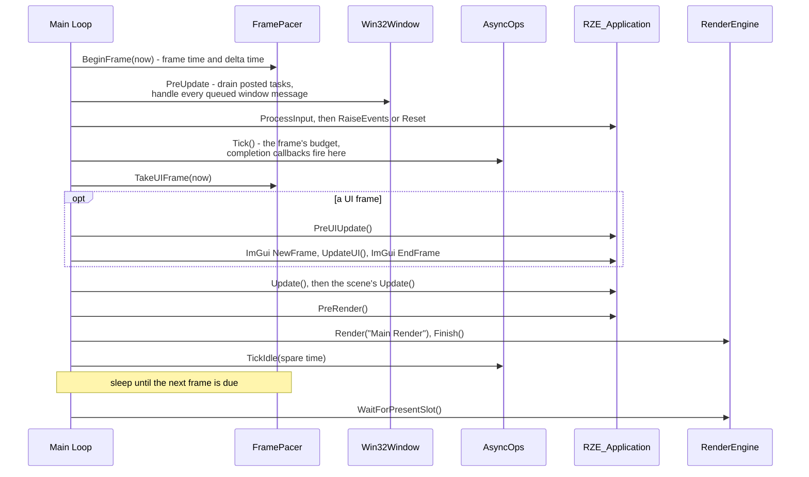

# Engine Startup & Frame Loop

The two central types in RZE are **`RZE_Engine`** (owns everything — window, renderer, scene, resources, input) and **`RZE_Application`** (a virtual base class overridden once per product: `GameApp`, `EditorApp`). There is no `main()` inside `Engine` itself — it's a library consumed by each product's entry point.

## The global engine accessor

`RZE\Engine\Src\RZE.h` / `RZE.cpp` expose a free function:

```cpp
RZE_Engine& RZE();
```

backed by a file-static global instance in `RZE.cpp`. This is used pervasively — `RZE().GetResourceHandler()`, `RZE().GetRenderEngine()`, `RZE().GetActiveScene()`, `RZE().GetInputHandler()`, `RZE().PostExit()` — as a **service locator**, not dependency injection. Almost any file in the codebase can reach any core subsystem through this single global.

## Entry points

```cpp
// RZE\Game\Src\Main.cpp
int main(int argc, char* argv[]) {
    GameApp gGameApp;
    if (argc > 1) gGameApp.ParseArguments(argv, argc);
    gGameApp.Run();
}
```

`RZE\Editor\Src\EditorMain.cpp` follows the identical shape with `Editor::EditorApp`. `RZE_Application::Run()` (in `EngineApp.cpp`) calls `RZE().Run(engineHook)`, passing a callback that returns the application, which `main` has already constructed.

## `RZE_Engine` (`Engine\Src\EngineCore\Engine.h` / `.cpp`)

Owns: `RZE_Application* m_application`, `GameScene* m_activeScene`, `Win32Window* m_window`, `std::unique_ptr<SplashScreen> m_splashScreen` (only while starting up, and only for an application with a splash screen), `ResourceHandler m_resourceHandler`, `EventHandler m_eventHandler`, `InputHandler m_inputHandler`, `std::unique_ptr<RenderEngine> m_renderEngine`, `AsyncOperationManager m_asyncOperationManager`, plus frame timing: `HiResTimer m_programTimer` (started with the main loop; frame times are measured on it), `FramePacer m_framePacer` ([below](#frame-pacing)), `PreciseSleep m_frameSleep`, `FrameTimeCapture m_frameTimeCapture`, `m_deltaTime` and `m_frameCount`.

Public accessors used as the de-facto service locator: `GetApplication()`, `GetResourceHandler()`, `GetInputHandler()`, `GetRenderEngine()`, `GetAsyncOperationManager()`, `GetActiveScene()`, `GetDeltaTime()`/`GetDeltaTimeMS()`, `GetFramePacer()` / `SetFrameSettings()`, `SetWindowSize()`, `PostExit()`.

## Startup sequence

```mermaid
%%{init: {'flowchart': {'subGraphTitleMargin': {'top': 6, 'bottom': 10}}, 'themeCSS': '.labelBkg, .edgeLabel { background-color: var(--background-primary) !important; } .messageText, .labelText, .loopText { paint-order: stroke; stroke: var(--background-primary); stroke-width: 5px; stroke-linejoin: round; }'}}%%
flowchart TD
    A[RZE_Application::Run] --> B["RZE_Engine::Run(createApplicationCallback):<br/>takes the application"]
    B --> C[Init]
    C --> C1[Debug::CreateLogFile / DebugServices::Get.Initialize]
    C1 --> C1b["MainThreadDispatcher::Initialize<br/>+ Debug::SetLogSink<br/>(log lines also go to DebugServices)"]
    C1b --> C2[Threading::JobScheduler::Get.Initialize]
    C2 --> C2b[AsyncOperationManager::Initialize]
    C2b --> C3["LoadEngineConfig (Config/Engine.ini)"]
    C3 --> C3b["SplashScreen, if the application<br/>has an image (the Editor)"]
    C3b --> C4["CreateAndInitializeWindow:<br/>Win32Window, made cloaked"]
    C4 --> C5[InputHandler::Initialize + RegisterWindowEvents]
    C5 --> C6[ResourceHandler::Init]
    C6 --> C7["CreateAndInitializeRenderer (new RenderEngine, Initialize(hwnd))"]
    C7 --> C8[Create + Initialize GameScene]
    C8 --> D[PostInit]
    D --> D2["InitializeApplication:<br/>app.Initialize() (registers components),<br/>app.RegisterInputEvents(), app.Start()"]
    D2 --> D3[GameScene::Start]
    D3 --> W["WaitForStartupLoading:<br/>async operations with no frames,<br/>until app.IsReadyToShow()"]
    W --> F["Start the program timer,<br/>FrameTimeCapture::Initialize,<br/>InitializeFramePacing"]
    F --> G["Focus the window, then DrawFirstFrames:<br/>three frames while it's cloaked"]
    G --> R["Win32Window::Reveal,<br/>then close the splash screen"]
    R --> E[Main Loop]
```



1. **Taking the application.** `Run()` calls the callback first, so start-up can ask the application what it needs (its splash screen image) before it's initialized in `PostInit()`.
2. **`Init()`**:
   - `Debug::CreateLogFile()`, `DebugServices::Get().Initialize()`
   - `Threading::MainThreadDispatcher::Get().Initialize()` (records the main thread's ID), then `Debug::SetLogSink(&TraceLogLine)` so every `RZE_LOG` line also reaches `DebugServices`, on its level's channel ([Debug-Services-And-Logging.md](../06-Platform-And-Infrastructure/Debug-Services-And-Logging.md))
   - `Threading::JobScheduler::Get().Initialize()`, then `m_asyncOperationManager.Initialize()` ([Threading-And-Jobs.md](../06-Platform-And-Infrastructure/Threading-And-Jobs.md))
   - `LoadEngineConfig()` — loads `Config/Engine.ini` as an `EngineConfig` resource
   - The **splash screen**, if `RZE_Application::GetSplashScreenImage()` is a valid path (the Editor's is `logo.png`; the Game has none). It opens as soon as Engine.ini gives it the window title and launch monitor, before the slow parts, and each step from here on shows on it (`SetStartupStatus`). See [Windowing.md](../06-Platform-And-Infrastructure/Windowing.md#splashscreen-splashscreenhcpp).
   - `CreateAndInitializeWindow()` — constructs `Win32Window` sized/titled per config. It's made **cloaked** ([Windowing.md](../06-Platform-And-Infrastructure/Windowing.md#win32window-win32windowhcpp)): shown, and maximized by the Editor, as usual, with its real size, but not on screen until start-up is done.
   - `m_inputHandler.Initialize()`, `RegisterWindowEvents()` (subscribes to `EEventType::Window` → window resize, destroy, and close requests, which exit if `RZE_Application::OnCloseRequested()` agrees)
   - `m_resourceHandler.Init()`
   - `CreateAndInitializeRenderer()` — `new RenderEngine`, `Initialize(hwnd)`, then the main view's anti-aliasing and auto-exposure from Engine.ini's `[Rendering]`
   - Creates and initializes the `GameScene`
3. **`PostInit()`**: gives the application its window, calls `app->Initialize()` (registers all built-in `GameObjectComponent` types via `RegisterEngineComponents()`), then `app->RegisterInputEvents()`, then `app->Start()`, then `m_activeScene->Start()`.
4. **`WaitForStartupLoading()`**: see [loading before the window shows](#loading-before-the-window-shows).
5. **Before the first frame**: the program timer starts, `FrameTimeCapture::Initialize()` reads the `-perf*` arguments, and `InitializeFramePacing()` reads the [frame settings](#settings), after the capture since a capture turns pacing off, and gives the `FramePacer` the monitor's refresh rate.
6. **`DrawFirstFrames()`, then the reveal**: see [the first frames](#the-first-frames).

### Loading before the window shows

What an application loads with async operations at start-up (the Editor's start scene, through `SceneDocument::Load`) finishes before its window shows, rather than under a loading dialog in it. `WaitForStartupLoading()` loops until `RZE_Application::IsReadyToShow()` is true (the Editor's is once its scene document has loaded; the base class's always is) or an exit is posted. Each pass:

1. drains `MainThreadDispatcher` (worker threads' log lines) and handles the window's messages, so Windows doesn't take the cloaked window for hung, then resets the input handler, since no input is meant for a window the user can't see;
2. `AsyncOperationManager::Tick()`, with completion callbacks as usual;
3. `RenderEngine::Submit()`, which hands what the operations recorded (resource creation, uploads) to the render thread without rendering or presenting a frame ([Low-Level-Renderer-Module.md](../04-Rendering/Low-Level-Renderer-Module.md));
4. shows the oldest operation that isn't background or a sub-step on the splash screen: its name, the first line of its status, and a progress bar.

Nothing is drawn meanwhile, so operations get 50 ms and 128 MB of uploads a pass (`k_startupLoadingBudgetMS`, `k_startupUploadBudgetBytes`) rather than a frame's 8 ms and 16 MB, and the frame budget is put back afterwards. A pass stays short enough that the window's messages and the splash screen's status keep up. The loop doesn't sleep, so it's for waiting on async operations, not anything else.

### The first frames

The window is still cloaked when the main loop's setup is done. `Win32Window::Focus()` makes it the foreground window first, so the first frames draw it as the one the user is working in (the Editor's title bar draws differently when it isn't). Then `DrawFirstFrames()` runs three frames (`k_firstFrameCount`) through `RunFrame`, each a UI frame (`FramePacer::RequestUIFrame`), waiting for a present slot after each. ImGui builds what they show over those frames: the dock layout on the first, windows that size themselves to their contents are hidden on the frame they first appear, and tabs take their widths from the frame before (with two frames the Editor's tabs still showed cut short). A final `RenderEngine::Submit()` returns once the render thread has finished the last frame, which presents it.

These frames aren't counted: `BeginFrame` isn't called for them, so they have no frame time and no delta time, the frame count doesn't move, and the frame time capture doesn't see them. Then `Win32Window::Reveal()` puts the window on screen, and only after that does the splash screen close, so there's always a window showing. The window appears fully drawn, where it used to open white and then show its frame before its panels.

## Per-frame loop

Each iteration of `while (!m_shouldExit)` is an Optick frame, and runs these steps in order. Everything from the input to handing the frame to the renderer is `RZE_Engine::RunFrame(frameStart)`, which [the first frames](#the-first-frames) run too.

```mermaid
gantt
    dateFormat x
    axisFormat %L
    title One paced frame on the main thread, in order (not to scale)
    section Main thread
    Tasks, input and events       :a, 0, 2ms
    Async tick                    :b, after a, 2ms
    UI, on UI frames              :c, after b, 3ms
    App, scene and PreRender      :d, after c, 3ms
    Render and hand over          :e, after d, 3ms
    Idle async work               :f, after e, 2ms
    Sleep                         :g, after f, 3ms
    Wait for a present slot       :h, after g, 1ms
```





### Input and events

`PreUpdate()` runs first:

1. `MainThreadDispatcher::Drain()` runs every task worker threads posted since the last frame, such as log lines.
2. `Win32Window::CompileInputMessages` handles **every** queued window message, not one per frame, so input doesn't queue up behind capped frames ([Windowing.md](../06-Platform-And-Infrastructure/Windowing.md)).
3. `InputHandler::UpdateFrameState` lets go of everything still held if the window has just lost focus, and works out whether the user is interacting ([Input-System.md](../06-Platform-And-Infrastructure/Input-System.md#interaction-and-focus)). If they are, the loop tells the `FramePacer` (`NoteInteraction`), so the UI keeps up (below).
4. `CompileWindowMessages`, then `EventHandler::ProcessEvents()`.
5. `RZE_Application::ProcessInput(inputHandler)`. Returning `true` fires the bound actions (`RaiseEvents()`); returning `false` means the application is "stealing" input (e.g. the Editor consuming mouse and keyboard for its panels), so the engine calls `Reset()` instead and no gameplay actions fire that frame.

### Update

The update is split into a scene part, which runs every frame, and a UI part, which can run less often:

1. **`AsyncOperationManager::Tick()`**, on its own and first, so completion callbacks (a scene finishing loading) land before the application gathers this frame's state.
2. **`RZE_Engine::UpdateUI()`**, only on a UI frame (`FramePacer::TakeUIFrame`, [below](#ui-frame-rate)): the application's `PreUIUpdate()`, then ImGui's `NewFrame` (DX11 and Win32 backends, `ImGuizmo::BeginFrame`), the application's `UpdateUI()`, and `ImGui::EndFrame()`.
3. **`RZE_Engine::Update()`**, every frame: the application's `Update()`, the scene's `Update()`, then the application's `PreRender()`.

| Hook on `RZE_Application` | Runs | For | ImGui calls |
|---|---|---|---|
| `PreUIUpdate()` | UI frames, before ImGui's frame | Gathering what the UI shows (the Editor's panel `Update`s) | No: there's no ImGui frame, so a stray call fails at once |
| `UpdateUI()` | UI frames, inside ImGui's frame | The UI and applying what it changes (the Editor's commands) | Yes |
| `Update()` | Every frame, after the UI | The application's own per-frame work | No |
| `PreRender()` | Every frame, after the scene's update | Per-frame scene overlays such as debug lines, which are cleared after every render (the Editor's grid and camera frustums) | No |

### Render and present

`RenderEngine::Render("Main Render")` runs the render pipeline for the main view, and `Finish()` hands the frame's commands to the render thread (`DevicePresent`). Nothing waits on the render thread after that: a released resource was already destroyed when its last handle went, and what the render thread still uses is held by its commands ([Asset-Import-Runtime.md](../05-AssetPipeline/Asset-Import-Runtime.md#releasing-resources)).

### Waiting for the next frame

`WaitForNextFrame()` ends the frame:

1. It tells the `FramePacer` the frame's work is done. If the frame is paced and has at least 1 ms to spare before the next one is due (less a 1.5 ms safety margin), `AsyncOperationManager::TickIdle` gets that time ([Asset-Import-Runtime.md](../05-AssetPipeline/Asset-Import-Runtime.md#async-operations)). It runs after `Finish()`, so it adds nothing to this frame's latency.
2. `PreciseSleep` sleeps until the CPU cap lets the next frame start: a high-resolution waitable timer, then a spin for the last millisecond, since timer wake-ups can be that late.
3. `RenderEngine::WaitForPresentSlot()` waits until the swap chain can queue another frame, so at most two are in flight ([Low-Level-Renderer-Module.md](../04-Rendering/Low-Level-Renderer-Module.md#the-swap-chain-and-vsync)). It comes last so the next frame reads its input as late as possible, and with vsync it's what paces frames. It gives up after 100 ms, e.g. while the window is minimised and nothing presents.

## Frame pacing

`FramePacer` (`Engine\Src\EngineCore\Timing\FramePacer.h/.cpp`) decides when each frame starts, what delta time it simulates, how much spare time it has and whether it updates the UI. It's only timing logic: the engine passes it the time, so it's unit tested (`FramePacerTests.cpp`), and the engine does the waiting.

### Settings

`FrameSettings` (`Engine\Src\EngineCore\Config\FrameSettings.h`):

| Setting | Engine.ini `[FrameSettings]` | Command line | Default (Engine.ini) | Meaning |
|---|---|---|---|---|
| `VSync` | `EnableVsync` | `-vsync 0/1` | On (on) | Present on the display's refresh |
| `MaxFrameRate` | `MaxFrameRate` | `-maxfps N` | 0 (0) | The most frames a second; 0 for no cap beyond vsync |
| `UnfocusedFrameRate` | `UnfocusedFrameRate` | | 30 (30) | Frames a second while the window is unfocused or minimised; 0 to not throttle |
| `UIFrameRate` | `UIFrameRate` | `-uifps N` | 0 (15) | How many times a second the UI updates; 0 for every frame |

`RZE_Engine::InitializeFramePacing()` reads them once the main loop's timer has started, with the command line overriding Engine.ini ([Config-System.md](../06-Platform-And-Infrastructure/Config-System.md)). `RZE_Engine::SetFrameSettings()` changes them while running (the Editor's [Frame Rate page](../07-Editor/Status-Bar-And-Settings.md#pages)); it also passes vsync on to the renderer. `GetFramePacer()` reads the settings and the stats.

A [`-perfcapture`](../06-Platform-And-Infrastructure/Debug-Services-And-Logging.md#frame-time-capture) run turns vsync, the caps and the UI rate off so it measures what frames cost; `-vsync`, `-maxfps` and `-uifps` still apply.

### When frames start

- **The frame period** is the longer of the CPU cap's period and the refresh period while vsync is on. The cap is `MaxFrameRate`, or the lower of it and `UnfocusedFrameRate` while the window isn't the foreground window or is minimised. The refresh rate comes from `Display::GetRefreshRate`, at start-up and on every `Window_Resize` event, which is also sent after a move to another monitor.
- **Scheduling.** The next frame is due a cap period after the current one *was due*, not after it started, so small oversleeps don't add up. A frame that starts over a period late re-bases on now instead, so the frames after it don't rush to catch up.
- **Delta time** (`GetDeltaTime()`, which `RZE().GetDeltaTime()` returns) is the measured frame time, clamped to 100 ms so breakpoints, window drags and load hitches don't make the scene jump. A frame within 10% of the target period simulates the running average of on-time frames instead, so timer jitter doesn't show as uneven motion. The average converges on the real cadence, e.g. 59.94 Hz on a display that reports 59.
- **Stats** (`GetStats()`), averaged over half a second and updated once per half second so they stay readable: frame time, frames a second, idle time per frame and the part of it spent on async work, and UI frames a second. The Editor's status bar shows them.

### UI frame rate

With `UIFrameRate` set, only some frames are UI frames. Everything else (the async tick, the application's `Update`, the scene's update, `PreRender` and rendering) still runs every frame. On a frame without a UI update, no ImGui frame has begun, so `ImGuiRenderStage`'s `ImGui::Render()` returns at once and the last UI's draw data goes out again around this frame's scene. `Renderer::ImGuiRender()` reuses its copy of that draw data rather than copying it again.

`TakeUIFrame(now)` says whether this frame is a UI frame:

- **Always**, with no UI frame rate.
- **While the user is interacting**, and for a quarter of a second after (`k_interactionHoldTime`), so what's drawn over the scene (the gizmo, object icons, the marquee) keeps up with the camera and drags don't feel steppy. Then the UI frame rate resumes, a UI period after the last UI frame.
- **When one was requested** (`RequestUIFrame`). The first frame always is one, and the engine asks for one when the window resizes, since the application may have replaced what the last UI shows (the Editor's scene view target).
- **Otherwise once the next is due**, counting one due within half a frame, so a rate that divides the frame rate gets an even cadence. UI frames are scheduled from when they were due, like frames.

## Shutdown

`BeginShutDown()`, in order:
1. `AsyncOperationManager::ShutDown()` first, so no async work touches the scene, resources or renderer while they shut down (it cancels operations and waits for their worker jobs; completion callbacks don't fire);
2. scene shutdown, then app shutdown;
3. the main scene's `ClearObjects()`, then `ReleaseRenderStages()` (must happen before resources are released). What these release is destroyed as it goes;
4. `RenderEngine::Shutdown()`, which lets the render thread finish what it was given, then stops it, shuts down ImGui's backends and destroys its context. Destroying the context saves `imgui.ini`, through what the application gave ImGui (the Editor's ini path and settings handlers). The application is never deleted (`RZE_Engine::m_application`), so they're still there; deleting it would have to come after this;
5. `JobScheduler::ShutDown()` (queued jobs are abandoned, running ones finish), clear the log sink, `MainThreadDispatcher::ShutDown()`;
6. `InternalShutDown()` deletes the scene and renderer, releases the engine config, shuts down the `ResourceHandler`, and deletes the window.

## Key files

- `Engine\Src\RZE.h` / `RZE.cpp` — global `RZE()` accessor
- `Engine\Src\EngineCore\Engine.h` / `Engine.cpp` — `RZE_Engine`, start-up and the main loop
- `Engine\Src\Windowing\SplashScreen.h` / `.cpp` — the splash screen
- `Engine\Src\EngineCore\Timing\FramePacer.h` / `.cpp`, `Engine\Src\EngineCore\Config\FrameSettings.h` — frame pacing
- `Utils\Src\Utils\Platform\Timers\PreciseSleep.h` / `.cpp` — the sleep between frames
- `UnitTests\Src\Engine\FramePacerTests.cpp`
- `Engine\Src\EngineApp.h` / `EngineApp.cpp` — `RZE_Application`
- `Game\Src\Main.cpp`, `Editor\Src\EditorMain.cpp` — the two entry points
