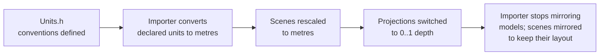

# World Conventions: Units, Axes, Angles

Everything spatial in the engine, the Editor and the content assumes these. The source of truth is `Utils\Src\Utils\Math\Units.h`.

## At a glance

| What | Convention |
|---|---|
| **Length** | 1 unit = **1 metre**. Speeds are metres per second. |
| **Time** | Seconds (`RZE().GetDeltaTime()`). |
| **Axes** | **Right-handed**: +X right, **+Y up**, **−Z forward**. An unrotated camera looks down −Z. |
| **Angles people see** | **Degrees**: `TransformComponent` rotation, camera FOV, the inspector, ImGuizmo, scene files. |
| **Angles in maths** | **Radians** inside trig and math calls. Convert only with `MathUtils::ToRadians` / `ToDegrees`. |
| **Euler order** | `R = Rz * Ry * Rx`, so X is applied first. This is what `glm::quat(eulerRadians)` builds in `Matrix4x4::CreateInPlace`, and what ImGuizmo's matrix (de)composition uses. |
| **Clip-space depth** | D3D's **0..1** (`CreatePerspectiveMatrixZeroToOne`), not OpenGL's −1..1. |
| **Matrices** | glm, column-major, multiplied `projection * view * world`. |
| **Triangle winding** | Counter-clockwise front faces, as models are authored. |

```
              +Y (up)
               |
               |
               |________ +X (right)
              /
             /
           +Z (toward the viewer; the camera looks down -Z)
```

`WorldAxes::Right()`, `Up()` and `Forward()` return these directions; use them instead of writing basis vectors by hand. `Units::` has named length constants.

## Why it matters

- **Camera speeds, light ranges and physics-like values** are all tuned in metres. The editor camera flies at 5 m/s, and scene cameras clip at 0.1 m / 1000 m.
- **Imported models** are converted to metres when their format declares a unit, and taken as metres otherwise. The burner warns if a model's size is implausible (under 1 cm or over 500 m). See [Asset-Burning-Pipeline.md](../05-AssetPipeline/Asset-Burning-Pipeline.md#units-and-handedness).
- **The Editor shows sizes in metres** (RenderComponent inspector), so a wrongly scaled mesh can be fixed per instance.

## History

These conventions were written down on 2026-10-10, and three fixes brought the content into line:



If you pull these changes into an older checkout, **re-burn assets**: `ProjectData` isn't tracked, and old burns are mirrored.

## Key files

- `Utils\Src\Utils\Math\Units.h` — the conventions, `Units::`, `WorldAxes::`
- `Utils\Src\Utils\Math\Math.h` — `MathUtils::ToRadians` / `ToDegrees`
- `Utils\Src\Utils\Math\Matrix4x4.h` — `CreatePerspectiveMatrixZeroToOne`, `CreateInPlace`
