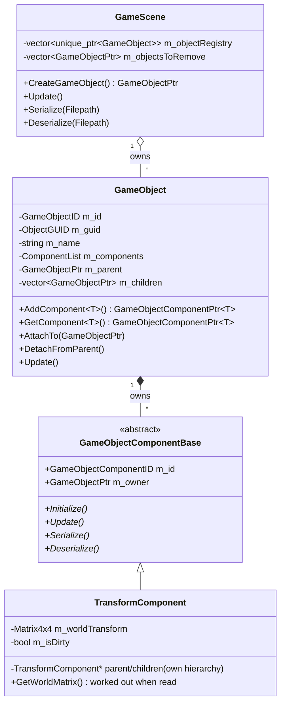
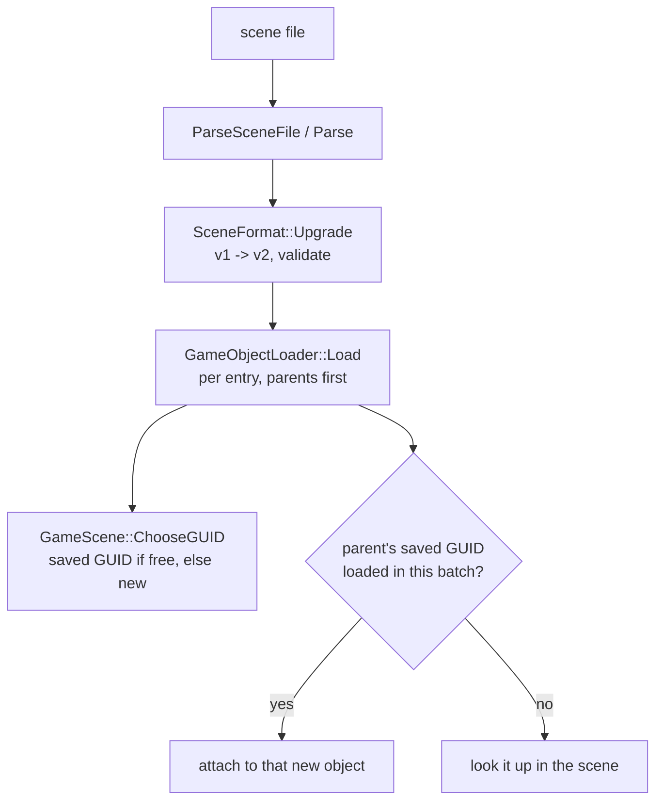

# Scene & GameObject Model

RZE's world is a scene graph of `GameObject`s, each carrying a set of polymorphic components. This is entity + component **composition**, not a data-oriented/archetype ECS — components are heap-allocated and stored as base-class pointers.

## `GameScene` (`Engine\Src\Game\GameScene.h` / `.cpp`)

`GameScene` owns the entire world: `std::vector<std::unique_ptr<GameObject>> m_objectRegistry`, plus a deferred-removal list `m_objectsToRemove` (removals are queued and flushed at the top of the next `Update()`, not applied immediately, so it's safe to remove a GameObject while iterating the scene mid-frame). The registry's order is the scene's order: the Scene panel lists root objects in it and files save in it, and removing objects keeps the rest in order (all of a frame's removals are applied in one pass).

Key API:
- `CreateGameObject()` — always attaches a `TransformComponent` first, since "all gameobjects have a spatial representation" (source comment). Use this instead of constructing `GameObject` directly.
- `AddGameObject(name)` / `AddGameObject(GameObjectPtr)`, `ForEachGameObject(Functor<void, GameObjectPtr>)`.
- `RemoveGameObject(gameObject)` removes the object **and everything under it**: it detaches the object from its parent, takes each object in the subtree out of the scene, and queues them all for destruction. It also works on an object that's already out of the scene.
- `SetObjectsChangedCallback(callback)` — a plain hook called whenever objects are added or removed. The Editor uses it in Debug to catch scene changes made outside a command ([Editor-Framework.md](../07-Editor/Editor-Framework.md#commands-how-panels-change-the-scene)).
- `FindGameObjectByGUID(guid)` — a hash lookup in `m_objectsByGUID`, the way to find a specific object. `FindGameObjectByName(name)` — the **first** object with that name, by linear scan; names aren't unique, so it's only for convenience (e.g. the Game finding its scene's `"Camera"`).
- Adding an object asserts its GUID is free; the scene only creates objects with free GUIDs, so a clash means the same object was added twice.
- `Update()` — replaces the main camera if it's gone (below), processes deferred removals, then calls `Update()` only on **root** GameObjects in the scene; children are updated transitively because `GameObject::Update()` recurses into its own children.
- `GetMainCamera()` / `SetMainCamera(camera)` — see [The main camera](#the-main-camera).
- `Serialize(Filepath)` / `Deserialize(Filepath)` / `NewScene()` — JSON scene persistence via RapidJSON; see [Scene files](#scene-files). `Deserialize` is the synchronous load; the editor uses the asynchronous `SceneLoadOperation`. Both start with `BeginLoad(path)`, which makes it the current scene path and logs `Loading scene [path].`, in the Game and the Editor alike; `EnableLogging(false)` turns that off (`HeadlessScene` does, so thumbnail renders don't fill the log). `Serialize` writes a temporary file beside the scene and then moves it over the old one (`File::MoveReplacing`), so a failed save never leaves half a file.
- `GetRenderScene()` — the scene's own [`RenderScene`](../04-Rendering/Engine-Graphics-Layer.md#scene-data): everything its components draw. `RZE_Engine` points the main view at the active scene's; any other scene's is only drawn when something renders it into a view of its own.
- `GetBounds()` — the world-space box around everything the scene draws (`RenderScene::GetBounds`, cached until something in it changes). Used to frame a scene thumbnail when the scene has no camera.
- `Start()` / `ShutDown()` / `Unload()` — lifecycle hooks called by `RZE_Engine`.

## `GameObject` (`Engine\Src\Game\World\GameObject\GameObject.h` / `.cpp`)

The "entity." Holds:
- `GameObjectID m_id` — unique within a session, never reused; what handles check liveness by
- `const ObjectGUID m_guid` — a random 64-bit ID, saved with the object, so it identifies the object across sessions (see [Identity](#identity-guids-and-names))
- `std::string m_name` — a label; doesn't have to be unique
- `ComponentList m_components` — `typedef std::vector<GameObjectComponentBase*> ComponentList`
- `GameObjectStateFlags m_stateFlags` — bitfields `IsInScene : 1`, `IncludeInSave : 1`
- A **scene-graph hierarchy** of its own: `GameObjectPtr m_parent`, `std::vector<GameObjectPtr> m_children`, with `AttachTo(parent, childIndex = -1)` (at that index among the parent's children, or last) / `DetachFromParent()`, `IsRoot()`, `GetParent()`, `NumChildren()` / `HasChildren()` / `GetChildAtIndex(index)` / `GetChildIndex(child)`, `GetSubtree(out)` (the object, then its descendants, depth first), and `IsSelfOrAncestorOf(other)` (attaching to one of those would make a cycle). Detaching keeps the other children in order.

Component API (templated, defined inline in the header):
```cpp
template <typename TComponentType, typename... Args>
GameObjectComponentPtr<TComponentType> AddComponent(Args... args);   // rejects duplicate types (linear scan)

template <typename TComponentType>
GameObjectComponentPtr<TComponentType> GetComponent();                // linear scan by TComponentType::GetID()

template <typename TComponentType>
void RemoveComponent();                                                // RemoveComponentByID(T::GetID())

GameObjectComponentBase* AddComponentByID(GameObjectComponentID id);   // for load/editor code only
bool RemoveComponentByID(GameObjectComponentID id);                    // OnRemoveFromScene if in the scene, then delete
```
All three templated lookups are a linear `std::find_if` over `m_components` — the header itself flags this with `// #TODO Slow function` on each. Fine for the current object/component counts; would need an index (e.g. a type→pointer map) to scale.

`AddComponent<T>` flow: constructs `new TComponentType(args...)`, pushes it, calls `component->SetOwner(...)` with a handle to this object (`GetOwner()` returns a `GameObjectPtr`), then `component->Initialize()`, and if the owning GameObject is already in the scene, also immediately calls `component->OnAddToScene()`.

Persistence: `Save(writer)` writes the object's entry in the scene format (id, name, parent GUID, components), then each child's. `LoadComponents(entry)` adds the components in an entry; `GameScene` handles the object's identity and parent. Each component writes and reads its own data with `Serialize`/`Deserialize`.

`GetComponentHandles(out)` returns lifetime-checked handles to every component, in order, for code that keeps them across frames (the editor's inspector).

A `GameObject` is made with the scene it belongs to and keeps it for life (`GetScene()`). Components take what they need from it in `Initialize()` (e.g. `RenderComponent` and `DirectionalLightComponent` keep the scene's `RenderScene`) rather than looking it up each frame.

## Object relationship diagram



## Bounds

`GameObject::GetHierarchyBounds()` is the world-space box around every mesh on an object and its descendants (empty if there are none). Double-click framing in the Scene panel uses it.

- **Extents are kept in the object's own space** (`GetLocalHierarchyBounds`), built from each component's `GetLocalBounds()` (only `RenderComponent` has any) and each child's extents placed by the child's local matrix. Asking for the world box only places those extents with the object's world matrix (`BoundingBox::Transformed`), so **moving an object never rebuilds anything**.
- **They're rebuilt only when what's under the object changes**: a mesh loads or changes, a component or child is added or removed, or a child moves within it. Each of those calls `MarkHierarchyBoundsChanged()`, which marks the object and walks up its ancestors. It stops at the first one that's already marked, since that one's ancestors were marked with it.
- `BoundingBox` (`Utils\Src\Utils\Math\BoundingBox.h`) is empty until something grows it, so empty pieces (a light, a mesh still loading) add nothing.

Render objects and render scenes cache their bounds the same way: see [`RenderObject`](../04-Rendering/Engine-Graphics-Layer.md#renderobject).

## `HeadlessScene`: a scene rendered off-screen

`HeadlessScene` (`Engine\Src\Game\HeadlessScene.h/.cpp`) is a `GameScene` of its own for rendering away from the screen, used by the editor's [thumbnail renderer](../07-Editor/Thumbnails-And-File-Browser.md). The active scene, the main view and the editor never see it.

| Call | Does |
|---|---|
| `Load(scenePath)` | Replaces what's in it with a scene file, loaded in the background (`SceneLoadOperation`). Cancels a load still running. |
| `AddGameObject` / `RemoveGameObject` | Objects removed are destroyed straight away. |
| `Capture(capture, camera, settings, file)` | Renders its `RenderScene` from a camera into a [`ViewCapture`](../04-Rendering/Engine-Graphics-Layer.md#capturing-a-view-to-a-file), lit and exposed as `ViewCaptureSettings` says, and writes a PNG. |
| `Unload()` | Cancels a load still running, destroys everything and releases its render state (e.g. its shadow map). Must happen before the engine shuts down. |

- It's **never updated**. A still capture doesn't need it: world matrices are worked out when read, render objects take their transform when they're made, and lights their direction when they're added.
- Its loads are `Background | SubStep` [async operations](../05-AssetPipeline/Asset-Import-Runtime.md#async-operations): they never block, and whoever uses the scene reports progress itself.
- To add an object without stalling, load what it uses first, e.g. a mesh with a [`PendingResource`](../05-AssetPipeline/Asset-Import-Runtime.md#one-resource-pendingresource), so `RenderComponent::LoadMesh` is a cache hit. The thumbnail renderer does, and drives the scene with a [`CaptureBatchOperation`](../07-Editor/Thumbnails-And-File-Browser.md#a-run).
- Main thread only.

## Handles: `GameObjectPtr` and `GameObjectComponentPtr<T>`

Defined in `Game\World\GameObject\GameObjectDefinitions.h`. Non-owning handles with private raw-pointer constructors (only `GameObject` and `GameScene` can make them), and **lifetime-checked**:

- Each holds the pointer plus the object's (or component's) ID. IDs are handed out in increasing order and **never reused**.
- `LiveIDSet` keeps one bit per ID ever handed out (8 KB per 65536 IDs), set while the object is alive. Checking a handle is a single array read.
- Once its target is destroyed, a handle **compares equal to `nullptr`** and `IsValid()` is false, even if a new object lands at the same address. Debug builds assert if a dead handle is dereferenced.
- Two handles are equal when they refer to the same object.

So code can hold handles across frames (the editor's selection, queued commands, a component's owner) and test them with `== nullptr` before use. A handle to an object that's [out of the scene](#in-the-scene-and-out-of-it) but not destroyed is still valid, so code that might hold one also checks `IsInScene()`. Main thread only, like the rest of the scene.

## In the scene and out of it

An object can be **owned by the scene but out of it** (`IsInScene()` false): waiting to be destroyed, or set aside by the Editor's undo (it parks deleted objects so it can put the same ones back; see [Editor-Framework.md](../07-Editor/Editor-Framework.md#parking-deleted-objects)).

- `OnAddToScene()` / `OnRemoveFromScene()` move an object in and out, calling the same on each of its components. Calling either twice asserts, then returns, so code that might do so checks `IsInScene()` first.
- Everything that lists or finds objects skips objects out of the scene: `ForEachGameObject`, `FindGameObjectByGUID`, `FindGameObjectByName`, `Serialize`, `GetMainCamera`, `CalculateSceneCenter` and `Update`.
- The object stays in the registry, so its place in the scene's order and its GUID are kept. `Unload()` destroys everything, in the scene or not.

## The main camera

A scene can have any number of cameras; one of them is the **main camera**, which the game renders through.

- It's saved with the camera: `CameraComponent` writes `"MainCamera": true/false`. On load, the first camera flagged main becomes it (a warning is logged if several are); in older files with no flag, the first camera loaded does.
- `GameScene::SetMainCamera(camera)` makes a camera main and clears the flag on every other one; null leaves the scene without one. `CameraComponent::SetMainCamera(bool)` goes through it: true makes this camera main, false clears the role if this camera has it. The scene caches the result, so `GetMainCamera()` is cheap; it returns null while there's none, or while the main camera is out of the scene or has lost its `CameraComponent`.
- **If the main camera goes** (removed, parked, or its `CameraComponent` removed), `Update()` makes the first camera still in the scene main and logs the hand-over. A scene left with no main camera (none at load, or cleared by undo) stays without one until a camera is made main.
- `SetMainCameraDrivesView(false)` stops the main camera writing the main view's matrices (the Editor's own camera drives it instead); its exposure still applies. See [Built-In-Components.md](Built-In-Components.md#cameracomponent).

## Identity: GUIDs and names

| | `GameObjectID` (`GetID()`) | `ObjectGUID` (`GetGUID()`) | Name |
|---|---|---|---|
| What | session counter | random 64-bit, `Game\World\GameObject\ObjectGUID.h` | free text |
| Saved | no | yes, as 16 hex digits | yes |
| Unique | yes, never reused | yes within a scene | **no** |
| Use it for | handles, picking IDs | finding an object, parent links in files | display |

- The scene chooses each object's GUID and passes it to the constructor; it never changes afterwards. A new object gets `GenerateFreeGUID()`. A loaded object keeps its saved GUID if no object in the scene has it, otherwise it gets a new one (`ChooseGUID`) — which is how pasting a copy of an object that's still in the scene works.
- Names can repeat. The editor numbers pasted copies ("Tank (1)") only so they're easy to tell apart.

## Scene files

`Game\SceneFormat.h/.cpp` defines the layout, **version 2**, used for scene files (the editor's copy and paste no longer use it; they copy objects in memory):

```json
{
  "version": 2,
  "gameobjects": [
    { "id": "7adf0ecbd126ff97", "name": "Camera", "components": { "TransformComponent": { ... }, "CameraComponent": { ... } } },
    { "id": "6abc8e380785f31f", "name": "Tank", "parent": "8ed8d2e6cb95b5fb", "components": { ... } }
  ]
}
```

- `gameobjects` is an **array**, in an order where every parent comes before its children (`GameObject::Save` writes an object, then its children).
- `parent` is the parent's GUID; it's left out for root objects. `components` is keyed by component type name.
- `SceneFormat::Write(writer, roots)` writes a document for some root objects and everything under them.
- `SceneFormat::Upgrade(document, error)` checks a parsed document and converts older versions in place, so readers only handle the current one. **Version 1** (no `version` key) keyed `gameobjects` by name and linked parents by name; it's converted on load, giving objects without an `id` a new GUID. Saving always writes version 2. A file newer than the build is refused with an error.
- `GameObjectLoader` creates objects from a batch of entries (a whole file). It links each to its parent by the GUID **saved in the batch**, so links hold even when an object is given a new GUID; a parent that isn't in the batch is looked up in the scene by GUID. `GetTopLevelObjects()` returns the ones whose parent wasn't in the batch.



`SceneLoadOperation` uses the same pieces asynchronously: it parses and upgrades on a worker thread, then loads entries with a `GameObjectLoader` a few at a time on the main thread. See [Asset-Import-Runtime.md](../05-AssetPipeline/Asset-Import-Runtime.md).

## Key files

- `Engine\Src\Game\GameScene.h` / `.cpp`
- `Engine\Src\Game\World\GameObject\GameObject.h` / `.cpp`
- `Engine\Src\Game\World\GameObject\GameObjectDefinitions.h`, `LiveIDSet.h`, `ObjectGUID.h/.cpp`
- `Engine\Src\Game\SceneFormat.h/.cpp` — the file layout, version upgrades, `GameObjectLoader`
- `Engine\Src\Game\SceneLoadOperation.h/.cpp`
- `Engine\Src\Game\HeadlessScene.h/.cpp`, `CaptureBatchOperation.h/.cpp`
- `Utils\Src\Utils\Math\BoundingBox.h/.cpp`
- `Assets\Scenes\*.scene` — example serialized scenes (JSON)
