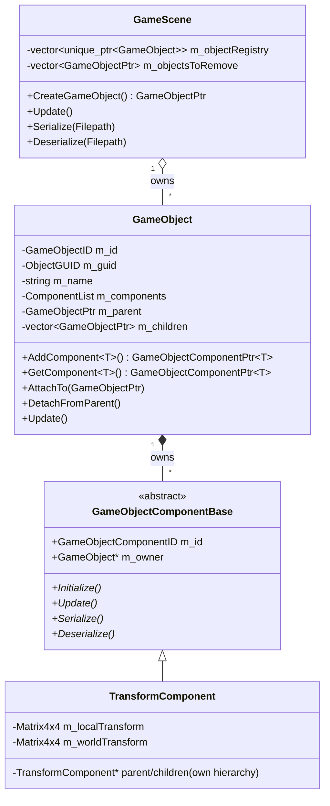
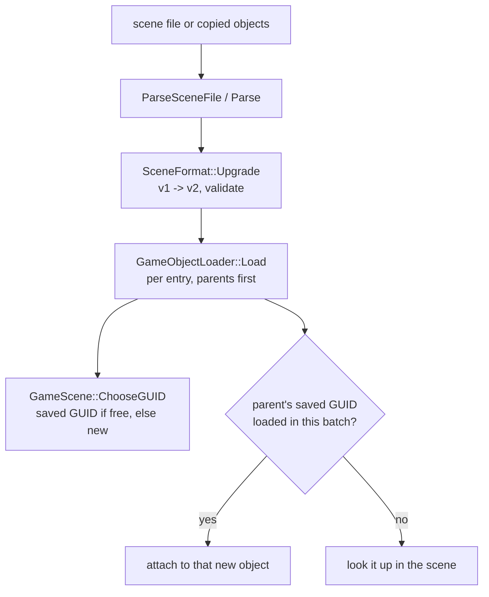

# Scene & GameObject Model

RZE's world is a scene graph of `GameObject`s, each carrying a set of polymorphic components. This is entity + component **composition**, not a data-oriented/archetype ECS — components are heap-allocated and stored as base-class pointers.

## `GameScene` (`Engine\Src\Game\GameScene.h` / `.cpp`)

`GameScene` owns the entire world: `std::vector<std::unique_ptr<GameObject>> m_objectRegistry`, plus a deferred-removal list `m_objectsToRemove` (removals are queued and flushed at the top of the next `Update()`, not applied immediately, so it's safe to remove a GameObject while iterating the scene mid-frame).

Key API:
- `CreateGameObject()` — always attaches a `TransformComponent` first, since "all gameobjects have a spatial representation" (source comment). Use this instead of constructing `GameObject` directly.
- `AddGameObject(name)` / `AddGameObject(GameObjectPtr)`, `RemoveGameObject`, `ForEachGameObject(Functor<void, GameObjectPtr>)`.
- `FindGameObjectByGUID(guid)` — a hash lookup in `m_objectsByGUID`, the way to find a specific object. `FindGameObjectByName(name)` — the **first** object with that name, by linear scan; names aren't unique, so it's only for convenience (e.g. the Game finding its scene's `"Camera"`).
- Adding an object asserts its GUID is free; the scene only creates objects with free GUIDs, so a clash means the same object was added twice.
- `Update()` — processes deferred removals, then calls `Update()` only on **root** GameObjects; children are updated transitively because `GameObject::Update()` recurses into its own children.
- `Serialize(Filepath)` / `Deserialize(Filepath)` / `NewScene()` — JSON scene persistence via RapidJSON; see [Scene files](#scene-files). `Deserialize` is the synchronous load; the editor uses the asynchronous `SceneLoadOperation`.
- `Start()` / `ShutDown()` / `Unload()` — lifecycle hooks called by `RZE_Engine`.

## `GameObject` (`Engine\Src\Game\World\GameObject\GameObject.h` / `.cpp`)

The "entity." Holds:
- `GameObjectID m_id` — unique within a session, never reused; what handles check liveness by
- `const ObjectGUID m_guid` — a random 64-bit ID, saved with the object, so it identifies the object across sessions (see [Identity](#identity-guids-and-names))
- `std::string m_name` — a label; doesn't have to be unique
- `ComponentList m_components` — `typedef std::vector<GameObjectComponentBase*> ComponentList`
- `GameObjectStateFlags m_stateFlags` — bitfields `IsInScene : 1`, `IncludeInSave : 1`
- A **scene-graph hierarchy** of its own: `GameObjectPtr m_parent`, `std::vector<GameObjectPtr> m_children`, with `AttachTo(GameObjectPtr)` / `DetachFromParent()`, `IsRoot()`, `GetParent()`, `NumChildren()` / `HasChildren()` / `GetChildAtIndex(index)`, and `IsSelfOrAncestorOf(other)` (attaching to one of those would make a cycle).

Component API (templated, defined inline in the header):
```cpp
template <typename TComponentType, typename... Args>
GameObjectComponentPtr<TComponentType> AddComponent(Args... args);   // rejects duplicate types (linear scan)

template <typename TComponentType>
GameObjectComponentPtr<TComponentType> GetComponent();                // linear scan by TComponentType::GetID()

template <typename TComponentType>
void RemoveComponent();                                                // linear scan + delete

GameObjectComponentBase* AddComponentByID(GameObjectComponentID id);   // for load/editor code only
```
All three templated lookups are a linear `std::find_if` over `m_components` — the header itself flags this with `// #TODO Slow function` on each. Fine for the current object/component counts; would need an index (e.g. a type→pointer map) to scale.

`AddComponent<T>` flow: constructs `new TComponentType(args...)`, pushes it, calls `component->SetOwner(this)`, then `component->Initialize()`, and if the owning GameObject is already in the scene, also immediately calls `component->OnAddToScene()`.

Persistence: `Save(writer)` writes the object's entry in the scene format (id, name, parent GUID, components), then each child's. `LoadComponents(entry)` adds the components in an entry; `GameScene` handles the object's identity and parent. Each component writes and reads its own data with `Serialize`/`Deserialize`.

`GetComponentHandles(out)` returns lifetime-checked handles to every component, in order, for code that keeps them across frames (the editor's inspector).

## Object relationship diagram



## Handles: `GameObjectPtr` and `GameObjectComponentPtr<T>`

Defined in `Game\World\GameObject\GameObjectDefinitions.h`. Non-owning handles with private raw-pointer constructors (only `GameObject` and `GameScene` can make them), and **lifetime-checked**:

- Each holds the pointer plus the object's (or component's) ID. IDs are handed out in increasing order and **never reused**.
- `LiveIDSet` keeps one bit per ID ever handed out (8 KB per 65536 IDs), set while the object is alive. Checking a handle is a single array read.
- Once its target is destroyed, a handle **compares equal to `nullptr`** and `IsValid()` is false, even if a new object lands at the same address. Debug builds assert if a dead handle is dereferenced.
- Two handles are equal when they refer to the same object.

So code can hold handles across frames (the editor's selection, queued commands, the clipboard's bookkeeping) and test them with `== nullptr` before use. Main thread only, like the rest of the scene.

## Identity: GUIDs and names

| | `GameObjectID` (`GetID()`) | `ObjectGUID` (`GetGUID()`) | Name |
|---|---|---|---|
| What | session counter | random 64-bit, `Game\World\GameObject\ObjectGUID.h` | free text |
| Saved | no | yes, as 16 hex digits | yes |
| Unique | yes, never reused | yes within a scene | **no** |
| Use it for | handles, picking IDs | finding an object, parent links in files | display |

- The scene chooses each object's GUID and passes it to the constructor; it never changes afterwards. A new object gets `GenerateFreeGUID()`. A loaded object keeps its saved GUID if no object in the scene has it, otherwise it gets a new one (`ChooseGUID`) — which is how pasting a copy of an object that's still in the scene works.
- Names can repeat. The editor numbers pasted copies ("Tank (1)") only so they're easy to tell apart.

## Scene files

`Game\SceneFormat.h/.cpp` defines the layout, **version 2**, used for scene files and for the editor's copied objects:

```json
{
  "version": 2,
  "gameobjects": [
    { "id": "7adf0ecbd126ff97", "name": "Camera", "components": { "TransformComponent": { ... }, "CameraComponent": { ... } } },
    { "id": "6abc8e380785f31f", "name": "Tank", "parent": "8ed8d2e6cb95b5fb", "components": { ... } }
  ]
}
```

- `gameobjects` is an **array**, in an order where every parent comes before its children (`GameObject::Save` writes an object, then its children).
- `parent` is the parent's GUID; it's left out for root objects. `components` is keyed by component type name.
- `SceneFormat::Write(writer, roots)` writes a document for some root objects and everything under them.
- `SceneFormat::Upgrade(document, error)` checks a parsed document and converts older versions in place, so readers only handle the current one. **Version 1** (no `version` key) keyed `gameobjects` by name and linked parents by name; it's converted on load, giving objects without an `id` a new GUID. Saving always writes version 2. A file newer than the build is refused with an error.
- `GameObjectLoader` creates objects from a batch of entries (a whole file, or a paste). It links each to its parent by the GUID **saved in the batch**, so links hold even when an object is given a new GUID; a parent that isn't in the batch is looked up in the scene by GUID. `GetTopLevelObjects()` returns the ones whose parent wasn't in the batch.



`SceneLoadOperation` uses the same pieces asynchronously: it parses and upgrades on a worker thread, then loads entries with a `GameObjectLoader` a few at a time on the main thread. See [Asset-Import-Runtime.md](../05-AssetPipeline/Asset-Import-Runtime.md).

## Key files

- `Engine\Src\Game\GameScene.h` / `.cpp`
- `Engine\Src\Game\World\GameObject\GameObject.h` / `.cpp`
- `Engine\Src\Game\World\GameObject\GameObjectDefinitions.h`, `LiveIDSet.h`, `ObjectGUID.h/.cpp`
- `Engine\Src\Game\SceneFormat.h/.cpp` — the file layout, version upgrades, `GameObjectLoader`
- `Engine\Src\Game\SceneLoadOperation.h/.cpp`
- `Assets\Scenes\*.scene` — example serialized scenes (JSON)
