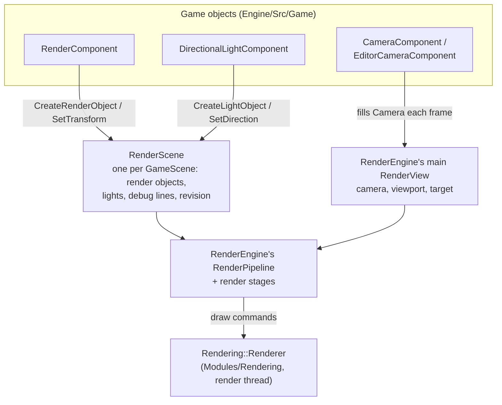
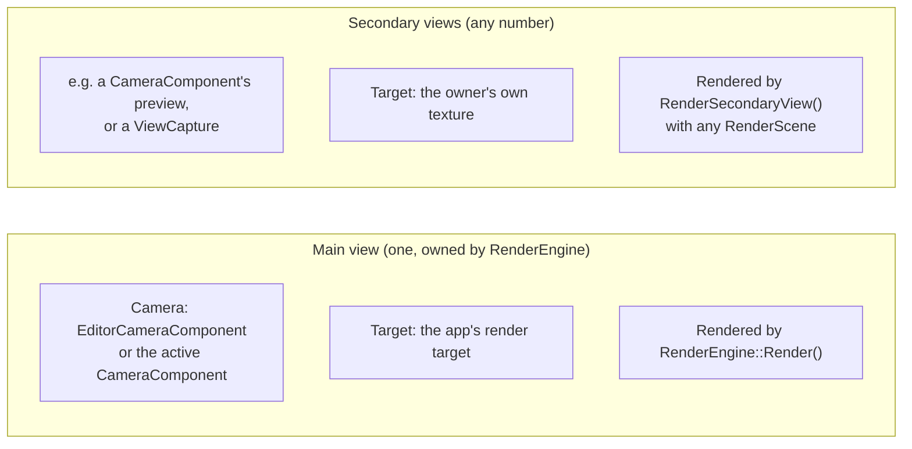
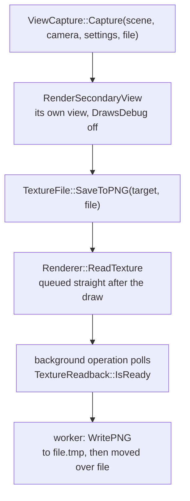
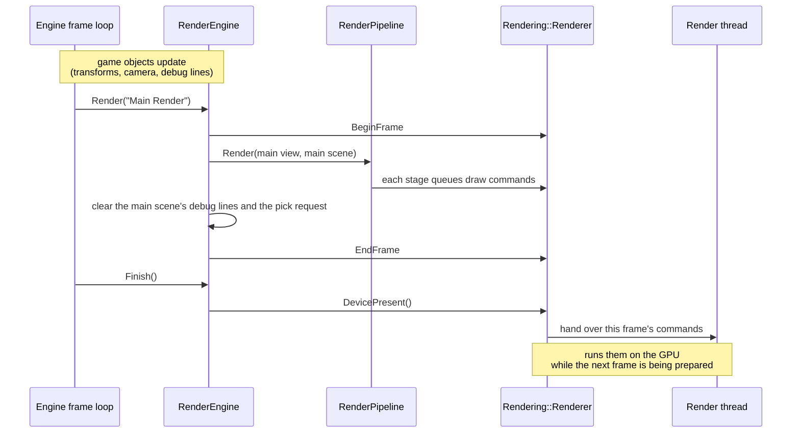

# Engine Graphics Layer: `RenderEngine`

`RenderEngine` (`Engine\Src\Graphics\RenderEngine.h/.cpp`) is the engine's rendering coordinator. It's reached through `RZE().GetRenderEngine()`, and it sits between gameplay code and the low-level renderer:



The render-side scene is deliberately separate from `GameScene`: a `RenderObject` knows its mesh, transform and bounds, plus an opaque pick ID, but nothing about the `GameObject` that owns it.

## Scene data

A **`RenderScene`** (`Engine\Src\Graphics\RenderScene.h/.cpp`) is what one scene draws. **Each `GameScene` owns one** (`GameScene::GetRenderScene()`), and its components put their render objects and lights in it. Any view can render any scene, so a scene can be drawn without being the one on screen, e.g. a [`HeadlessScene`](../03-SceneAndGameObjects/Scene-And-GameObject-Model.md#headlessscene-a-scene-rendered-off-screen) for a thumbnail.

| Holds | Notes |
|---|---|
| Render objects, lights | `CreateRenderObject(staticMesh)` / `DestroyRenderObject`, `CreateLightObject()` / `DestroyLightObject`, `ClearObjects()` (render objects only) |
| Debug lines | `DrawLine` / `DrawWireBox`, kept until `ClearDebugLines()`. `RenderEngine::Render` clears the main scene's once it has drawn them. |
| `GetRevision()` | A cheap "did anything change?" counter. It goes up when a render object is added, removed, moved or given a new mesh, or when a light changes direction. `ShadowRenderStage` skips re-rendering the scene's shadow map when it hasn't changed. |
| `GetBounds()` | The box around every render object, kept until one is added, removed, moved or given a new mesh, then rebuilt from the objects' boxes when next asked. |
| Persistent stage state | What stages keep for this scene across frames, whichever view renders it: today, **each scene's own shadow map**. `ReleaseStageState()` drops it; it's made again the next time the scene is rendered. |

### Handles

`CreateRenderObject` and `CreateLightObject` return a **`RenderObjectPtr`** / **`LightObjectPtr`** (`Graphics\GraphicsDefines.h`, one template, `RenderSceneObjectPtr`). Whoever made the object keeps the handle and destroys the object through it (`DestroyRenderObject(handle)` empties it).

- **Move-only**, so each object has one holder (`RenderComponent`, `DirectionalLightComponent`). Code that only looks at an object borrows the holder's handle by reference, e.g. `RenderComponent::GetRenderObject()` returns `const RenderObjectPtr&`.
- **Lifetime-checked**, like `GameObjectPtr`. Each object takes an ID that's never reused (`RenderSceneLifetime`, a `LiveIDSet` per kind), and a handle compares equal to `nullptr` once its object is gone, however it went: destroyed through the handle, `ClearObjects`, or the scene being destroyed. Debug builds assert if a dead handle is dereferenced, and destroying through a dead handle just empties it.

`RenderEngine` doesn't own a scene. `SetMainScene(scene)` says which one the main view shows; `RZE_Engine` sets it to the active `GameScene`'s. `RenderEngine::DrawLine` / `DrawWireBox` draw into the main scene, for tools that draw over the main view (the editor's grid and gizmos).

### `RenderObject`

| Holds | Notes |
|---|---|
| `StaticMeshInstance` | What it draws: a shared mesh with this object's material slots ([Materials-Meshes-Shaders.md](Materials-Meshes-Shaders.md#shared-meshes-per-object-instances)). `SetMeshInstance()` swaps it, keeping the render object; null draws nothing. |
| `MatrixMem { transform, invTransform }` | `SetTransform()` is called every frame by `RenderComponent`, but returns early if the matrix hasn't changed. |
| Draws | `GetDraws()`: one `MeshDraw` per placed sub-mesh, with its geometry, the material slot it draws with, its world transform, and 8 world-space corners plus the box around them. |
| Bounds | `GetLocalBounds()`: the mesh's box in the object's own space, which only changes with the mesh. `GetBounds()`: that box placed in the world as an axis-aligned `BoundingBox`. The world boxes and the draws are **worked out when asked** after the object moves or changes mesh (`MarkChanged()`), not on every move. Used for frustum culling, shadow fitting, framing thumbnails, the Editor's marquee selection and its bounds boxes. |
| Pick ID | `SetPickID()` / `GetPickID()`. What `PickRenderStage` writes for this object's pixels. `RenderComponent` sets it to its owner's `GameObjectID + 1`, so 0 means "nothing pickable". |

### `LightObject`

A directional light: `direction` (normalized, the way light travels), `colour` and `strength`, uploaded to a constant buffer (`PropertyBufferLayout`). The forward pass uses the first light. If the scene has none yet (e.g. while it's streaming in), it binds a zero-strength fallback light.

## Views

A **`RenderView`** is one point of view to render the scene from. Its owner fills in the inputs; render stages read them.

```cpp
class RenderView
{
public:
    RenderCamera Camera;                     // ClipSpace (projection * view), Position, Viewport
    Vector2D ViewportSize;
    Rendering::RenderTargetTexture* Target;  // owned by whoever owns the view
    bool AutoExposure = true;                // off for a fixed exposure of 1, for lighting whose brightness is known
    float ExposureCompensation;              // EV on top of the exposure
    ERenderViewLighting Lighting = Scene;    // Scene: the scene's light and sky. Uniform: even, ignoring the light
    bool DrawsDebug = true;                  // debug lines; off for clean captures such as thumbnails
    std::optional<RenderPickRequest> Pick;   // Editor picking (clicks, drops); cleared after each render
    // + a frame blackboard and a persistent blackboard (see Render-Stages.md)
};
```



- `GetMainView()` returns the main view. The app sets its `Target` and `ViewportSize` (the Editor sizes it to the scene view panel); the active scene's main camera fills in `Camera` every frame.
- `RenderSecondaryView(name, view, scene)` renders a scene into another view as part of the current frame. `CameraComponent` uses this for the "Camera View" preview it draws in the Editor's inspector (`CameraComponent::RenderPreview`, called by the camera's `Preview` property each frame the inspector shows it), so a preview is only rendered while that camera is selected. Stages marked `MainOnly` (picking, ImGui, the final blit) skip secondary views.

## Capturing a view to a file

`ViewCapture` (`Engine\Src\Graphics\ViewCapture.h/.cpp`) renders a scene from a camera into an offscreen target of its own, at a size fixed when it's made, and saves it as a PNG. The editor's thumbnails use a 512×512 one; it's in the Engine so the game could take screenshots the same way.



- `Capture` returns the `AsyncOperation` that writes the file. The image is read back from the commands queued so far, so another capture can follow in the same frame.
- **No debug lines** (grid, frustums, bounds boxes): its view has `DrawsDebug` off.
- `ViewCaptureSettings` sets the view's `Lighting`, `AutoExposure` and `ExposureCompensation` for each capture. The defaults light and expose like any other view. Mesh thumbnails use `Uniform` lighting with auto-exposure off ([Thumbnails-And-File-Browser.md](../07-Editor/Thumbnails-And-File-Browser.md#a-run)).
- `TextureFile` (`Engine\Src\Graphics\TextureFile.h/.cpp`) wraps `stb_image_write`. `WritePNG(file, width, height, rgba)` is safe from any thread. It creates the folder, writes the PNG beside the file and moves it over the file (`File::MoveReplacing`), so readers only ever see a whole image. `SaveToPNG(texture, file)` is the GPU-to-file path above. Its operation is `Background | Hidden`, since whoever asked for the capture reports on it.

## Frame lifecycle



Nothing touches D3D11 on the game thread; every `Renderer::` call just queues a command for the render thread (see [Low-Level-Renderer-Module.md](Low-Level-Renderer-Module.md)).

## API summary

| Area | Calls |
|---|---|
| Lifetime | `Initialize(windowHandle)` (also adds the engine's stages), `Shutdown()`, `ReleaseRenderStages()` (must run before `ResourceHandler::ShutDown()`) |
| Per frame | `Render(frameName)` (the main view, of the main scene), `Finish()`, `RenderSecondaryView(name, view, scene)` |
| Scene | `SetMainScene(scene)` / `GetMainScene()`. Objects and lights are made in a [`RenderScene`](#scene-data). |
| Debug drawing | Into the main scene: `DrawLine(start, end, colour, alpha = 1, fade = {})`, `DrawWireBox(box, transform, colour, alpha = 1)`. `alpha` makes lines semi-transparent; `fade` (`DebugLineFade { centre, start, end }`) fades a line out with each pixel's distance from `centre`, between the `start` and `end` radii (`end` = 0: no fade). The editor grid uses both. |
| Stages | `AddRenderStage<T>(args...)` (see [Render-Stages.md](Render-Stages.md)) |
| Views & canvas | `GetMainView()`, `ResizeCanvas(size)`, `GetCanvasSize()` |

Both object containers erase with swap-and-pop (`ContainerUtils::VectorEraseBack`), since their order doesn't matter.

## Key files

- `Engine\Src\Graphics\RenderEngine.h/.cpp` — `RenderEngine`
- `Engine\Src\Graphics\RenderScene.h/.cpp` — `RenderScene`, `RenderObject`, `LightObject`
- `Engine\Src\Graphics\RenderView.h` — `RenderView`, `RenderCamera`, `RenderPickRequest`
- `Engine\Src\Graphics\ViewCapture.h/.cpp`, `TextureFile.h/.cpp` — capturing a view to a PNG
- `Utils\Src\Utils\Math\Frustum.h/.cpp` — the six-plane view frustum used for culling and marquee selection (see [Utils-Library-Reference.md](../06-Platform-And-Infrastructure/Utils-Library-Reference.md))
- `Engine\Src\Graphics\GraphicsDefines.h` — `RenderObjectPtr` / `LightObjectPtr`, move-only and lifetime-checked
