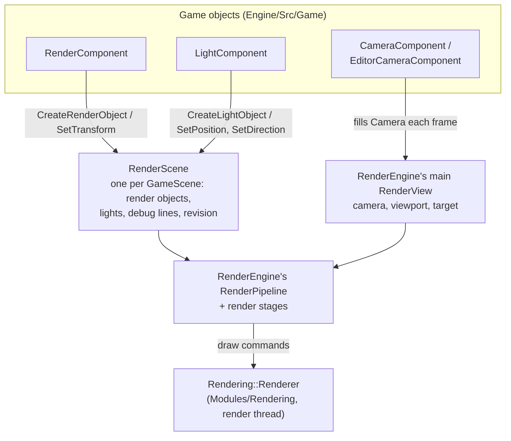
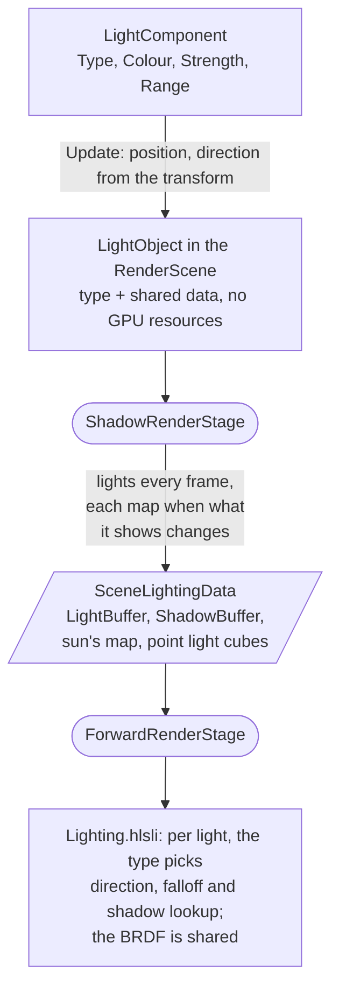
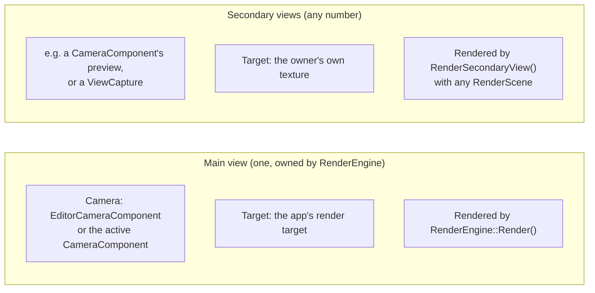
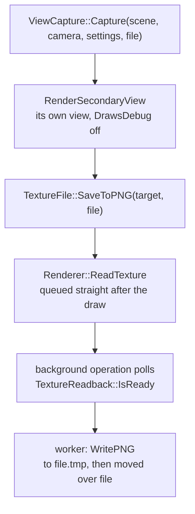
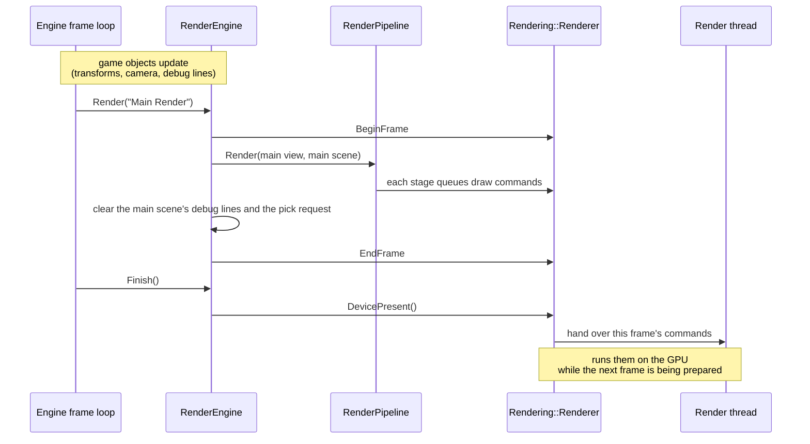

# Engine Graphics Layer: `RenderEngine`

`RenderEngine` (`Engine\Src\Graphics\RenderEngine.h/.cpp`) is the engine's rendering coordinator. It's reached through `RZE().GetRenderEngine()`, and it sits between gameplay code and the low-level renderer:



The render-side scene is deliberately separate from `GameScene`: a `RenderObject` knows its mesh, transform and bounds, plus an opaque pick ID, but nothing about the `GameObject` that owns it.

## Scene data

A **`RenderScene`** (`Engine\Src\Graphics\RenderScene.h/.cpp`) is what one scene draws. **Each `GameScene` owns one** (`GameScene::GetRenderScene()`), and its components put their render objects and lights in it. Any view can render any scene, so a scene can be drawn without being the one on screen, e.g. a [`HeadlessScene`](../03-SceneAndGameObjects/Scene-And-GameObject-Model.md#headlessscene-a-scene-rendered-off-screen) for a thumbnail.

| Holds | Notes |
|---|---|
| Render objects, lights | `CreateRenderObject(staticMesh)` / `DestroyRenderObject`, `CreateLightObject(type)` / `DestroyLightObject`, `ClearObjects()` (render objects only). `GetDirectionalLight()` is the first directional light, or null. |
| Debug lines | `DrawLine` / `DrawWireBox` / `DrawWireSphere`, kept until `ClearDebugLines()`. `RenderEngine::Render` clears the main scene's once it has drawn them. |
| `GetRevision()` | A cheap "did anything change?" counter. It goes up when a render object is added, removed, moved or given a new mesh, or when a light is added, removed, or changed in a way that moves its shadows: its type, a directional light's direction, a point light's position or range. Colour and strength don't count. `ShadowRenderStage` skips checking the scene's shadow maps when it hasn't changed. |
| `GetObjectsRevision()` | The revision of the last render object change alone (lights don't move it). The sun's shadow map is out of date once it's newer than the revision the map was rendered at. |
| `HaveObjectsChangedWithin(region, sinceRevision)` | Whether a render object was added, removed, moved or given a new mesh within a world-space box after a revision, counting both where it was and where it is. Backed by a `SceneChangeLog` (below). A point light's shadow cube asks it about the box its six faces see. |
| `GetBounds()` | The box around every render object, kept until one is added, removed, moved or given a new mesh, then rebuilt from the objects' boxes when next asked. |
| Persistent stage state | What stages keep for this scene across frames, whichever view renders it: today, **each scene's own light buffer and shadow maps**. `ReleaseStageState()` drops them; they're made again the next time the scene is rendered. |

**Where objects changed (`SceneChangeLog`).** Each render object change is logged as world-space boxes stamped with the new revision: a move or a new mesh logs where the object was and where it is as two boxes, so an object that jumps across the scene doesn't mark everything between; a new object logs where it is and a destroyed one where it was. `ClearObjects` counts as a change everywhere. The log keeps the latest 256 changes (`SceneChangeLog::k_capacity`). Asking about a revision from before them answers that it changed, so the answer can be true for a change elsewhere once many objects have moved, but never false for one within the box.

### Handles

`CreateRenderObject` and `CreateLightObject` return a **`RenderObjectPtr`** / **`LightObjectPtr`** (`Graphics\GraphicsDefines.h`: `UniqueLiveObjectPtr` from `Utils\Src\Utils\LiveObjectPtr.h`, with the `RenderSceneLifetime` policy). Whoever made the object keeps the handle and destroys the object through it (`DestroyRenderObject(handle)` empties it).

- **Move-only**, so each object has one holder (`RenderComponent`, `LightComponent`). Code that only looks at an object borrows the holder's handle by reference, e.g. `RenderComponent::GetRenderObject()` returns `const RenderObjectPtr&`.
- **Lifetime-checked**, like `GameObjectPtr`. Each object takes a 64-bit ID that's never handed out twice (`RenderSceneLifetime`: one `LiveIDAllocator` shared by render objects and lights, made on first use and never destroyed; see [Handles](../03-SceneAndGameObjects/Scene-And-GameObject-Model.md#handles-gameobjectptr-and-gameobjectcomponentptrt)). A handle compares equal to `nullptr` once its object is gone, however it went: destroyed through the handle, `ClearObjects`, or the scene being destroyed. Debug builds assert if a dead handle is dereferenced, and destroying through a dead handle just empties it.

`RenderEngine` doesn't own a scene. `SetMainScene(scene)` says which one the main view shows; `RZE_Engine` sets it to the active `GameScene`'s. `RenderEngine::DrawLine` / `DrawWireBox` draw into the main scene, for tools that draw over the main view (the editor's grid and gizmos).

### `RenderObject`

| Holds | Notes |
|---|---|
| `StaticMeshInstance` | What it draws: a shared mesh with this object's material slots ([Materials-Meshes-Shaders.md](Materials-Meshes-Shaders.md#shared-meshes-per-object-instances)). `SetMeshInstance()` swaps it, keeping the render object; null draws nothing. |
| `GraphicsLayouts::ObjectBufferLayout { Transform, InvTransform }`, uploaded as the vertex shaders' `ObjectBuffer` | `SetTransform()` is called every frame by `RenderComponent`, but returns early if the matrix hasn't changed. |
| Draws | `GetDraws()`: one `MeshDraw` per placed sub-mesh, with its geometry, the material slot it draws with, its world transform, and 8 world-space corners plus the box around them. |
| Bounds | `GetLocalBounds()`: the mesh's box in the object's own space, which only changes with the mesh. `GetBounds()`: that box placed in the world as an axis-aligned `BoundingBox`. The world boxes and the draws are **worked out when asked** after the object moves or changes mesh (`MarkChanged()`), not on every move. Used for frustum culling, shadow fitting, framing thumbnails, the Editor's marquee selection and its bounds boxes. |
| Pick ID | `SetPickID()` / `GetPickID()`, a U64. What `PickRenderStage` writes for this object's pixels. `RenderComponent` sets it to its owner's `GameObjectID + 1`, so 0 means "nothing pickable". |

### `LightObject`

A light of any type. It holds the data every type shares, and its **type** (`ELightType`) decides which of it is read and which path it takes through lighting and shadows:

| | `Directional` | `Point` |
|---|---|---|
| Reads | `direction` (normalized, the way light travels) | `position`, `range` (metres to where it fades to nothing) |
| Also reads | `colour` (sRGB), `strength` | `colour` (sRGB), `strength` |
| Falloff | None: the same everywhere | Inverse square over distance as a fraction of the range, windowed to exactly 0 at the range (below) |
| Shadows | The first one: a 2D map fitted around the scene | The first 8: a cube each, in a cube map array |

It has **no GPU resources of its own**. `ShadowRenderStage` puts every light of a scene into one buffer each frame (see [Render-Stages.md](Render-Stages.md#shadowrenderstage)). `GetShadowRevision()` is the scene revision when the light was made or its shadows last moved (the same changes that move `GetRevision`), so its shadow map is out of date once that's newer than the revision the map was rendered at. `SetType` can change a light's type in place, which is how the inspector's Type drop-down works without remaking it. The `ELightType` values are what the shaders branch on (`LIGHT_TYPE_*`), so new types go at the end.



**Point light falloff.** `strength × f(distance / range)`, with `f(x) = (1 − x⁴)² / (1 + 8x²)`: inverse square, but over the fraction of the range rather than metres, so a longer range reaches further instead of only moving where a physically faded light is cut off. Strength is the brightness right next to the light. `LightObject::CalculatePointFalloff` is the same function on the CPU, for the editor's gizmo; its constant (`k_pointFalloffSharpness`) mirrors `PointFalloffSharpness` in `Lighting.hlsli`.

**Where a point light outshines the ambient light.** `LightObject::CalculateOutshinesAmbientRatio(strength, colour)` is the fraction of the range within which the light lights a surface facing it more than the ambient light does (the sky and ground halfway, as a wall gets them). It grows with strength, up to 1, and is 0 for a light dimmer than the ambient light even next to it. The editor draws it as the inner range sphere. The ambient colours (`k_ambientSky`, `k_ambientGround`) mirror `AmbientSky` and `AmbientGround` in `Lighting.hlsli`.

## Views

A **`RenderView`** is one point of view to render the scene from. Its owner fills in the inputs; render stages read them.

```cpp
class RenderView
{
public:
    RenderCamera Camera;                     // ClipSpace (projection * view), Position; mirrors the shaders' CameraBuffer
    Vector2D ViewportSize;
    Rendering::RenderTargetTexture* Target;  // owned by whoever owns the view
    bool AutoExposure = true;                // off for a fixed exposure of 1, for lighting whose brightness is known
    float ExposureCompensation;              // EV on top of the exposure
    EAntiAliasing AntiAliasing = Medium;     // FXAA after tonemapping: Off, Low, Medium or High
    ERenderViewLighting Lighting = Scene;    // Scene: the scene's light and sky. Uniform: even, ignoring the light
    bool DrawsDebug = true;                  // debug lines; off for clean captures such as thumbnails
    std::optional<RenderPickRequest> Pick;   // Editor picking (clicks, drops); cleared after each render
    // + a frame blackboard and a persistent blackboard (see Render-Stages.md)
};
```



- `GetMainView()` returns the main view. The app sets its `Target` and `ViewportSize` (the Editor sizes it to the scene view panel); the active scene's main camera fills in `Camera` every frame.
- `RenderSecondaryView(name, view, scene)` renders a scene into another view as part of the current frame. `CameraComponent` uses this for the "Camera View" preview it draws in the Editor's inspector (`CameraComponent::RenderPreview`, called by the camera's `Preview` property each frame the inspector shows it), so a preview is only rendered while that camera is selected. Stages marked `MainOnly` (picking, ImGui, the final blit) skip secondary views.

## Capturing a view to a file

`ViewCapture` (`Engine\Src\Graphics\ViewCapture.h/.cpp`) renders a scene from a camera into an offscreen target of its own, at a size fixed when it's made, and saves it as a PNG. The editor's thumbnails use a 512×512 one; it's in the Engine so the game could take screenshots the same way.



- `Capture` returns the `AsyncOperation` that writes the file. The image is read back from the commands queued so far, so another capture can follow in the same frame.
- **No debug lines** (grid, frustums, bounds boxes): its view has `DrawsDebug` off.
- `ViewCaptureSettings` sets the view's `Lighting`, `AutoExposure` and `ExposureCompensation` for each capture. The defaults light and expose like any other view. Mesh thumbnails use `Uniform` lighting with auto-exposure off ([Thumbnails-And-File-Browser.md](../07-Editor/Thumbnails-And-File-Browser.md#a-run)).
- `TextureFile` (`Engine\Src\Graphics\TextureFile.h/.cpp`) wraps `stb_image_write`. `WritePNG(file, width, height, rgba)` is safe from any thread. It creates the folder, writes the PNG beside the file and moves it over the file (`File::MoveReplacing`), so readers only ever see a whole image. `SaveToPNG(texture, file)` is the GPU-to-file path above. Its operation is `Background | Hidden`, since whoever asked for the capture reports on it.

## Frame lifecycle



Nothing touches D3D11 on the game thread; every `Renderer::` call just queues a command for the render thread (see [Low-Level-Renderer-Module.md](Low-Level-Renderer-Module.md)).

## API summary

| Area | Calls |
|---|---|
| Lifetime | `Initialize(windowHandle)` (also adds the engine's stages), `Shutdown()`, `ReleaseRenderStages()` (must run before `ResourceHandler::ShutDown()`) |
| Per frame | `Render(frameName)` (the main view, of the main scene), `Finish()`, `RenderSecondaryView(name, view, scene)` |
| Scene | `SetMainScene(scene)` / `GetMainScene()`. Objects and lights are made in a [`RenderScene`](#scene-data). |
| Debug drawing | Into the main scene: `DrawLine(start, end, colour, alpha = 1, fade = {})`, `DrawWireBox(box, transform, colour, alpha = 1)`, `DrawWireSphere(centre, radius, colour, alpha = 1, occludedAlpha = 0)` (three circles, one around each world axis). `alpha` makes lines semi-transparent; `fade` (`DebugLineFade { centre, start, end }`) fades a line out with each pixel's distance from `centre`, between the `start` and `end` radii (`end` = 0: no fade). The editor grid uses both. `occludedAlpha` (`DebugLine::occludedAlpha`) is how opaque a line's parts behind the scene are drawn, so e.g. a light's range still shows through the walls it passes behind; 0 hides them, as for every other line. |
| Stages | `AddRenderStage<T>(args...)` (see [Render-Stages.md](Render-Stages.md)) |
| Stats | `GetStats()` (`RenderStats`, main thread only): per frame, the time recording every view's render stages, each stage's part of it (`RenderStageTime`, from `RenderPipeline::TakeStageTimes()`), and draw calls not counting the UI's. Averaged over a `StatsWindow`; a frame runs from one `Render()` to the next, and the window is updated as `Render()` starts, before recording. The Editor's status bar shows them. |
| Views & canvas | `GetMainView()`, `ResizeCanvas(size)`, `GetCanvasSize()` |

Both object containers erase with swap-and-pop (`ContainerUtils::VectorEraseBack`), since their order doesn't matter.

## Key files

- `Engine\Src\Graphics\RenderEngine.h/.cpp` — `RenderEngine`
- `Engine\Src\Graphics\RenderScene.h/.cpp` — `RenderScene` (and `RenderSceneLifetime`'s ID allocator)
- `Engine\Src\Graphics\RenderObject.h/.cpp` — `RenderObject`
- `Engine\Src\Graphics\LightObject.h/.cpp` — `LightObject`, `ELightType`
- `Engine\Src\Graphics\DebugLine.h` — `DebugLine`, `DebugLineFade`
- `Engine\Src\Graphics\SceneChangeLog.h/.cpp` — where a scene's render objects changed, by revision
- `Engine\Src\Game\World\GameObjectComponents\LightComponent.h/.cpp` — the component that drives a `LightObject` ([Built-In-Components.md](../03-SceneAndGameObjects/Built-In-Components.md#lightcomponent))
- `Engine\Src\Graphics\RenderView.h` — `RenderView`, `RenderCamera`, `RenderPickRequest`
- `Engine\Src\Graphics\ViewCapture.h/.cpp`, `TextureFile.h/.cpp` — capturing a view to a PNG
- `Utils\Src\Utils\Math\Frustum.h/.cpp` — the six-plane view frustum used for culling and marquee selection (see [Utils-Library-Reference.md](../06-Platform-And-Infrastructure/Utils-Library-Reference.md))
- `Engine\Src\Graphics\GraphicsDefines.h` — `RenderSceneLifetime` and the `RenderObjectPtr` / `LightObjectPtr` aliases, move-only and lifetime-checked
- `Engine\Src\Graphics\GraphicsLayouts.h` — the shader buffer layouts the render stages share: lights and shadows (`GraphicsLayouts::LightLayout`, `GraphicsLayouts::ShadowBufferLayout`, ...), an object's matrices (`ObjectBufferLayout`) and a material's parameters (`MaterialBufferLayout`) (see [Render-Stages.md](Render-Stages.md#shadowrenderstage))
