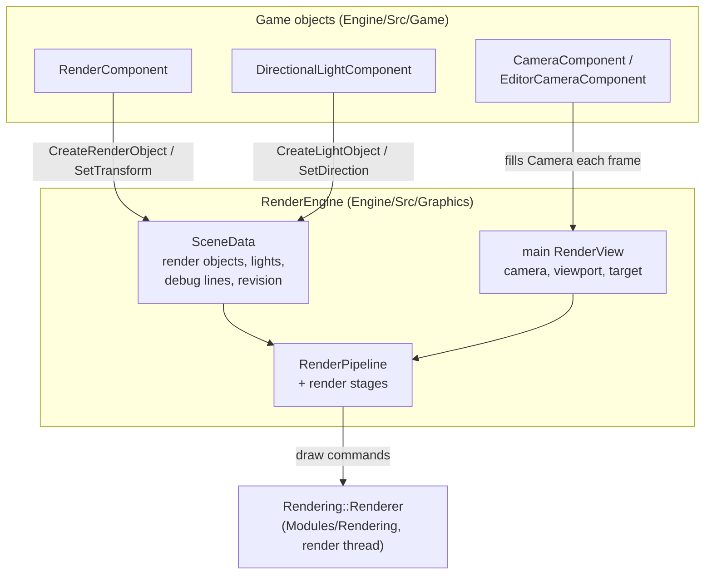
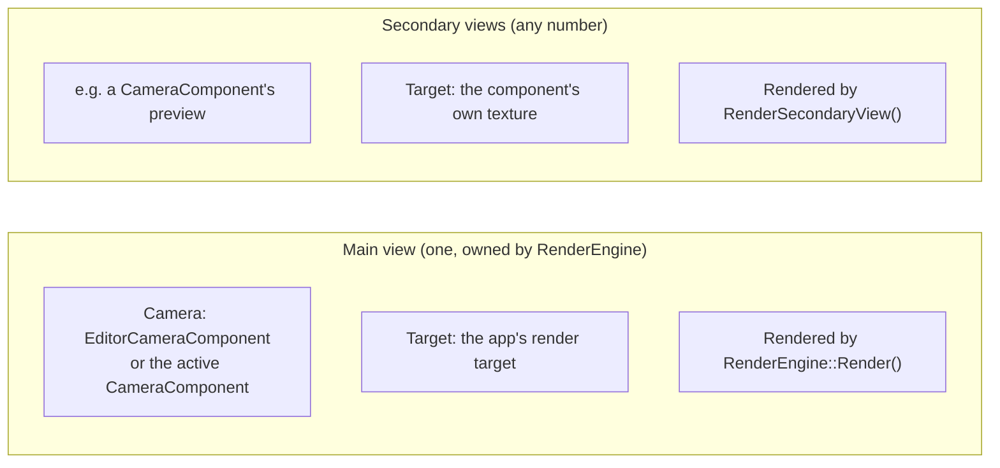
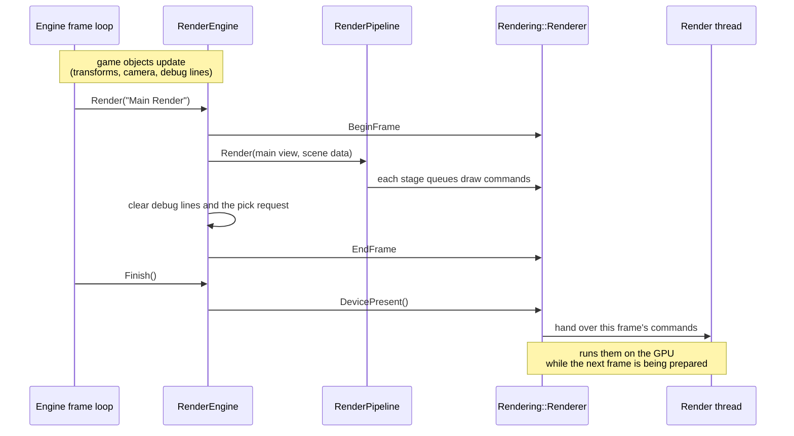

# Engine Graphics Layer: `RenderEngine`

`RenderEngine` (`Engine\Src\Graphics\RenderEngine.h/.cpp`) is the engine's rendering coordinator. It's reached through `RZE().GetRenderEngine()`, and it sits between gameplay code and the low-level renderer:



The render-side scene is deliberately separate from `GameScene`: a `RenderObject` knows its mesh, transform and bounds, plus an opaque pick ID, but nothing about the `GameObject` that owns it.

## Scene data

```cpp
struct RenderEngine::SceneData
{
    RenderObjectContainer renderObjects;   // vector<unique_ptr<RenderObject>>
    LightObjectContainer  lightObjects;    // vector<unique_ptr<LightObject>>
    DebugLineContainer    debugLines;      // DrawLine / DrawWireBox, cleared every frame
    U64 revision = 0;                      // bumped whenever anything that affects shadows changes
};
```

**`revision`** is a cheap "did anything change?" counter. It goes up when a render object is added, removed, moved or given a new mesh, or when a light changes direction. `ShadowRenderStage` compares it with the revision it last rendered for and skips re-rendering the shadow map when nothing has changed.

### `RenderObject`

| Holds | Notes |
|---|---|
| `StaticMeshInstance` | The mesh's submeshes, each with its own material. |
| `MatrixMem { transform, invTransform }` | `SetTransform()` is called every frame by `RenderComponent`, but returns early if the matrix hasn't changed. |
| World-space bounds | Per submesh (`GetSubMeshBounds()`: 8 corners plus an axis-aligned min/max) and for the whole object (`GetBoundsMin/Max()`). Recomputed only when the mesh or transform changes. Used for frustum culling, shadow fitting, the Editor's marquee selection and its bounds boxes. |
| Pick ID | `SetPickID()` / `GetPickID()`. What `PickRenderStage` writes for this object's pixels. `RenderComponent` sets it to its owner's `GameObjectID + 1`, so 0 means "nothing pickable". |

### `LightObject`

A directional light: `direction` (normalized, the way light travels), `colour` and `strength`, uploaded to a constant buffer (`PropertyBufferLayout`). The forward pass uses the first light. If the scene has none yet (e.g. while it's streaming in), it binds a zero-strength fallback light.

## Views

A **`RenderView`** is one point of view to render the scene from. Its owner fills in the inputs; render stages read them.

```cpp
class RenderView
{
public:
    RenderCamera Camera;                     // ClipSpace (projection * view), Position, Viewport
    Vector2D ViewportSize;
    Rendering::RenderTargetTexture* Target;  // owned by whoever owns the view
    float ExposureCompensation;              // EV on top of auto-exposure
    std::optional<RenderPickRequest> Pick;   // Editor click picking; cleared after each render
    // + a frame blackboard and a persistent blackboard (see Render-Stages.md)
};
```



- `GetMainView()` returns the main view. The app sets its `Target` and `ViewportSize` (the Editor sizes it to the scene view panel); the active camera component fills in `Camera` every frame.
- `RenderSecondaryView(name, view)` renders the scene into another view as part of the current frame. `CameraComponent` uses this for the "Camera View" preview it draws in the Editor's inspector (`OnEditorInspect`), so a preview is only rendered while that camera is selected. Stages marked `MainOnly` (picking, ImGui, the final blit) skip secondary views.

## Frame lifecycle



Nothing touches D3D11 on the game thread; every `Renderer::` call just queues a command for the render thread (see [Low-Level-Renderer-Module.md](Low-Level-Renderer-Module.md)).

## API summary

| Area | Calls |
|---|---|
| Lifetime | `Initialize(windowHandle)` (also adds the engine's stages), `Shutdown()`, `ClearObjects()`, `ReleaseRenderStages()` (must run before `ResourceHandler::ShutDown()`) |
| Per frame | `Render(frameName)`, `Finish()`, `RenderSecondaryView(name, view)` |
| Scene | `CreateRenderObject(staticMesh)` / `DestroyRenderObject`, `CreateLightObject()` / `DestroyLightObject` |
| Debug drawing | `DrawLine(start, end, colour)`, `DrawWireBox(min, max, transform, colour)` |
| Stages | `AddRenderStage<T>(args...)` (see [Render-Stages.md](Render-Stages.md)) |
| Views & canvas | `GetMainView()`, `ResizeCanvas(size)`, `GetCanvasSize()` |

Both object containers erase with swap-and-pop (`ContainerUtils::VectorEraseBack`), since their order doesn't matter.

## Key files

- `Engine\Src\Graphics\RenderEngine.h/.cpp` — `RenderEngine`, `RenderObject`, `LightObject`
- `Engine\Src\Graphics\RenderView.h` — `RenderView`, `RenderCamera`, `RenderPickRequest`
- `Engine\Src\Graphics\Frustum.h` — the six-plane view frustum used for culling and marquee selection
- `Engine\Src\Graphics\GraphicsDefines.h` — `RenderObjectPtr` / `LightObjectPtr` handle wrappers
