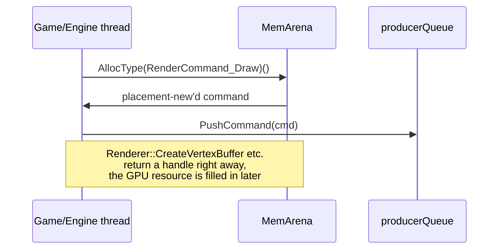
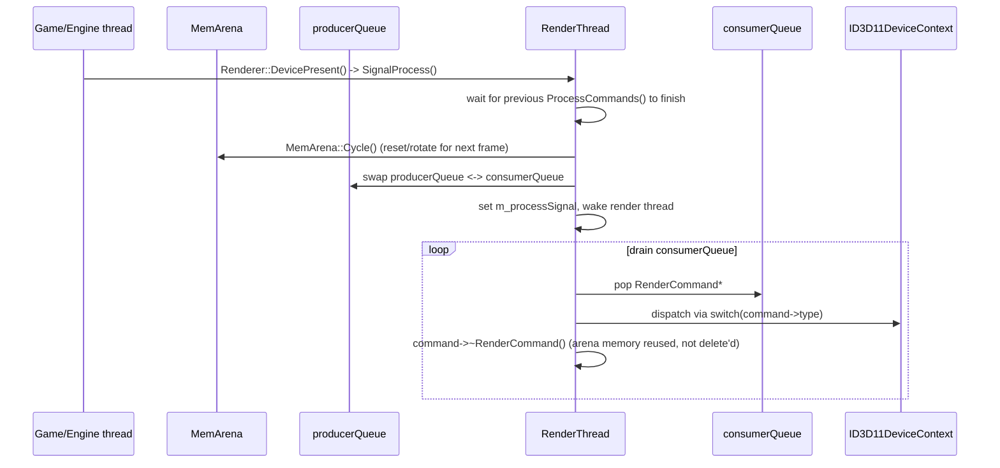

# Low-Level Renderer Module (`Modules\Rendering`)

This is a self-contained, DirectX 11–backed rendering library, deliberately decoupled from `Engine` (Engine depends on it, not the other way around — see [Module-Dependency-Graph.md](../02-Architecture/Module-Dependency-Graph.md)). Its defining architectural feature is a **producer/consumer command-buffer renderer with a dedicated render thread**: game/engine code never touches D3D11 directly, it only ever queues commands and receives opaque handles.

## Directory map

- `Renderer.h` / `.cpp` — the public static-method facade (`class Renderer`, no instance state besides a static `RenderThread`). This is the only entry point game/engine code should call.
- `RenderThread.h` / `.cpp` — worker thread owning the actual `DX11Device` and executing queued commands.
- `RenderCommand.h` — `RenderCommandType` enum + one POD struct per command, all deriving `RenderCommand`.
- `MemArena.h` / `.cpp` — the frame-scoped bump allocator backing every render command.
- `BufferHandle.h`/`.cpp`, `ShaderHandle.h` — opaque `shared_ptr`-wrapping handle types.
- `Driver/` — hardware abstraction interfaces (`IGFXDevice`, `IVertexBuffer`/`IIndexBuffer`/`IConstantBuffer`/`ITextureBuffer2D`, `IVertexShader`/`IPixelShader`) plus the concrete `Driver/DX11/` implementations (`DX11Device`, `DX11VertexBuffer`, `DX11IndexBuffer`, `DX11ConstantBuffer`, `DX11TextureBuffer2D`, `DX11VertexShader`/`DX11PixelShader`, `DX11TypeConversion`).
- `Graphics/` — `RenderTarget.h/.cpp` (`RenderTargetTexture`, used by both Editor and Game as their "screen" surface) and `Texture.h/.cpp` (`TexturePack`, a texture-array abstraction).
- `old_RenderCommands.h` — vestigial dead code from a prior command-struct design, not referenced anywhere current (see [10-KnownIssues](../10-KnownIssues/Architectural-Notes-And-TODOs.md)).

## The command-buffer render thread pattern

### Submission: game/engine thread queues a command



### Processing: render thread drains the queue



1. **`MemArena`** — a bump allocator with a fixed 64MB size (`MemoryUtils::Megabytes(64)`, set in `Renderer::Initialize`). `MemArena::AllocType<T>()` placement-news a `T` inside arena memory. Tracks a pressure level (`PressureValue::LOW`/`MED`/`HIGH`), last-frame allocation size, and peak usage — surfaced live in the Editor's menu bar memory readout.
2. Every `Renderer::*` static call allocates a `RenderCommand_*` struct out of the arena, fills in parameters (deep-copying transient data where needed), and pushes it onto `RenderThread::m_producerQueue` via `PushCommand`. Creation calls (`CreateVertexBuffer`, `CreateVertexShader`, etc.) synchronously return a caller-visible handle wrapping a `shared_ptr` to the concrete DX11 object — but that object is only populated **later**, asynchronously, when the render thread actually executes the command (`cmd->bufferPtr->Allocate(...)`). Callers get a handle immediately and must not assume the resource is ready before the render thread has processed it.
3. **`RenderThread`** runs a dedicated `std::thread` looping `Update()`, waiting on a `std::condition_variable` (`m_updateCondition`/`m_processSignal`). `Renderer::DevicePresent()` calls `SignalProcess()`, which waits for prior processing to finish, calls `MemArena::Cycle()`, swaps `m_producerQueue`/`m_consumerQueue` (classic double-buffered command queue — the header notes these queues are "guaranteed to be contiguous as its backed by MemArena"), then wakes the render thread. `ProcessCommands()` drains the consumer queue via a large `switch (command->type)`, dispatching directly against `ID3D11DeviceContext` calls, and explicitly destructs each command afterward (`command->~RenderCommand()`) — memory is reused via the arena's next `Cycle()`, never `delete`d individually.
4. This decouples game/render-logic submission from GPU-thread execution — a hand-rolled version of the "render command list"/deferred-context pattern, implemented without D3D11's actual deferred contexts.

### What a command keeps alive

The render thread runs a frame behind, so a command must not point at anything the main thread may free in the meantime. Every command holds what it reads:

| What | Held as |
|---|---|
| Buffer contents (`CreateVertexBuffer`, `CreateIndexBuffer`, `CreateConstantBuffer`, `UpdateVertexBuffer`, `UploadDataToBuffer`) | Copied into the arena |
| A texture's texels (`CreateTextureBuffer2D`) | A `TexelBuffer`, which owns them and frees them with the function they came with (e.g. `stbi_image_free`) when the command is destroyed, once the texture is made |
| GPU objects: buffers, textures, render targets, shaders | Their handles, which share ownership (`shared_ptr`) |
| Readback results (`ReadTexel`, `ReadTexture`) | `shared_ptr`s shared with whoever asked |
| The UI's draw data, and the textures it draws | A [`UIFrameData`](#imgui-integration-lives-at-this-layer-too) shared with `Renderer` |

So whoever queues a command can let go of anything straight after: a resource is destroyed as soon as its last handle goes ([Asset-Import-Runtime.md](../05-AssetPipeline/Asset-Import-Runtime.md#releasing-resources)), and its GPU objects live on until the last command using them is done. A GPU texture is freed with its last handle: `DX11TextureBuffer2D::Release()` releases each view it made (render target, shader resource and depth views), since each one keeps the texture alive.

### How the two threads overlap

The double-buffered queue means the game thread builds frame N+1 while the render thread executes frame N:

```mermaid
gantt
    dateFormat x
    axisFormat %L
    section Game thread
    Build frame 1 commands :g1, 0, 4ms
    Build frame 2 commands :g2, 4, 4ms
    Build frame 3 commands :g3, 8, 4ms
    section Render thread
    Execute frame 1 :r1, 4, 3ms
    Execute frame 2 :r2, 8, 3ms
```



`DevicePresent()` is the hand-off point: it waits until the render thread has finished the previous batch, swaps the queues, and wakes it. A frame's commands therefore run on the GPU one frame after they were queued, which is why results that come back from the GPU (like `ReadTexel`) arrive a frame or two later.

### The swap chain and vsync

`DX11Device` creates the device first (`D3D11CreateDevice`), then the swap chain from the device's own DXGI factory (`CreateSwapChain`):

- **Flip model** (`DXGI_SWAP_EFFECT_FLIP_DISCARD`), two single-sample buffers. Flip model can't be multisampled, and nothing needs it to be: the scene renders into its own targets, and only the final blit and the Editor's UI draw to the back buffer. The back buffer's depth buffer is single-sample to match.
- **Tearing** (`DXGI_SWAP_CHAIN_FLAG_ALLOW_TEARING`) where the system supports it, so a present with vsync off shows at once rather than at the next refresh. Only an unsynced present asks for it.
- **At most two queued frames** (`SetMaximumFrameLatency(2)`, `k_maxFrameLatency`), since the main thread already records a frame while the render thread runs the previous one. The swap chain's **frame latency waitable object** is signalled when it can take another frame. `RenderThread` takes the handle before its thread starts, so `Renderer::WaitForPresentSlot(timeoutMS)` can wait on it from the main thread without touching the device. The engine waits on it at the end of every frame, before the next one reads input; with vsync on, that wait is what paces frames ([Engine-Startup-And-Frame-Loop.md](../02-Architecture/Engine-Startup-And-Frame-Loop.md#waiting-for-the-next-frame)).
- **Sync interval.** `Renderer::SetSyncInterval(interval)` is a render command (`SetSyncInterval`), applied from the next frame the render thread runs: 0 presents at once, 1 on every refresh. `RenderEngine::SetVSync` calls it with `FrameSettings::VSync`.
- **Present** checks its result and logs a removed or reset device once, with the reason.
- **Resizing** releases the back buffer view and flushes the context first, because flip model can only resize once nothing references the buffers and D3D11 destroys views lazily, then passes `ResizeBuffers` the flags the swap chain was created with, which flip model requires. Shutdown closes the waitable object and releases the back buffer view before the swap chain.

## `RenderCommandType` (full list, from `RenderCommand.h`)

| Group | Commands |
|---|---|
| Frame / pass | `BeginFrame`, `EndFrame`, `Begin`, `End`, `DevicePresent`, `HandleWindowResize`, `SetSyncInterval`, `ImGuiRender` |
| Create | `CreateVertexBuffer` (static or dynamic), `CreateIndexBuffer`, `CreateConstantBuffer`, `CreateTextureBuffer2D`, `CreateVertexShader`, `CreatePixelShader` |
| Update / release | `UploadDataToBuffer`, `UpdateVertexBuffer`, `ReleaseVertexShader`, `ReleasePixelShader`, `GenerateMips` |
| Targets | `SetRenderTargetBackBuffer`, `SetColourTarget` (colour, optionally with depth), `SetDepthTarget` (depth only, e.g. shadow maps), `ClearRenderTarget`, `ClearRenderTargets`, `ClearDepthStencilBuffer` |
| Pipeline state | `SetViewport`, `SetInputLayout`, `SetPrimitiveTopology`, `SetRasterizerState`, `SetBlendState`, `SetVertexShader`, `SetPixelShader`, `SetConstantBufferVS`, `SetConstantBufferPS`, `SetVertexBuffer`, `SetIndexBuffer`, `SetTextureResource`, `UnsetTextureResource` |
| Draw | `Draw`, `DrawIndexed`, `DrawFullScreenQuad` |
| Readback | `ReadTexel`, `ReadTexture` |

Every one of these has a matching `RenderCommand_*` POD struct carrying exactly the parameters that call needs (e.g. `RenderCommand_SetConstantBufferVS { ConstantBufferHandle bufferHandle; U32 bufferSlot; }`).

## ImGui integration lives at this layer too

`RenderThread::InitializeImGui()` sets up `imgui_impl_win32`/`imgui_impl_dx11` bound to the `DX11Device`. `Renderer::ImGuiRender()` deep-copies the current frame's `ImDrawData` (since ImGui's `ImDrawData` is only valid until the next frame) and pushes a `RenderCommand_ImGuiRender`, so ImGui draw submission funnels through the exact same command queue/thread as everything else — it isn't a special-cased side path. On a frame that didn't update the UI (`FrameSettings::UIFrameRate`), `ImGui::Render()` returns at once and the draw data is still the last UI frame's, so the same UI is drawn again. `ImGuiRender()` keeps the last UI frame's copy and hands that copy to the render thread again until `ImGui::GetFrameCount()` moves on, rather than copying it every frame. Before the first UI frame there's no draw data, and `ImGuiRender()` does nothing.

The copy is a `UIFrameData` (`UIFrameData.h`), shared by `Renderer` and every `RenderCommand_ImGuiRender` that draws it, so whichever lets go last deletes it. ImGui knows a texture only by its view's raw pointer (`ImTextureID`), so the copy also holds the textures it draws: `Renderer::KeepTextureForUI(texture)` adds one to the UI frame being drawn, and `ImGuiRender()` hands that list to the frame's `UIFrameData`. A texture the UI draws stays alive for as long as any copy that draws it can still be drawn, even if its resource was released since. The Editor draws every texture through `EditorUI::TextureID(handle)`, which does this and returns its ID ([Editor-Framework.md](../07-Editor/Editor-Framework.md#shared-ui-helpers-editorui)).

## Handle types (`BufferHandle.h`, `ShaderHandle.h`)

`VertexBufferHandle`, `IndexBufferHandle`, `ConstantBufferHandle`, `TextureBuffer2DHandle`/`RenderTargetHandle`, `VertexShaderHandle`, `PixelShaderHandle` — thin `shared_ptr`-wrapping types with **private constructors**, friended only to `Renderer`/`RenderThread`. Game/engine code can hold and pass these around freely but can never construct one itself or reach into the underlying DX11 object — this is the opaque-handle idiom used consistently across RZE (see also `GameObjectPtr`/`RenderObjectPtr` in the Engine layer).

## Public `Renderer` API surface

Everything is a static call on `Rendering::Renderer`, and every call only *queues* work.

| Area | Calls |
|---|---|
| Lifetime | `Initialize`, `Shutdown`, `HandleWindowResize` |
| Presenting | `SetSyncInterval(interval)` (vsync), `WaitForPresentSlot(timeoutMS)` (blocks until the swap chain can queue another frame; false on timeout, e.g. while minimised). See [the swap chain](#the-swap-chain-and-vsync). |
| Frame and passes | `BeginFrame` / `EndFrame`, `Begin(name)` / `End()` (one pass; also resets the rasterizer state and names the pass for PIX), `DevicePresent`, `ImGuiRender`, `KeepTextureForUI` |
| Resources | `CreateVertexBuffer`, `CreateDynamicVertexBuffer` + `UpdateVertexBuffer`, `CreateIndexBuffer`, `CreateConstantBuffer`, `CreateTextureBuffer2D(params)` (empty, e.g. a render target) / `CreateTextureBuffer2D(TexelBuffer&&, params)`, `CreateVertexShader`, `CreatePixelShader`, `Release*Shader`, `UploadDataToBuffer<T>` (copies the data, so a stack variable is fine), `GenerateMips` |
| Targets | `SetColourTarget(colour[, depth])`, `SetDepthTarget`, `ClearRenderTargets` (unbinds every target, e.g. so one can be read from next), `SetRenderTargetBackBuffer`, `ClearRenderTarget`, `ClearDepthStencilBuffer` |
| State | `SetViewport`, `SetInputLayout`, `SetPrimitiveTopology`, `SetRasterizerState` (`Default` = back-face culling, `ShadowCaster` = no culling + slope-scaled depth bias), `SetBlendState` (`Opaque` = no blending, `AlphaBlend` = source alpha over the target, leaving the target's alpha unchanged), shaders, constant buffers, vertex/index buffers, texture slots |
| Draw | `Draw`, `DrawIndexed`, `DrawFullScreenQuad` |
| Readback | `ReadTexel`, `ReadTexture` (below) |

Texture formats (`ETextureFormat`): `RGBA8_UNORM` (default), `RGBA16_FLOAT` (HDR scene colour), `RG16_FLOAT`, `R32_UINT` (integer IDs for picking). Depth textures are `D24_UNORM_S8_UINT`, with an optional shader-readable view.

### Reusable dynamic buffers (`Engine\Src\Graphics\DynamicVertexBuffer.h`)

For geometry rewritten every frame (debug lines, gizmos), `DynamicVertexBuffer` wraps `CreateDynamicVertexBuffer` / `UpdateVertexBuffer` and decides when to reallocate with `BufferCapacityPolicy`:

- **Grow** straight away, to the next power of two, so a growing buffer reallocates only O(log n) times.
- **Shrink** only when recent peak use has stayed at or below a quarter of capacity for a while, and then to twice that peak, so brief spikes don't cause grow/shrink churn.

In steady state this means no GPU allocations at all.

### Reading back from the GPU: `ReadTexel` and `ReadTexture`

```cpp
static void ReadTexel(const TextureBuffer2DHandle& texture, U32 x, U32 y, std::shared_ptr<TexelReadback> result);
static void ReadTexture(const TextureBuffer2DHandle& texture, std::shared_ptr<TextureReadback> result);
```

- **`ReadTexel`** copies one texel of a 4-byte-per-texel texture (e.g. the `R32_UINT` format, added for picking, or a `D24_UNORM_S8_UINT` depth texture) into `TexelReadback::Value` (`Rendering\TexelReadback.h`). D3D only copies a depth texture whole, so one must be 1×1, like the pick stage's.
- **`ReadTexture`** copies the whole of mip 0 into `TextureReadback` (`Rendering\TextureReadback.h`): `Width`, `Height`, `BytesPerTexel` and `Data`, rows from the top, tightly packed. It copies row by row, since the GPU's row pitch can be wider than a row. `TextureFile::SaveToPNG` uses it to save captures ([Engine-Graphics-Layer.md](Engine-Graphics-Layer.md#capturing-a-view-to-a-file)).

Both go through one helper on the render thread: it creates a `D3D11_USAGE_STAGING` texture the size of the region, `CopySubresourceRegion`s into it (with no box when the region is the whole texture, as D3D requires for depth textures), `Map`s it, and hands back the rows with their pitch. The result's `IsReady` is set at the end; callers poll it from any thread, and it's true once the render thread has processed that frame's commands. `Map` waits for the GPU to finish drawing the texture, so these are for occasional reads such as the Editor's click picking (`PickRenderStage`) or saving a thumbnail, not per-frame use.

`R32_UINT` textures are created without `D3D11_RESOURCE_MISC_GENERATE_MIPS`, since integer formats don't support mip generation.

## Profiling

- **Optick:** `OPTICK_EVENT` / `OPTICK_THREAD("Render Thread")` are spread through the render thread and main loop, viewable in the bundled `Tools\Optick\Optick.exe`.
- **PIX / RenderDoc markers:** each `Renderer::Begin(name)` / `End()` pair becomes a named region (`D3DPERF_BeginEvent`), so captures group draws by pass (`ForwardRenderStage`, `PickRenderStage`, ...). Markers are only built when a profiler is attached (`D3DPERF_GetStatus()` is checked once per batch), so they cost nothing otherwise.
- **Command memory:** the Editor's menu bar shows `RenderCommand MemArena: <N> KB`, the arena memory used by last frame's commands. Compare it before and after a change to see its render-path cost.

## Key files

- `Modules\Rendering\Src\Rendering\Renderer.h/.cpp`
- `Modules\Rendering\Src\Rendering\RenderThread.h/.cpp`
- `Modules\Rendering\Src\Rendering\RenderCommand.h`
- `Modules\Rendering\Src\Rendering\TexelBuffer.h/.cpp` — texels an upload owns
- `Modules\Rendering\Src\Rendering\UIFrameData.h/.cpp` — a UI frame's draw data and the textures it draws
- `Modules\Rendering\Src\Rendering\TexelReadback.h`, `TextureReadback.h`
- `Modules\Rendering\Src\Rendering\MemArena.h/.cpp`
- `Modules\Rendering\Src\Rendering\BufferHandle.h/.cpp`, `ShaderHandle.h`
- `Modules\Rendering\Src\Rendering\Driver\GFXDevice.h`, `GFXBuffer.h`, `ShaderTypes.h`, `TypeDefines.h`
- `Modules\Rendering\Src\Rendering\Driver\DX11\DX11Device.h/.cpp` (+ sibling DX11* files)
- `Modules\Rendering\Src\Rendering\Graphics\RenderTarget.h/.cpp`, `Texture.h/.cpp`
