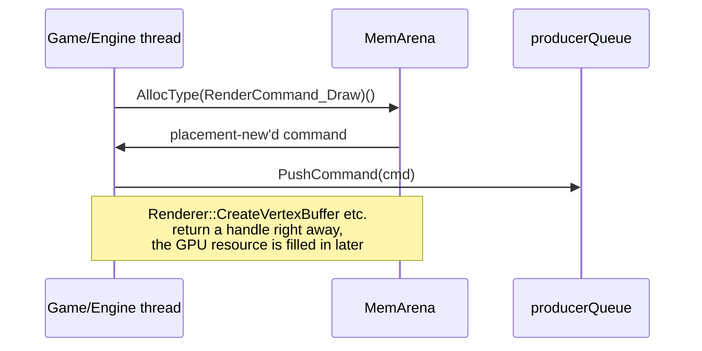
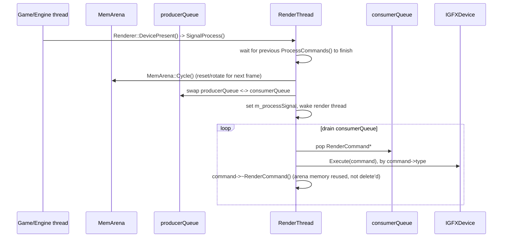
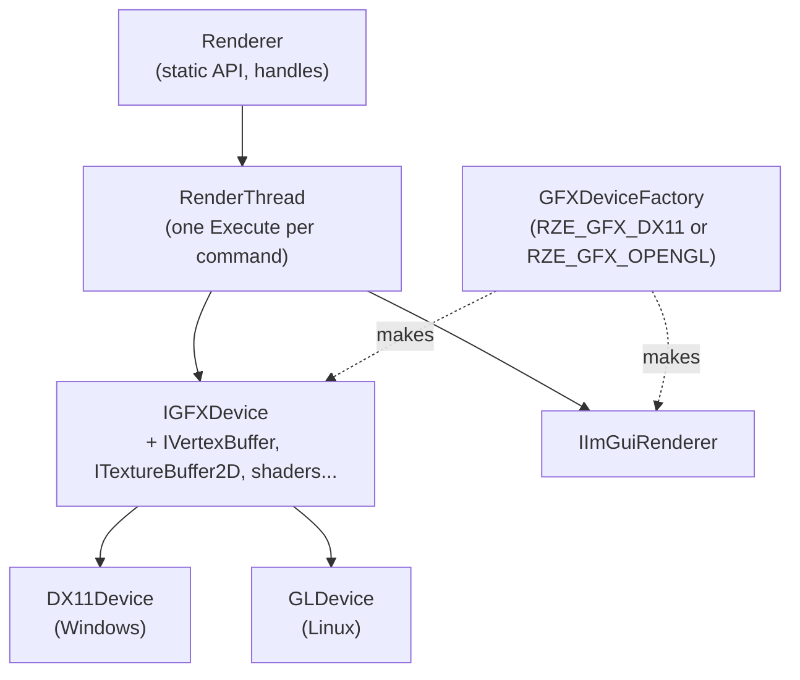

# Low-Level Renderer Module (`Modules/Rendering`)

A self-contained rendering library, deliberately decoupled from `Engine` (Engine depends on it, not the other way
around — see [Module-Dependency-Graph.md](../02-Architecture/Module-Dependency-Graph.md)). Two features define it:

- **A producer/consumer command-buffer renderer with a dedicated render thread.** Game and engine code never touch a
  graphics API: they queue commands through the static `Renderer` and get opaque handles back.
- **An RHI** (`IGFXDevice` and the resource interfaces), with one backend per graphics API: **DirectX 11** on Windows
  and **OpenGL 4.5 core** on Linux. Each build has one, chosen at compile time. Nothing outside the backend's folder
  knows which, so the same engine code and the same HLSL shaders draw the same pictures on both.

## Directory map

- `Renderer.h` / `.cpp` — the public static-method facade (`class Renderer`, no instance state besides a static `RenderThread`). This is the only entry point game/engine code should call.
- `RenderThread.h` / `.cpp` — the worker thread that owns the `IGFXDevice` and executes queued commands.
- `RenderThreadCommands.cpp` — what each command does on the render thread: one private `RenderThread::Execute` overload per command, each a forward to the device or a resource.
- `RenderCommand.h` — `RenderCommandType` (an `enum class`) + one POD struct per command, all deriving `RenderCommand`.
- `MemArena.h` / `.cpp` — the frame-scoped bump allocator backing every render command.
- `BufferHandle.h`/`.cpp`, `ShaderHandle.h` — opaque `shared_ptr`-wrapping handle types.
- `Driver/` — the RHI:
  - `GFXDevice.h` (`IGFXDevice`), `GFXBuffer.h` (`IVertexBuffer`, `IIndexBuffer`, `IConstantBuffer`, `ITextureBuffer2D`, `ETextureFormat`, `GFXTextureBufferParams`), `ShaderTypes.h` (`IVertexShader`, `IPixelShader`, `IComputeShader`), `TypeDefines.h`;
  - `GFXDeviceFactory.h/.cpp` and `GraphicsAPI.h` (`EGraphicsAPI`): which API this build draws with;
  - `DX11/`: `DX11Device`, `DX11VertexBuffer`, `DX11IndexBuffer`, `DX11ConstantBuffer`, `DX11TextureBuffer2D`, `DX11VertexShader`/`DX11PixelShader`/`DX11ComputeShader` (`DX11ShaderTypes`), `DX11TypeConversion`. Compiled on Windows only.
  - `OpenGL/`: `GLDevice`, `GLVertexBuffer`, `GLIndexBuffer`, `GLConstantBuffer`, `GLTextureBuffer2D`, `GLShaderTypes`, `GLShaderTranslator`, `GLCommon.h`. Compiled on Linux only.
- `ImGui/` — `ImGuiRenderer.h` (`IImGuiRenderer`), with `DX11/DX11ImGuiRenderer` and `OpenGL/GLImGuiRenderer`.
- `Graphics/RenderTarget.h/.cpp` — `RenderTargetTexture`, used by both Editor and Game as their "screen" surface.

## The command-buffer render thread pattern

### Submission: game/engine thread queues a command



### Processing: render thread drains the queue



1. **`MemArena`** — a bump allocator over two buffers of 256 MB each (`MEM_ARENA_SIZE`, `MemoryUtils::Megabytes(256)`, passed to `MemArena::InitializeArena` in `Renderer::Initialize`). Commands are allocated from the producer buffer; `Cycle()` swaps it with the consumer buffer, so the commands the render thread is executing stay valid while the next frame's are written. `MemArena::AllocType<T>()` placement-news a `T` inside arena memory. Tracks a pressure level (`PressureValue::LOW`/`MED`/`HIGH`), last-frame allocation size, and peak usage — surfaced live in the Editor's [status bar](../07-Editor/Status-Bar-And-Settings.md#the-status-bar).
2. Every `Renderer::*` static call allocates a `RenderCommand_*` struct out of the arena, fills in parameters (deep-copying transient data where needed), and pushes it onto `RenderThread::m_producerQueue` via `PushCommand`. Creation calls (`CreateVertexBuffer`, `CreateVertexShader`, etc.) synchronously return a caller-visible handle wrapping a `shared_ptr` to the backend's object, made by the device's factory (`IGFXDevice::CreateVertexBuffer`, ...) — but that object is only populated **later**, asynchronously, when the render thread actually executes the command (`cmd->bufferPtr->Allocate(...)`). Callers get a handle immediately and must not assume the resource is ready before the render thread has processed it.
3. **`RenderThread`** runs a dedicated `std::thread` looping `Update()`, waiting on a `std::condition_variable` (`m_updateCondition`/`m_processSignal`). `Renderer::DevicePresent()` calls `SignalProcess()`, which waits for prior processing to finish, calls `MemArena::Cycle()`, swaps `m_producerQueue`/`m_consumerQueue` (classic double-buffered command queue — the header notes these queues are "guaranteed to be contiguous as its backed by MemArena"), then wakes the render thread. `ProcessCommands()` drains the consumer queue with a `switch (command->type)` that hands each command to its own `Execute` overload (`RenderThreadCommands.cpp`), which forwards it to the device or a resource, and explicitly destructs each command afterward (`command->~RenderCommand()`) — memory is reused via the arena's next `Cycle()`, never `delete`d individually. `Shutdown()` waits for the last batch, then sets `m_shuttingDown` and the signal together under `m_updateMutex`; `Update()` checks the flag under that lock as it wakes and returns `false`, which ends the thread's loop, so the thread can't miss it and wait again.
4. This decouples game/render-logic submission from GPU-thread execution — a hand-rolled version of the "render command list"/deferred-context pattern, implemented without any API's deferred contexts.

### Arena allocations

- **Alignment.** Each allocation starts aligned: `AllocType<T>()` asks for `alignof(T)`, and raw data (buffer contents copied into a command) for `alignof(std::max_align_t)`, which is 16 with clang on Linux and 8 with MSVC. Without it, a command after data of an odd size (the `U32` indices of a mesh with an odd number of triangles) would start 4 bytes off. Over-aligned types are refused at compile time, since the arena's memory comes from `new[]` and is only aligned for `max_align_t`. The padding counts as used, so with no spill the frame's total is the arena's position, which [`AsyncFrameBudget`](../05-AssetPipeline/Asset-Import-Runtime.md) estimates from.
- **When it's full.** An allocation that doesn't fit, its padding included, comes from the heap instead: zeroed like the arena's memory and held by the buffer it was allocated for (`ArenaBuffer::overflow`). `Cycle()` frees it when it hands that buffer out again, once the render thread has run its commands, and logs `[Warning] Rendering memory arena was full: <N> KB in <M> allocations went to the heap this frame` for each frame that spilled. Asset uploads mostly stay inside the arena, because the async loader budgets them against it (from an estimate based on last frame), so spills come mainly from what isn't budgeted. With the arena cut to 1 MB, Sponza still loads, with 47 frames spilling up to 11 MB.
- **Size.** 256 MB a buffer covers far more than frames use (Sponza's load peaks at about 12 MB), but the size also caps one asset load step: [`AsyncFrameBudget::CanEverAfford`](../05-AssetPipeline/Asset-Import-Runtime.md) fails a step that needs more than the size less 8 MB. A mesh step copies a whole submesh's vertices and indices into a command, so the largest submesh decides it: Mountain's, about 28 MB, is the largest today. A texture step needs only 256 bytes, since its texels are moved into the command, not copied. Windows commits both buffers up front, and the Debug CRT writes to every byte of a `new[]`, so a larger size costs memory in every Windows process; on Linux, pages are only backed once used.
- **Pressure** (`GetPressureValue`) is the last frame's total against one buffer's size: `MED` from 60%, `HIGH` from 90%. The last frame's total (`GetTotalMemoryAllocatedLastFrame`) and the session's peak (`GetPeakUsedBytes`) include what spilled, so they can be more than the arena's size, and show what a frame really needed.

### What a command keeps alive

The render thread runs a frame behind, so a command must not point at anything the main thread may free in the meantime. Every command holds what it reads:

| What | Held as |
|---|---|
| Buffer contents (`CreateVertexBuffer`, `CreateIndexBuffer`, `CreateConstantBuffer`, `UpdateVertexBuffer`, `UploadDataToBuffer`) | Copied into the arena |
| A texture's texels (`CreateTextureBuffer2D`) | A `TexelBuffer`, which owns them and frees them with the function they came with (e.g. `stbi_image_free`) when the command is destroyed, once the texture is made |
| GPU objects: buffers, textures, render targets, shaders | Their handles, which share ownership (`shared_ptr`) |
| Readback results (`ReadTexel`, `ReadTexture`, `ReadBackBuffer`) | `shared_ptr`s shared with whoever asked |
| The UI's draw data, and the textures it draws | A [`UIFrameData`](#imgui-iimguirenderer) shared with `Renderer` |

So whoever queues a command can let go of anything straight after: a resource is destroyed as soon as its last handle goes ([Asset-Import-Runtime.md](../05-AssetPipeline/Asset-Import-Runtime.md#releasing-resources)), and its GPU objects live on until the last command using them is done. A GPU texture is freed with its last handle: `DX11TextureBuffer2D::Release()` releases each view it made (render target, shader resource and depth views), since each one keeps the texture alive; a GL texture is deleted on the render thread ([below](#threads)).

### How the two threads overlap

The double-buffered queue means the game thread builds frame N+1 while the render thread executes frame N:

```mermaid
gantt
    dateFormat x
    axisFormat %L
    section Game thread
    Build frame 1 commands :g1, 0, 4ms
    Build frame 2 commands :g2, 4, 4ms
    Build frame 3 commands :g3, 8, 4ms
    section Render thread
    Execute frame 1 :r1, 4, 3ms
    Execute frame 2 :r2, 8, 3ms
```



`DevicePresent()` is the hand-off point: it waits until the render thread has finished the previous batch, swaps the queues, and wakes it. A frame's commands therefore run on the GPU one frame after they were queued, which is why results that come back from the GPU (like `ReadTexel`) arrive a frame or two later.

`Submit()` is the same hand-off with no frame: it hands over what's been recorded so far (resource creation, uploads) without a present. The engine uses it, through `RenderEngine::Submit()`, while it loads before the window shows, and to wait for the render thread to finish the first frames ([Engine-Startup-And-Frame-Loop.md](../02-Architecture/Engine-Startup-And-Frame-Loop.md#loading-before-the-window-shows)).

## The RHI: `IGFXDevice` and the backends



- **`IGFXDevice`** is what the render thread draws with: about thirty **device-context operations** (targets and
  clears, viewport and pipeline state, texture slots, unordered access, draws and dispatches, copies, mips, present,
  sync interval, readbacks, profiler markers) plus a factory per resource type. What a resource does to itself
  (allocating, uploading, binding itself to a slot) stays on the resource's own interface, as it always was. Each
  `RenderThread::Execute` is a one-line forward to one of them.
- **`GFXDeviceFactory`** is the one place that knows the API: `GetGraphicsAPI()`, `CreateGFXDevice()` and
  `CreateImGuiRenderer(device)`, chosen by the build's `RZE_GFX_DX11` or `RZE_GFX_OPENGL` define. It and
  `Utils/Platform/Platform.h` are the only first-party files that check the platform with the preprocessor.
  `Renderer::GetGraphicsAPI()` lets the window prepare for it (SDL makes a window for OpenGL differently).
- **One device per process.** A device only ever receives resources from its own factory, so a backend casts the
  interfaces to its own types (`AsDX11`, `AsGL`) without checking.
- **The DX11 backend** is the code that was in the render thread before the RHI, moved unchanged into `DX11Device`;
  only its window handle is new (it takes the `HWND` from the SDL window's properties).

### Threads

A GL context can be current on only one thread at a time, so the device says when it's in use:
`AttachToCurrentThread()` and `DetachFromCurrentThread()`.
- The device is made and initialized on the main thread, which then detaches it.
- The render thread attaches it when it starts and detaches it as it stops.
- Shutdown attaches it on the main thread again after the render thread has joined.

On DX11 both are nothing. `RenderThread::RunWhileIdle(func)` runs `func` **on the render thread** while the caller
waits: that's how ImGui's texture updates reach the device from the main thread. It must be called from the thread
that called `Initialize`, like `Shutdown`, and both assert it: the shutdown pass doesn't run idle tasks, which is only
safe because the two can't overlap.

A resource can be let go on any thread, the main thread among them, which has no GL context. So `GLDevice::DeleteLater`
queues GL object names, and the render thread deletes them at the next Present. DX11 needs none of this: COM's
`Release` is safe from any thread.

## Presenting and vsync

### DX11: the swap chain

`DX11Device` creates the device first (`D3D11CreateDevice`), then the swap chain from the device's own DXGI factory (`CreateSwapChain`):

- **Flip model** (`DXGI_SWAP_EFFECT_FLIP_DISCARD`), two single-sample buffers. Flip model can't be multisampled, and nothing needs it to be: the scene renders into its own targets, and only the final blit and the Editor's UI draw to the back buffer. The back buffer's depth buffer is single-sample to match.
- **Tearing** (`DXGI_SWAP_CHAIN_FLAG_ALLOW_TEARING`) where the system supports it, so a present with vsync off shows at once rather than at the next refresh. Only an unsynced present asks for it.
- **At most two queued frames** (`SetMaximumFrameLatency(2)`, `k_maxFrameLatency`), since the main thread already records a frame while the render thread runs the previous one. The swap chain's **frame latency waitable object** is signalled when it can take another frame. `Renderer::WaitForPresentSlot(timeoutMS)` waits on it from the main thread without touching the device. The engine waits on it at the end of every frame, before the next one reads input; with vsync on, that wait is what paces frames ([Engine-Startup-And-Frame-Loop.md](../02-Architecture/Engine-Startup-And-Frame-Loop.md#waiting-for-the-next-frame)).
- **Sync interval.** `Renderer::SetSyncInterval(interval)` is a render command (`SetSyncInterval`), applied from the next frame the render thread runs: 0 presents at once, 1 on every refresh. `RenderEngine::SetVSync` calls it with `FrameSettings::VSync`.
- **Present** checks its result and logs a removed or reset device once, with the reason.
- **The debug layer's reports** reach the log when the device validates ([graphics validation](../06-Platform-And-Infrastructure/Debug-Services-And-Logging.md#graphics-validation): Debug by default, `-gfxvalidation` otherwise; `IGFXDevice::Initialize(validate)`). A validating device is created with `D3D11_CREATE_DEVICE_DEBUG`, any other with `D3D11_CREATE_DEVICE_SINGLETHREADED`. D3D11 has no message callback, so `ReportDebugMessages` reads the device's `ID3D11InfoQueue` after every Present, at the end of `Initialize` and at the start of `Shutdown`, then clears it. Corruption and errors log as `[Error] D3D11 (<id>): ...`, warnings as `[Warning] D3D11 (<id>): ...`; INFO and MESSAGE aren't stored. Unlike GL's errors, they don't assert yet. A message reported by another thread between the read and the clear is lost. Without validation there's no debug layer, and nothing is read; if the device has no info queue, a warning says so and nothing is read either.
- **Resizing** releases the back buffer view and flushes the context first, because flip model can only resize once nothing references the buffers and D3D11 destroys views lazily, then passes `ResizeBuffers` the flags the swap chain was created with, which flip model requires. Shutdown closes the waitable object and releases the back buffer view before the swap chain.

### OpenGL: drawn the way Direct3D draws

`GLDevice::Initialize` asks SDL for a **4.5 core** context (with the debug flag when it validates, as for DX11 above) and loads GL's functions
through glad. The engine and its shaders assume D3D's conventions throughout, so the GL backend keeps them rather than
changing anything above it:

- **Depth runs 0 to 1, and the engine's own targets are D3D's way up.** `glClipControl(GL_UPPER_LEFT, GL_ZERO_TO_ONE)`
  makes row 0 of every engine target its top, as in D3D, so viewports, texture coordinates, readback and cube faces
  need no changes. Front faces are counter-clockwise on screen (`glFrontFace(GL_CCW)`), as D3D's rasterizer states
  have them, under either origin.
- **The back buffer is the exception.** It's an RGBA8 texture with a D24S8 depth buffer, drawn **GL's way up**: while
  it's bound the clip origin is lower-left. Present copies it onto the window as it is (`glBlitNamedFramebuffer`),
  then `SDL_GL_SwapWindow`. What draws to it, the final full-screen copy (which samples by UV) and the Editor's ImGui
  (whose GL backend always draws GL's way up), come out the right way up with no changes either.
- **Presenting waits for the display itself**, so `WaitForPresentSlot` returns at once. The sync interval is set on
  the window's context at the next Present (`SDL_GL_SetSwapInterval`).
- **The driver's debug messages**, when it validates (a debug context, with `GL_DEBUG_OUTPUT_SYNCHRONOUS` so each arrives on the thread and in the call that caused it), reach the log graded by type: errors log as errors and assert, undefined and
  deprecated behaviour are warnings, and the rest are Debug: performance notes (e.g. NVIDIA's shader recompiles) and
  portability notes (Mesa checks every draw against OpenGL ES 3.1's rules, which don't apply to desktop GL 4.5).
- `GL_TEXTURE_CUBE_MAP_SEAMLESS` is on, as D3D filters across cube faces.

## `RenderCommandType` (full list, from `RenderCommand.h`)

| Group | Commands |
|---|---|
| Frame / pass | `BeginFrame`, `EndFrame`, `Begin`, `End`, `DevicePresent`, `HandleWindowResize`, `SetSyncInterval`, `ImGuiRender` |
| Create | `CreateVertexBuffer` (static or dynamic), `CreateIndexBuffer`, `CreateConstantBuffer`, `CreateTextureBuffer2D`, `CreateVertexShader`, `CreatePixelShader`, `CreateComputeShader` |
| Update / release | `UploadDataToBuffer`, `UpdateVertexBuffer`, `ReleaseVertexShader`, `ReleasePixelShader`, `ReleaseComputeShader`, `GenerateMips`, `CopyTexture`, `CopyTextureRegion` |
| Targets | `SetRenderTargetBackBuffer`, `SetColourTarget` (colour, optionally with depth), `SetDepthTarget` (depth only, e.g. shadow maps; a slice of a texture array), `ClearRenderTarget`, `ClearRenderTargets`, `ClearDepthStencilBuffer`, `ClearDepthStencilSlice` |
| Pipeline state | `SetViewport`, `SetInputLayout`, `SetPrimitiveTopology`, `SetRasterizerState`, `SetBlendState`, `SetDepthState`, `SetVertexShader`, `SetPixelShader`, `UnsetPixelShader`, `SetConstantBufferVS`, `SetConstantBufferPS`, `SetVertexBuffer`, `SetIndexBuffer`, `SetTextureResource`, `UnsetTextureResource` |
| Compute | `SetComputeShader`, `SetConstantBufferCS`, `SetTextureResourceCS`, `UnsetTextureResourceCS`, `SetUnorderedAccess`, `UnsetUnorderedAccess`, `Dispatch` |
| Draw | `Draw`, `DrawIndexed`, `DrawFullScreenQuad` |
| Readback | `ReadTexel`, `ReadTexture`, `ReadBackBuffer` |

Every one of these has a matching `RenderCommand_*` POD struct carrying exactly the parameters that call needs (e.g. `RenderCommand_SetConstantBufferVS { ConstantBufferHandle bufferHandle; U32 bufferSlot; }`).

## ImGui (`IImGuiRenderer`)

ImGui's *renderer* backend is beside the device rather than part of it: `IImGuiRenderer`, made by
`GFXDeviceFactory::CreateImGuiRenderer(device)` for the same API, so the two can't be mismatched. `DX11ImGuiRenderer`
wraps `imgui_impl_dx11` and `GLImGuiRenderer` wraps `imgui_impl_opengl3`; `IGFXDevice` has no ImGui types at all.
ImGui's *platform* side is the window's (`Windowing/ImGuiPlatform`, [Windowing.md](../06-Platform-And-Infrastructure/Windowing.md#imguiplatform-imguiplatformhcpp)).

- `RenderThread::InitializeImGui()` creates ImGui's context and initializes the renderer, on the main thread while the device is attached; `RenderThread::Shutdown()` shuts it down after re-attaching, then `ImGui::DestroyContext()`, which saves `imgui.ini`.
- `NewFrame` runs on the main thread and uses no graphics API. Texture updates (`UpdateTexture`, e.g. the font atlas) and drawing (`RenderDrawData`) run on the render thread; texture updates go there through `RunWhileIdle`.
- **On OpenGL, ImGui's backend always draws GL's way up.** That's right for the back buffer, where the Editor draws its UI. The Game draws ImGui into an engine target instead, which is D3D's way up, so `GLImGuiRenderer` mirrors the draw data's Y (its vertices and clip rectangles) for such a target and mirrors it back afterwards, since a frame that doesn't update the UI draws the same data again. It tells the two apart by the bound target's clip origin.

`Renderer::ImGuiRender()` deep-copies the current frame's `ImDrawData` (since ImGui's `ImDrawData` is only valid until the next frame) and pushes a `RenderCommand_ImGuiRender`, so ImGui draw submission funnels through the exact same command queue/thread as everything else — it isn't a special-cased side path. On a frame that didn't update the UI (`FrameSettings::UIFrameRate`), `ImGui::Render()` returns at once and the draw data is still the last UI frame's, so the same UI is drawn again. `ImGuiRender()` keeps the last UI frame's copy and hands that copy to the render thread again until `ImGui::GetFrameCount()` moves on, rather than copying it every frame. Before the first UI frame there's no draw data, and `ImGuiRender()` does nothing.

The copy is a `UIFrameData` (`UIFrameData.h`), shared by `Renderer` and every `RenderCommand_ImGuiRender` that draws it, so whichever lets go last deletes it. ImGui knows a texture only by its `ImTextureID` (a shader resource view's pointer on DX11, a GL texture name on OpenGL, from `TextureBuffer2DHandle::GetTextureData()`), so the copy also holds the textures it draws: `Renderer::KeepTextureForUI(texture)` adds one to the UI frame being drawn, and `ImGuiRender()` hands that list to the frame's `UIFrameData`. A texture the UI draws stays alive for as long as any copy that draws it can still be drawn, even if its resource was released since. The Editor draws every texture through `EditorUI::TextureID(handle)`, which does this and returns its ID ([Editor-Framework.md](../07-Editor/Editor-Framework.md#shared-ui-helpers-editorui)).

## Handle types (`BufferHandle.h`, `ShaderHandle.h`)

`VertexBufferHandle`, `IndexBufferHandle`, `ConstantBufferHandle`, `TextureBuffer2DHandle`/`RenderTargetHandle`, `VertexShaderHandle`, `PixelShaderHandle`, `ComputeShaderHandle` — thin `shared_ptr`-wrapping types with **private constructors**, friended only to `Renderer`/`RenderThread`. They hold the RHI's interfaces, never a backend's types. Game/engine code can hold and pass these around freely but can never construct one itself or reach into the underlying GPU object — this is the opaque-handle idiom used consistently across RZE (see also `GameObjectPtr`/`RenderObjectPtr` in the Engine layer).

## Public `Renderer` API surface

Everything is a static call on `Rendering::Renderer`, and every call only *queues* work.

| Area | Calls |
|---|---|
| Lifetime | `Initialize`, `Shutdown`, `HandleWindowResize`, `GetGraphicsAPI` |
| Presenting | `SetSyncInterval(interval)` (vsync), `WaitForPresentSlot(timeoutMS)` (on DX11, blocks until the swap chain can queue another frame; false on timeout, e.g. while minimised). See [presenting](#presenting-and-vsync). |
| Frame and passes | `BeginFrame` / `EndFrame`, `Begin(name)` / `End()` (one pass; also resets the rasterizer state and names the pass for graphics debuggers), `DevicePresent`, `Submit` (the hand-off without a present), `ImGuiRender`, `KeepTextureForUI` |
| Resources | `CreateVertexBuffer`, `CreateDynamicVertexBuffer` + `UpdateVertexBuffer`, `CreateIndexBuffer`, `CreateConstantBuffer`, `CreateTextureBuffer2D(params)` (empty, e.g. a render target) / `CreateTextureBuffer2D(TexelBuffer&&, params)`, `CreateVertexShader`, `CreatePixelShader`, `CreateComputeShader`, `Release*Shader`, `UploadDataToBuffer<T>` (copies the data, so a stack variable is fine), `GenerateMips` |
| Copies | `CopyTexture(source, destination)` (every slice and mip; the two must match in size, format, slices and mips, e.g. keeping last frame's probe lighting), `CopyTextureRegion(source, x, y, width, height, destination, x, y)` (a rectangle of mip 0's first slice, between textures of one format, e.g. a probe's capture into its scene's atlas) |
| Targets | `SetColourTarget(colour[, depth])`, `SetDepthTarget(depth, slice = 0)` (one slice of a texture array, e.g. a cube face), `ClearRenderTargets` (unbinds every target, e.g. so one can be read from next), `SetRenderTargetBackBuffer`, `ClearRenderTarget`, `ClearDepthStencilBuffer` (every slice of an array), `ClearDepthStencilSlice(depth, slice)` (one slice, e.g. one light's cube faces, leaving the rest) |
| State | `SetViewport`, `SetInputLayout`, `SetPrimitiveTopology`, `SetRasterizerState` (`Default` = back-face culling, `ShadowCaster` = no culling + slope-scaled depth bias, `NoCull` = no culling or bias, for probe captures, which tell back faces apart), `SetBlendState` (`Opaque` = no blending, `AlphaBlend` = source alpha over the target, leaving the target's alpha unchanged, and `Premultiplied`, `Additive`, `Multiply`), `SetDepthState` (`ReadWrite`, `ReadOnly`, `ReadOnlyLessEqual` = tests equal-or-nearer without writing, for drawing over the depth prepass, `Off`; stays bound, so set it back to `ReadWrite`), shaders (`UnsetPixelShader` draws depth only), constant buffers, vertex/index buffers, texture slots |
| Compute | `SetComputeShader`, `SetConstantBufferCS`, `SetTextureResourceCS` / `UnsetTextureResourceCS`, `SetUnorderedAccess(texture, slot, mip = 0)` / `UnsetUnorderedAccess(slot)`, `Dispatch(groupsX, groupsY = 1, groupsZ = 1)` ([below](#compute-shaders-and-unordered-access)) |
| Draw | `Draw`, `DrawIndexed`, `DrawFullScreenQuad` |
| Readback | `ReadTexel`, `ReadTexture`, `ReadBackBuffer` (below) |

Texture formats (`ETextureFormat`): `RGBA8_UNORM` (default), `RGBA16_FLOAT` (HDR scene colour), `RG16_FLOAT`, `R32_UINT` (integer IDs), `RG32_UINT` (64-bit integer IDs as two halves, low then high; the pick target, and probe captures' packed surfaces), `RG8_UNORM` (SMAA's edges and area texture), and single channels: `R8_UNORM` (ambient occlusion, SMAA's search texture), `R16_FLOAT` and `R32_FLOAT` (linear depth). Depth textures are `D24_UNORM_S8_UINT`, with an optional shader-readable view. GL uses the matching sized formats (`GL_RGBA8`, `GL_RGBA16F`, ..., `GL_DEPTH24_STENCIL8`).

`CreateTextureBuffer2D(TexelBuffer&&, params)` takes texels in the texture's own format, rows tightly packed: each row is `Width × bytes per texel` (`GetBytesPerTexel` on DX11), whatever the width. GL takes rows the same way because `GLDevice` sets both pack and unpack alignment to 1 at start-up; GL's default of 4 would misread the rows of a 1- or 2-byte format whose width isn't a multiple of 4.

A texture always has a shader resource view. Only a render target (`bIsRenderTarget`) gets a render target view and has its mips generated (`GenerateMips`; never for the integer formats); `bIsUnorderedAccess` gives it a view per mip that compute shaders can write.

Pixel and compute shaders get the same samplers, which the device owns and every `Begin()` binds: `s0`, linear and wrapping, for materials' and other ordinary textures (bound even when a draw binds no texture, so a shader that declares it always has one); `s1`, the shadow maps' comparison sampler; `s2`, linear with clamped edges, for screen-sized and probe textures whose edges mustn't wrap; and `s3`, point with clamped edges, for reads that must land on exact texels (SMAA's edge detection). GL has the same four as fixed sampler objects (the comparison one with `GL_COMPARE_REF_TO_TEXTURE`, `LEQUAL` and a border of 1), bound with each texture where a shader reads it ([below](#how-opengl-binds-what-d3d-binds)).

### Compute shaders and unordered access

`CreateComputeShader(path)` makes a compute shader from a `.hlsl` file's `CSMain`: compiled for `cs_5_0` on DX11, translated on GL ([below](#shaders-hlsl-on-both-apis)). A failed compile logs its errors and leaves the shader empty, so its dispatches do nothing. Compute has its own slots: `SetConstantBufferCS`, `SetTextureResourceCS` for reading, and `SetUnorderedAccess(texture, slot, mip)` for writing one mip of a texture, every slice of it, as a `RWTexture2D` (or `RWTexture2DArray`) at `u<slot>`. `Dispatch` runs the bound shader over thread groups.

- **One binding at a time.** D3D11 won't bind a texture to be read and written at once: binding it one way silently unbinds it the other. A pass unsets what it wrote (`UnsetUnorderedAccess`) before the next reads it, and unsets what it read before writing it.
- **Typed loads.** A shader can only read from an unordered-access texture for `R32_UINT` and `R32_FLOAT` formats; others are write-only, so passes that read and write (the probes' relighting) read last frame's copy as a texture instead (`CopyTexture`).
- **On GL**, `u<slot>` is image unit `<slot>` (`glBindImageTexture`). A cube or cube-array texture is bound through a 2D-array view of itself (`glTextureView`), as D3D's `RWTexture2DArray` sees it. Images are written without a declared format, which GLSL allows for write-only images, so each store converts to the texture's own format, as D3D's do. Every dispatch is followed by a full memory barrier, so what it wrote is there for whatever reads it next, as D3D11 guarantees.
- Ambient occlusion, the probes' lighting and visibility, and the reflection probes' cubes are made this way ([Render-Stages.md](Render-Stages.md)).

### Texture arrays and cube maps

`GFXTextureBufferParams::ArraySize` makes a texture of several slices (0 or 1: a single texture, so zero-initialised params are unchanged), and `bIsCubeMap` makes it a cube map, with 6 slices per cube in D3D's face order (+X, −X, +Y, −Y, +Z, −Z; the Engine names them `ECubeFace`, [Engine-Graphics-Layer.md](Engine-Graphics-Layer.md#cube-maps-cubemaphcpp)); more than 6 makes a cube array. Depth or colour, it's read through the matching shader type:

| `ArraySize` | `bIsCubeMap` | HLSL type | GL texture |
|---|---|---|---|
| 0 or 1 | no | `Texture2D` | `GL_TEXTURE_2D` |
| more | no | `Texture2DArray` | `GL_TEXTURE_2D_ARRAY` |
| 6 | yes | `TextureCube` | `GL_TEXTURE_CUBE_MAP` |
| 6 × N | yes | `TextureCubeArray` | `GL_TEXTURE_CUBE_MAP_ARRAY` |

- A depth array has a view per slice (`GetDepthSliceView(slice)` on DX11; a framebuffer per slice on GL), so `SetDepthTarget(texture, slice)` renders into one slice, e.g. a shadow cube's face. Clearing clears every slice. A single texture keeps exactly the views it had.
- A colour array has one render target view over all its slices, and no per-slice target. Nothing renders into one slice: probes capture into one 2D atlas a face per viewport, and compute writes the slices of the reflection cubes and the probes' textures through unordered access.
- It asserts that a cube's slice count is a multiple of 6, that an array isn't multisampled, and that one isn't made with texels (only the first slice would be filled).
- The DX11 device is created at the highest feature level the GPU has (11_0 on anything current); cube arrays need 10.1.

Point light shadows use it ([Render-Stages.md](Render-Stages.md#shadowrenderstage)), and reflection probes keep a scene's cubes in one cube array, mipped by roughness ([Render-Stages.md](Render-Stages.md#reflectionprobestage)). The same support serves skyboxes and cascaded sun shadows later.

### Reusable dynamic buffers (`Engine/Src/Graphics/DynamicVertexBuffer.h`)

For geometry rewritten every frame (debug lines, gizmos), `DynamicVertexBuffer` wraps `CreateDynamicVertexBuffer` / `UpdateVertexBuffer` and decides when to reallocate with `BufferCapacityPolicy`:

- **Grow** straight away, to the next power of two, so a growing buffer reallocates only O(log n) times.
- **Shrink** only when recent peak use has stayed at or below a quarter of capacity for a while, and then to twice that peak, so brief spikes don't cause grow/shrink churn.

In steady state this means no GPU allocations at all.

## Shaders: HLSL on both APIs

The shaders are HLSL (Shader Model 5), in `Assets/Shaders`, and they're the only source: both APIs compile the same
files at run time, when a shader is created, so a shader edit shows up on the next launch.

**Includes are written from `Assets/Shaders`**, in every file, however deep it is: `#include "Common/Lighting.hlsli"`,
and from inside `Common/SMAA/`, `#include "Common/SMAA/SMAA.hlsli"`, never `"SMAA.hlsli"` or `"../FullScreenQuad.hlsli"`.
D3D's standard include handler looks beside the shader being compiled and in the working directory, never beside the
file doing the including, and GL looks only beside the shader, so both find the same files. A path relative to the
including file fails on both.

- **DX11** compiles them with `D3DCompileFromFile` (`DX11ShaderTypes`): `VSMain`, `PSMain` or `CSMain` for SM 5, with
  `D3D_COMPILE_STANDARD_FILE_INCLUDE`. A failed compile logs fxc's errors (`[Error] Couldn't compile shader [...]`) and
  leaves the shader null, so a pass drawn with it writes no colour: with the default SMAA's shaders failing, the
  whole scene view came out blank. A vertex shader made with an empty `ShaderInputLayout` (a
  full-screen pass that reads `SV_VertexID`) gets no input layout, and `SetInputLayout` binds none, which D3D allows
  for a shader without vertex inputs.
- **OpenGL** translates them (`GLShaderTranslator`, run by `GLShaderTypes`), in two steps:
  1. **shaderc** compiles the HLSL to SPIR-V, with Vulkan's rules (which allow HLSL's separate textures and samplers),
     HLSL's constant-buffer packing (which the C++ structs that fill them follow), the HLSL semantics kept, no
     optimization, `RZE_SPIRV=1` defined, and includes found beside the shader (`ResolveInclude`), as D3D finds them.
  2. **SPIRV-Cross** writes the SPIR-V out as GLSL 4.50, one separable program per stage, bound into a program
     pipeline, as D3D binds stages separately. A few things HLSL allows and GLSL doesn't are written the GLSL way: a
     compare on a cube array at mip 0 uses `texture()` (GLSL has no `textureLod` for `samplerCubeArrayShadow`), and
     write-only images lose their format.

  Matrices need no transpose: the HLSL declares them `row_major` and multiplies `v * M`, which survives translation.
  A translation error is logged with the file, as a compile error is on DX11. All 24 shaders translate in about half a
  second.
- **What GL couldn't lay out:** a `float3` or `uint3` pad in a constant buffer, so those few pads are split into
  scalars, keeping every offset the same on both APIs.

### How OpenGL binds what D3D binds

D3D binds each stage's resources by register (`b`, `t`, `s`, `u`), separately per stage; GL binds a program's by
unit, and binds a texture and a sampler together. So the translator remaps them, and `GLDevice` keeps what's bound to
each stage's slots, as D3D's context does, then binds them for each draw or dispatch where the programs read them:

| D3D | GL |
|---|---|
| Constant buffer `b<n>` | Uniform block binding `n` + the stage's base: vertex 0, pixel 16, compute 32 (GL's bindings are shared by every program, so each stage has its own range) |
| Texture `t<n>` read through sampler `s<m>` | A combined sampler per (`t`, `s`) pair the shader uses, at its own texture unit: the pixel shader's from 0, the vertex shader's from 16. At draw time the unit gets the texture bound to `t<n>` and the sampler object for `s<m>`. |
| Texture read with `Load` (no sampler) | A combined sampler with no sampler object (`texelFetch`) |
| `RWTexture` `u<n>` | Image unit `n` |
| Vertex and pixel inputs, by semantic | Locations: glslang already numbers them by semantic. A Debug check logs a pixel shader input that the vertex shader drawn with it doesn't write, once per pair. |

The shaders and every `SetTextureResource[CS]` call stay unchanged.

## Reading back from the GPU: `ReadTexel`, `ReadTexture` and `ReadBackBuffer`

```cpp
static void ReadTexel(const TextureBuffer2DHandle& texture, U32 x, U32 y, std::shared_ptr<TexelReadback> result);
static void ReadTexture(const TextureBuffer2DHandle& texture, std::shared_ptr<TextureReadback> result);
static void ReadBackBuffer(const std::shared_ptr<TextureReadback>& result);
```

- **`ReadTexel`** copies one texel, of up to 8 bytes, into `TexelReadback::Value` (`Rendering/TexelReadback.h`), a U64 filled from the low bytes up. It reads as many bytes as the texture's format has: 8 for the pick stage's `RG32_UINT` ID target and `RGBA16_FLOAT`, 4 for a shader-readable `D24_UNORM_S8_UINT` depth texture and the other 32-bit formats, 2 for `R16_FLOAT`, 1 for `R8_UNORM`. D3D only copies a depth texture whole, so one must be 1×1, like the pick stage's.
- **`ReadTexture`** copies the whole of mip 0 into `TextureReadback` (`Rendering/TextureReadback.h`): `Width`, `Height`, `BytesPerTexel` and `Data`, rows from the top, tightly packed. `TextureFile::SaveToPNG` uses it to save captures ([Engine-Graphics-Layer.md](Engine-Graphics-Layer.md#capturing-a-view-to-a-file)).
- **`ReadBackBuffer`** copies the frame as it will be presented, UI and all (RGBA8, rows from the top). It's recorded by `DevicePresent` just before the present command, so it reads the finished frame on both APIs: a flip-model swap chain discards the back buffer at Present. DX11 copies swap-chain buffer 0; GL reads its internal back buffer and turns its rows top first, since that one is drawn GL's way up. EditorHarness's screenshots use it ([Building-And-Running.md](../01-GettingStarted/Building-And-Running.md#driving-the-running-editor)).

On DX11, the reads go through one helper on the render thread: it creates a `D3D11_USAGE_STAGING` texture the size of the region, `CopySubresourceRegion`s into it (with no box when the region is the whole texture, as D3D requires for depth textures), `Map`s it, and copies the rows out with their pitch. On GL they're `glGetTextureSubImage` (or `glGetTextureImage`), with a D24S8 depth texel repacked into D3D's order (depth in the low 24 bits, stencil on top) for `RenderView::DecodeDepth`. The result's `IsReady` is set at the end; callers poll it from any thread, and it's true once the render thread has processed that frame's commands. A read waits for the GPU to finish drawing what it reads, so these are for occasional reads such as the Editor's click picking (`PickRenderStage`), saving a thumbnail or a screenshot, not per-frame use.

`R32_UINT` and `RG32_UINT` textures are created without mip generation, since integer formats don't support it.

## Profiling

- **Optick:** `OPTICK_EVENT` / `OPTICK_THREAD("Render Thread")` are spread through the render thread and main loop, viewable in the bundled `Tools/Optick/Optick.exe` on Windows; on Linux, `driver.py optick` takes a capture over Optick's network protocol.
- **Graphics debugger markers:** each `Renderer::Begin(name)` / `End()` pair becomes a named region, so captures group draws by pass (`ForwardRenderStage`, `PickRenderStage`, ...): `D3DPERF_BeginEvent` on DX11, built only when a profiler is attached (`D3DPERF_GetStatus()`, checked once per batch), and a `KHR_debug` group on GL (`glPushDebugGroup`), always, since they're cheap. RenderDoc shows both. On Linux, `driver.py launch --renderdoc` and `renderdoc-capture` take a capture.
- **Command memory:** the Editor's status bar shows `RenderCommand MemArena: <N> KB / 256.00 MB · peak <N> KB`, the arena memory used by last frame's commands, out of one buffer's size; both figures include what spilled to the heap. Compare it before and after a change to see its render-path cost.
- **Render thread stats:** `Renderer::GetRenderThreadStats()` (`RenderThreadStats`, safe from any thread) gives how long the render thread is busy per frame, Present included, and the part spent in Present. A frame runs from one present to the next, averaged over a `StatsWindow` that the first present starts. The Editor's status bar shows them.

## Key files

- `Modules/Rendering/Src/Rendering/Renderer.h/.cpp`
- `Modules/Rendering/Src/Rendering/RenderThread.h/.cpp`, `RenderThreadCommands.cpp`
- `Modules/Rendering/Src/Rendering/RenderCommand.h`
- `Modules/Rendering/Src/Rendering/TexelBuffer.h/.cpp` — texels an upload owns
- `Modules/Rendering/Src/Rendering/UIFrameData.h/.cpp` — a UI frame's draw data and the textures it draws
- `Modules/Rendering/Src/Rendering/TexelReadback.h`, `TextureReadback.h`
- `Modules/Rendering/Src/Rendering/MemArena.h/.cpp`
- `Modules/Rendering/Src/Rendering/BufferHandle.h/.cpp`, `ShaderHandle.h`
- `Modules/Rendering/Src/Rendering/RenderingDefines.h` — the rasterizer, blend and depth states, `ViewportParams`
- `Modules/Rendering/Src/Rendering/Driver/GFXDevice.h`, `GFXBuffer.h` (`ETextureFormat`, `GFXTextureBufferParams`), `ShaderTypes.h`, `TypeDefines.h`, `GFXDeviceFactory.h/.cpp`, `GraphicsAPI.h`
- `Modules/Rendering/Src/Rendering/Driver/DX11/DX11Device.h/.cpp` (+ sibling DX11* files): the device, swap chain, and the blend, depth and rasterizer states each enum asks for (`GetBlendState`, `GetDepthState`, `GetRasterizerState`)
- `Modules/Rendering/Src/Rendering/Driver/OpenGL/GLDevice.h/.cpp` (+ sibling GL* files), `GLShaderTranslator.h/.cpp`
- `Modules/Rendering/Src/Rendering/ImGui/ImGuiRenderer.h`, `DX11/DX11ImGuiRenderer.*`, `OpenGL/GLImGuiRenderer.*`
- `Modules/Rendering/Src/Rendering/Graphics/RenderTarget.h/.cpp`
- `Externals/Src/OpenGL/glad/`, `SPIRV-Cross/`
