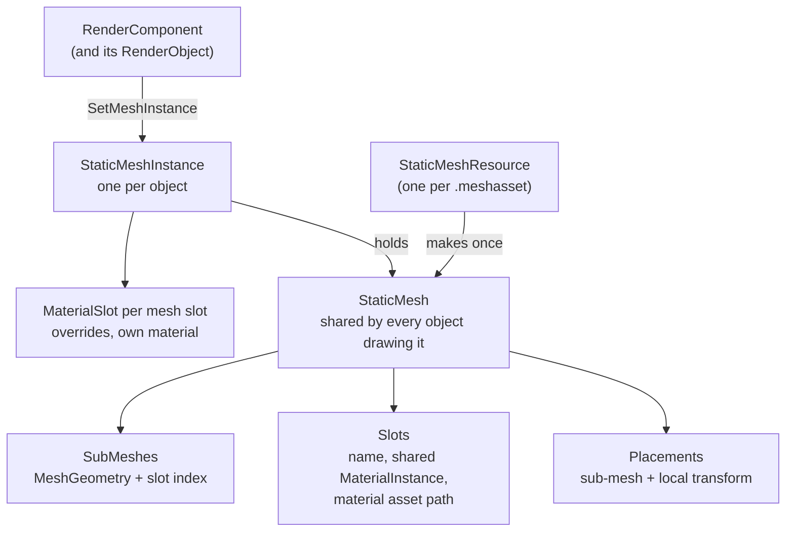
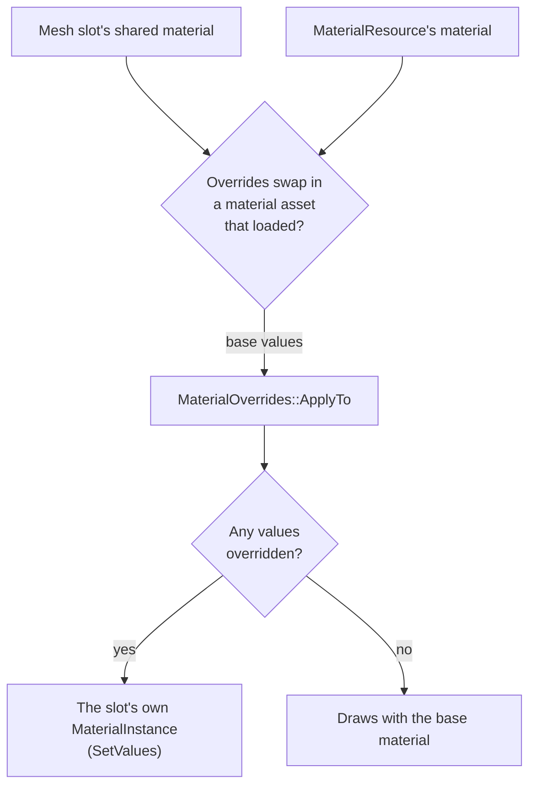
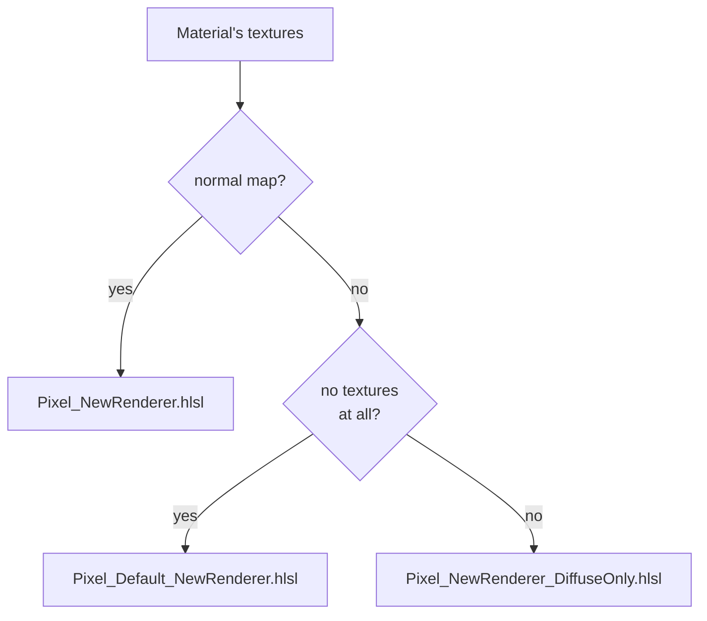
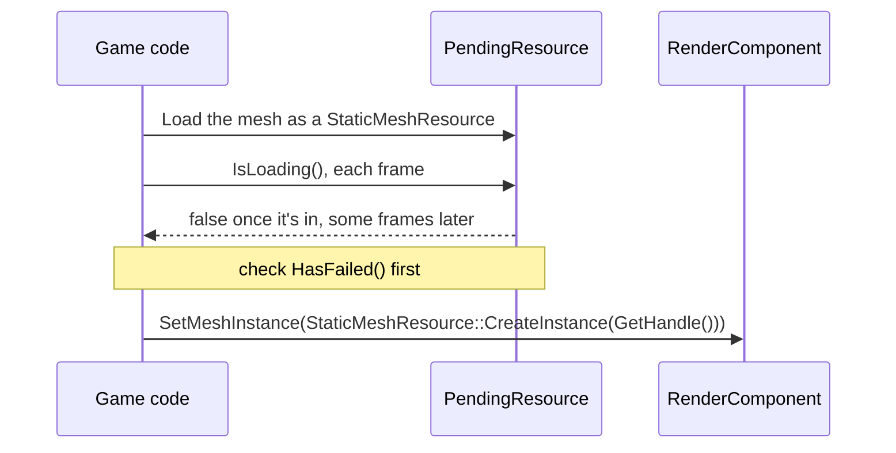

# Materials, Meshes & Shaders

This page covers the engine-side representation between a burned `.meshasset`/`.materialasset` file on disk ([Asset-Burning-Pipeline.md](../05-AssetPipeline/Asset-Burning-Pipeline.md)) and the GPU handles consumed by `Rendering::Renderer` ([Low-Level-Renderer-Module.md](Low-Level-Renderer-Module.md)).

## Shared meshes, per-object instances

A mesh asset is loaded once and shared. Everything one object changes about it lives in that object's instance:

Its `RenderObject` draws the instance as one `MeshDraw` per placement ([Draws](#draws-meshdraw-renderobject)).

### `MeshGeometry` (`Engine\Src\Graphics\MeshGeometry.h`)

One sub-mesh's geometry: its name, object-space bounds, and GPU `VertexBuffer`/`IndexBuffer` (`shared_ptr`). `AllocateData` uploads the vertices (`MeshVertex { Position, Normal, Tangent, UVData }`) and indices, then **frees the CPU copies**, since nothing reads them once they're on the GPU. The bounds stay. Building a geometry (`AddVertex`, `SetVertexData`, ...) only works before that.

### `StaticMesh` (`Engine\Src\Graphics\StaticMesh.h`)

Immutable once created, so every object drawing it shares one rather than copying it:

- **Sub-meshes**: a `MeshGeometry` each, and the index of the slot it's drawn with.
- **Slots**: one per material asset. Sub-meshes made with the same material share a slot, so changing the slot changes them all. Each has a `Name` (the material asset's file name, unique within the mesh), the shared `MaterialInstance`, and the `MaterialPath` it came from (invalid for a mesh made in code).
- **Placements**: each draws one sub-mesh at a local transform, and a sub-mesh can be placed more than once (instancing from FBX). A mesh made in code places each sub-mesh once, at the origin.
- `BuildDraws(objectMatrices, materialSlots, outDraws)` makes one `MeshDraw` per placement. Draws for placements at the mesh's origin share the object's matrices.

### `StaticMeshInstance` (`Engine\Src\Graphics\StaticMeshInstance.h`)

A `StaticMesh` as one object draws it. It holds the mesh directly (no `ResourceHandler` lookup when drawing), plus the asset's `ResourceHandle`, which keeps the asset loaded and cached while the instance lives and gives its path. It has one `MaterialSlot` per mesh slot, never resized, so draws can point at them.

Its mesh never changes: swapping meshes means a new instance (see [Swapping a mesh at runtime](#swapping-a-mesh-at-runtime)).

- `SetOverrides(MaterialOverridesByName)` replaces every slot's overrides, matching them by slot name. Overrides for names this mesh has no slot for are **kept**, so swapping to another mesh and back, or saving, doesn't lose them.
- `GetOverrides()` returns the slots' overrides by name, plus the kept ones.

### Draws (`MeshDraw`, `RenderObject`)

A `MeshDraw` is one placed sub-mesh in the world: the `MeshGeometry`, the `MaterialSlot` it draws with, its world transform (with the inverse after it, uploaded together as the `ObjectBuffer`), and world-space corners and bounds for culling each draw.

It points at the slot rather than a material, so an override being set or reset is drawn without rebuilding the draws.

`RenderObject::SetMeshInstance` swaps what an object draws while keeping the render object, and `GetDraws()` rebuilds the draws only when asked after the object moved or changed mesh.

## Materials

### Values, overrides and slots

- **`MaterialValues`** (`MaterialValues.h`) is everything about a material that can be edited:
  - the blend mode;
  - opacity;
  - shininess;
  - the tint;
  - five texture paths;
  - the two opacity-mask flags.

  `FromMaterialData` makes one from a material asset.
- **`MaterialOverrides`** (`MaterialOverrides.h`) is what one object changes, each field optional:

  | Field | Meaning |
  |---|---|
  | `Material` | A material asset drawn instead of the mesh's own; the value overrides go on top of it. Not a value, so `ApplyTo` leaves it to the slot. |
  | `BlendMode`, `Opacity`, `Shininess`, `Tint` | Replace the base's value |
  | `Textures[slot]` | Replace a texture; an invalid path empties the slot |
  | `InvertOpacityMask`, `OpacityMaskInAlpha` | Replace the mask flags |

  - `ApplyTo(base)` returns the base values with the value overrides on top.
  - `IsEmpty()` checks whether anything is overridden.
  - `ChangesValues()` checks whether any value is, rather than only the material.
  - `Serialize`/`Deserialize` write and read JSON with just the overridden fields, as scene files keep them: blend mode by name, tint as `[r, g, b]`, textures by slot name with `""` for an emptied slot. Unknown names are ignored.
- **`MaterialSlot`** (`MaterialSlot.h`) is one mesh slot as one object draws it. `GetMaterial()` is what its sub-meshes draw with:
  - The **base** is the mesh's shared material, or the material asset the overrides swap in. The slot loads that asset through the `ResourceHandler` (instant once preloaded) and only tries again when the path changes. One that fails to load leaves the mesh's own and logs it; the override is kept.
  - While any **values** are overridden, the slot draws its own `MaterialInstance`, made on the first override and updated in place after. Otherwise it draws the base itself.
  - `GetValues()` is the base's values with the overrides on top, and `GetMaterialPath()` is the asset it draws.
  - A slot without a shared material (a mesh never drawn, as in tests) only keeps its overrides.
- **`MaterialResource`** (`MaterialResource.h`) loads one `.materialasset` on its own, rather than as part of a mesh, into one material shared by everything drawing that asset.
  - It loads asynchronously: the file on a worker, the textures before the material is made.
  - Preloading it (e.g. from a scene's overrides) makes swapping it in instant.

### `MaterialInstance` (`Engine\Src\Graphics\Material.h`)

`SetValues(values)` is the one way a described material changes. It loads the textures and the shader, and works out and uploads the GPU parameters, so nothing derived from the values can go stale. `Create(materialData)` makes a material asset's material. Materials made in code (`GifChatComponent`'s frames) use `SetTexture`/`SetShaderTechnique` directly and keep the default parameters.

| Texture slot | Shader register | Used for |
|---|---|---|
| `TEXTURE_SLOT_DIFFUSE` | `t0` `DiffuseMap` | Base colour, multiplied by the tint |
| `TEXTURE_SLOT_SPECULAR` | `t1` `SpecularMap` | Specular strength; without one, 0.5 (a typical non-metal) |
| `TEXTURE_SLOT_NORMAL` | `t2` `NormalMap` | Tangent-space normals |
| `TEXTURE_SLOT_OPACITY` | `t3` `OpacityMap` | Opacity mask (leaves, chains, decals), in red or alpha |
| `TEXTURE_SLOT_HEIGHT` | `t4` `HeightMap` | Grayscale height, turned into extra normal detail |

`MaterialParams` (constant buffer `b1`, mirrored by `MaterialBuffer` in `Common/PixelResources.hlsli`) is worked out by `BuildParams(values)`, which needs no GPU, so it's tested directly:

| Parameter | Meaning |
|---|---|
| `Shininess` | Blinn-Phong exponent |
| `Opacity` | The material's opacity when it's blended; 1 otherwise, since the scene's alpha is read by post-processing |
| `HasOpacityMask`, `HasHeightMap`, `HasDiffuseMap`, `HasSpecularMap` | Whether those textures are set |
| `OpacityMaskInAlpha`, `InvertOpacityMask` | How to read the mask |
| `OpacityMaskIsCoverage` | 1 for blended materials, where the mask fades rather than cuts |
| `Tint` | sRGB; multiplies the diffuse texture, or is the colour without one |

The `Has...` flags matter because texture slots are **not unbound** between draws: without them a shader would sample the previous draw's texture. The shaders take their colour from `GetAlbedo` (`Common/Lighting.hlsli`), which returns the diffuse texture times the tint, or the tint alone without a diffuse texture.

**Which pixel shader a material gets** follows its textures (`ChooseShader`):

A normal map is only applied by `Pixel_NewRenderer` (`EShader::NormalMapped`), so any material with one gets it; it reads the diffuse and specular maps only if they're set (`HasDiffuseMap`, `HasSpecularMap`). That covers PBR exports that come with normal maps but roughness/metallic instead of specular maps. Opacity and height maps work with any of the three, through the flags above. The loaded shader and textures are **resolved when they're set** (`GetPixelShader()`, `GetTextureResource(slot)`), so drawing never looks a resource up by path.

The same opacity mask is honoured in three passes: the forward pass, the shadow caster (cut-out shadows) and the pick pass (clicks go through cut-out pixels). Blended materials are drawn after everything opaque, sorted, and cast no shadow ([Render-Stages.md](Render-Stages.md)).

## Swapping a mesh at runtime

`RenderComponent::SetMeshInstance(instance, overrides)` is the one way a component's mesh changes. The render object keeps its identity and swaps what it draws. `EMaterialOverrides::CarryOver` (the default) moves the previous instance's overrides onto the new one by slot name, and `UseNew` keeps a prepared instance's own.

To swap without stalling, load the mesh first with a [`PendingResource`](../05-AssetPipeline/Asset-Import-Runtime.md#one-resource-pendingresource), then swap once it has loaded. The component's mesh never goes through a request on the component itself:

Keep the component's handle rather than a pointer, since the component can be destroyed while the mesh loads ([Asset-Import-Runtime.md](../05-AssetPipeline/Asset-Import-Runtime.md)).

The editor does the same for an asset set in the Object Inspector or a mesh dropped in the scene view: RenderComponent's Mesh, a material slot's Material and its texture fields declare `.Preload<T>()`, so the asset loads in the background first and the property is set once it's in, when `LoadMesh` or the material swap is a cache hit ([Object-Inspector-And-Properties.md](../07-Editor/Object-Inspector-And-Properties.md#asset-fields)). A swapped material's textures load with it as its dependencies.

## `Shader` / `Texture2D` / `VertexBuffer` / `IndexBuffer` (`Engine\Src\Graphics\`)

Thin engine-side `IResource` wrappers around the lower-level GPU objects exposed by `Modules\Rendering` (`Rendering::VertexShaderHandle`/`PixelShaderHandle`, `Rendering::TextureBuffer2DHandle`, `Rendering::VertexBufferHandle`/`IndexBufferHandle`). These are what `ResourceHandler` loads/caches by file path.

A `Texture2D` hands its texels to the upload as a `TexelBuffer`, so the upload frees them once the render thread has made the texture, and the texture keeps no CPU copy. `Load(TexelBuffer&&, width, height)` makes one from an image already in memory (`GifChatComponent`'s frames), taking ownership of its texels.

## Key files

- `Engine\Src\Graphics\MeshGeometry.h/.cpp`, `StaticMesh.h/.cpp`, `StaticMeshInstance.h/.cpp`, `MeshDraw.h`
- `Engine\Src\Graphics\Material.h/.cpp`, `MaterialValues.h/.cpp`, `MaterialOverrides.h/.cpp`, `MaterialSlot.h/.cpp`, `MaterialResource.h/.cpp`
- `Engine\Src\Graphics\RenderScene.h/.cpp` (`RenderObject`)
- `Engine\Src\Graphics\Shader.h/.cpp`, `Texture2D.h/.cpp`, `VertexBuffer.h/.cpp`, `IndexBuffer.h/.cpp`
- `Engine\Src\Game\StaticMeshResource.h/.cpp`
- `Assets\Shaders\Common\PixelResources.hlsli`, `Lighting.hlsli`, and the three `Pixel_*NewRenderer*.hlsl`
