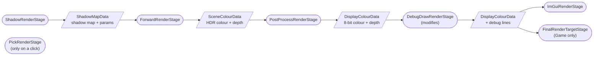
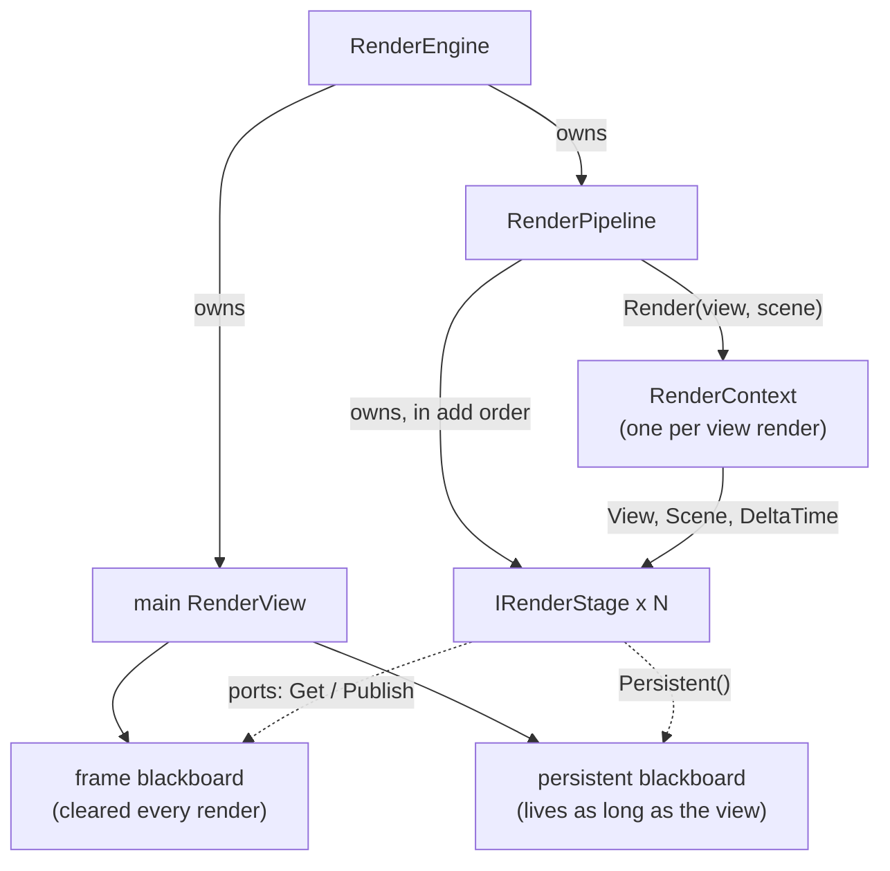
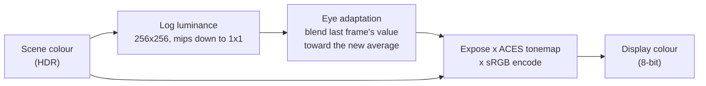
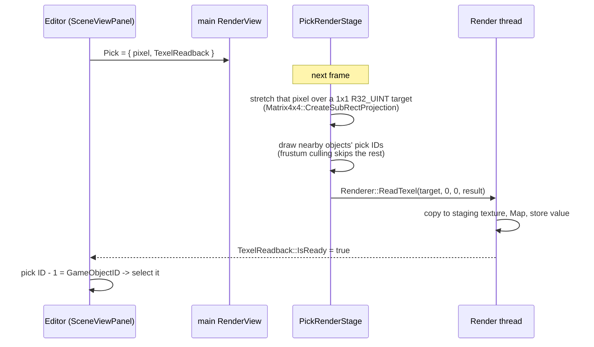

# Render Pipeline & Stages

A frame is drawn by a handful of **render stages**: small, independent passes such as "draw the shadow map" or "tonemap the image". Stages never call each other. Each one declares what data it **writes**, **reads** or **modifies**, and the `RenderPipeline` works out the order from those declarations.

> **In one sentence:** stages hand each other typed data packets ("contracts") through a per-view blackboard, and the pipeline sorts the stages so every packet is written before anyone reads it.

## A frame at a glance

Rounded boxes are stages, and the parallelograms between them are the data contracts they pass along.



`PickRenderStage` stands apart because it uses no contracts. It renders from the scene alone and hands its result straight back to the Editor (see [Picking](#pickrenderstage)).

The order the pipeline settles on is logged when it compiles, e.g. in the Editor:

```
Render pipeline: ShadowRenderStage -> ForwardRenderStage -> PostProcessRenderStage -> PickRenderStage -> DebugDrawRenderStage -> ImGuiRenderStage
```

## The pieces



| Piece | File | What it is |
|---|---|---|
| `IRenderStage` | `Graphics/RenderStage.h` | A pass: `Initialize()`, `Setup(builder)` to declare its data, `Render(context)` to draw. The header has a step-by-step guide to writing one. |
| Data contract | `Graphics/RenderData/*.h` | A small struct of handles and values deriving `RenderStageData<T>`, e.g. `ShadowMapData { ShadowMap, ShadowParams }`. One header each, so readers depend on the data, not on the stage that makes it. |
| Port | `Graphics/RenderPorts.h` | What `Setup()` hands back: `RenderInput<T>` (`Get`/`TryGet`), `RenderOutput<T>` (`Publish`), `RenderInOut<T>`. A stage can only touch data it declared. |
| `RenderPipeline` | `Graphics/RenderPipeline.h/.cpp` | Owns the stages; compiles the declarations when stages change, then runs them in order for a view. |
| `RenderView` | `Graphics/RenderView.h` | One point of view: camera, viewport size, target, exposure compensation, pick request, and two blackboards. See [Engine-Graphics-Layer.md](Engine-Graphics-Layer.md#views). |
| `RenderContext` | `Graphics/RenderContext.h` | What a stage gets while rendering one view: the view's inputs (read-only), the scene, `DeltaTime`, and `Persistent()`. |

## How the order is worked out

`CompileRenderPipeline()` (`RenderPipelineCompiler.cpp`) reads every stage's declarations and applies a few rules:

| Declaration | Meaning | Ordering rule |
|---|---|---|
| `Writes<T>()` | Produces a new `T` | Runs **first** for that contract. Exactly one writer per contract. |
| `Modifies<T>()` | Changes an existing `T` in place (e.g. draws into its target) | After the writer, **before** any reader. Several modifiers run in the order they were added. |
| `Reads<T>()` | Needs `T` | After the writer and all modifiers. |
| `ReadsOptional<T>()` | Uses `T` if it exists (`TryGet`) | Same as `Reads`, but no error if nobody writes it. |
| `RunsIn(MainOnly)` | Skip secondary views (camera previews) | Not an ordering rule; a filter applied at render time. |

Stages with no dependency between them keep the order they were added in.

**What it catches** (logged, and the pipeline asserts):
- a contract written by more than one stage;
- a stage that reads or modifies a contract nobody writes;
- a stage that runs in every view depending on a contract whose writer is `MainOnly` (it would be missing in camera previews).

## Views: main and secondary

Every render is for one `RenderView`. There are two kinds:

| | Main view | Secondary view |
|---|---|---|
| What it is | The picture shown to the user | An extra picture, e.g. a `CameraComponent` preview |
| Rendered by | `RenderEngine::Render()` once per frame | `RenderEngine::RenderSecondaryView()`, on request |
| `MainOnly` stages | Run | Skipped (`PickRenderStage`, `ImGuiRenderStage`, `FinalRenderTargetStage`) |
| Eye adaptation | Adapts smoothly over time | Exposes instantly |

Because stage objects are shared by every view, anything that must carry over between frames *for one view* (like eye-adaptation history) goes in `context.Persistent()`, not in a stage member.

## The stages

| Stage | Declares | Views | In one line |
|---|---|---|---|
| `ShadowRenderStage` | writes `ShadowMapData` | all | Renders the sun's shadow map, but only when the scene or light has changed. |
| `ForwardRenderStage` | reads `ShadowMapData`, writes `SceneColourData` | all | Draws every visible object, lit, into an HDR target. |
| `PostProcessRenderStage` | reads `SceneColourData`, writes `DisplayColourData` | all | Eye adaptation, ACES tonemapping, sRGB encode to 8-bit. |
| `PickRenderStage` | nothing | main | On a click, finds the object under one pixel. |
| `DebugDrawRenderStage` | modifies `DisplayColourData` | all | Draws debug lines on top, after tonemapping. Not in Retail builds. |
| `ImGuiRenderStage` | Editor: reads `DisplayColourData`; Game: modifies it | main | Draws ImGui. Added by the app, not the engine. |
| `FinalRenderTargetStage` | reads `DisplayColourData` | main | Game only: copies the finished image to the back buffer. |

The engine adds Shadow, Forward, PostProcess, Pick and (outside Retail) DebugDraw in `RenderEngine::Initialize()`. The Editor adds `ImGuiRenderStage(withEditor = true)`; the Game adds `ImGuiRenderStage` and `FinalRenderTargetStage`.

### `ShadowRenderStage`

- One 4096² shadow map for the directional light, **fitted around the bounds of every render object** as seen from the light. It doesn't follow the camera, so it never shimmers as the camera moves.
- **Cached:** it only re-renders when `SceneData::revision` changes (an object added, removed, moved or re-meshed, or the light turned). On other frames it just republishes the existing map.
- Casters draw with `ERasterizerState::ShadowCaster` (no culling, so thin geometry still casts, plus slope-scaled depth bias). `Pixel_ShadowCaster.hlsl` clips cutout materials (leaves, chains), so they cast cut-out shadows.

### `ForwardRenderStage`

- Draws into the view's HDR scene target (`RGBA16_FLOAT`, alpha 0 marks the background) with depth.
- **Frustum culling** at two levels: whole objects first, then each submesh, using the world-space bounds every `RenderObject` keeps (`Graphics/Frustum.h`).
- Per-view constants (camera, light, shadow map) are bound once; per object only the world matrix changes. Pixel shaders are only re-bound when the next submesh uses a different one.
- Shading lives in `Assets/Shaders/Common/Lighting.hlsli`: hemisphere ambient, the sun with soft shadows (`SampleShadow`), normal and height maps, and opacity masks.

### `PostProcessRenderStage`

Turns linear HDR colour into something a monitor can show, in three steps:



- **Eye adaptation** moves toward the scene's log-average luminance at about 1.5 s to settle, clamped to −3…+4 EV, then `RenderView::ExposureCompensation` is added on top. Its 1×1 history is ping-ponged between two textures kept in the view's persistent blackboard.
- The tonemap pass leaves the scene **depth** bound to `DisplayColourData`, so overlays drawn later (debug lines) can still depth-test against the scene.

### `PickRenderStage`

Finds the object at one pixel of the main view for the Editor's click selection. It only does work on frames where `RenderView::Pick` holds a `RenderPickRequest { X, Y, Result }`; `RenderEngine::Render()` clears the request afterwards.



- **Cheap by design:** a 1×1 target means nothing to resize with the window, the one-pixel frustum culls nearly everything, and only 4 bytes come back.
- `Pixel_PickID.hlsl` writes each `RenderObject::GetPickID()`. Objects with ID 0 still draw, so they hide what's behind them. Cutout pixels are clipped as in the shadow pass, so clicks go through them.
- The readback makes the render thread wait for the GPU, but only on a click frame. See [`ReadTexel`](Low-Level-Renderer-Module.md#reading-back-from-the-gpu-readtexel).

### `DebugDrawRenderStage`

Draws the lines queued with `RenderEngine::DrawLine()` / `DrawWireBox()` (bounds boxes, camera frustums, the light's direction) on top of the display colour, after tonemapping so they keep their exact colours. They depth-test against the scene. The queue is cleared after the main view renders, so secondary views drawn earlier in the frame get them too. Compiled out of Retail builds.

### `ImGuiRenderStage` and `FinalRenderTargetStage`

- **Editor:** ImGui draws the whole UI to the back buffer; the scene view panel shows the display colour target as an `ImGui::Image`, so the stage *reads* `DisplayColourData`.
- **Game:** ImGui draws over the display colour (*modifies* it), then `FinalRenderTargetStage` copies it to the back buffer.

Both are `MainOnly`: `ImGui::Render()` ends ImGui's frame, so it can only run once per frame.

## Writing a new stage

1. Add a data contract in `Graphics/RenderData/` if the stage produces something new.
2. Implement `IRenderStage`. In `Setup()`, declare everything and keep the ports:

    ```cpp
    void MyStage::Setup(RenderStageBuilder& builder)
    {
        m_sceneColour = builder.Reads<SceneColourData>();
        m_output = builder.Writes<MyData>();
        builder.RunsIn(ERenderViewFilter::MainOnly); // only if it must skip previews
    }

    void MyStage::Render(RenderContext& context)
    {
        const SceneColourData& scene = m_sceneColour.Get(context);
        // ... draw with Rendering::Renderer ...
        m_output.Publish(context, MyData{ /* handles */ });
    }
    ```

3. Register it: `RZE().GetRenderEngine().AddRenderStage<MyStage>()`. Where it lands in the order follows from the declarations; check the logged `Render pipeline:` line.

Keep per-view, across-frame state in `context.Persistent()`, and add new per-frame inputs to `RenderView`/`RenderContext` rather than reading globals.

## Key files

- `Engine\Src\Graphics\RenderStage.h`, `RenderStageBuilder.h`, `RenderPorts.h`, `RenderBlackboard.h`, `RenderContext.h`
- `Engine\Src\Graphics\RenderPipeline.h/.cpp`, `RenderPipelineCompiler.h/.cpp`
- `Engine\Src\Graphics\RenderData\` — `ShadowMapData.h`, `SceneColourData.h`, `DisplayColourData.h`
- `Engine\Src\Graphics\RenderStages\` — one `.h/.cpp` per stage
- `Assets\Shaders\` — `Pixel_ShadowCaster`, `Pixel_NewRenderer*`, `Pixel_LuminanceLog`, `Pixel_ExposureAdapt`, `Pixel_Tonemap`, `Pixel_PickID`, `Pixel_Line`
