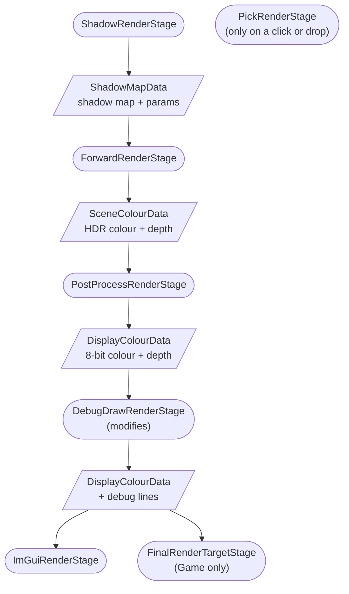
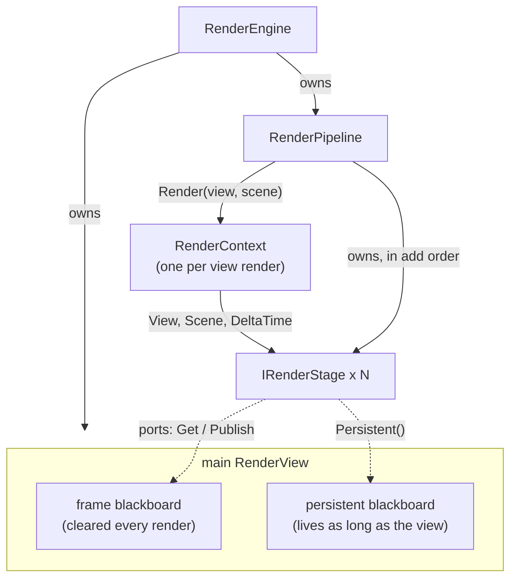
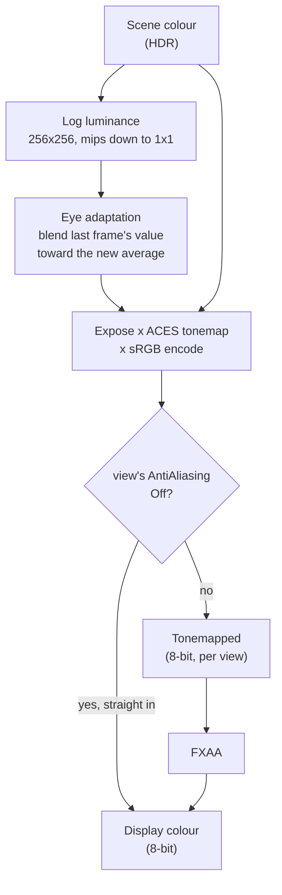
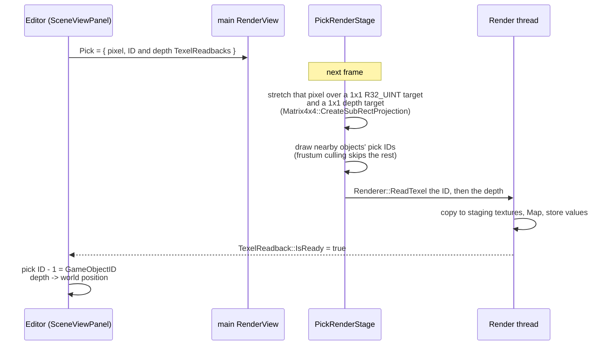

# Render Pipeline & Stages

A frame is drawn by a handful of **render stages**: small, independent passes such as "draw the shadow map" or "tonemap the image". Stages never call each other. Each one declares what data it **writes**, **reads** or **modifies**, and the `RenderPipeline` works out the order from those declarations.

> **In one sentence:** stages hand each other typed data packets ("contracts") through a per-view blackboard, and the pipeline sorts the stages so every packet is written before anyone reads it.

## A frame at a glance

Rounded boxes are stages, and the parallelograms between them are the data contracts they pass along.



`PickRenderStage` stands apart because it uses no contracts. It renders from the scene alone and hands its result straight back to the Editor (see [Picking](#pickrenderstage)).

The order the pipeline settles on is logged when it compiles, e.g. in the Editor:

```
Render pipeline: ShadowRenderStage -> ForwardRenderStage -> PostProcessRenderStage -> PickRenderStage -> DebugDrawRenderStage -> ImGuiRenderStage
```

## The pieces



| Piece | File | What it is |
|---|---|---|
| `IRenderStage` | `Graphics/RenderStage.h` | A pass: `Initialize()`, `Setup(builder)` to declare its data, `Render(context)` to draw. The header has a step-by-step guide to writing one. |
| Data contract | `Graphics/RenderData/*.h` | A small struct of handles and values deriving `RenderStageData<T>`, e.g. `ShadowMapData { ShadowMap, ShadowParams }`. One header each, so readers depend on the data, not on the stage that makes it. |
| Port | `Graphics/RenderPorts.h` | What `Setup()` hands back: `RenderInput<T>` (`Get`/`TryGet`), `RenderOutput<T>` (`Publish`), `RenderInOut<T>`. A stage can only touch data it declared. |
| `RenderPipeline` | `Graphics/RenderPipeline.h/.cpp` | Owns the stages; compiles the declarations when stages change, then runs them in order for a view. |
| `RenderView` | `Graphics/RenderView.h` | One point of view: camera, viewport size, target, lighting (`Scene` or `Uniform`), auto-exposure and exposure compensation, pick request, and two blackboards. See [Engine-Graphics-Layer.md](Engine-Graphics-Layer.md#views). |
| `RenderContext` | `Graphics/RenderContext.h` | What a stage gets while rendering one view: the view's inputs (read-only), the `RenderScene` being drawn, `DeltaTime`, `Persistent()` (this view's state across frames) and `ScenePersistent()` (this scene's state across frames, shared by every view that renders it). |

## How the order is worked out

`CompileRenderPipeline()` (`RenderPipelineCompiler.cpp`) reads every stage's declarations and applies a few rules:

| Declaration | Meaning | Ordering rule |
|---|---|---|
| `Writes<T>()` | Produces a new `T` | Runs **first** for that contract. Exactly one writer per contract. |
| `Modifies<T>()` | Changes an existing `T` in place (e.g. draws into its target) | After the writer, **before** any reader. Several modifiers run in the order they were added. |
| `Reads<T>()` | Needs `T` | After the writer and all modifiers. |
| `ReadsOptional<T>()` | Uses `T` if it exists (`TryGet`) | Same as `Reads`, but no error if nobody writes it. |
| `RunsIn(MainOnly)` | Skip secondary views (camera previews) | Not an ordering rule; a filter applied at render time. |

Stages with no dependency between them keep the order they were added in.

**What it catches** (logged, and the pipeline asserts):
- a contract written by more than one stage;
- a stage that reads or modifies a contract nobody writes;
- a stage that runs in every view depending on a contract whose writer is `MainOnly` (it would be missing in camera previews).

## Views: main and secondary

Every render is for one `RenderView`. There are two kinds:

| | Main view | Secondary view |
|---|---|---|
| What it is | The picture shown to the user | An extra picture, e.g. a `CameraComponent` preview or a `ViewCapture` |
| Scene | The active scene's (`RenderEngine::GetMainScene`) | Any `RenderScene`, passed in |
| Rendered by | `RenderEngine::Render()` once per frame | `RenderEngine::RenderSecondaryView()`, on request |
| `MainOnly` stages | Run | Skipped (`PickRenderStage`, `ImGuiRenderStage`, `FinalRenderTargetStage`) |
| Eye adaptation | Adapts smoothly over time | Exposes instantly |

Because stage objects are shared by every view, anything that must carry over between frames *for one view* (like eye-adaptation history) goes in `context.Persistent()`, not in a stage member. Anything that belongs to *the scene*, whichever view draws it (like the shadow map), goes in `context.ScenePersistent()`.

## The stages

| Stage | Declares | Views | In one line |
|---|---|---|---|
| `ShadowRenderStage` | writes `ShadowMapData` | all | Renders the sun's shadow map, but only when the scene or light has changed. |
| `ForwardRenderStage` | reads `ShadowMapData`, writes `SceneColourData` | all | Draws every visible object, lit, into an HDR target. |
| `PostProcessRenderStage` | reads `SceneColourData`, writes `DisplayColourData` | all | Eye adaptation, ACES tonemapping, sRGB encode to 8-bit, FXAA. |
| `PickRenderStage` | nothing | main | On a click or drop, finds the object under one pixel and the depth there. |
| `DebugDrawRenderStage` | modifies `DisplayColourData` | all | Draws debug lines on top, after tonemapping. Not in Retail builds. |
| `ImGuiRenderStage` | Editor: reads `DisplayColourData`; Game: modifies it | main | Draws ImGui. Added by the app, not the engine. |
| `FinalRenderTargetStage` | reads `DisplayColourData` | main | Game only: copies the finished image to the back buffer. |

The engine adds Shadow, Forward, PostProcess, Pick and (outside Retail) DebugDraw in `RenderEngine::Initialize()`. The Editor adds `ImGuiRenderStage(withEditor = true)`; the Game adds `ImGuiRenderStage` and `FinalRenderTargetStage`.

### `ShadowRenderStage`

- A 4096² shadow map for the directional light **per scene**, kept in the scene's persistent state (`RenderScene`), so a thumbnail's scene and the editor's each have their own. It's **fitted around the bounds of every render object** as seen from the light. It doesn't follow the camera, so it never shimmers as the camera moves.
- **Cached:** it only re-renders when the scene's revision (`RenderScene::GetRevision`) changes: an object added, removed, moved or re-meshed, or the light turned. On other frames it just republishes the existing map.
- A view with `Uniform` lighting ignores the light, so it doesn't render the map for it (mesh thumbnails never render one).
- Casters draw with `ERasterizerState::ShadowCaster` (no culling, so thin geometry still casts, plus slope-scaled depth bias). `Pixel_ShadowCaster.hlsl` clips cutout materials (leaves, chains), so they cast cut-out shadows.

### `ForwardRenderStage`

- Draws into the view's HDR scene target (`RGBA16_FLOAT`, alpha 0 marks the background) with depth.
- **Frustum culling** at two levels: whole objects first, then each submesh, using the world-space bounds every `RenderObject` keeps (`Frustum`, in `Utils/Math/Frustum.h`).
- Per-view constants (camera, light, shadow map, and the view's lighting in `ViewLightingBuffer`, `b4`) are bound once; per object only the world matrix changes. Pixel shaders are only re-bound when the next submesh uses a different one.
- Shading lives in `Assets/Shaders/Common/Lighting.hlsli`: hemisphere ambient, the sun with soft shadows (`SampleShadow`), normal and height maps, and opacity masks.
- With `Uniform` lighting, `ComputeLighting` skips the light and its shadows and lights the surface from an even white environment (`UniformAmbient`), diffuse and reflections alike. Faces are still shaded from 1 facing the camera to `UniformEdgeShade` (0.45) edge-on, as if lit from the camera, since even light alone turns untextured meshes into silhouettes.

### `PostProcessRenderStage`

Turns linear HDR colour into something a monitor can show, then smooths its jagged edges:



- **Eye adaptation** moves toward the scene's log-average luminance at about 1.5 s to settle, clamped to −3…+4 EV, then `RenderView::ExposureCompensation` is added on top. Its 1×1 history is ping-ponged between two textures kept in the view's persistent blackboard.
- A view with `AutoExposure` off skips measuring and adapting, and the tonemap exposes at a fixed 1 (plus `ExposureCompensation`), so what's drawn sets the brightness. Mesh thumbnails use this.
- The tonemap pass leaves the scene **depth** bound to `DisplayColourData`, so overlays drawn later (debug lines) can still depth-test against the scene. So does FXAA, and debug lines are drawn after it, so they aren't smoothed.

#### Anti-aliasing (FXAA)

Unless `RenderView::AntiAliasing` is `Off`, the tonemap draws into an intermediate 8-bit texture (`AntiAliasState`, kept in the view's persistent blackboard and remade when the view's target changes size), and `Pixel_FXAA.hlsl` smooths it into the display target. It's a port of FXAA 3.11 Quality, run on the tonemapped, sRGB-encoded image so its contrast thresholds mean the same in shadow as in sunlight. For each pixel:

1. **Is it an edge?** If the contrast between the pixel and its four neighbours is under `max(EdgeThresholdMin, brightest × EdgeThreshold)`, it passes through unchanged. Most pixels stop here, so texture detail stays sharp.
2. **Which way does the edge run, and which side is it on?** Second differences over the 3×3 neighbourhood pick horizontal or vertical (they catch one-pixel-thin lines too); the neighbour across the edge with the bigger step picks the side.
3. **How long is the stair-step?** It samples half a pixel across, exactly on the boundary, where bilinear filtering averages the two pixels, and walks both ways along the edge until that average changes. The search steps grow (Medium: 1, 1.5, 2, 4, then an unsampled 12), and an end not found by the last step is assumed to be that far.
4. **How far to move the sample?** `0.5 − distance to the nearer end / step length`: about half a pixel at the ends of a step, none in the middle, and none toward an end on the other side of the step. A pixel that stands out from its whole neighbourhood (detail thinner than a pixel) is moved by up to `Subpixel` instead, if that's more.
5. The pixel's colour is one bilinear sample moved that far across the edge: a blend with its neighbour.

The levels are FXAA 3.11's quality presets (`GetAntiAliasingSettings`, `Graphics/AntiAliasing.h`), uploaded in `PostProcessParams`:

| Level | Preset | EdgeThreshold | EdgeThresholdMin | Subpixel | Search steps (reach) |
|---|---|---|---|---|---|
| Low | 10 | 0.250 | 0.0833 | 0.25 | 1.5, 3, 12 (16.5 px) |
| Medium (default) | 12 | 0.166 | 0.0625 | 0.50 | 1, 1.5, 2, 4, 12 (20.5 px) |
| High | 39 | 0.125 | 0.0312 | 0.75 | 1 ×5, 1.5, 2 ×4, 4, 8 (26.5 px) |

Higher levels treat fainter contrast as an edge, find the ends of long edges more accurately, and soften more sub-pixel sparkle, at the cost of more texture blur and more samples on edge pixels (5 for a pixel that isn't an edge; at most 14, 18 or 32 for one that is). FXAA works on single frames, so it softens shimmer on thin geometry but doesn't remove it.

### `PickRenderStage`

Finds the object at one pixel of the main view, and how far away its surface is, for the Editor's click selection and for placing meshes dropped into the SceneView. It only does work on frames where `RenderView::Pick` holds a `RenderPickRequest { X, Y, Result, DepthResult }`; `RenderEngine::Render()` clears the request afterwards.



- **Cheap by design:** 1×1 targets mean nothing to resize with the window, the one-pixel frustum culls nearly everything, and only 8 bytes come back.
- **Depth:** `DepthResult` is optional. It gets the depth target's texel (D24S8), which `RenderPickRequest::DecodeDepth` turns into 0 at the near plane to 1 at the far plane. The depth target is cleared to 1, so 1 means nothing is drawn there. The Editor's `ScenePicker` unprojects it with the camera it asked with (`ViewProjection::Unproject`) to find where the surface is.
- `Pixel_PickID.hlsl` writes each `RenderObject::GetPickID()`. Objects with ID 0 still draw, so they hide what's behind them. Cutout pixels are clipped as in the shadow pass, so clicks go through them.
- The readback makes the render thread wait for the GPU, but only on a click frame. See [`ReadTexel`](Low-Level-Renderer-Module.md#reading-back-from-the-gpu-readtexel-and-readtexture).

### `DebugDrawRenderStage`

Draws the rendered scene's debug lines, queued with `RenderScene::DrawLine()` / `DrawWireBox()` or `RenderEngine`'s versions for the main scene (bounds boxes, camera frustums, the light's direction, the editor grid), on top of the display colour. A view with `DrawsDebug` off (a `ViewCapture`'s) skips it. They're drawn after tonemapping so they keep their exact colours. They depth-test against the scene. Lines can be semi-transparent: the stage turns on `EBlendState::AlphaBlend` for its draw and restores `Opaque` after. Each vertex also carries an optional distance fade (`FADECENTRE`, `FADERANGE`), which `Pixel_Line.hlsl` applies per pixel; pixels that fade to nothing are clipped so they don't write depth. The queue is cleared after the main view renders, so secondary views drawn earlier in the frame get them too. Compiled out of Retail builds.

### `ImGuiRenderStage` and `FinalRenderTargetStage`

- **Editor:** ImGui draws the whole UI to the back buffer; the scene view panel shows the display colour target as an `ImGui::Image`, so the stage *reads* `DisplayColourData`.
- **Game:** ImGui draws over the display colour (*modifies* it), then `FinalRenderTargetStage` copies it to the back buffer.

Both are `MainOnly`: `ImGui::Render()` ends ImGui's frame, so it can only run once per frame.

## Writing a new stage

1. Add a data contract in `Graphics/RenderData/` if the stage produces something new.
2. Implement `IRenderStage`. In `Setup()`, declare everything and keep the ports:

    ```cpp
    void MyStage::Setup(RenderStageBuilder& builder)
    {
        m_sceneColour = builder.Reads<SceneColourData>();
        m_output = builder.Writes<MyData>();
        builder.RunsIn(ERenderViewFilter::MainOnly); // only if it must skip previews
    }

    void MyStage::Render(RenderContext& context)
    {
        const SceneColourData& scene = m_sceneColour.Get(context);
        // ... draw with Rendering::Renderer ...
        m_output.Publish(context, MyData{ /* handles */ });
    }
    ```

3. Register it: `RZE().GetRenderEngine().AddRenderStage<MyStage>()`. Where it lands in the order follows from the declarations; check the logged `Render pipeline:` line.

Keep per-view, across-frame state in `context.Persistent()`, and add new per-frame inputs to `RenderView`/`RenderContext` rather than reading globals.

## Key files

- `Engine\Src\Graphics\RenderStage.h`, `RenderStageBuilder.h`, `RenderPorts.h`, `RenderBlackboard.h`, `RenderContext.h`
- `Engine\Src\Graphics\RenderPipeline.h/.cpp`, `RenderPipelineCompiler.h/.cpp`
- `Engine\Src\Graphics\RenderData\` — `ShadowMapData.h`, `SceneColourData.h`, `DisplayColourData.h`
- `Engine\Src\Graphics\RenderStages\` — one `.h/.cpp` per stage
- `Engine\Src\Graphics\AntiAliasing.h/.cpp` — `EAntiAliasing` levels and their FXAA settings
- `Assets\Shaders\` — `Pixel_ShadowCaster`, `Pixel_NewRenderer*`, `Pixel_LuminanceLog`, `Pixel_ExposureAdapt`, `Pixel_Tonemap`, `Pixel_FXAA`, `Pixel_PickID`, `Pixel_Line`
