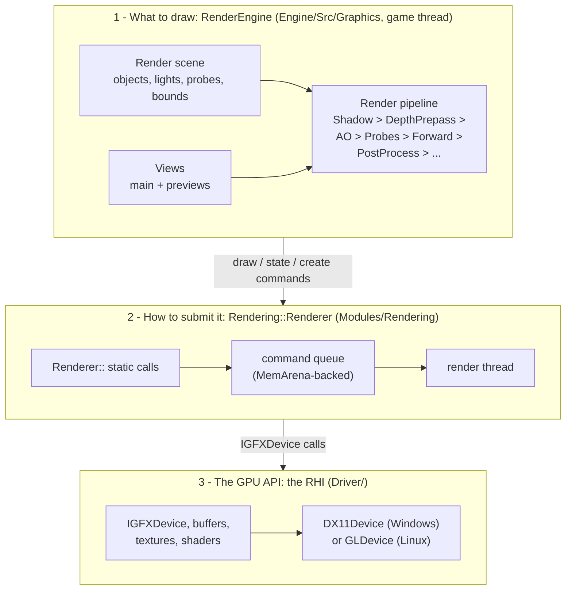
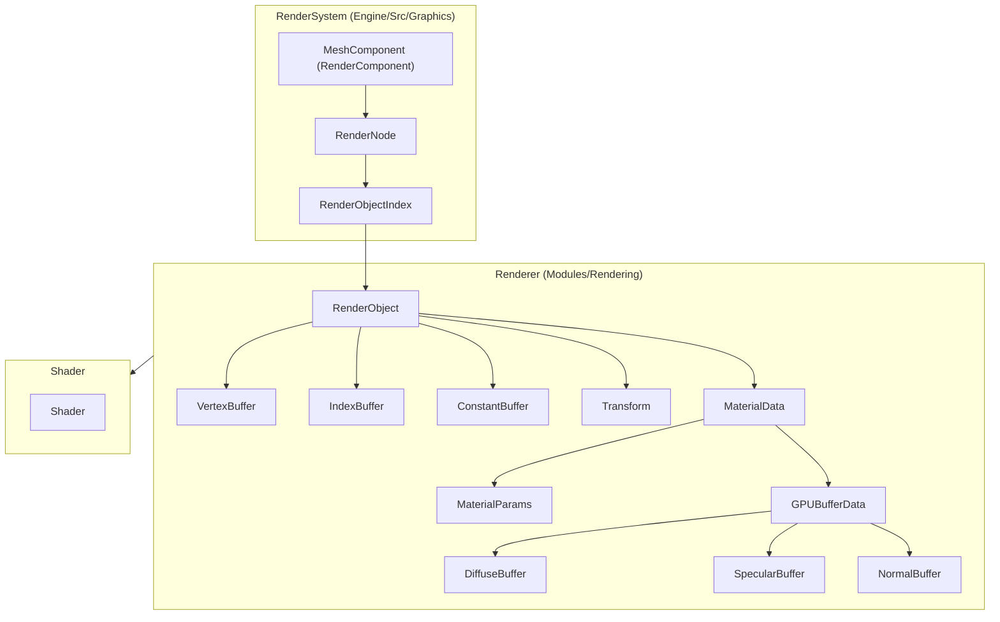

# Rendering: Overview & Design Philosophy

RZE renders with DirectX 11 on Windows and OpenGL 4.5 on Linux, the same way on both, split into three layers. Each layer only talks to the one below it, and only the bottom one knows the API:

| Layer | Answers | Main types | Read |
|---|---|---|---|
| **RenderEngine** | *What* is drawn, in which passes, from which views | `RenderEngine`, `RenderObject`, `RenderView`, `IRenderStage`, `RenderPipeline` | [Engine-Graphics-Layer.md](Engine-Graphics-Layer.md), [Render-Stages.md](Render-Stages.md) |
| **Renderer** | *How* work reaches the GPU without stalling the game | `Rendering::Renderer`, `RenderThread`, `RenderCommand_*`, handles | [Low-Level-Renderer-Module.md](Low-Level-Renderer-Module.md) |
| **Driver** | The graphics API's specifics, behind one interface | `IGFXDevice`; `DX11Device`, `DX11TextureBuffer2D`, ...; `GLDevice`, `GLTextureBuffer2D`, `GLShaderTranslator`, ... | [Low-Level-Renderer-Module.md](Low-Level-Renderer-Module.md#the-rhi-igfxdevice-and-the-backends) |

Assets feeding all this (meshes, materials, textures, shaders) are covered in [Materials-Meshes-Shaders.md](Materials-Meshes-Shaders.md).

## What a frame does, in plain terms

1. **Lights and shadows.** Upload the scene's lights. Re-render only the shadow maps whose light, or part of the scene, changed: the sun's when anything moved, and a point light's cube when it or something near it moved (otherwise reuse them).
2. **Depth and ambient occlusion.** Draw the visible objects' depth alone, then work out from it how much creases and corners hide each pixel from the light around it (GTAO, on compute shaders).
3. **Indirect light.** Capture what's around the scene's irradiance and reflection probes when the scene changes, and relight a budget of them each frame with the current lights, so light bounces and glossy surfaces reflect their surroundings.
4. **Scene.** Draw the visible objects over that depth, lit by the lights and shadowed, with ambient light from the probes darkened by the ambient occlusion, into an HDR image.
5. **Exposure and tonemapping.** Measure the image's average brightness, ease the exposure toward it, and squeeze HDR into displayable 8-bit colour with ACES. Then smooth jagged edges with FXAA.
6. **Overlays.** Draw debug lines (bounds, camera frustums) on top, depth-tested against the scene.
7. **UI.** Draw ImGui. The Editor shows the scene inside its scene view panel; the Game copies it to the screen.
8. **(Editor, on a click) Picking.** Work out which object is under the mouse.

All of this is *queued* on the game thread and *executed* on the render thread one frame behind, so the game can prepare frame N+1 while the GPU draws frame N.

## Conventions worth knowing

- **Clip-space depth is D3D's 0..1**, not OpenGL's usual −1..1, on both APIs: the OpenGL backend sets it with `glClipControl`. Projections come from `Matrix4x4::CreatePerspectiveMatrixZeroToOne` / `CreateOrthoMatrixZeroToOne`, and `Frustum` assumes it.
- **Matrices are glm, column-major, multiplied `projection * view * world`.** `RenderCamera::ClipSpace` is `projection * view`, and `RenderCamera::Projection` the projection alone (for passes that rebuild positions from depth).
- **World units are metres, Y is up and the world is right-handed** (`Utils/Math/Units.h`).
- **HDR until the end.** The forward pass writes linear `RGBA16_FLOAT`; only post-processing converts to 8-bit sRGB.

## Where the design came from (2020 notes)

The engine's own design notes (`Docs\RenderSystemThoughts.txt`, `Docs\Render_Architexture_2020.txt`) describe the split as **RenderSystem** vs **Renderer**:

> "RenderSystem" is conventionally what people mean by "a rendering engine" — it uses composition to prepare the scene (culling, pass management/population) and submits render commands that determine per-frame render state. "Renderer" is written with intimate knowledge of the hardware API; its sole job is to organize/issue draw calls to the GPU as fast as possible, exploiting hardware-specific nuances.

| Design-doc term | Actual code today | Lives in |
|---|---|---|
| RenderSystem | `RenderEngine` + the `IRenderStage` pipeline | `Engine\Src\Graphics\` |
| Renderer (called "Diotima" in one internal note) | `Rendering::Renderer` + `RenderThread` | `Modules\Rendering\` |
| Driver API | `Rendering::IGFXDevice`, with `DX11Device` or `GLDevice` and friends | `Modules/Rendering/Src/Rendering/Driver/` (`DX11/`, `OpenGL/`) |

The notes list RenderSystem's intended jobs as: keeping render state in sync with component add/remove/modify, **bucketing** RenderObjects into passes (e.g. shadow casters), **culling** to what the view can see, and sending creation/update requests to the Renderer. **Culling is implemented today** (per object and per submesh, in the depth prepass, forward, shadow-fitting, probe capture and pick passes). **Bucketing isn't**: each stage still walks the whole render-object list, and every submesh is its own draw call (see [10-KnownIssues](../10-KnownIssues/Architectural-Notes-And-TODOs.md)).

### Layered decomposition (reproduced from `DrawIO\Render_Decomposition_March2021.drawio`)

This was a design sketch. The diffuse/specular/normal texture-slot scheme it shows is what `MaterialInstance` implements ([Materials-Meshes-Shaders.md](Materials-Meshes-Shaders.md)); `RenderNode`/`RenderObjectIndex` never materialised, and `RenderObject` lives in the Engine layer rather than in the Renderer module.

The same notes end on a question that's still worth keeping in mind: *"Should we build the render data every frame — hold buffer state?"* Today, draw commands are rebuilt every frame, while expensive results (the shadow maps, the probes' captures, render-object bounds) are cached and only recomputed when the scene's revision or a transform changes.

## Read next

- [Render-Stages.md](Render-Stages.md) — the pipeline and every stage, with diagrams
- [Engine-Graphics-Layer.md](Engine-Graphics-Layer.md) — `RenderEngine`, render objects, views, the frame lifecycle
- [Materials-Meshes-Shaders.md](Materials-Meshes-Shaders.md) — asset representation hierarchy
- [Low-Level-Renderer-Module.md](Low-Level-Renderer-Module.md) — the command-buffer render thread, the RHI, and the DX11 and OpenGL backends
