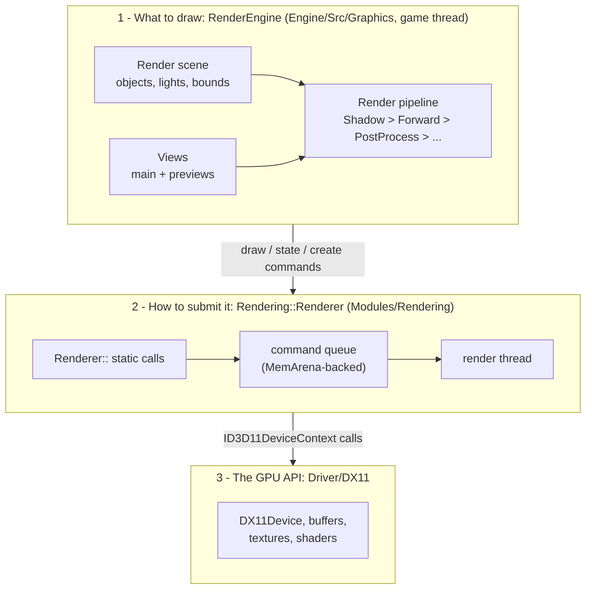
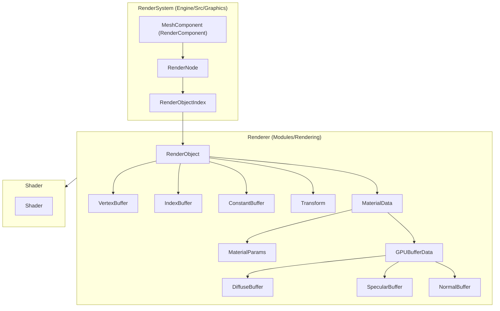

# Rendering: Overview & Design Philosophy

RZE renders with DirectX 11, split into three layers. Each layer only talks to the one below it:

| Layer | Answers | Main types | Read |
|---|---|---|---|
| **RenderEngine** | *What* is drawn, in which passes, from which views | `RenderEngine`, `RenderObject`, `RenderView`, `IRenderStage`, `RenderPipeline` | [Engine-Graphics-Layer.md](Engine-Graphics-Layer.md), [Render-Stages.md](Render-Stages.md) |
| **Renderer** | *How* work reaches the GPU without stalling the game | `Rendering::Renderer`, `RenderThread`, `RenderCommand_*`, handles | [Low-Level-Renderer-Module.md](Low-Level-Renderer-Module.md) |
| **Driver** | The D3D11 specifics | `DX11Device`, `DX11TextureBuffer2D`, ... | [Low-Level-Renderer-Module.md](Low-Level-Renderer-Module.md) |

Assets feeding all this (meshes, materials, textures, shaders) are covered in [Materials-Meshes-Shaders.md](Materials-Meshes-Shaders.md).

## What a frame does, in plain terms

1. **Shadows.** If anything moved, re-render the sun's shadow map (otherwise reuse it).
2. **Scene.** Cull objects outside the camera's view, then draw the rest, lit and shadowed, into an HDR image.
3. **Exposure and tonemapping.** Measure the image's average brightness, ease the exposure toward it, and squeeze HDR into displayable 8-bit colour with ACES. Then smooth jagged edges with FXAA.
4. **Overlays.** Draw debug lines (bounds, camera frustums) on top, depth-tested against the scene.
5. **UI.** Draw ImGui. The Editor shows the scene inside its scene view panel; the Game copies it to the screen.
6. **(Editor, on a click) Picking.** Work out which object is under the mouse.

All of this is *queued* on the game thread and *executed* on the render thread one frame behind, so the game can prepare frame N+1 while the GPU draws frame N.

## Conventions worth knowing

- **Clip-space depth is D3D's 0..1**, not OpenGL's −1..1. Projections come from `Matrix4x4::CreatePerspectiveMatrixZeroToOne` / `CreateOrthoMatrixZeroToOne`, and `Frustum` assumes it.
- **Matrices are glm, column-major, multiplied `projection * view * world`.** `RenderCamera::ClipSpace` is `projection * view`.
- **World units are metres, Y is up and the world is right-handed** (`Utils/Math/Units.h`).
- **HDR until the end.** The forward pass writes linear `RGBA16_FLOAT`; only post-processing converts to 8-bit sRGB.

## Where the design came from (2020 notes)

The engine's own design notes (`Docs\RenderSystemThoughts.txt`, `Docs\Render_Architexture_2020.txt`) describe the split as **RenderSystem** vs **Renderer**:

> "RenderSystem" is conventionally what people mean by "a rendering engine" — it uses composition to prepare the scene (culling, pass management/population) and submits render commands that determine per-frame render state. "Renderer" is written with intimate knowledge of the hardware API; its sole job is to organize/issue draw calls to the GPU as fast as possible, exploiting hardware-specific nuances.

| Design-doc term | Actual code today | Lives in |
|---|---|---|
| RenderSystem | `RenderEngine` + the `IRenderStage` pipeline | `Engine\Src\Graphics\` |
| Renderer (called "Diotima" in one internal note) | `Rendering::Renderer` + `RenderThread` | `Modules\Rendering\` |
| Driver API | `Rendering::DX11Device` and friends | `Modules\Rendering\Src\Rendering\Driver\DX11\` |

The notes list RenderSystem's intended jobs as: keeping render state in sync with component add/remove/modify, **bucketing** RenderObjects into passes (e.g. shadow casters), **culling** to what the view can see, and sending creation/update requests to the Renderer. **Culling is implemented today** (per object and per submesh, in the forward, shadow-fitting and pick passes). **Bucketing isn't**: each stage still walks the whole render-object list, and every submesh is its own draw call (see [10-KnownIssues](../10-KnownIssues/Architectural-Notes-And-TODOs.md)).

### Layered decomposition (reproduced from `DrawIO\Render_Decomposition_March2021.drawio`)

This was a design sketch. The diffuse/specular/normal texture-slot scheme it shows is what `MaterialInstance` implements ([Materials-Meshes-Shaders.md](Materials-Meshes-Shaders.md)); `RenderNode`/`RenderObjectIndex` never materialised, and `RenderObject` lives in the Engine layer rather than in the Renderer module.

The same notes end on a question that's still worth keeping in mind: *"Should we build the render data every frame — hold buffer state?"* Today, draw commands are rebuilt every frame, while expensive results (the shadow map, render-object bounds) are cached and only recomputed when `SceneData::revision` or a transform changes.

## Read next

- [Render-Stages.md](Render-Stages.md) — the pipeline and every stage, with diagrams
- [Engine-Graphics-Layer.md](Engine-Graphics-Layer.md) — `RenderEngine`, render objects, views, the frame lifecycle
- [Materials-Meshes-Shaders.md](Materials-Meshes-Shaders.md) — asset representation hierarchy
- [Low-Level-Renderer-Module.md](Low-Level-Renderer-Module.md) — the command-buffer render thread and DX11 driver layer
