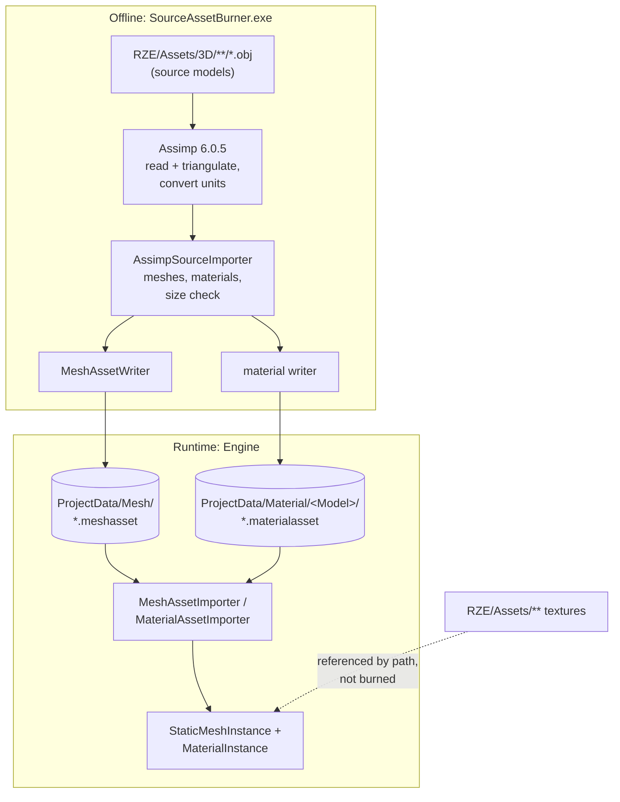
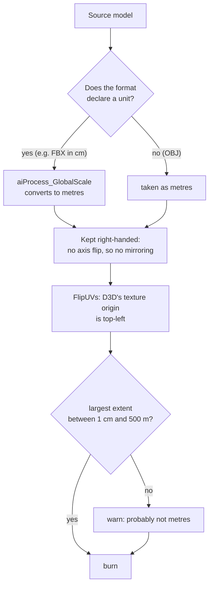

# Asset Burning Pipeline

RZE never loads `.obj` / `.fbx` models at runtime. A separate tool, **SourceAssetBurner**, converts ("burns") them ahead of time into RZE's own binary formats, and the engine only ever reads those.



The offline and runtime halves share only the binary format, not code paths. Loading the burned files is covered in [Asset-Import-Runtime.md](Asset-Import-Runtime.md).

## Running it

```powershell
.\RZE\_build\debug\SourceAssetBurner.exe            # burn every .obj under RZE\Assets\3D
.\RZE\_build\debug\SourceAssetBurner.exe <file>     # burn one source file
```

It takes about 15 seconds for everything. **`ProjectData/` isn't tracked in git**, so burn once after cloning, and again after pulling any change to the importer, such as the coordinate fix below. Burns are **deterministic**: burning the same source twice gives byte-identical files.

## What the importer does (`AssimpSourceImporter`)

1. **Read** with Assimp: `aiProcessPreset_TargetRealtime_Fast | aiProcess_FlipUVs | aiProcess_OptimizeMeshes | aiProcess_OptimizeGraph | aiProcess_GlobalScale`.
2. **Walk the node graph** (`ProcessNode` / `ProcessMesh`): per-vertex position, normal, UV and tangent, plus indices, into `MeshData`. Missing normals are tolerated.
3. **Read materials**: shininess (Assimp 6 reports a raw Phong exponent, ×4 for the engine's Blinn-Phong), opacity, and texture paths. glTF-style materials fall back to `BASE_COLOR` / `NORMAL_CAMERA`. A bit set records which textures exist:

    | Flag | Texture |
    |---|---|
    | `TEXTUREFLAG_ALBEDO` | diffuse / base colour |
    | `TEXTUREFLAG_SPECULAR` | specular |
    | `TEXTUREFLAG_NORMAL` | normal map |
    | `TEXTUREFLAG_OPACITY` | cutout mask |
    | `TEXTUREFLAG_HEIGHT` | height map |
    | `TEXTUREFLAG_OPACITY_IN_ALPHA` | the cutout is the diffuse texture's alpha |

    These flags decide the material's pixel shader at runtime ([Materials-Meshes-Shaders.md](../04-Rendering/Materials-Meshes-Shaders.md)).
4. **Check the size**: if the model's largest dimension is under 1 cm or over 500 m, it logs a warning that the source probably isn't in metres. It still imports as-is; scale it per instance in the Editor, where the RenderComponent inspector shows the size in metres.
5. **Write** the mesh (`MeshAssetWriter`) and each material (deduplicated by output path).

Textures aren't converted: materials store paths back into `RZE\Assets\`, and `WriteTextureAsset()` is a stub.

## Units and handedness

The engine's conventions (`Utils/Math/Units.h`) are **1 unit = 1 metre, right-handed, +Y up, −Z forward**. The importer keeps models in that space:



- **No mirroring.** The importer used to apply `aiProcess_MakeLeftHanded`, which negated Z on every mesh, so every model appeared as its mirror image (text read backwards). It no longer does. Front faces are now counter-clockwise, as authored, and normal mapping uses `bitangent = cross(normal, tangent)`. Existing scenes were mirrored across Z at the same time so their layouts didn't change.
- **Metres.** Existing scenes were rescaled once so that 1 unit = 1 m (e.g. Sponza's centimetre source now sits at scale 0.01, and characters are about 1.8 m tall).

## The binary mesh format

Defined in `Engine\Src\Asset\AssetImport\MeshAssetWriter.h/.cpp`:

```
MeshAssetFileHeader { uint16_t AssetVersion; size_t BufSize; size_t MeshCount; }   // zeroed first, so padding is deterministic
per mesh:
    name length + bytes
    material-path length + bytes
    vertex-data length + raw MeshVertex array bytes
    index-data length + raw U32 array bytes
```

Materials are hand-serialised with `ByteStream` to `ProjectData\Material\<Model>\<Material>.materialasset` (JSON was tried first and was too large).

## Output layout

- `RZE\ProjectData\Mesh\*.meshasset`
- `RZE\ProjectData\Material\<ModelName>\*.materialasset`

This is the "cooked" counterpart of `RZE\Assets\3D\`. The Editor reads it from the source tree; the Game reads the copy that `AssetCpy.bat` puts in `_build\<config>` (see [Building-And-Running.md](../01-GettingStarted/Building-And-Running.md)).

## Key files

- `SourceAssetBurner\Src\SourceAssetBurner\SourceAssetBurnerMain.cpp`
- `SourceAssetBurner\Src\SourceAssetBurner\Importers\SourceImporter.h`, `AssimpSourceImporter.h/.cpp`
- `Engine\Src\Asset\AssetImport\AssetWriter.h`, `MeshAssetWriter.h/.cpp`
- `Utils\Src\Utils\Math\Units.h` — the unit and axis conventions
