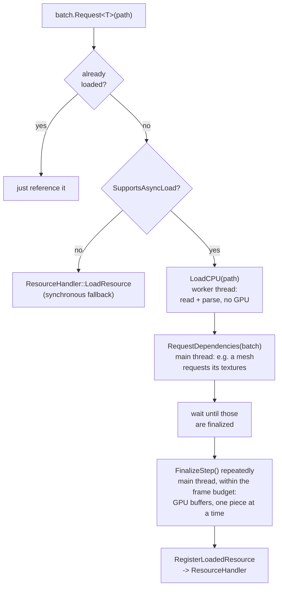
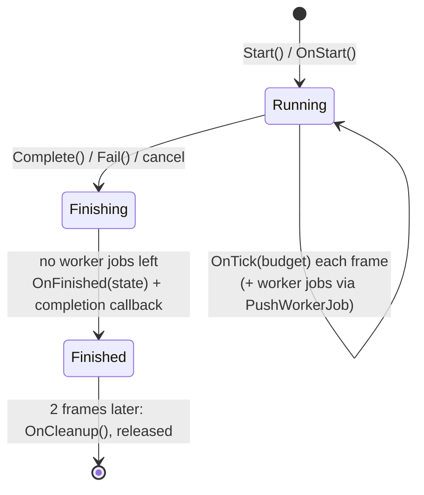
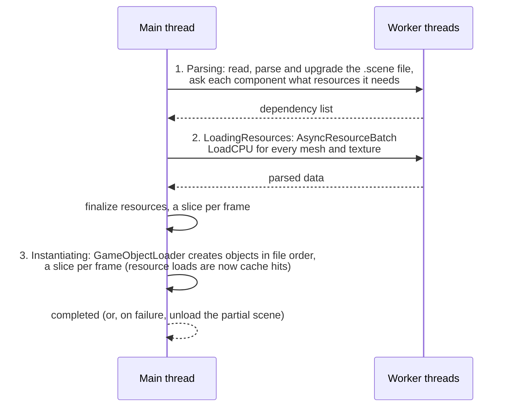

# Runtime Asset Import & Resource Loading

How burned `.meshasset` / `.materialasset` files (see [Asset-Burning-Pipeline.md](Asset-Burning-Pipeline.md)) and textures get loaded at runtime, and how `ResourceHandler` keeps track of them.

There are **two ways to load** a resource:

| | Synchronous | Asynchronous |
|---|---|---|
| Call | `ResourceHandler::LoadResource<T>(path)` | `AsyncResourceBatch::Request<T>(path)`, inside an `AsyncOperation` |
| Where the work runs | All on the main thread, right away | File reading and parsing on worker threads; GPU uploads on the main thread, a little each frame |
| Stalls the frame? | Yes, for the whole load | No; it's time-sliced by a per-frame budget |
| Used by | One-off loads: shaders, config, picking a mesh in the inspector | **Scene loading** (`SceneLoadOperation`), **preloading** (`ResourcePreloadOperation`) |

Both end in the same place: a resource registered in `ResourceHandler`, reached through a `ResourceHandle`.

## `ResourceHandler` (`Engine\Src\EngineCore\Resources\`)

A reference-counted table of loaded resources, keyed by a string made from the file path. **Main thread only**: the table and the reference counts aren't synchronised.

```cpp
ResourceHandle LoadResource<ResourceT>(const Filepath& path, Args... args); // load, or reuse if already loaded
const ResourceT* GetResource<ResourceT>(const ResourceHandle& handle);      // no type check: ask for the right type
bool HasResource(const Filepath& path) const;
ResourceHandle GetHandle(const Filepath& path);                             // empty handle if it isn't loaded
ResourceHandle RegisterLoadedResource(const Filepath& path, IResource* r);  // adopt a resource loaded elsewhere (async)
void ReleaseResource(ResourceHandle& handle);
```

`ResourceHandle` is a move-only handle; when the last handle to a resource goes, the resource is released. Resources implement `IResource` (`Utils\Src\Utils\Interfaces\Resource.h`): `Load(path)` and `Release()`, plus the optional async hooks below.

Used for `StaticMeshResource`, `MaterialResource`, `Texture2D`, `VertexShader` / `PixelShader`, and engine config.

## Async loading, step by step

A resource opts in by returning `true` from `SupportsAsyncLoad()` and splitting its load in two. Today `StaticMeshResource`, `MaterialResource` and `Texture2D` do; anything else requested through a batch falls back to a normal synchronous load.



- **`LoadCPU`** may not touch the renderer, the `ResourceHandler` or any other engine state; it only reads and decodes.
- **`GetNextFinalizeStepCost`** tells the batch how big the next step is (bytes copied into the render command arena, bytes uploaded to the GPU), so it can be pushed to a later frame if it won't fit. `StaticMeshResource` finalizes one submesh (its GPU buffers) per step, and makes the mesh's materials with the last.
- Because a mesh's or material's textures are its dependencies, they're always finalized first, so when the materials are made, their texture lookups are cache hits.
- The batch holds every resolved resource until `ReleaseHeldResources()`, so nothing is unloaded before whoever asked for it picks it up.
- **Loads in flight are shared.** A batch asking for a resource another batch is already loading (`ResourceHandler::TryBeginAsyncLoad` returns false) waits for that load and takes a handle to the result, instead of reading and uploading it a second time. If the other load fails or is cancelled, the waiting batch loads it itself. This matters once two scenes load at once, e.g. the editor's scene and a thumbnail's.

### Preloading: `ResourcePreloadOperation`

`ResourcePreloadOperation` (`Engine\Src\EngineCore\Resources\ResourcePreloadOperation.h/.cpp`) loads a list of resources and their dependencies through a batch, then **keeps them loaded for as long as the operation is held**. Whoever started it can then use them without stalling the main thread:
- `GetHandle(path)` returns the handle to a resource it was asked for (or one that pulled in) as soon as that has loaded, even while it's still loading others. It returns an empty handle for one that failed, hasn't loaded yet, or wasn't asked for, and loads nothing. The handle is a reference of its own, so it keeps the resource loaded after the operation is gone. This is how a mesh is swapped at runtime: `StaticMeshResource::CreateInstance(handle)`, then `RenderComponent::SetMeshInstance` ([Materials-Meshes-Shaders.md](../04-Rendering/Materials-Meshes-Shaders.md#swapping-a-mesh-at-runtime)).
- Or load them synchronously, e.g. `RenderComponent::LoadMesh`, as a cache hit.

A resource that fails is logged and left out; the operation still succeeds. `HeadlessScene::Preload` uses it for mesh thumbnails.

## Releasing resources

A resource can't be destroyed the moment its last handle goes: the render thread runs a frame behind, so a command queued this frame (an upload, a draw) may still read its memory. So **every** resource the `ResourceHandler` destroys, whether released or discarded, goes through `DestroyWhenRendered`:

1. It's taken out of the table straight away, tagged with the frame being recorded (`Renderer::GetRecordingFrame()`).
2. `ResourceHandler::Update()`, once a frame after present, destroys the ones whose frame the render thread has finished (`Renderer::IsFrameProcessed`).
3. At shutdown, `DestroyPendingNow()` destroys the rest once the render thread is idle, before the renderer shuts down ([Engine-Startup-And-Frame-Loop.md](../02-Architecture/Engine-Startup-And-Frame-Loop.md#shutdown)).

So a resource can be released in the same frame it was uploaded or drawn in. Code that releases something no longer has to wait frames itself.

## Async operations

Long-running work, like loading a scene or building the game, runs as an **`AsyncOperation`** (`Engine\Src\EngineCore\Async\`), driven by `AsyncOperationManager` (`RZE().GetAsyncOperationManager()`).



- **Threading rules:** progress, status text and cancellation can be set from any thread. Every hook and the completion callback run on the main thread. The manager won't finish an operation while any of its worker jobs are still running, so jobs can safely capture `this`.
- **Frame budget** (`AsyncFrameBudget`): shared by the foreground operations each frame. It allows **8 ms** of main-thread time and **16 MB** of GPU uploads (soft limits; the first piece of work each frame always runs, so everything makes progress), and leaves **8 MB** of headroom in the render command arena (a hard limit). Background operations get a budget of their own on top (below).
- **Flags** (`EAsyncOperationFlags`, combinable):

  | Flag | Meaning |
  |---|---|
  | `Blocking` | Blocks the user. The Editor shows its progress modal for the oldest one (`GetBlockingOperation`). |
  | `Hidden` | Left out of progress displays (`GetVisibleOperations`), e.g. a step another operation already reports on: a scene thumbnail's load, a PNG save. |
  | `Background` | Work nobody is waiting on. It's ticked **after** every foreground operation, with **2 ms** of main-thread time and a quarter of the upload allowance of its own, so it always progresses but never takes much of a frame. Its worker jobs go to the [background lane](../06-Platform-And-Infrastructure/Threading-And-Jobs.md#background-work). It keeps going while a `Blocking` operation runs. |

- **History:** `LogStep(text)` and `AddWarning(text)` add timestamped entries (`GetLoggedSteps`). A warning doesn't stop the operation, which can still succeed with warnings. The Editor's status bar shows them ([Status-Bar-And-Settings.md](../07-Editor/Status-Bar-And-Settings.md)).
- **Retiring:** an operation is only released two frames after it finishes, because the render thread may still be using data it submitted (see [Low-Level-Renderer-Module.md](../04-Rendering/Low-Level-Renderer-Module.md)).
- **Progress:** `WeightedProgress` blends several stages of different cost into one 0–1 value that never goes backwards. Operations flagged `Blocking` get the Editor's progress modal automatically.
- **`JobAsyncOperation`** wraps a single worker-thread function (the Editor's Build/Launch uses it).

## Loading a scene: `SceneLoadOperation`

`Engine\Src\Game\SceneLoadOperation.h/.cpp` loads a `.scene` file into a `GameScene` in three phases. The engine loads into the active scene, `Blocking`. A [`HeadlessScene`](../03-SceneAndGameObjects/Scene-And-GameObject-Model.md#headlessscene-a-scene-rendered-off-screen) loads into its own, `Background | Hidden`; the operation holds that scene by `shared_ptr`, so it stays alive until the load finishes even if its owner lets go.



Parsing also runs `SceneFormat::Upgrade`, so an older scene file is converted to the current format before anything reads it, and instantiating links each object to its parent by GUID; see [Scene-And-GameObject-Model.md](../03-SceneAndGameObjects/Scene-And-GameObject-Model.md#scene-files).

Components say what they need with a static `GatherResourceDependencies(componentData, outDependencies)` registered with `GameObjectComponentRegistry`; `RenderComponent` lists its mesh, and the materials and textures its material overrides swap in. Gathering everything up front is what lets the heavy loading happen before any objects exist.

## Importers (`Engine\Src\Asset\AssetImport\`)

- `MeshAssetImporter` reads the `.meshasset` format back into submesh data, placements and each submesh's material (name, path and `MaterialData`).
- `MaterialAssetImporter` reads `.materialasset` (versions 0 to 2) into `MaterialData`, which `MaterialInstance::Create` turns into a material. Older versions read as they drew: version 0 has no blend mode (cutout with an opacity mask, otherwise opaque), and versions 0 and 1 have no tint (white with a diffuse texture, grey without).
- `StaticMeshResource` (`Engine\Src\Game\StaticMeshResource.h/.cpp`) is the `IResource` for a mesh asset. It makes one shared, immutable `StaticMesh`, and `CreateInstance(handle)` gives each object its own `StaticMeshInstance` of it, holding the handle so the asset stays loaded ([Materials-Meshes-Shaders.md](../04-Rendering/Materials-Meshes-Shaders.md)).
- `MaterialResource` (`Engine\Src\Graphics\MaterialResource.h/.cpp`) is the `IResource` for one material asset loaded on its own, which a material slot's overrides can swap in.

## Key files

- `Engine\Src\EngineCore\Resources\ResourceHandler.h/.cpp`, `AsyncResourceBatch.h/.cpp`, `ResourceDependencyList.h`, `ResourcePreloadOperation.h/.cpp`
- `Engine\Src\EngineCore\Async\` — `AsyncOperation`, `AsyncOperationManager`, `AsyncFrameBudget`, `JobAsyncOperation`, `WeightedProgress`
- `Engine\Src\Game\SceneLoadOperation.h/.cpp`, `StaticMeshResource.h/.cpp`
- `Engine\Src\Graphics\MaterialResource.h/.cpp`
- `Engine\Src\Asset\AssetImport\MeshAssetImporter.h/.cpp`, `MaterialAssetImporter.h/.cpp`
- `Utils\Src\Utils\Interfaces\Resource.h` — `IResource`
