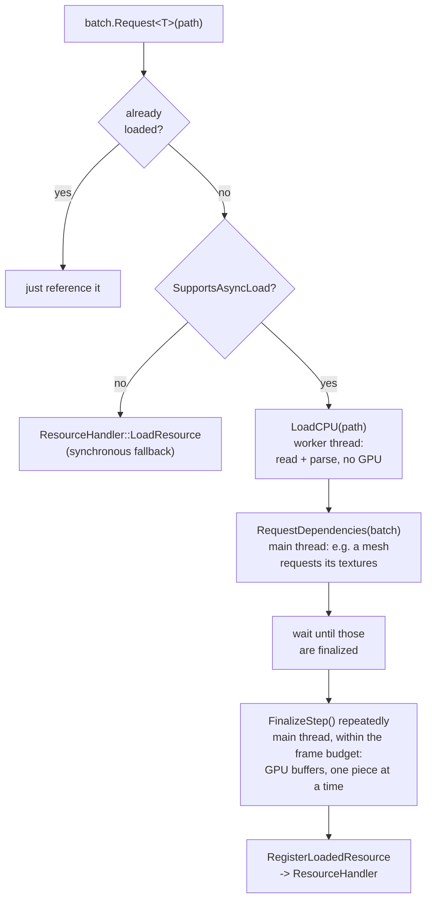
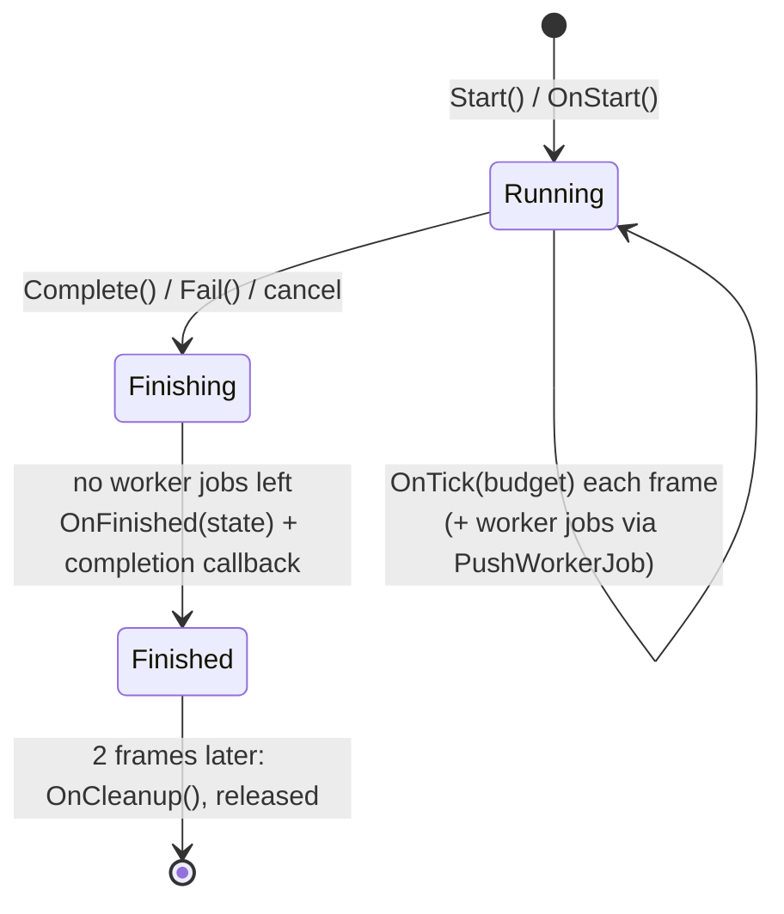
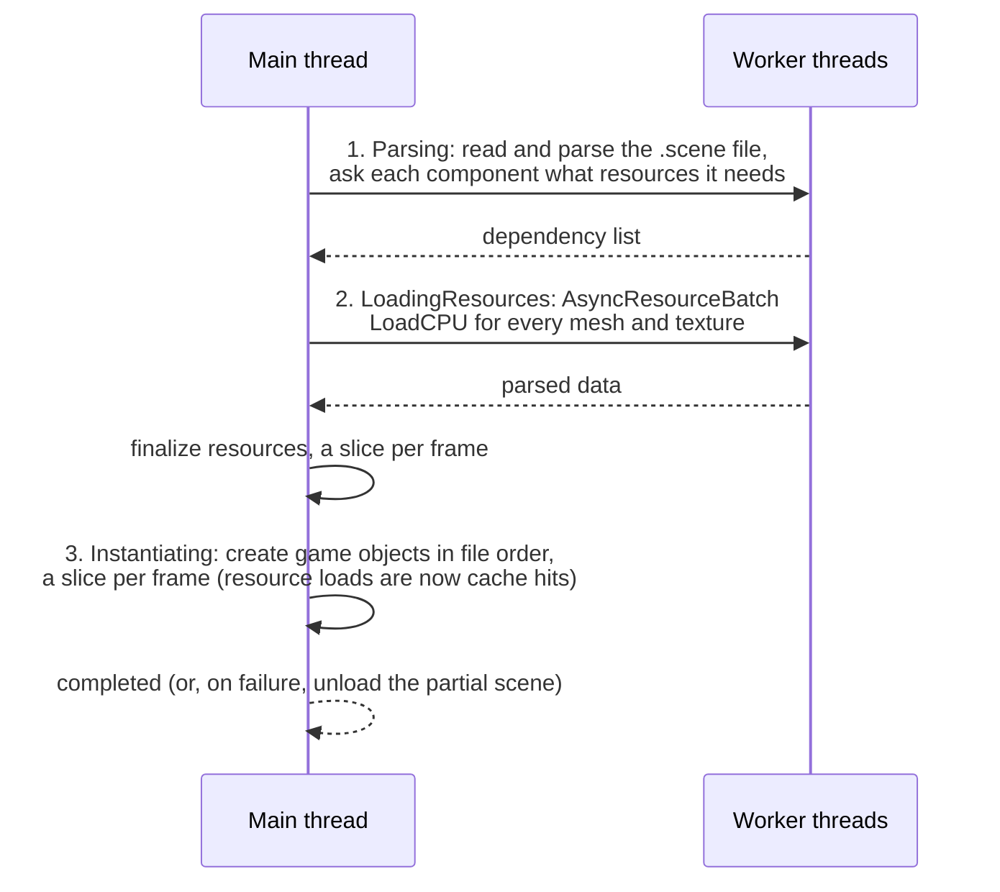

# Runtime Asset Import & Resource Loading

How burned `.meshasset` / `.materialasset` files (see [Asset-Burning-Pipeline.md](Asset-Burning-Pipeline.md)) and textures get loaded at runtime, and how `ResourceHandler` keeps track of them.

There are **two ways to load** a resource:

| | Synchronous | Asynchronous |
|---|---|---|
| Call | `ResourceHandler::LoadResource<T>(path)` | `AsyncResourceBatch::Request<T>(path)`, inside an `AsyncOperation` |
| Where the work runs | All on the main thread, right away | File reading and parsing on worker threads; GPU uploads on the main thread, a little each frame |
| Stalls the frame? | Yes, for the whole load | No; it's time-sliced by a per-frame budget |
| Used by | One-off loads: shaders, config, "Select Mesh..." in the inspector | **Scene loading** (`SceneLoadOperation`) |

Both end in the same place: a resource registered in `ResourceHandler`, reached through a `ResourceHandle`.

## `ResourceHandler` (`Engine\Src\EngineCore\Resources\`)

A reference-counted table of loaded resources, keyed by a string made from the file path. **Main thread only**: the table and the reference counts aren't synchronised.

```cpp
ResourceHandle LoadResource<ResourceT>(const Filepath& path, Args... args); // load, or reuse if already loaded
const ResourceT* GetResource<ResourceT>(const ResourceHandle& handle);      // no type check: ask for the right type
bool HasResource(const Filepath& path) const;
ResourceHandle GetHandle(const Filepath& path);                             // empty handle if it isn't loaded
ResourceHandle RegisterLoadedResource(const Filepath& path, IResource* r);  // adopt a resource loaded elsewhere (async)
void ReleaseResource(ResourceHandle& handle);
```

`ResourceHandle` is a move-only handle; when the last handle to a resource goes, the resource is released. Resources implement `IResource` (`Utils\Src\Utils\Interfaces\Resource.h`): `Load(path)` and `Release()`, plus the optional async hooks below.

Used for `StaticMeshResource`, `Texture2D`, `VertexShader` / `PixelShader`, and engine config.

## Async loading, step by step

A resource opts in by returning `true` from `SupportsAsyncLoad()` and splitting its load in two. Today `StaticMeshResource` and `Texture2D` do; anything else requested through a batch falls back to a normal synchronous load.



- **`LoadCPU`** may not touch the renderer, the `ResourceHandler` or any other engine state; it only reads and decodes.
- **`GetNextFinalizeStepCost`** tells the batch how big the next step is (bytes copied into the render command arena, bytes uploaded to the GPU), so it can be pushed to a later frame if it won't fit. `StaticMeshResource` finalizes one submesh (material and GPU buffers) per step.
- Because a mesh's textures are its dependencies, they're always finalized first, so when the mesh builds its materials, its texture lookups are cache hits.
- The batch holds every resolved resource until `ReleaseHeldResources()`, so nothing is unloaded before whoever asked for it picks it up.

## Async operations

Long-running work, like loading a scene or building the game, runs as an **`AsyncOperation`** (`Engine\Src\EngineCore\Async\`), driven by `AsyncOperationManager` (`RZE().GetAsyncOperationManager()`).



- **Threading rules:** progress, status text and cancellation can be set from any thread. Every hook and the completion callback run on the main thread. The manager won't finish an operation while any of its worker jobs are still running, so jobs can safely capture `this`.
- **Frame budget** (`AsyncFrameBudget`): shared by all operations each frame. It allows **8 ms** of main-thread time and **16 MB** of GPU uploads (soft limits; the first piece of work each frame always runs, so everything makes progress), and leaves **8 MB** of headroom in the render command arena (a hard limit).
- **Retiring:** an operation is only released two frames after it finishes, because the render thread may still be using data it submitted (see [Low-Level-Renderer-Module.md](../04-Rendering/Low-Level-Renderer-Module.md)).
- **Progress:** `WeightedProgress` blends several stages of different cost into one 0–1 value that never goes backwards. Operations flagged `Blocking` get the Editor's progress modal automatically.
- **`JobAsyncOperation`** wraps a single worker-thread function (the Editor's Build/Launch uses it).

## Loading a scene: `SceneLoadOperation`

`Engine\Src\Game\SceneLoadOperation.h/.cpp` loads a `.scene` file into the active scene in three phases:



Components say what they need with a static `GatherResourceDependencies(componentData, outDependencies)` registered with `GameObjectComponentRegistry`; `RenderComponent` lists its mesh. Gathering everything up front is what lets the heavy loading happen before any objects exist.

## Importers (`Engine\Src\Asset\AssetImport\`)

- `MeshAssetImporter` reads the `.meshasset` format back into submesh data.
- `MaterialAssetImporter` reads `.materialasset` into `MaterialData`, which `MaterialInstance::Create` turns into a material.
- `StaticMeshResource` (`Engine\Src\Game\StaticMeshResource.h/.cpp`) is the `IResource` that wraps both, and owns the resulting `StaticMeshInstance`. It's what `RenderComponent` holds.

## Key files

- `Engine\Src\EngineCore\Resources\ResourceHandler.h/.cpp`, `AsyncResourceBatch.h/.cpp`, `ResourceDependencyList.h`
- `Engine\Src\EngineCore\Async\` — `AsyncOperation`, `AsyncOperationManager`, `AsyncFrameBudget`, `JobAsyncOperation`, `WeightedProgress`
- `Engine\Src\Game\SceneLoadOperation.h/.cpp`, `StaticMeshResource.h/.cpp`
- `Engine\Src\Asset\AssetImport\MeshAssetImporter.h/.cpp`, `MaterialAssetImporter.h/.cpp`
- `Utils\Src\Utils\Interfaces\Resource.h` — `IResource`
