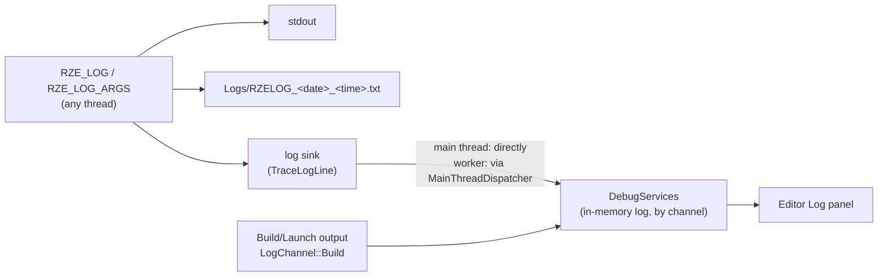

# Debug Services & Logging

## Where a log line goes



- **`RZE_LOG(msg)`** takes a stream expression (`RZE_LOG("Loaded " << count << " meshes")`).
- **`RZE_LOG_ARGS(fmt, ...)`** takes `printf` formatting (`RZE_LOG_ARGS("Render pipeline: %s", order.c_str())`), up to 1024 characters.
- Each line goes to stdout, to the session's log file under `Logs\`, and to the **log sink**. The engine sets the sink (`Debug::SetLogSink`) at start-up so every line also lands in `DebugServices`, which is what the Editor's Log panel shows. Lines logged on worker threads are posted to the main thread first, so `DebugServices` is only ever written from one thread.
- stdout only shows up when the process has a console; see [The console](#the-console).

### The console

The Editor and the Game are windowed apps (`/SUBSYSTEM:WINDOWS`), so they start without a console. On Windows 11 a console app's console opens in Windows Terminal, and that window came up after the app's own and took the foreground, so they opened unfocused. Their log is in the log file, and the Editor's is in its Log panel too. `-console` opens a console: `RZE_Application::ParseArguments` calls `Debug::OpenConsole()`, which allocates one and reopens stdout and stderr on it. Its window appears before the app's, which still ends up focused. SourceAssetBurner and UnitTests are console apps.

### Which builds have what

| | Debug | Release | Retail (`RZE_RETAIL`) |
|---|---|---|---|
| `RZE_LOG`, `RZE_LOG_ARGS`, `LOG_CONSOLE_ANNOUNCE` | ✓ | ✓ | compiled out |
| Asserts (`AssertExpr`, `AssertMsg`, ...) | ✓ | compiled out | compiled out |
| `START_TIMED_BLOCK` | ✓ | — | — |
| `IMGUI_ENABLED` (Game's ImGui) | ✓ | — | — |
| `DebugDrawRenderStage` (debug lines) | ✓ | ✓ | compiled out |

In Retail, the log macros still "use" their arguments in a dead branch, so variables that only feed a log line don't cause unused-variable warnings.

## Asserts (`Utils\Src\Utils\DebugUtils\Debug.h`)

`AssertFalse()`, `AssertEqual(a, b)`, `AssertIsNull(p)`, `AssertNotNull(p)`, `AssertExpr(expr)`, `AssertMsg(expr, "why")`. Debug builds only.

A failing assert:
1. writes `Assertion failed: <expression>, file <file>, line <n>` (and the message, if any, on a second line) to stderr and to the log, as one entry, so it reaches the log file and the Log panel without a console. An assert that fires while another is being logged, e.g. from the log sink, only goes to stderr, since logging it would recurse or block on the log file's lock;
2. shows the CRT assert dialog with the **expression and message**, in both console and windowed apps;
3. if you choose **Retry**, breaks into the debugger on the line of the failing assert (`__debugbreak` sits in the macro, not in a helper function). **Ignore** carries on, and **Abort** quits.

## `DebugServices` (`Engine\Src\DebugUtils\DebugServices.h/.cpp`)

A singleton in-memory log (`DebugServices::Get()`), with three channels:

| Channel | Used for | Colour in the Log panel |
|---|---|---|
| `LogChannel::Info` | Everything from `RZE_LOG` | white |
| `LogChannel::Debug` | Debug traces | white too: it's set to (255, 255, 1), which clamps to white; probably meant to be yellow |
| `LogChannel::Build` | Build/Launch output | grey |

`Trace(channel, text)` adds an entry in the channel's colour; `AddData(text, colour)` adds one in any colour. Entries are kept per channel too, so a UI could filter by channel. Main-thread only: post from other threads with `MainThreadDispatcher` (the log sink already does this).

## Timing a block

```cpp
{
    START_TIMED_BLOCK("Build navmesh");   // Debug only; ScopedHiResTimer
    ...
}
```

For frame-level profiling use Optick or PIX instead (see [Low-Level-Renderer-Module.md](../04-Rendering/Low-Level-Renderer-Module.md#profiling)).

## Frame time capture

`FrameTimeCapture` (`Engine\Src\DebugUtils\FrameTimeCapture.h/.cpp`, owned by `RZE_Engine`) records every frame's timings for A/B performance comparisons, in either app. It's off unless the command line asks for it:

| Argument | Meaning |
|---|---|
| `-perfcapture <file>` | Where to write the samples: one `frameMs,updateMs` line per frame. `updateMs` is the async operations' tick, the application's `PreUIUpdate`, `UpdateUI`, `Update` and `PreRender`, and the scene's update, but not ImGui's `NewFrame` and `EndFrame` or rendering. |
| `-perfwarmup <seconds>` | How long to wait before recording, e.g. for the scene to load (default 10) |
| `-perfduration <seconds>` | How long to record (default 15) |

When the duration is up it writes the file and the engine exits, so a script can launch the Editor or Game on a scene, wait for it to close and compare the files from two builds.

A capture runs **unpaced**, so it measures what frames cost and stays comparable with captures from before frames were paced: vsync, the frame rate caps and the UI frame rate are off, and every frame updates the UI. The pacing arguments still apply if given:

| Argument | Meaning |
|---|---|
| `-vsync 0/1` | Vsync off or on, over Engine.ini's `EnableVsync` |
| `-maxfps <N>` | Frame rate cap, over Engine.ini's `MaxFrameRate`; 0 for none |
| `-uifps <N>` | UI updates a second, over Engine.ini's `UIFrameRate`; 0 for every frame |

These work without `-perfcapture` too; see [Engine-Startup-And-Frame-Loop.md](../02-Architecture/Engine-Startup-And-Frame-Loop.md#settings). Integer arguments (`CmdLine::Arguments::GetInt`) log a value that isn't an integer and leave the default in place.

## Key files

- `Utils\Src\Utils\DebugUtils\Debug.h/.cpp` — macros, log file, log sink, assert dialog
- `Engine\Src\DebugUtils\DebugServices.h/.cpp`
- `Engine\Src\DebugUtils\FrameTimeCapture.h/.cpp`
- `Engine\Src\EngineCore\Engine.cpp` — `TraceLogLine`, the engine's log sink
- `Utils\Src\Utils\Platform\Timers\HiResTimer.h/.cpp`
