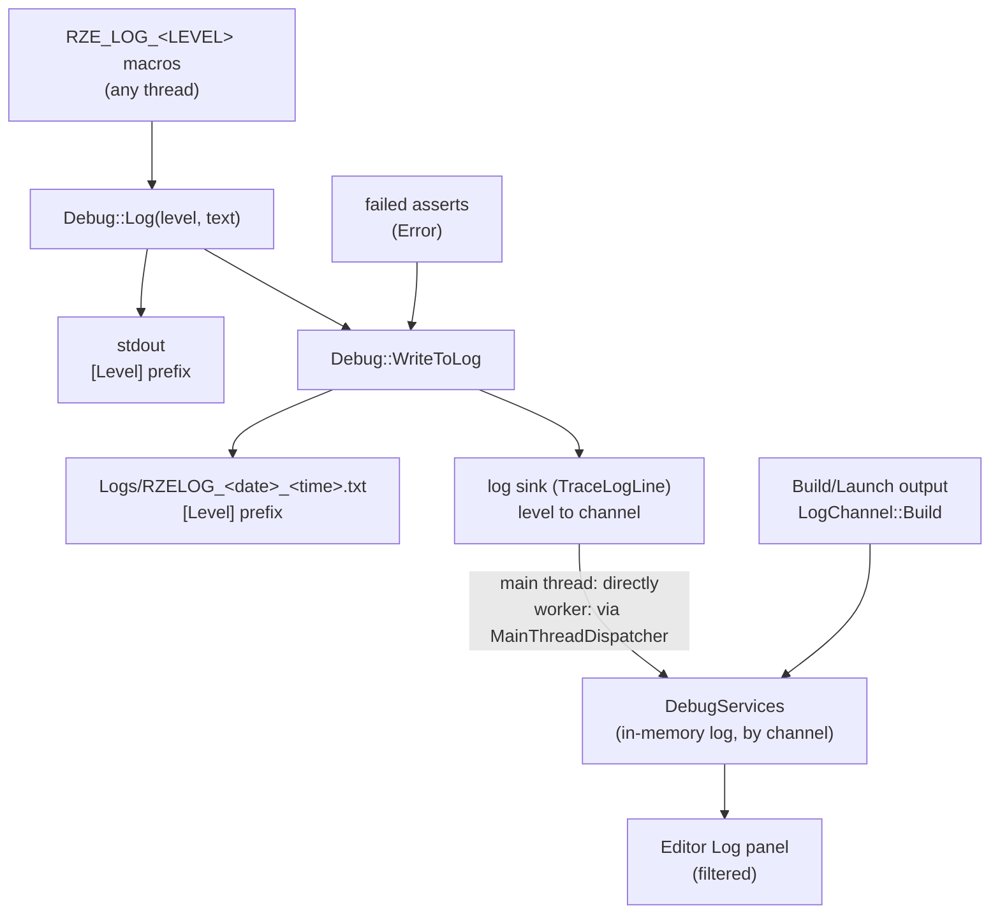

# Debug Services & Logging

## Where a log line goes



### Levels

Each line has a level (`Debug::ELogLevel`), and each level has a stream form and a `printf` form:

| Level | Stream form | `printf` form | Use it for |
|---|---|---|---|
| Debug | `RZE_LOG_DEBUG(msg)` | `RZE_LOG_DEBUG_ARGS(fmt, ...)` | High-volume detail: a line per resource created, made or released, `START_TIMED_BLOCK` timings, the importer's per-mesh progress |
| Info | `RZE_LOG(msg)` | `RZE_LOG_ARGS(fmt, ...)` | Start-up, shutdown and one-off status: the render pipeline's order, the scene being loaded, an asset written |
| Warning | `RZE_LOG_WARNING(msg)` | `RZE_LOG_WARNING_ARGS(fmt, ...)` | Something recovered or fell back: config defaults used, a material slot drawing the mesh's own material, a second main camera ignored, a shader that compiled with warnings |
| Error | `RZE_LOG_ERROR(msg)` | `RZE_LOG_ERROR_ARGS(fmt, ...)` | Something failed and its result is missing or wrong: an asset that won't read, a scene that won't load or save, a shader that won't compile, a job that threw |

- The stream form takes a stream expression (`RZE_LOG_WARNING("Loaded " << count << " of " << total << " meshes")`), with no length limit. The `printf` form takes `printf` formatting (`RZE_LOG_ARGS("Render pipeline: %s", order.c_str())`), up to 1024 characters, so text that could be long (a shader compiler's output) goes through the stream form.
- Every macro calls `Debug::Log(level, text)`. It writes the line to stdout and to the session's log file under `Logs\`, each starting with the level (`[Debug] `, `[Info] `, `[Warning] `, `[Error] `), and passes it to the **log sink** without the prefix.
- The engine sets the sink (`Debug::SetLogSink`) at start-up. Its `TraceLogLine` puts each line on its level's channel in `DebugServices`, which is what the Editor's Log panel shows, so there the colour says the level instead of a prefix. Lines logged on worker threads are posted to the main thread first, so `DebugServices` is only ever written from one thread.
- A failed assert is logged at Error (see Asserts, below).
- stdout only shows up when the process has a console; see [The console](#the-console).

Some messages used to go around the log, and now go through it: shader compile output (DX11: `DX11ShaderTypes.cpp`'s `LogCompileMessages`, Error if the compile failed and Warning if it compiled with warnings, which used to go only to Visual Studio's Output window; OpenGL: `GLShaderTypes.cpp` logs an Error with the translator's or the driver's message), the Editor's own messages (which reached the Log panel but not the log file), and the window being created (which went to stdout only). Two command-line messages in `CmdLine.cpp` still `printf` to stdout only, since they come before the log file exists.

### The console

On Windows, the Editor and the Game are windowed apps (`/SUBSYSTEM:WINDOWS`), so they start without a console. On Windows 11 a console app's console opens in Windows Terminal, and that window came up after the app's own and took the foreground, so they opened unfocused. Their log is in the log file, and the Editor's is in its Log panel too. `-console` opens a console: `RZE_Application::ParseArguments` calls `Debug::OpenConsole()`, which allocates one and reopens stdout and stderr on it. Its window appears before the app's, which still ends up focused. SourceAssetBurner, UnitTests and EditorHarness are console apps. Linux has no such split: every program has the terminal it was started from, if any, and `Debug::OpenConsole()` does nothing and returns true.

### Which builds have what

Development is everything Debug is, but optimized. Retail, the build that ships, strips the lot. Each row but the last is a macro in `Utils/Src/Utils/DebugUtils/DebugConfig.h`, defined unless `RZE_RETAIL` is, so code tests what it needs rather than which configuration it's in; the build settings are in [Building-And-Running.md](../01-GettingStarted/Building-And-Running.md#configurations).

| | Debug | Development | Retail (`RZE_RETAIL`) |
|---|---|---|---|
| The `RZE_LOG` macros, every level (`RZE_LOGGING_ENABLED`) | ✓ | ✓ | compiled out |
| Asserts (`AssertExpr`, `AssertMsg`, ..., `RZE_ASSERTS_ENABLED`) | ✓ | ✓ | compiled out |
| [`START_TIMED_BLOCK`](#timing-a-block) (with logging) | ✓ | ✓ | compiled out |
| The Game's ImGui (`IMGUI_ENABLED`) | ✓ | ✓ | — |
| [`RZE_DISABLE_OPTIMIZATION`](#reading-an-optimized-function-in-the-debugger) (`RZE_OPTIMIZATION_SWITCH_ENABLED`) | ✓ | ✓ | a compile error |
| [Graphics validation](#graphics-validation) (`RZE_GFX_VALIDATION_AVAILABLE`) | on | `-gfxvalidation` | — |
| `DebugDrawRenderStage` (debug lines) | ✓ | ✓ | compiled out |
| The debug CRT's report hook (Windows, `_DEBUG`) | ✓ | — | — |

In Retail, the log macros and `START_TIMED_BLOCK` still "use" their arguments in a dead branch, so variables that only feed a log line don't cause unused-variable warnings.

## Asserts (`Utils\Src\Utils\DebugUtils\Debug.h`)

`AssertFalse()`, `AssertEqual(a, b)`, `AssertIsNull(p)`, `AssertNotNull(p)`, `AssertExpr(expr)`, `AssertMsg(expr, "why")`. Debug and Development; Retail compiles them to nothing, so a variable only an assert reads is unused there, which clang rejects: put the whole check inside the assert.

A failing assert:
1. writes `Assertion failed: <expression>, file <file>, line <n>` (and the message, if any, on a second line) to stderr and to the log at Error, as one entry, so it reaches the log file and the Log panel without a console. An assert that fires while another is being logged, e.g. from the log sink, only goes to stderr, since logging it would recurse or block on the log file's lock;
2. on Windows, shows an assert dialog with the **expression and message**, in both console and windowed apps: the debug CRT's in Debug, and in Development, whose release CRT has none, a message box with the same buttons and meanings ("RZE: Assertion Failed"). **Retry** breaks into the debugger on the line of the failing assert (`RZE_DEBUG_BREAK()` sits in the macro, not in a helper function), **Ignore** carries on, and **Abort** quits;
3. on Linux, where there's no dialog to ask, breaks there only when a debugger is attached (`TracerPid` in `/proc/self/status`), as Retry would, and otherwise carries on, as Ignore would.

`Debug::SetAssertFailureHook(hook)` puts a function in place of the dialog or the break, on both platforms: the unit tests use it to turn an assert into a failed check ([Building-And-Running.md](../01-GettingStarted/Building-And-Running.md#unit-tests)). It's handed the report and returns whether to break. In Windows Debug builds it's installed as the debug CRT's report hook, so it sees the CRT's own errors too.

## `DebugServices` (`Engine\Src\DebugUtils\DebugServices.h/.cpp`)

A singleton in-memory log (`DebugServices::Get()`), with a channel per log level plus one for build output:

| Channel | Used for | Colour in the Log panel |
|---|---|---|
| `LogChannel::Info` | `RZE_LOG`, `RZE_LOG_ARGS` | white |
| `LogChannel::Debug` | `RZE_LOG_DEBUG` | muted blue-grey (0.50, 0.58, 0.70), so the many per-resource lines don't stand out |
| `LogChannel::Build` | The Editor's build and launch output (`GameBuilder`, which calls `Trace` directly) | grey |
| `LogChannel::Warning` | `RZE_LOG_WARNING` | orange (1, 0.60, 0.20) |
| `LogChannel::Error` | `RZE_LOG_ERROR`, failed asserts | red (1, 0.42, 0.36) |

Warning and Error use the same colours as the Editor's status colours (`EditorStyle::k_warningColour` and `k_errorColour`, `Editor\Src\UI\Framework\EditorStyle.h`), repeated in the Engine since it can't include Editor headers.

`Trace(channel, text)` adds an entry in the channel's colour. Each `LogEntry` keeps its `Channel` as well as its colour and text, which is what the Log panel filters by. `LogChannel::Count` is the number of channels; `GetLogChannelIndex(channel)` gives a channel's underlying value (`LogChannelIndex`), for indexing per-channel arrays. Main-thread only: post from other threads with `MainThreadDispatcher` (the log sink already does this).

## Timing a block

```cpp
{
    START_TIMED_BLOCK("Build navmesh");   // [Debug] Build navmesh took 12.345678 ms to complete.
    ...
    START_TIMED_BLOCK("Write navmesh");   // a second one in the same scope is fine
    ...
}
```

`START_TIMED_BLOCK(name)` declares a `ScopedHiResTimer` (`Utils/Platform/Timers/HiResTimer.h`), which logs at Debug how long the rest of the enclosing scope took, when the scope ends. It's on wherever logging is, Debug and Development. Its variable is named from the line it's on, so a scope can hold any number, one per line; they log in reverse, as the scope unwinds. `TimedBlockTests` covers both.

For frame-level profiling use Optick or PIX instead (see [Low-Level-Renderer-Module.md](../04-Rendering/Low-Level-Renderer-Module.md#profiling)).

## Graphics validation

The graphics API's own checking of every call: on DX11 the **D3D11 debug layer** (`D3D11_CREATE_DEVICE_DEBUG`), whose reports `DX11Device` reads from its info queue into the log; on OpenGL a **debug context** (`SDL_GL_CONTEXT_DEBUG_FLAG`) with synchronous `KHR_debug` output, whose callback logs each report and asserts on errors. See [Low-Level-Renderer-Module.md](../04-Rendering/Low-Level-Renderer-Module.md#presenting-and-vsync) for what each reports and how.

It costs CPU time in every API call, so Development leaves it off unless asked:

| Argument | Meaning |
|---|---|
| `-gfxvalidation` | On (the default in Debug) |
| `-gfxvalidation 0` | Off, e.g. to time a Debug build without it |
| `-gfxliveobjects` | Logs the graphics objects still alive at shutdown ([below](#objects-alive-at-shutdown)), and turns validation on |

`GetGraphicsDeviceOptions` in `Engine.cpp` decides, from `DebugConfig.h`'s `RZE_GFX_VALIDATION_BY_DEFAULT` (Debug) and the command line, and the Engine passes the answer, a `GFXDeviceOptions` (`Validate`, `ReportLiveObjects`), down through `RenderEngine::Initialize`, `Renderer::Initialize` and `RenderThread::Initialize` to `IGFXDevice::Initialize(options)`, so the Rendering module never reads the command line. When it's on, the log says `Graphics validation is on: the graphics API checks every call, which costs CPU time`. Retail never validates, whatever the command line says. The drivers pass it as `driver.ps1 launch -AppArgs '-gfxvalidation'` and `driver.py launch -- -gfxvalidation`.

On Windows the debug layer needs the **Graphics Tools** optional feature; without it, creating a validating device fails.

### Objects alive at shutdown

`-gfxliveobjects` asks the debug layer which D3D11 objects are still alive once the device has let go of its own, the
last thing `DX11Device::Shutdown` does. Anything listed then was never released: a handle that outlived
`Renderer::Shutdown`, or a wrapper that never calls `Release`. The report needs the debug layer, so the flag turns
validation on (the log says `-gfxliveobjects needs graphics validation, so it's on` when it had to). In Retail it does
nothing.

- `DX11Device::ReportLiveObjects` empties the info queue, lifts its 1024-message limit, then calls
  `ID3D11Debug::ReportLiveDeviceObjects` with `D3D11_RLDO_DETAIL | D3D11_RLDO_IGNORE_INTERNAL`. The layer stores its
  report in the info queue as warnings, so it reaches the log like any other message: one line for the device (its
  refcount includes the two references the report holds), then one for each object, with its type, refcount and
  debug name.
- It ends with a summary line: `No D3D11 objects outlived shutdown besides the device.`, or the warning
  `N D3D11 objects outlived shutdown besides the device: the engine never released them.`
- On OpenGL it does nothing, and says so: GL has no such report.

Without the flag, the debug layer still notices a leak, but later: as the process ends it prints
`D3D11 WARNING: Process is terminating. Using simple reporting.` and its own list to the debugger's output, which only
a debugger or a DebugView-style listener sees. The flag puts the same information in the log, at a point where the
engine's shutdown is over, so it names what the engine itself forgot. The Debug [smoke
test](../01-GettingStarted/Building-And-Running.md#editor-smoke-test) runs with it and fails on Windows if anything is
listed.

## Reading an optimized function in the debugger

An optimized function's locals live in registers for parts of it, or are optimized away, and stepping jumps around. Rather than switching the whole build to Debug, wrap the function's definition in its .cpp:

```cpp
RZE_DISABLE_OPTIMIZATION
Vector3D Octahedral::Decode(const Vector2D& point)
{
    ...
}
RZE_ENABLE_OPTIMIZATION
```

Each goes on a line of its own at file scope, without a semicolon. Between them the compiler doesn't optimize (`#pragma clang optimize off` on Linux, `#pragma optimize("", off)` on Windows; `RZE_PRAGMA_OPTIMIZE_OFF/ON` in `Platform.h`), so each local has a fixed stack slot for the whole function and the debugger steps line by line, while the rest of the program stays optimized. **Never commit them:** in Retail, `RZE_DISABLE_OPTIMIZATION` is a `static_assert` that names itself, so a build that ships fails while one is in. `OptimizationSwitchTests` checks a wrapped function still computes the same.

## Frame time capture

`FrameTimeCapture` (`Engine\Src\DebugUtils\FrameTimeCapture.h/.cpp`, owned by `RZE_Engine`) records every frame's timings for A/B performance comparisons, in either app. It's off unless the command line asks for it:

| Argument | Meaning |
|---|---|
| `-perfcapture <file>` | Where to write the samples: one `frameMs,updateMs` line per frame. `updateMs` is the async operations' tick, the application's `PreUIUpdate`, `UpdateUI`, `Update` and `PreRender`, and the scene's update, but not ImGui's `NewFrame` and `EndFrame` or rendering. |
| `-perfwarmup <seconds>` | How long to wait before recording, e.g. for the scene to load (default 10) |
| `-perfduration <seconds>` | How long to record (default 15) |

When the duration is up it writes the file and the engine exits, so a script can launch the Editor or Game on a scene, wait for it to close and compare the files from two builds.

A capture runs **unpaced**, so it measures what frames cost and stays comparable with captures from before frames were paced: vsync, the frame rate caps and the UI frame rate are off, and every frame updates the UI. The pacing arguments still apply if given:

| Argument | Meaning |
|---|---|
| `-vsync 0/1` | Vsync off or on, over Engine.ini's `EnableVsync` |
| `-maxfps <N>` | Frame rate cap, over Engine.ini's `MaxFrameRate`; 0 for none |
| `-uifps <N>` | UI updates a second, over Engine.ini's `UIFrameRate`; 0 for every frame |

These work without `-perfcapture` too; see [Engine-Startup-And-Frame-Loop.md](../02-Architecture/Engine-Startup-And-Frame-Loop.md#settings). Integer arguments (`CmdLine::Arguments::GetInt`) log a value that isn't an integer and leave the default in place.

## Key files

- `Utils/Src/Utils/DebugUtils/DebugConfig.h` — which debugging aids a build has
- `Utils/Src/Utils/DebugUtils/Debug.h/.cpp` — log levels and macros, log file, log sink, asserts, `START_TIMED_BLOCK`, `RZE_DISABLE_OPTIMIZATION`; the OS half in `Utils/Src/Utils/Platform/Windows/DebugWindows.cpp` and `Linux/DebugLinux.cpp`
- `Engine\Src\DebugUtils\DebugServices.h/.cpp` — channels and their colours
- `Editor\Src\UI\Panels\LogPanel.h/.cpp`, `LogFilter.h/.cpp` — the Log panel and its filter (see [Editor-Panels.md](../07-Editor/Editor-Panels.md#log-logpanel))
- `Modules/Rendering/Src/Rendering/Driver/DX11/DX11ShaderTypes.cpp` — `LogCompileMessages`; `Driver/OpenGL/GLShaderTypes.cpp`
- `Engine\Src\DebugUtils\FrameTimeCapture.h/.cpp`
- `Modules/Rendering/Src/Rendering/Driver/GFXDevice.h` — `GFXDeviceOptions`; `Driver/DX11/DX11Device.cpp` — `ReportDebugMessages`, `ReportLiveObjects`
- `Engine\Src\EngineCore\Engine.cpp` — `TraceLogLine`, the engine's log sink; `GetGraphicsDeviceOptions`
- `Utils\Src\Utils\Platform\Timers\HiResTimer.h/.cpp`
