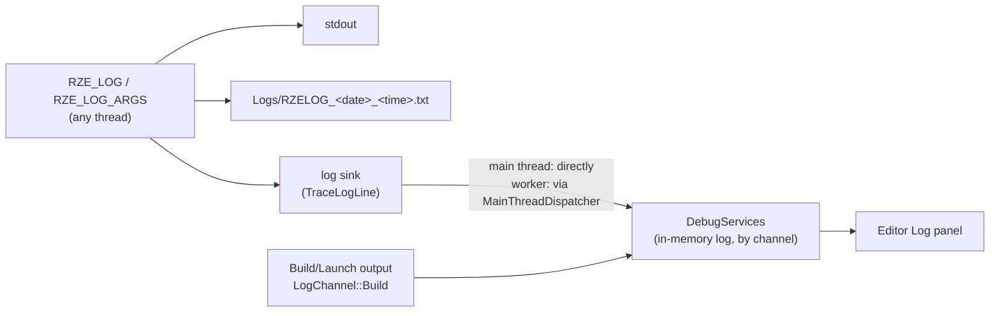

# Debug Services & Logging

## Where a log line goes



- **`RZE_LOG(msg)`** takes a stream expression (`RZE_LOG("Loaded " << count << " meshes")`).
- **`RZE_LOG_ARGS(fmt, ...)`** takes `printf` formatting (`RZE_LOG_ARGS("Render pipeline: %s", order.c_str())`), up to 1024 characters.
- Each line goes to stdout, to the session's log file under `Logs\`, and to the **log sink**. The engine sets the sink (`Debug::SetLogSink`) at start-up so every line also lands in `DebugServices`, which is what the Editor's Log panel shows. Lines logged on worker threads are posted to the main thread first, so `DebugServices` is only ever written from one thread.

### Which builds have what

| | Debug | Release | Retail (`RZE_RETAIL`) |
|---|---|---|---|
| `RZE_LOG`, `RZE_LOG_ARGS`, `LOG_CONSOLE_ANNOUNCE` | ✓ | ✓ | compiled out |
| Asserts (`AssertExpr`, `AssertMsg`, ...) | ✓ | compiled out | compiled out |
| `START_TIMED_BLOCK` | ✓ | — | — |
| `IMGUI_ENABLED` (Game's ImGui) | ✓ | — | — |
| `DebugDrawRenderStage` (debug lines) | ✓ | ✓ | compiled out |

In Retail, the log macros still "use" their arguments in a dead branch, so variables that only feed a log line don't cause unused-variable warnings.

## Asserts (`Utils\Src\Utils\DebugUtils\Debug.h`)

`AssertFalse()`, `AssertEqual(a, b)`, `AssertIsNull(p)`, `AssertNotNull(p)`, `AssertExpr(expr)`, `AssertMsg(expr, "why")`. Debug builds only.

A failing assert:
1. prints `Assertion failed: <expression>, file <file>, line <n>` (and the message, if any) to stderr;
2. shows the CRT assert dialog with the **expression and message**, in both console and windowed apps;
3. if you choose **Retry**, breaks into the debugger on the line of the failing assert (`__debugbreak` sits in the macro, not in a helper function). **Ignore** carries on, and **Abort** quits.

## `DebugServices` (`Engine\Src\DebugUtils\DebugServices.h/.cpp`)

A singleton in-memory log (`DebugServices::Get()`), with three channels:

| Channel | Used for | Colour in the Log panel |
|---|---|---|
| `LogChannel::Info` | Everything from `RZE_LOG` | white |
| `LogChannel::Debug` | Debug traces | white too: it's set to (255, 255, 1), which clamps to white; probably meant to be yellow |
| `LogChannel::Build` | Build/Launch output | grey |

`Trace(channel, text)` adds an entry in the channel's colour; `AddData(text, colour)` adds one in any colour. Entries are kept per channel too, so a UI could filter by channel. Main-thread only: post from other threads with `MainThreadDispatcher` (the log sink already does this).

## Timing a block

```cpp
{
    START_TIMED_BLOCK("Build navmesh");   // Debug only; ScopedHiResTimer
    ...
}
```

For frame-level profiling use Optick or PIX instead (see [Low-Level-Renderer-Module.md](../04-Rendering/Low-Level-Renderer-Module.md#profiling)).

## Key files

- `Utils\Src\Utils\DebugUtils\Debug.h/.cpp` — macros, log file, log sink, assert dialog
- `Engine\Src\DebugUtils\DebugServices.h/.cpp`
- `Engine\Src\EngineCore\Engine.cpp` — `TraceLogLine`, the engine's log sink
- `Utils\Src\Utils\Platform\Timers\HiResTimer.h/.cpp`
