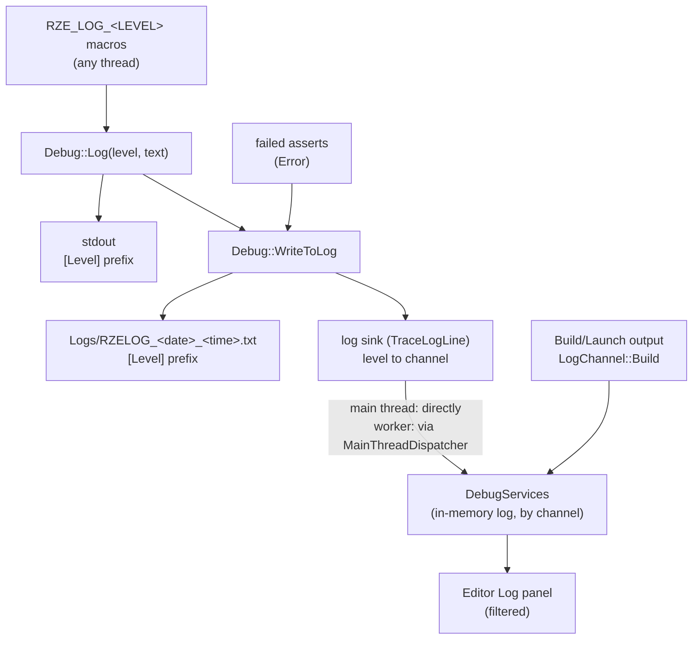

# Debug Services & Logging

## Where a log line goes



### Levels

Each line has a level (`Debug::ELogLevel`), and each level has a stream form and a `printf` form:

| Level | Stream form | `printf` form | Use it for |
|---|---|---|---|
| Debug | `RZE_LOG_DEBUG(msg)` | `RZE_LOG_DEBUG_ARGS(fmt, ...)` | High-volume detail: a line per resource created, made or released, `START_TIMED_BLOCK` timings, the importer's per-mesh progress |
| Info | `RZE_LOG(msg)` | `RZE_LOG_ARGS(fmt, ...)` | Start-up, shutdown and one-off status: the render pipeline's order, the scene being loaded, an asset written |
| Warning | `RZE_LOG_WARNING(msg)` | `RZE_LOG_WARNING_ARGS(fmt, ...)` | Something recovered or fell back: config defaults used, a material slot drawing the mesh's own material, a second main camera ignored, a shader that compiled with warnings |
| Error | `RZE_LOG_ERROR(msg)` | `RZE_LOG_ERROR_ARGS(fmt, ...)` | Something failed and its result is missing or wrong: an asset that won't read, a scene that won't load or save, a shader that won't compile, a job that threw |

- The stream form takes a stream expression (`RZE_LOG_WARNING("Loaded " << count << " of " << total << " meshes")`), with no length limit. The `printf` form takes `printf` formatting (`RZE_LOG_ARGS("Render pipeline: %s", order.c_str())`), up to 1024 characters, so text that could be long (a shader compiler's output) goes through the stream form.
- Every macro calls `Debug::Log(level, text)`. It writes the line to stdout and to the session's log file under `Logs\`, each starting with the level (`[Debug] `, `[Info] `, `[Warning] `, `[Error] `), and passes it to the **log sink** without the prefix.
- The engine sets the sink (`Debug::SetLogSink`) at start-up. Its `TraceLogLine` puts each line on its level's channel in `DebugServices`, which is what the Editor's Log panel shows, so there the colour says the level instead of a prefix. Lines logged on worker threads are posted to the main thread first, so `DebugServices` is only ever written from one thread.
- A failed assert is logged at Error (see Asserts, below).
- stdout only shows up when the process has a console; see [The console](#the-console).

Some messages used to go around the log, and now go through it: shader compile output (`DX11ShaderTypes.cpp`'s `LogCompileMessages`: Error if the compile failed, Warning if it compiled with warnings; it used to go only to Visual Studio's Output window), the Editor's own messages (which reached the Log panel but not the log file), and the window being created (which went to stdout only). Two command-line messages in `CmdLine.cpp` still `printf_s` to stdout only, since they come before the log file exists.

### The console

The Editor and the Game are windowed apps (`/SUBSYSTEM:WINDOWS`), so they start without a console. On Windows 11 a console app's console opens in Windows Terminal, and that window came up after the app's own and took the foreground, so they opened unfocused. Their log is in the log file, and the Editor's is in its Log panel too. `-console` opens a console: `RZE_Application::ParseArguments` calls `Debug::OpenConsole()`, which allocates one and reopens stdout and stderr on it. Its window appears before the app's, which still ends up focused. SourceAssetBurner and UnitTests are console apps.

### Which builds have what

| | Debug | Release | Retail (`RZE_RETAIL`) |
|---|---|---|---|
| The `RZE_LOG` macros, every level | ✓ | ✓ | compiled out |
| Asserts (`AssertExpr`, `AssertMsg`, ...) | ✓ | compiled out | compiled out |
| `START_TIMED_BLOCK` | ✓ | — | — |
| `IMGUI_ENABLED` (Game's ImGui) | ✓ | — | — |
| `DebugDrawRenderStage` (debug lines) | ✓ | ✓ | compiled out |

In Retail, the log macros still "use" their arguments in a dead branch, so variables that only feed a log line don't cause unused-variable warnings.

## Asserts (`Utils\Src\Utils\DebugUtils\Debug.h`)

`AssertFalse()`, `AssertEqual(a, b)`, `AssertIsNull(p)`, `AssertNotNull(p)`, `AssertExpr(expr)`, `AssertMsg(expr, "why")`. Debug builds only.

A failing assert:
1. writes `Assertion failed: <expression>, file <file>, line <n>` (and the message, if any, on a second line) to stderr and to the log at Error, as one entry, so it reaches the log file and the Log panel without a console. An assert that fires while another is being logged, e.g. from the log sink, only goes to stderr, since logging it would recurse or block on the log file's lock;
2. shows the CRT assert dialog with the **expression and message**, in both console and windowed apps;
3. if you choose **Retry**, breaks into the debugger on the line of the failing assert (`__debugbreak` sits in the macro, not in a helper function). **Ignore** carries on, and **Abort** quits.

## `DebugServices` (`Engine\Src\DebugUtils\DebugServices.h/.cpp`)

A singleton in-memory log (`DebugServices::Get()`), with a channel per log level plus one for build output:

| Channel | Used for | Colour in the Log panel |
|---|---|---|
| `LogChannel::Info` | `RZE_LOG`, `RZE_LOG_ARGS` | white |
| `LogChannel::Debug` | `RZE_LOG_DEBUG` | muted blue-grey (0.50, 0.58, 0.70), so the many per-resource lines don't stand out |
| `LogChannel::Build` | The Editor's build and launch output (`GameBuilder`, which calls `Trace` directly) | grey |
| `LogChannel::Warning` | `RZE_LOG_WARNING` | orange (1, 0.60, 0.20) |
| `LogChannel::Error` | `RZE_LOG_ERROR`, failed asserts | red (1, 0.42, 0.36) |

Warning and Error use the same colours as the Editor's task colours (`Editor\Src\UI\TaskColours.h`), repeated in the Engine since it can't include Editor headers.

`Trace(channel, text)` adds an entry in the channel's colour. Each `LogEntry` keeps its `Channel` as well as its colour and text, which is what the Log panel filters by. `LogChannel::Count` is the number of channels; `GetLogChannelIndex(channel)` gives a channel's underlying value (`LogChannelIndex`), for indexing per-channel arrays. Main-thread only: post from other threads with `MainThreadDispatcher` (the log sink already does this).

## Timing a block

```cpp
{
    START_TIMED_BLOCK("Build navmesh");   // Debug only; ScopedHiResTimer
    ...
}
```

For frame-level profiling use Optick or PIX instead (see [Low-Level-Renderer-Module.md](../04-Rendering/Low-Level-Renderer-Module.md#profiling)).

## Frame time capture

`FrameTimeCapture` (`Engine\Src\DebugUtils\FrameTimeCapture.h/.cpp`, owned by `RZE_Engine`) records every frame's timings for A/B performance comparisons, in either app. It's off unless the command line asks for it:

| Argument | Meaning |
|---|---|
| `-perfcapture <file>` | Where to write the samples: one `frameMs,updateMs` line per frame. `updateMs` is the async operations' tick, the application's `PreUIUpdate`, `UpdateUI`, `Update` and `PreRender`, and the scene's update, but not ImGui's `NewFrame` and `EndFrame` or rendering. |
| `-perfwarmup <seconds>` | How long to wait before recording, e.g. for the scene to load (default 10) |
| `-perfduration <seconds>` | How long to record (default 15) |

When the duration is up it writes the file and the engine exits, so a script can launch the Editor or Game on a scene, wait for it to close and compare the files from two builds.

A capture runs **unpaced**, so it measures what frames cost and stays comparable with captures from before frames were paced: vsync, the frame rate caps and the UI frame rate are off, and every frame updates the UI. The pacing arguments still apply if given:

| Argument | Meaning |
|---|---|
| `-vsync 0/1` | Vsync off or on, over Engine.ini's `EnableVsync` |
| `-maxfps <N>` | Frame rate cap, over Engine.ini's `MaxFrameRate`; 0 for none |
| `-uifps <N>` | UI updates a second, over Engine.ini's `UIFrameRate`; 0 for every frame |

These work without `-perfcapture` too; see [Engine-Startup-And-Frame-Loop.md](../02-Architecture/Engine-Startup-And-Frame-Loop.md#settings). Integer arguments (`CmdLine::Arguments::GetInt`) log a value that isn't an integer and leave the default in place.

## Key files

- `Utils\Src\Utils\DebugUtils\Debug.h/.cpp` — log levels and macros, log file, log sink, assert dialog
- `Engine\Src\DebugUtils\DebugServices.h/.cpp` — channels and their colours
- `Editor\Src\UI\Panels\LogPanel.h/.cpp`, `LogFilter.h/.cpp` — the Log panel and its filter (see [Editor-Panels.md](../07-Editor/Editor-Panels.md#log-logpanel))
- `Modules\Rendering\Src\Rendering\Driver\DX11\DX11ShaderTypes.cpp` — `LogCompileMessages`
- `Engine\Src\DebugUtils\FrameTimeCapture.h/.cpp`
- `Engine\Src\EngineCore\Engine.cpp` — `TraceLogLine`, the engine's log sink
- `Utils\Src\Utils\Platform\Timers\HiResTimer.h/.cpp`
