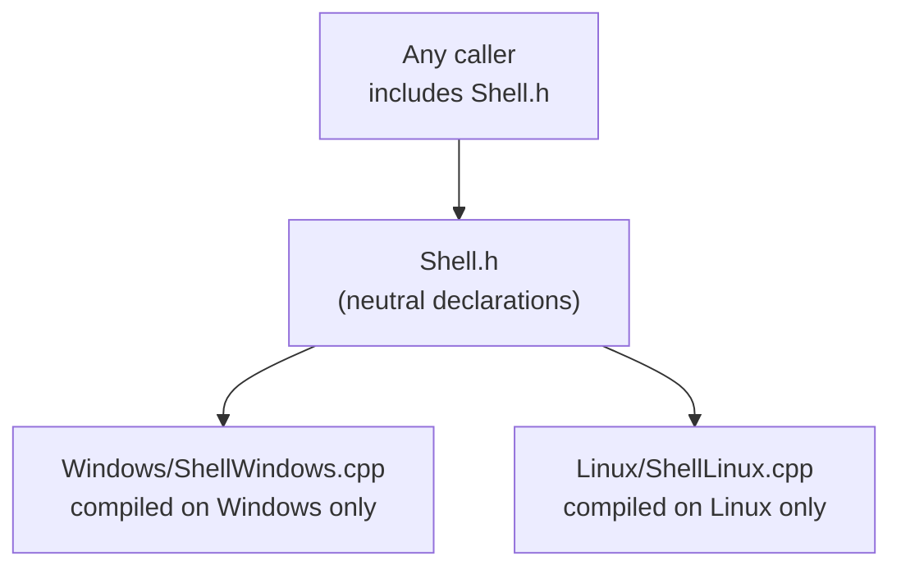

# Platforms and Graphics APIs

RZE builds and runs on **Windows** (MSVC, DirectX 11) and **Linux** (clang, OpenGL 4.5). The rule that shapes how:
**code that uses the engine never knows the OS or the graphics API.** The Editor, the Game, gameplay components and
render stages are the same source on both. What differs lives behind a neutral interface, in a folder that only its
platform or API compiles.

## What differs, and where

**Per platform** (Windows / Linux):

| What | Neutral interface | Windows | Linux |
|---|---|---|---|
| The window's native gaps: custom title bar, first appearance, icons, metrics | `Engine/Src/Windowing/WindowNative.h` (internal to `Window`) | `Windows/WindowNativeWindows.cpp`: a window subclass, the DWM cloak, Snap Layouts | `Linux/WindowNativeLinux.cpp`: borderless with an SDL hit test |
| The splash screen | `Windowing/SplashScreen.h` | its own thread, GDI | the main thread, SDL's window surface |
| Icons | `Windowing/WindowIcon.h` (reading images) | `Windows/WindowIconWindows`: `HICON`s | `Linux/WindowIconLinux`: SDL surfaces, `RZE.png` by default |
| The file manager and trash | `Utils/Platform/Shell.h` | `ShellExecute`, `SHFileOperation` | `FileManager1` over D-Bus, the freedesktop.org Trash spec |
| Running programs | `Utils/Platform/Process.h` | `CreateProcess`, `cmd.exe` | `posix_spawn`, `/bin/sh` |
| Watching folders | `Utils/Platform/FolderWatcher.h` | change notifications | inotify |
| Precise sleeps | `Utils/Platform/Timers/PreciseSleep.h` | a high-resolution waitable timer | `clock_nanosleep` |
| The console, assert reports | `Utils/DebugUtils/Debug.h` (its OS half) | `AllocConsole`, the CRT's dialog | stderr; break only under a debugger |
| Type names | `Utils/Platform/TypeNames.h` | MSVC's names, `class ` stripped | demangled |
| Reading stdin (EditorHarness) | `EditorHarness/Src/HarnessStdin.h` | `ReadFile` | `read` |
| Building the game | `Platform::k_buildGameScript` | `BuildGame.bat` | `BuildGame.sh` |

The window itself, input and displays are **SDL3** on both, so `Window`, `Display` and `ImGuiPlatform` are one
implementation each ([Windowing.md](Windowing.md)).

**Per graphics API** (DX11 / OpenGL), all in `Modules/Rendering`
([Low-Level-Renderer-Module.md](../04-Rendering/Low-Level-Renderer-Module.md#the-rhi-igfxdevice-and-the-backends)):

| What | Neutral interface | DX11 | OpenGL |
|---|---|---|---|
| The device: targets, state, draws, dispatches, present, readback | `Driver/GFXDevice.h` (`IGFXDevice`) | `Driver/DX11/DX11Device` | `Driver/OpenGL/GLDevice` |
| Buffers, textures, shaders | `Driver/GFXBuffer.h`, `ShaderTypes.h` | `DX11VertexBuffer`, `DX11TextureBuffer2D`, ... | `GLVertexBuffer`, `GLTextureBuffer2D`, ... |
| ImGui's renderer | `ImGui/ImGuiRenderer.h` (`IImGuiRenderer`) | `imgui_impl_dx11` | `imgui_impl_opengl3` |
| Shaders | HLSL, the only source | compiled with `D3DCompileFromFile` | translated: shaderc to SPIR-V, SPIRV-Cross to GLSL 4.50 |

Each platform has one API today: DX11 on Windows, OpenGL on Linux. They're separate choices, though, so OpenGL on
Windows would only mean enabling its folder there and choosing it in the factory.

## How the build picks the code

- **Folder tokens.** A folder named `Windows` or `DX11` anywhere under a project's `Src` is compiled only on Windows;
  one named `Linux` or `OpenGL`, only on Linux. `BaseProject.sharpmake.cs` excludes the other platform's folders
  from every project ([Sharpmake-Project-Graph.md](../09-BuildSystem/Sharpmake-Project-Graph.md)). The linker then
  finds exactly one implementation of each neutral function.
- **Names.** A file that implements a neutral header is `<Header><Platform>.cpp` (`ShellWindows.cpp`,
  `ShellLinux.cpp`), and a helper only one platform uses carries its suffix too (`WideStrings` on Windows,
  `SpawnProcessLinux`). A search, an editor tab or a compiler message names the platform. A class of one graphics
  backend carries the API's prefix instead (`DX11Device`, `GLDevice`).
- **Only two files check with the preprocessor.** `Utils/Platform/Platform.h` defines `RZE_PLATFORM_WINDOWS` or
  `RZE_PLATFORM_LINUX` and the few constants that can't be functions (the path separator, the executable suffix,
  `RZE_DEBUG_BREAK()`). `Modules/Rendering/Src/Rendering/Driver/GFXDeviceFactory.cpp` picks the device from the
  build's `RZE_GFX_DX11` or `RZE_GFX_OPENGL`. Everything else that differs is a file in a token folder. Vendored code
  is the exception.

## How DX11 and OpenGL are kept the same

The engine and its shaders were written for D3D's conventions, so the OpenGL backend keeps them, rather than anything
above it changing. In brief (details in
[Low-Level-Renderer-Module.md](../04-Rendering/Low-Level-Renderer-Module.md#opengl-drawn-the-way-direct3d-draws)):

| D3D convention | How OpenGL keeps it |
|---|---|
| Depth from 0 to 1; row 0 of a target is its top | `glClipControl(GL_UPPER_LEFT, GL_ZERO_TO_ONE)` for the engine's targets. The back buffer is drawn GL's way up and copied to the window as it is. |
| Each stage binds its own `b`, `t`, `s` and `u` registers | Uniform blocks and texture units offset per stage, combined texture-sampler pairs bound at each draw, image units for `u` |
| Three fixed samplers (`s0` wrap, `s1` shadow compare, `s2` clamp) | Three sampler objects with the same settings |
| HLSL source | Translated when the shader is created; the same files, the same edit-and-relaunch workflow |
| A compute write is visible to the next read | A memory barrier after every dispatch |
| D24S8 depth readback (depth low, stencil high) | GL's texels repacked into D3D's order |
| COM objects released on any thread | GL objects deleted later, on the render thread |
| Present waits for a swap chain slot | `SDL_GL_SwapWindow` waits for the display itself |

## Rules that keep both platforms working

From the repo's `CLAUDE.md`, where they're kept up to date:
- **Every change keeps both platforms building and their tests passing.** CI builds and tests both
  (`.github/workflows/Windows.yml`, `Linux.yml`). Warnings are errors on both: MSVC's `/W3 /WX`, and clang's
  `-Wall -Werror`.
- **A variable only an assert reads** is unused in Release, where asserts are empty, and clang rejects that. Put the
  whole check in the assert (e.g. `std::all_of` with a lambda). Don't mark a range-for variable `[[maybe_unused]]`:
  MSVC 14.51 crashes on it (C1001).
- **Name files exactly as they are on disk.** Windows ignores case and Linux doesn't. For names written on Windows,
  use `FileNames::FindIgnoringCase` and `FileNames::IsTaken`, which apply Windows' rules on every platform
  ([Utils-Library-Reference.md](Utils-Library-Reference.md#platform-platform)).
- **Saved files are the same on both.** Scene files store `\\` separators (`Filepath::GetSerializedPath()`), and an
  object's components save in the order the file had them, not in a hash map's order, which differs between standard
  libraries.
- **Checking the platform you can't build.** On Linux, `.claude/WindowsChecks.md` lists what a Windows machine still
  has to check, for Windows Claude to run; the drivers in `.claude/skills/run-rze/` drive the Editor on each
  platform for automated checks ([Building-And-Running.md](../01-GettingStarted/Building-And-Running.md#driving-the-running-editor)).

## Adding a platform

The pieces a third platform (e.g. macOS) needs, in roughly the order a build would ask for them:

1. **A target.** A `CommonTarget.GetDefaultTargets()` case for the host, and a `Configure<Platform>` in
   `BaseProject.sharpmake.cs` with its compiler settings and the folders it excludes; a token for it (e.g. `Mac`)
   in the folder lists.
2. **`Platform.h`:** its `RZE_PLATFORM_*` branch, separators, executable suffix, build script, `LocalTime`.
3. **Utils' neutral headers:** `Shell`, `Process`, `FolderWatcher`, `PreciseSleep`, `TypeNames`, and `Debug`'s OS
   half, each as `<Mac>/<Name>Mac.cpp`.
4. **Windowing:** `WindowNative`, `SplashScreen` and the icon code for it. SDL covers the window, input and
   displays already.
5. **A graphics API**, if it has none of the two: a backend under its own token folder implementing `IGFXDevice` and
   the resource interfaces, its `IImGuiRenderer`, and a branch in `GFXDeviceFactory`. A Vulkan backend would reuse
   the SPIR-V the OpenGL backend already makes.
6. **EditorHarness's `HarnessStdin`**, and a CI workflow.

## Key files

- `Utils/Src/Utils/Platform/Platform.h`; `Modules/Rendering/Src/Rendering/Driver/GFXDeviceFactory.cpp`
- `Make/Sharpmake/BaseProject.sharpmake.cs` (the folder tokens), `CommonTarget.sharpmake.cs`
- The neutral headers and their `Windows/`, `Linux/`, `DX11/` and `OpenGL/` folders, listed above
- `CLAUDE.md`, `.claude/WindowsChecks.md`
