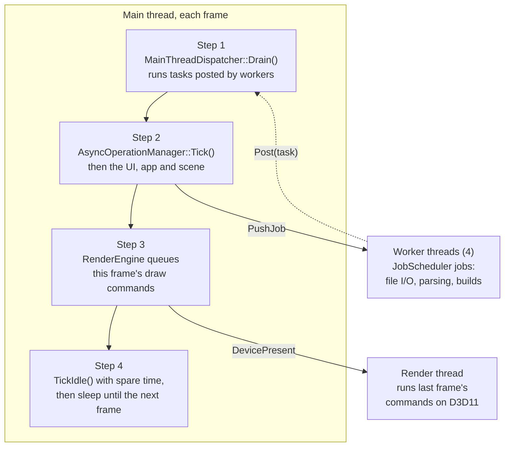

# Threading & Job System

RZE runs on a few kinds of threads:



- The **main thread** owns the engine: scenes, components, `ResourceHandler`, ImGui and render submission. Most engine state is main-thread only.
- **Worker threads** do work that doesn't touch engine state: reading and parsing files, decoding textures, running build scripts.
- The **render thread** owns the D3D11 device and executes queued render commands (see [Low-Level-Renderer-Module.md](../04-Rendering/Low-Level-Renderer-Module.md)).

## The job system (`Engine\Src\EngineCore\Threading\JobSystem\`)

A fixed pool of `MAX_WORKER_THREADS = 4` workers pulling from two queues, one per [lane](#background-work).

| Type | What it is |
|---|---|
| `JobScheduler` | Singleton (`JobScheduler::Get()`). `PushJob(task, lane = Foreground)` from any thread returns a `JobHandle` (ignore it for fire-and-forget). `Wait(handle)` blocks until a job is done; `WaitForIdle()` until both queues are empty and nothing is running. |
| `Job` | A task (`std::function`, so captures must be copyable) plus its shared completion state. |
| `JobHandle` | Stays valid however long the job or scheduler lives. `IsComplete()`; `WasAbandoned()` if the scheduler shut down before the job ran. |
| `WorkerThread` | A thread that asks the scheduler for the next job and runs it. |

On shutdown, queued jobs are abandoned (never run), running ones finish, then the workers are joined. Started in `RZE_Engine::Init()`, stopped in `BeginShutDown()` ([Engine-Startup-And-Frame-Loop.md](../02-Architecture/Engine-Startup-And-Frame-Loop.md)).

Don't `Wait()` from a worker on a job that might be queued behind you; with only four workers that can deadlock.

## Background work

Some work nobody is waiting on, such as rendering thumbnails, shouldn't slow down work someone is waiting on, such as opening a scene. Two things keep it out of the way:

| | Foreground | Background |
|---|---|---|
| **Jobs** (`Threading::EJobLane`) | Taken first | A worker only takes one when no foreground job is queued, and background jobs **never run on every worker at once** (at most `MAX_WORKER_THREADS − 1`), so a foreground job always has a worker free to start on |
| **Async operations** (`EAsyncOperationFlags::Background`) | Ticked first, sharing the 8 ms budget | Ticked after, with 2 ms and a quarter of the upload allowance of their own; their `PushWorkerJob`s go to the background lane |

An operation flagged `Background` gets both automatically. A paced frame's spare time also goes to async operations (`AsyncOperationManager::TickIdle`), foreground first, so background work takes up idle time before the main thread sleeps. See [Asset-Import-Runtime.md](../05-AssetPipeline/Asset-Import-Runtime.md#async-operations) for the flags.

## Getting back to the main thread: `MainThreadDispatcher`

```cpp
Threading::MainThreadDispatcher::Get().Post(task);   // any thread
```

Posted tasks run on the main thread, in the order they were posted, at the start of the next frame (`RZE_Engine::PreUpdate`). Tasks posted while draining run the following frame. This is how worker code hands results back without touching main-thread-only state.

## Cancelling: `CancellationToken`

A shared, cooperative cancel flag. Copies share state, so it can be captured by value into jobs and checked from any thread. Long jobs should check it and stop early (the Editor's build job passes it to the process it runs).

## Who uses all this

- **Async operations** (`Engine\Src\EngineCore\Async\`): **scene loading** reads and parses on workers, then finalizes on the main thread a slice per frame; the Editor's **Build/Launch** runs as a worker job. See [Asset-Import-Runtime.md](../05-AssetPipeline/Asset-Import-Runtime.md#async-operations).
- **`AsyncResourceBatch`** runs each resource's `LoadCPU` as a worker job, in its operation's lane.
- **Editor thumbnails** load scenes and meshes, and encode PNGs, as background work ([Thumbnails-And-File-Browser.md](../07-Editor/Thumbnails-And-File-Browser.md)).

## Key files

- `Engine\Src\EngineCore\Threading\Threading.h`, `MainThreadDispatcher.h/.cpp`, `CancellationToken.h`
- `Engine\Src\EngineCore\Threading\JobSystem\Job.h/.cpp`, `WorkerThread.h/.cpp`, `JobScheduler.h/.cpp`
- `Engine\Src\EngineCore\Async\` — operations built on top of the job system
