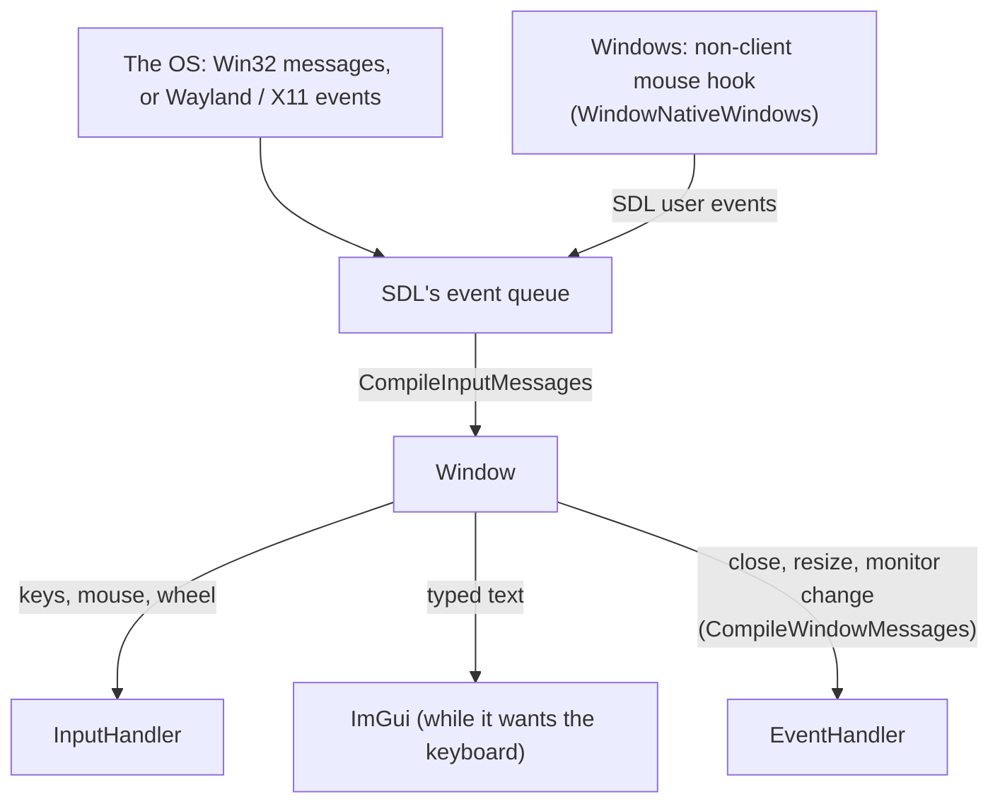

# Windowing

`Engine/Src/Windowing/` is the window, input from the OS, and displays, on every platform. **SDL3** (3.4.18) does the
work on both Windows and Linux. What SDL doesn't do the same way everywhere (a custom title bar, the window's first
appearance, icons, frame metrics) is done natively, behind one internal header, `WindowNative.h`, with one
implementation per platform. Nothing outside `Windowing/` knows which OS it's on.

| File | What it is |
|---|---|
| `Window.h/.cpp` | The application's window, one class for every platform |
| `WindowNative.h`, `Windows/WindowNativeWindows.cpp`, `Linux/WindowNativeLinux.cpp` | What SDL doesn't do the same everywhere. Only `Window.cpp` uses it. |
| `SDLVideo.h/.cpp` | Starts SDL's video once, with the hints that keep RZE's behaviour |
| `ImGuiPlatform.h/.cpp` | ImGui's platform backend (`imgui_impl_sdl3`) |
| `Display.h/.cpp` | Monitors, work areas, refresh rates |
| `SplashScreen.h`, `SplashScreenLayout.h/.cpp`, `Windows/SplashScreenWindows.cpp`, `Linux/SplashScreenLinux.cpp` | The start-up splash screen |
| `WindowIcon.h/.cpp`, `Windows/WindowIconWindows.*`, `Linux/WindowIconLinux.*` | Reading icon images; making icons per platform |
| `TitleBarLayout.h/.cpp` | Where a custom title bar's parts are |

## `Window` (`Window.h/.cpp`)

A concrete class: SDL underneath, the same code on every platform. The engine makes it in
`RZE_Engine::CreateAndInitializeWindow` from `WindowCreationParams` (title, size, launch monitor, and the graphics API,
since SDL makes a window for OpenGL differently), and `GetNativeHandle()` gives the `SDL_Window*` to what needs it:
the renderer, and `Display::GetRefreshRate`.

- **Creation.** The window opens at the top-left of the launch monitor's work area, where the desktop lets an
  application place windows (Windows and X11, not Wayland). On Windows its *outer* size is the size asked for, as
  before SDL; on Linux the compositor draws the frame, so it's the client size.
- **`CompileInputMessages(InputHandler&)`** drains every queued SDL event once a frame (not one per frame, which let
  input queue up and lag once frames were capped), and is the one place OS input enters the engine:
  - keys become `KeyCode`s ([Input-System.md](Input-System.md#key-codes));
  - mouse moves, buttons (X1 and X2 are Back and Forward) and the wheel go to the input handler, the wheel in
    Windows' units (120 a notch);
  - typed text goes to ImGui, only while ImGui wants the keyboard (`TEXT_INPUT`, as `WM_CHAR` was).
  - **A key released in the same pump it was pressed in** is told as released in the *next* one. Fast typing at a
    low frame rate does this, and so does KDE, which hands over a text key's press and release together. That way
    every press is seen for at least a frame.
- **`CompileWindowMessages(EventHandler&)`**: the window's own events from the last pump, as engine events. Resizes
  are told once per pump, so dragging an edge gives one `Window_Resize` after it. Moving to another monitor counts as a
  resize, so the frame pacer reads the new refresh rate.
- **State the engine asks each frame:**
  - `IsFocused()` and `IsMinimised()` (on Wayland, `IsMinimised()` is always false, since xdg-shell never reports
    it);
  - `IsMouseButtonDown()`, SDL's global mouse state, which unlike the input handler's can't get stuck down.

  The `FramePacer` throttles frames while the window is unfocused or minimised
  ([Input-System.md](Input-System.md#interaction-and-focus)). While a button is down, SDL keeps the mouse, so a drag
  that ends past the window's edge still ends.
- **Made hidden, then revealed.** The window can be shown, maximized and drawn into at its real size before the user
  sees it, and `Reveal()` puts it on screen once start-up is done; `Focus()` makes it the foreground window
  ([Engine-Startup-And-Frame-Loop.md](../02-Architecture/Engine-Startup-And-Frame-Loop.md#the-first-frames)).
  - On Windows it's **cloaked** (`DWMWA_CLOAK`): to Windows a cloaked window is visible, so showing and maximizing work
    as usual and its taskbar button is already there.
  - On Linux it's hidden until `Reveal()`, since a desktop window can't be shown without the user seeing it.
- **Closing.** The close button, Alt+F4 and `RequestClose()` become `Window_CloseRequested`; SDL doesn't destroy the
  window. The engine exits only if `RZE_Application::OnCloseRequested()` returns true, so an app can ask first (the
  Editor's unsaved-changes prompt).
- **DPI.** RZE is DPI-unaware: `GetDpiScale()` is 1 on Linux, and on Windows the process stays DPI-unaware, so the OS
  scales it on high-DPI monitors, as before SDL.
- **No file dialogs:** the native Open/Save prompts were removed once the Editor had its own
  [file browser](../07-Editor/Thumbnails-And-File-Browser.md).

### Custom title bar

`SetCustomTitleBar(true)` leaves out the OS's caption, so the app draws its own title bar across the top of the client
area; the Editor does this, the Game doesn't. `SetTitleBarLayout` (once a UI frame) says where the bar's parts are,
and the window answers the OS from it. The window still moves, snaps, resizes and maximizes as usual.

- **Windows** (`WindowNativeWindows.cpp`): a window subclass, ahead of SDL's window procedure, handles the non-client
  messages; SDL makes a normal window and leaves them alone.
  - `WM_NCCALCSIZE` lets `DefWindowProc` work out the client area, then puts its top back where the window's top is,
    so only the caption goes. The invisible side and bottom borders stay, to resize the window and cast its shadow.
    While maximized, the top is inset by the frame thickness, which would otherwise be off-screen.
  - `WM_NCHITTEST` asks `DefWindowProc` first, which keeps the native borders. Over the client area it asks the
    `TitleBarLayout`: the bar's free space is `HTCAPTION`, so it drags, snaps and double-click maximizes; its top
    edge resizes; and its maximize button is `HTMAXBUTTON`, which is what makes **Windows 11 show Snap Layouts**.
  - Over those parts the mouse sends non-client messages. A hook in SDL's message loop turns them into SDL events,
    so they're handled in order with the client mouse events around them, and the UI shows hovers and takes clicks
    there. Clicks on the maximize button aren't dispatched, so Windows doesn't draw its own button over it.
- **Linux** (`WindowNativeLinux.cpp`): the window has no decorations at all (`SDL_SetWindowBordered(false)`), and an
  SDL hit test tells the compositor what the mouse is over: the bar's free space drags, the top edge and corners
  resize, the maximize button is the app's, and bands along the sides and bottom resize (not while maximized). The
  metrics are Windows' at 96 DPI, so the bar is the size it is there.
  - **Limits on Wayland:** double-clicking the bar doesn't maximize (SDL takes the press for the move), and the
    window can't place itself.
- `GetSystemTitleBarHeight()` is the OS's caption plus frame at the window's DPI, the least a custom bar should be.

## SDL's start-up (`SDLVideo.h/.cpp`)

`SDLVideo::Acquire()` starts SDL's video subsystem when something first needs it (the splash screen, the window or
`Display`) and keeps it running until a matching `Release()`; `SDLVideo::Scope` does the pair for as long as it lives.
Hints are set before it first starts, where SDL's defaults differ from what RZE did before it used SDL:
- `SDL_WINDOWS_DPI_AWARENESS=unaware`: the process stays DPI-unaware;
- `SDL_HINT_WINDOWS_ENABLE_MENU_MNEMONICS=1`: Alt and F10 still open the window menu, and Alt+Space its system menu;
- `SDL_HINT_VIDEO_ALLOW_SCREENSAVER=1`: the screensaver and display sleep still come on;
- `SDL_HINT_MOUSE_FOCUS_CLICKTHROUGH=1`: the click that focuses the window still reaches it;
- `SDL_HINT_NO_SIGNAL_HANDLERS=1`: Ctrl+C and SIGTERM still end the process.

RZE keeps its own `main()`: SDL only needs `SDL_main.h` where it must run `main` itself.

## `ImGuiPlatform` (`ImGuiPlatform.h/.cpp`)

ImGui's platform side, through `imgui_impl_sdl3` on every platform: the clipboard, cursor shapes and display sizes.
It's given no SDL events; input reaches ImGui through the engine's `ImGuiInput`, as it always has. The backend turns
SDL's mouse capture off at start, expecting to capture from the events it's given, so `ImGuiPlatform` turns it back
on. ImGui's *renderer* side is the renderer's (`IImGuiRenderer`, [Low-Level-Renderer-Module.md](../04-Rendering/Low-Level-Renderer-Module.md)).

## Icons

- **The executable's icon, on Windows.** `Editor.exe` and `Game.exe` embed `Assets/Application/RZE.ico` (the RZE
  mark, from `icon.svg` beside it) as icon 1, through `Editor/Resources/Editor.rc` and `Game/Resources/Game.rc`.
  `WindowNativeWindows` gives the window that icon at the system's large *and* small sizes; SDL alone would shrink one
  large icon for both.
- **On Linux**, an executable has no icon, so every window, the splash screen's too, gets
  `Assets/Application/RZE.png` when it's made: `RZE.ico`'s largest image, its bytes as they are (`WindowIconLinux`).
- **`SetIcon(image)`** shows an image file (e.g. a PNG) instead, and returns false, leaving the icon alone, if it can't
  be read. The Game uses it for `Game.ini`'s `Icon` ([Config-System.md](Config-System.md#gameconfig-gameconfighcpp-and-configgameini)).
  - On Windows (`WindowIconWindows`), it's a large and a small `HICON` at the system sizes for the window's DPI, sent
    with `WM_SETICON` and also set as the class's: the taskbar falls back on the class's when the window is too busy
    to answer.
  - On Linux, it's an SDL surface (`SDL_SetWindowIcon`). GNOME on Wayland ignores per-window icons; KDE shows them.
- **`WindowIcon`** (`WindowIcon.h/.cpp`), shared: `ReadImage` loads RGBA texels with stb_image. `MakeSquare` centres
  the image on a transparent square and scales it to an icon size, each output texel averaging what it covers,
  weighted by alpha so edges don't darken. The unit tests and the Editor's preview use it too.

## `SplashScreen` (`SplashScreen.h`)

A small borderless window (400×225 at 96 DPI) that the engine shows while it starts up, for an application whose
`RZE_Application::GetSplashScreenImage()` is a valid path: the Editor's is `logo.png`, and the Game has none. It shows
the image centred on the launch monitor's work area, with a status line along the bottom and, while start-up loads, a
progress bar under it ([Engine-Startup-And-Frame-Loop.md](../02-Architecture/Engine-Startup-And-Frame-Loop.md#startup-sequence)).
Its title is the application's `GetWindowTitle()` (the Editor's is "RZEStudio"), which is what a taskbar shows for it.
How it looks is one layout (`SplashScreenLayout`: sizes, colours, the image blended once onto the Editor's window
background); each platform draws it its own way.

- **Windows** (`SplashScreenWindows.cpp`): **its own thread** and message loop, so it keeps drawing while the main
  thread is busy and Windows never calls it not responding. It paints itself with GDI, so the status text keeps
  ClearType, off screen first so it doesn't flicker. It's a tool window, so it has no taskbar button; Windows 11 rounds
  its corners. It isn't topmost, so an assert's message box can't hide behind it, and Alt+F4 doesn't close it.
- **Linux** (`SplashScreenLinux.cpp`): SDL only makes and draws windows on the main thread, so it's drawn there, when
  it's made and each time the status is set. It draws into a canvas on the CPU (the status text with stb_truetype and
  the Editor's UI font) and copies it to the window's surface, with no GPU involved.
- `SetStatus(status)` and `SetStatus(status, progress)` are safe from any thread, and do nothing when nothing changed,
  since loading sets the status every pass.

## `Display` (`Display.h/.cpp`)

Monitors through SDL: `GetMonitor(index, info)`, a monitor's bounds and work area (which `-launchMonitor` uses), with
the primary first and the rest in the OS's order; and `GetRefreshRate(windowHandle)`, the refresh rate of the monitor
the window is on, exactly (e.g. 59.94), or 0 if it can't be read. The engine reads it at start-up and after every
resize or move, for vsync pacing ([Engine-Startup-And-Frame-Loop.md](../02-Architecture/Engine-Startup-And-Frame-Loop.md#when-frames-start)).

## `TitleBarLayout` (`TitleBarLayout.h/.cpp`)

A custom title bar's layout, in client pixels: its `Height`, the `Controls` that take clicks themselves (menus,
buttons), and the `MaximizeButton`. `HitTest(x, y, clientWidth, isMaximized, resizeBorder)` says what a point is over
(`ETitleBarHit`): the top resize edge and its corners (not while maximized), the maximize button, a control
(`Client`), the rest of the bar (`Caption`), or below the bar (`Client`). Both platforms' hit tests use it. It's pure,
so `UnitTests/Src/Engine/TitleBarLayoutTests.cpp` tests it without a window.

## Diagram

## Key files

- `Engine/Src/Windowing/Window.h/.cpp`, `WindowNative.h`, `WindowNativeState.h`
- `Engine/Src/Windowing/Windows/WindowNativeWindows.cpp`, `Linux/WindowNativeLinux.cpp`
- `Engine/Src/Windowing/SDLVideo.h/.cpp`, `ImGuiPlatform.h/.cpp`, `Display.h/.cpp`, `TitleBarLayout.h/.cpp`
- `Engine/Src/Windowing/SplashScreen.h`, `SplashScreenLayout.h/.cpp`, `Windows/SplashScreenWindows.cpp`, `Linux/SplashScreenLinux.cpp`
- `Engine/Src/Windowing/WindowIcon.h/.cpp`, `Windows/WindowIconWindows.*`, `Linux/WindowIconLinux.*`; `UnitTests/Src/Engine/WindowIconTests.cpp`
- `Assets/Application/RZE.ico`, `RZE.png`, `icon.svg`; `Editor/Resources/Editor.rc`, `Game/Resources/Game.rc`
