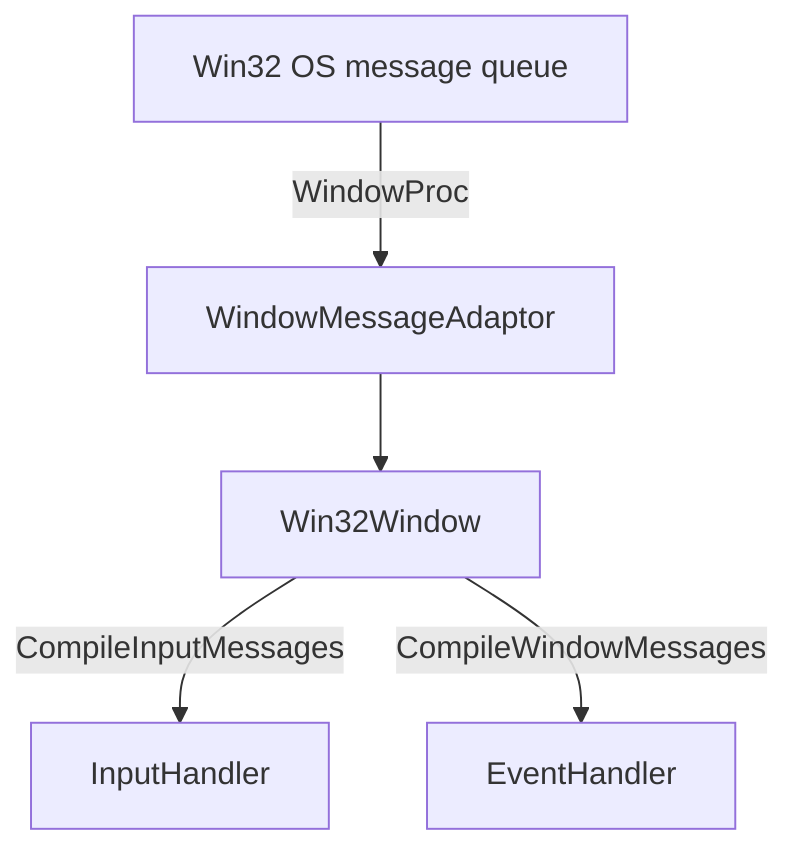

# Windowing / Win32 Platform Layer

`Engine\Src\Windowing\` is RZE's Win32 platform abstraction — the only OS layer supported today (no macOS/Linux path exists; see [09-BuildSystem](../09-BuildSystem/Sharpmake-Project-Graph.md), where non-Windows target platforms are commented out in the Sharpmake config).

## `Win32Window` (`Win32Window.h/.cpp`)

Wraps `HWND`/`HDC`/`HGLRC`/`PIXELFORMATDESCRIPTOR` in an `OSWindowHandleData` struct. Responsibilities:
- Window creation (`Create`), show, maximize, minimize and restore (`IsMaximised`), cursor control, title/size get/set, and `GetDpiScale` (the window's DPI over 96). `Create` also moves the console, if the process has one, to the launch monitor's corner. The Editor and the Game only have one with `-console`, and a console hosted in Windows Terminal doesn't move ([Debug-Services-And-Logging.md](Debug-Services-And-Logging.md#the-console)).
- No file dialogs: the native Open/Save prompts were removed once the Editor had its own [file browser](../07-Editor/Thumbnails-And-File-Browser.md).
- **`CompileInputMessages(InputHandler&)`** / **`CompileWindowMessages(EventHandler&)`** — once per frame, handles **every** queued Win32 message (a `PeekMessage` loop, not one message per frame, which let input queue up and lag once frames were capped) and translates them into `InputHandler`/`EventHandler` calls via `ProcessWinProcMessage`. This is the single point where all OS input/window events enter the engine.
- **Mouse capture.** While a mouse button is down the window captures the mouse (`SetCapture`), so the release still arrives when it happens outside the window and drags carry on past its edge. It lets go once no button is down.
- **State the engine asks of the OS each frame:** `IsFocused()` (it's the foreground window), `IsMinimised()`, and `IsMouseButtonDown()` (`GetAsyncKeyState`, which unlike the input handler's state can't get stuck down). The `FramePacer` throttles frames while the window is unfocused or minimised, and the input handler uses focus and the button state ([Input-System.md](Input-System.md#interaction-and-focus)).
- **Closing.** `WM_CLOSE` (the close button, Alt+F4, `RequestClose()`) isn't passed to `DefWindowProc`, which would destroy the window. It becomes a `Window_CloseRequested` event, and the engine exits only if `RZE_Application::OnCloseRequested()` returns true, so an app can ask first (the Editor's unsaved-changes prompt). The window then lasts until the process exits.
- **Custom title bar.** `SetCustomTitleBar(true)` removes the OS's caption so the app can draw its own title bar in the client area; the Editor does this, the Game doesn't. Only the caption goes: the invisible side and bottom borders stay, so they still resize the window and cast its shadow.
  - `WM_NCCALCSIZE` lets `DefWindowProc` work out the client area, then puts its top back where the window's top is. While maximized it's inset by the frame thickness, which would otherwise be off-screen.
  - `WM_NCHITTEST` asks `DefWindowProc` first, which keeps the native side and bottom borders. Over the client area it asks the `TitleBarLayout` the app gave it with `SetTitleBarLayout` (once each UI frame): the bar's free space is `HTCAPTION`, so it drags, snaps and double-click maximizes; its top edge resizes; and its maximize button is `HTMAXBUTTON`, which is what makes Windows 11 show Snap Layouts.
  - Over those parts the mouse sends non-client messages, so `CompileInputMessages` passes them on as client ones: moves (and leaving the window, through `TrackMouseEvent`), so the UI shows hovers there, and clicks on the maximize button, which aren't dispatched so Windows doesn't draw its own button.
  - `GetSystemTitleBarHeight()` is the height of the OS's title bar at the window's DPI (caption plus frame), the least a custom one should be.

## `WindowMessageAdaptor` (`WindowMessageAdaptor.h/.cpp`)

An intermediary queue (`EMessageType`: `Create`/`Move`/`Resize`/`Destroy`/`Close`/`Quit`) that decouples the window procedure — `Win32Window::WindowProc`, a private static, as the Win32 API needs — from handling the messages. Messages get pushed from `WindowProc` and later popped and processed by `Win32Window` once a frame. The custom title bar's messages can't wait, since Windows needs their answer straight away, so for those `WindowProc` reaches the window through `GWLP_USERDATA`, which `Create` points at it.

## `Display` (`Display.h/.cpp`)

Monitor queries: the monitors and their work areas (`GetMonitor(index, info)`, which `-launchMonitor` uses), and `GetRefreshRate(windowHandle)`, the refresh rate in Hz of the monitor most of the window is on, or 0 if it can't be read. The rate is a whole number, so a 59.94 Hz mode reads 59. The engine reads it at start-up and after every resize or move, for vsync pacing ([Engine-Startup-And-Frame-Loop.md](../02-Architecture/Engine-Startup-And-Frame-Loop.md#when-frames-start)).

## `TitleBarLayout` (`TitleBarLayout.h/.cpp`)

A custom title bar's layout, in client pixels: its `Height`, the `Controls` that take clicks themselves (menus, buttons), and the `MaximizeButton`. `HitTest(x, y, clientWidth, isMaximized, resizeBorder)` says what a point is over (`ETitleBarHit`): the top resize edge and its corners (not while maximized), the maximize button, a control (`Client`), the rest of the bar (`Caption`), or below the bar (`Client`). It's pure, so `UnitTests\Src\Engine\TitleBarLayoutTests.cpp` tests it without a window.

## `WinKeyCodes.h`

Win32 virtual-key-code constants and mapping (`Win32KeyCode`), used by `InputHandler` to translate WM_KEYDOWN/WM_KEYUP messages into engine `InputKey` values.

## Diagram

## Key files

- `Engine\Src\Windowing\Win32Window.h/.cpp`
- `Engine\Src\Windowing\WindowMessageAdaptor.h/.cpp`
- `Engine\Src\Windowing\Display.h/.cpp`
- `Engine\Src\Windowing\TitleBarLayout.h/.cpp`
- `Engine\Src\Windowing\WinKeyCodes.h`
