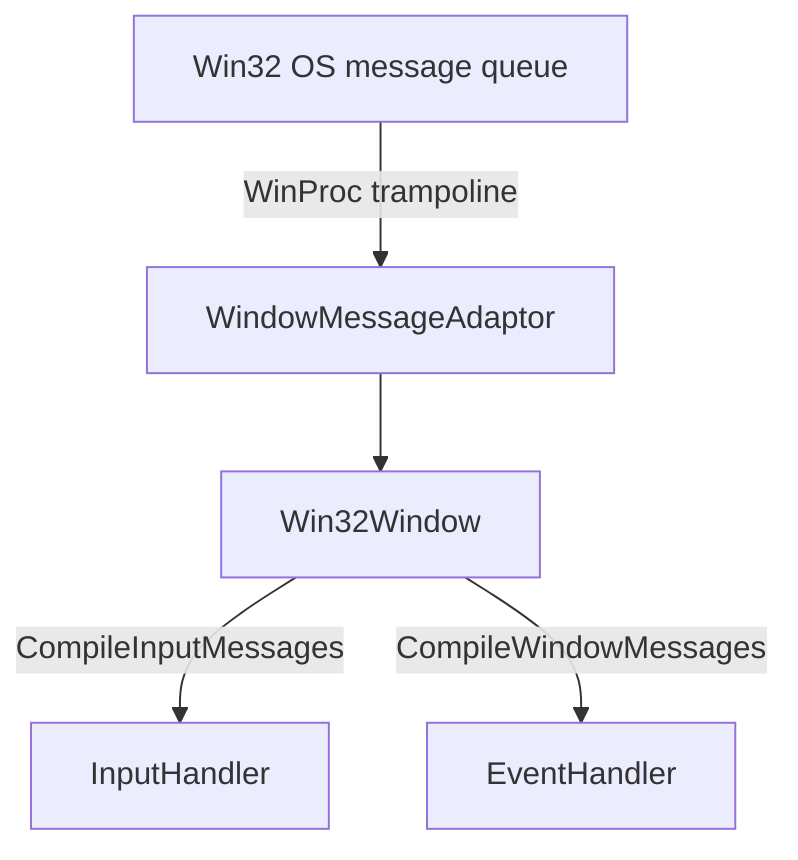

# Windowing / Win32 Platform Layer

`Engine\Src\Windowing\` is RZE's Win32 platform abstraction — the only OS layer supported today (no macOS/Linux path exists; see [09-BuildSystem](../09-BuildSystem/Sharpmake-Project-Graph.md), where non-Windows target platforms are commented out in the Sharpmake config).

## `Win32Window` (`Win32Window.h/.cpp`)

Wraps `HWND`/`HDC`/`HGLRC`/`PIXELFORMATDESCRIPTOR` in an `OSWindowHandleData` struct. Responsibilities:
- Window creation (`Create`), show/maximize, cursor control, title/size get/set. `Create` also moves the console, if the process has one, to the launch monitor's corner. The Editor only has one with `-console`, and a console hosted in Windows Terminal doesn't move ([Debug-Services-And-Logging.md](Debug-Services-And-Logging.md#the-console)).
- No file dialogs: the native Open/Save prompts were removed once the Editor had its own [file browser](../07-Editor/Thumbnails-And-File-Browser.md).
- **`CompileInputMessages(InputHandler&)`** / **`CompileWindowMessages(EventHandler&)`** — once per frame, handles **every** queued Win32 message (a `PeekMessage` loop, not one message per frame, which let input queue up and lag once frames were capped) and translates them into `InputHandler`/`EventHandler` calls via `ProcessWinProcMessage`. This is the single point where all OS input/window events enter the engine.
- **Mouse capture.** While a mouse button is down the window captures the mouse (`SetCapture`), so the release still arrives when it happens outside the window and drags carry on past its edge. It lets go once no button is down.
- **State the engine asks of the OS each frame:** `IsFocused()` (it's the foreground window), `IsMinimised()`, and `IsMouseButtonDown()` (`GetAsyncKeyState`, which unlike the input handler's state can't get stuck down). The `FramePacer` throttles frames while the window is unfocused or minimised, and the input handler uses focus and the button state ([Input-System.md](Input-System.md#interaction-and-focus)).
- **Closing.** `WM_CLOSE` (the close button, Alt+F4) isn't passed to `DefWindowProc`, which would destroy the window. It becomes a `Window_CloseRequested` event, and the engine exits only if `RZE_Application::OnCloseRequested()` returns true, so an app can ask first (the Editor's unsaved-changes prompt). The window then lasts until the process exits.

## `WindowMessageAdaptor` (`WindowMessageAdaptor.h/.cpp`)

An intermediary queue (`EMessageType`: `Create`/`Move`/`Resize`/`Destroy`/`Close`/`Quit`) that decouples the raw WinProc callback — which must be a static/global function per the Win32 API — from the `Win32Window` instance. Messages get pushed from the WinProc trampoline and later popped/processed by `Win32Window`, avoiding the need for global mutable window state at the WinProc callback site.

## `Display` (`Display.h/.cpp`)

Monitor queries: the monitors and their work areas (`GetMonitor(index, info)`, which `-launchMonitor` uses), and `GetRefreshRate(windowHandle)`, the refresh rate in Hz of the monitor most of the window is on, or 0 if it can't be read. The rate is a whole number, so a 59.94 Hz mode reads 59. The engine reads it at start-up and after every resize or move, for vsync pacing ([Engine-Startup-And-Frame-Loop.md](../02-Architecture/Engine-Startup-And-Frame-Loop.md#when-frames-start)).

## `WinKeyCodes.h`

Win32 virtual-key-code constants and mapping (`Win32KeyCode`), used by `InputHandler` to translate WM_KEYDOWN/WM_KEYUP messages into engine `InputKey` values.

## Diagram

## Key files

- `Engine\Src\Windowing\Win32Window.h/.cpp`
- `Engine\Src\Windowing\WindowMessageAdaptor.h/.cpp`
- `Engine\Src\Windowing\Display.h/.cpp`
- `Engine\Src\Windowing\WinKeyCodes.h`
