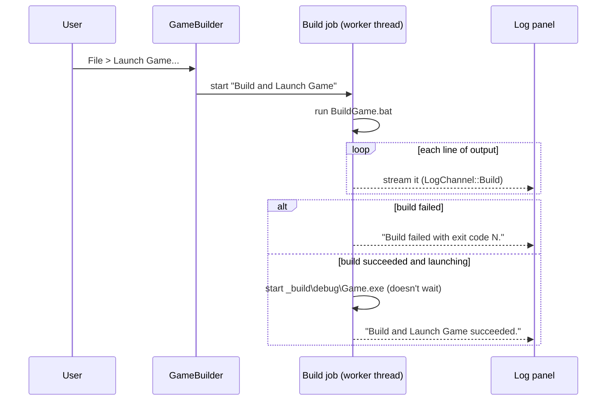

# Editor Camera & Build/Launch Workflow

## The editor camera (`EditorCameraComponent`)

`Editor\Src\Game\World\GameObjectComponents\EditorCameraComponent.h/.cpp`: the viewport camera, used only by the Editor. It lives on the `"EditorCam"` object, which isn't saved with the scene, and fills the main view's camera every frame. `SceneDocument` creates it after each load and hands it to the `EditorContext`, where panels find it (`GetEditorCamera()`, `GetEditorCameraComponent()`); the SceneView keeps its aspect ratio matched to the viewport.

### Controls

Camera input only works while the mouse is over the scene view. All the Editor's shortcuts are listed in [Editor-Shortcuts.md](Editor-Shortcuts.md).

| Do this | To | Feels like |
|---|---|---|
| **Hold RMB + move mouse** | Look around | First-person mouse look |
| **Hold RMB + W A S D** | Fly forward / left / back / right | Speeds up the longer a key is held |
| **Hold RMB + E / Q** | Fly up / down (relative to the view) | |
| **R** / **Space** (while flying) | ×4 speed / ÷8 speed | Base speed is 5 m/s |
| **Hold MMB + move mouse** | **Orbit** around the pivot | Like Maya / Blender |
| **Shift + MMB drag** | **Pan**: slide the view | The scene stays under the cursor |
| **Ctrl + MMB drag** | **Dolly**: drag down to pull back, up to push in | Same feel near and far (exponential) |
| **Mouse wheel** | Dolly toward the pivot | Each tick covers 15% of the remaining distance |
| **Double-click an object** in the Scene panel | **Frame** it | A short glide, see below |

### The orbit pivot

Orbit, pan and dolly all work around a **pivot**: a point straight ahead of the camera, `m_orbitDistance` metres away.

```mermaid
%%{init: {'flowchart': {'subGraphTitleMargin': {'top': 6, 'bottom': 10}}, 'themeCSS': '.labelBkg, .edgeLabel { background-color: var(--background-primary) !important; } .messageText, .labelText, .loopText { paint-order: stroke; stroke: var(--background-primary); stroke-width: 5px; stroke-linejoin: round; }'}}%%
flowchart LR
    Cam(("camera")) -->|"m_orbitDistance metres<br/>along m_forward"| Pivot(("pivot"))
    Orbit["MMB: orbit<br/>the camera circles the pivot"] -.- Pivot
    Dolly["wheel / Ctrl+MMB: dolly<br/>the camera moves toward<br/>or away from the pivot"] -.- Cam
    Pan["Shift+MMB: pan<br/>camera and pivot<br/>slide together"] -.- Cam
```

- **Orbit** turns the camera like mouse look, then backs it off along the new forward vector so the pivot stays put.
- **Pan** moves camera and pivot together. Mouse pixels are converted to metres *at the pivot's depth*, so whatever is at the pivot tracks the cursor exactly.
- **Wheel dolly** covers a fraction of the distance per tick, so it slows down as you get close. It never gets closer than 0.1 m; scrolling further pushes the pivot ahead instead, so you can keep moving forward.
- **Flying** with WASD carries the pivot along with the camera.
- At start-up the camera is aimed at the scene's centre, and the pivot is placed there.
- Pitch is clamped to ±89° so the view never flips over the poles.

### Framing an object (`FocusOn`)

Double-clicking an object in the Scene panel calls `FocusOn(bounds)` with the object's hierarchy bounds (`GameObject::GetHierarchyBounds`), or a box around just its position for lights and empties. The camera then glides over 0.5 s:

- It **approaches from the side it's already on** (the direction from the camera to the object, flattened onto the ground plane) and ends up looking down on the object from its current elevation, kept within **30–45°**.
- It backs off far enough to fit the object's bounding sphere, plus 40% padding, so the object fills about 70% of the view and its surroundings stay visible. Tiny objects are treated as at least 0.5 m across.
- It **turns faster than it moves** (0.3 s vs 0.5 s), so the object comes into view early in the glide.
- The pivot ends up on the object, so orbiting afterwards circles it.

### How it plugs in

- `Update()` (when it's the active camera): handle input, step any focus glide, rebuild the view and projection matrices, then write `ClipSpace = projection * view` and `Position` into `RZE().GetRenderEngine().GetMainView().Camera`.
- The projection uses D3D's 0..1 depth range (`Matrix4x4::CreatePerspectiveMatrixZeroToOne`), like every camera in the engine.
- It registers as a reflection child of `CameraComponent` (`REFLECT_REGISTER_COMPONENT_CHILD`) for inspector ordering. That doesn't fix the component-ID collision between the two classes described in [Component-System.md](../03-SceneAndGameObjects/Component-System.md); see [10-KnownIssues](../10-KnownIssues/Architectural-Notes-And-TODOs.md).
- It's an ordinary `GameObjectComponent` using public engine APIs, not a privileged engine type.

## Build/Launch workflow

File > **Build Game...** and **Launch Game...** call `GameBuilder::Build(launchAfterBuild)` (`Editor\Src\Services\GameBuilder.h/.cpp`, owned by `EditorContext`). The build runs as an async job (`JobAsyncOperation`), so the Editor keeps running while the Game builds. Both items are greyed out while a build is in progress (`IsBuilding()`), and a second request is ignored with a log line.

- **Build Game** runs `BuildGame.bat` (MSBuild for the Game project) and stops there.
- **Launch Game** does the same, then starts `_build\debug\Game.exe` without waiting for it.
- **Nothing is copied.** The Game reads `Assets\`, `Config\` and `ProjectData\` from the source tree, like the Editor (`EDirectoryContext::Source`, see [Building-And-Running.md](../01-GettingStarted/Building-And-Running.md)), so it sees a saved scene straight away.

## Key files

- `Editor\Src\Game\World\GameObjectComponents\EditorCameraComponent.h/.cpp`
- `Editor\Src\Services\GameBuilder.h/.cpp` — Build Game, Launch Game
- `Editor\Src\Services\SceneDocument.h/.cpp` — creates the editor camera after each load
- `Editor\Src\UI\MainMenuBar.cpp` — the File menu items
- `BuildGame.bat`
