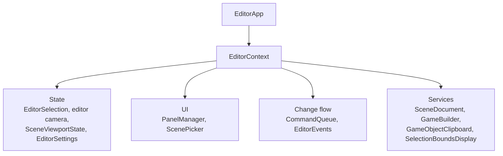
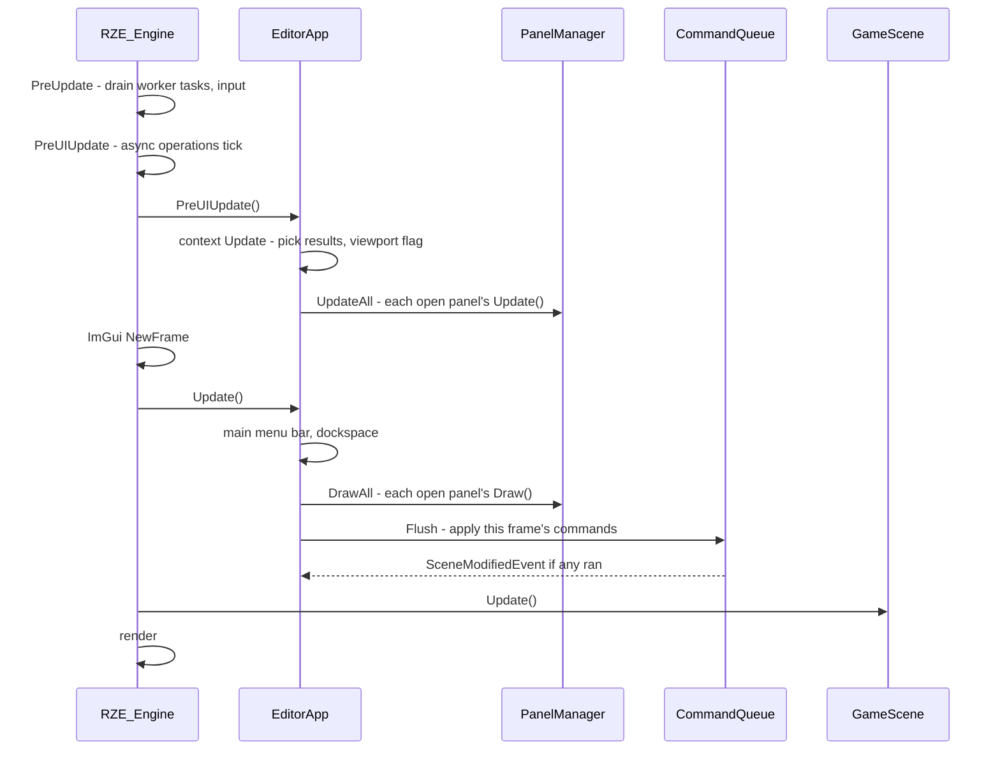

# Editor Framework: Context, Panels, Commands & Events

How the Editor's UI code is put together: what panels share, how a panel is written and registered, when it runs in the frame, and how it changes the scene. The framework lives in `Editor\Src\UI\Framework\`, `Editor\Src\Commands\` and `Editor\Src\Services\`. The panels built on it are described in [Editor-Panels.md](Editor-Panels.md), and the component inspector in [Object-Inspector-And-Properties.md](Object-Inspector-And-Properties.md).

The Editor uses **immediate-mode** Dear ImGui throughout. The framework adds structure around it rather than replacing it:

| Rule | Why |
|---|---|
| Panels share state through `EditorContext`, never through `EditorApp` or each other | Panels stay independent; any code can drive the selection or the scene document |
| Each panel has `Update()` (data, no ImGui) and `Draw()` (ImGui only) | Data work is testable without ImGui, and ImGui asserts if `Update()` calls it |
| Scene changes are pushed as **commands** and applied once per frame | No panel sees the scene change mid-draw; every change goes through one place, ready for undo |
| Interested code subscribes to **events** instead of polling | Loading, saving, selection and modification changes reach whoever needs them |

## `EditorContext`: what panels share

`EditorApp` owns one `EditorContext` and hands it to every panel. It owns the editor's state and services:



| Member | What it is |
|---|---|
| `GetEvents()` → `EditorEvents` | The event bus (below). Declared first, so it's destroyed last. |
| `GetSettings()` → `EditorSettings` | Session-only preferences more than one place reads. Today: the snap size (0.25–1 m), used by the gizmo, the grid and paste. |
| `GetSelection()` → `EditorSelection` | The selected GameObjects, in selection order. The **last** one is the **primary**: what the gizmo moves, the inspector shows first and the right-click menu acts on. Publishes `SelectionChangedEvent`. |
| `GetEditorCamera()` / `GetEditorCameraComponent()` | The `"EditorCam"` object. Null while a scene is loading. |
| `GetSceneViewport()` → `SceneViewportState` | Whether the SceneView is hovered (editor input only reaches the scene then) and its size in pixels. |
| `GetScenePicker()` → `ScenePicker` | GPU picking: `RequestPick(x, y, callback)` asks `PickRenderStage` which object covers a pixel; the callback fires a frame or two later. |
| `GetPanels()` → `PanelManager` | Every registered panel. `Find<T>()` exists for rare cases; prefer sharing state through the context. |
| `GetSceneDocument()` → `SceneDocument` | New, load, save and save-as for the scene, and whether it has unsaved changes. |
| `GetGameBuilder()` → `GameBuilder` | File > Build Game / Launch Game, on a worker thread. See [Editor-Camera-And-Build-Launch.md](Editor-Camera-And-Build-Launch.md). |
| `GetClipboard()` → `GameObjectClipboard` | Copy and paste of GameObjects (see [Editor-Overview.md](Editor-Overview.md#edit-copy-paste-and-duplicate)). |
| `GetCommands()` → `CommandQueue` | Where scene changes go (below). |

`ResetSceneState()` runs before a scene unloads. It clears the selection, the editor camera, any pick in flight and pending commands, then publishes `SceneUnloadingEvent`, which `PanelManager` turns into each panel's `OnSceneReset()`. UI state such as the viewport size carries over.

## Panels

A panel is an `EditorPanel` subclass that describes its window in a static `Describe()` and registers itself in its `.cpp`. That's all it takes; nothing else lists panels.

```cpp
class LogPanel : public EditorPanel
{
public:
    static PanelDesc Describe()
    {
        PanelDesc desc;
        desc.Name = "Log";                      // window title and ImGui ID; imgui.ini saves the layout under it
        desc.MenuPath = "View/Windows/Log";     // menu item that opens and closes it
        desc.DefaultDock = EPanelDock::Bottom;  // where it docks when there's no saved layout
        desc.WindowFlags = ImGuiWindowFlags_NoCollapse;
        return desc;
    }

private:
    void Update(EditorContext& context) override;   // before ImGui's frame: gather what Draw shows
    void Draw(EditorContext& context) override;     // the window's contents; PanelManager does Begin/End
};

REGISTER_EDITOR_PANEL(LogPanel);   // in LogPanel.cpp
```

`PanelDesc` fields:

| Field | Meaning |
|---|---|
| `Name` | Window title and ImGui ID. Renaming a panel loses its saved dock position. |
| `MenuPath` | Where its checkable menu item goes, starting with a main menu (`"View/Windows/Log"`, `"Help/ImGui Demo"`). Empty leaves it out of the menus. Items are sorted by name. |
| `DefaultDock` | `Left`, `Right`, `Bottom`, `Center` or `Floating`, for the generated layout. |
| `DefaultOpen` | Open on first run. |
| `Closable` | Shows the close button. A panel that can't close is always open (the SceneView). |
| `WindowFlags` | Passed to `Begin`. Include `ImGuiWindowFlags_MenuBar` to get a `DrawMenuBar()` call. |
| `OwnsWindow` | `Draw()` does its own `Begin`/`End` (the ImGui demo). Use `GetOpenFlag()` for its close button. |

Optional hooks: `Initialize(context)` (once, after every panel exists), `DrawMenuBar(context)`, `OnSceneReset()`, and `PushWindowStyle(style)` (style vars that cover the title bar and tab too).

`PanelManager` creates every registered panel at start-up, sorted by name. Each frame it updates and draws the open ones, builds the View and Help menu items from their `MenuPath`s, and, when `imgui.ini` has no saved layout, docks each panel into its `DefaultDock` slot.

> **Registration caveat.** `REGISTER_EDITOR_PANEL` (and `REGISTER_COMPONENT_INSPECTOR`) use static initializers, which only run for code linked straight into the Editor executable. If the panels ever move into a static library, they need force-linking (e.g. `/WHOLEARCHIVE`).

## When things run in a frame



`RZE_Application::PreUIUpdate()` is the engine hook that makes the split possible: it runs **before** `ImGui::NewFrame`, so an ImGui call in a panel's `Update()` hits ImGui's own "no frame" assert straight away. Commands are flushed after every panel has drawn and before the scene updates, so changes show in the same frame's render.

## Commands: how panels change the scene

Panels never change the scene while drawing. They push an `EditorCommand` to the context's `CommandQueue`:

```cpp
context.GetCommands().Push<DeleteGameObjectCommand>(gameObject);
```

- `Flush()` runs the queue in push order once per frame, including commands pushed during the flush.
- Commands hold `GameObjectPtr` / `GameObjectComponentPtr` **handles**, which become invalid when their target is destroyed, so a command whose object was deleted by an earlier command in the same flush does nothing. See [Scene-And-GameObject-Model.md](../03-SceneAndGameObjects/Scene-And-GameObject-Model.md#handles-gameobjectptr-and-gameobjectcomponentptrt).
- `Push` and `Flush` are main-thread only. Workers marshal back with `MainThreadDispatcher` first.
- A flush that ran at least one command publishes `SceneModifiedEvent`. Every command changes the scene; editor state such as the selection is changed directly, not through commands.

| Command | File | Does |
|---|---|---|
| `CreateGameObjectCommand` | `SceneCommands` | Adds a named GameObject |
| `RenameGameObjectCommand` | `SceneCommands` | Sets its name; names don't have to be unique |
| `DeleteGameObjectCommand` | `SceneCommands` | Deselects it (while it's still alive, so its bounds turn off), then removes it |
| `AddComponentCommand` | `SceneCommands` | Adds a component by type ID |
| `AttachToParentCommand` | `SceneCommands` | Reparents; refuses to make a cycle |
| `DetachFromParentCommand` | `SceneCommands` | Makes it a root object |
| `PasteGameObjectsCommand` | `SceneCommands` | Loads copied scene data as new objects, offset beside the originals, and selects them |
| `SetTransformCommand` | `TransformCommands` | Sets local position, rotation and scale (the gizmo) |
| `SetPropertyCommand` | `PropertyCommands` | Sets one described property through its setter (the inspector) |

### Interactions: one drag, many commands

A gizmo drag or a dragged number changes a value every frame, and each frame is a command. To let undo treat the whole drag as **one** step later, every command carries an `InteractionID`:

- `InteractionTracker` turns a control's per-frame "is it being used" into start and end edges and gives each interaction a unique ID. The gizmo's tracker follows `ImGuizmo::IsUsing()`, and `GizmoSnapper` uses the same edges to capture where a drag started.
- One-off edits (a checkbox, Enter in a text field, a file pick) get a fresh ID from `NewInteractionID()`.
- Widgets edit a **copy** of the value and push the result. The command is applied before the frame renders, so the round trip is invisible.

## Events

`EditorEvents` delivers typed events to subscribers, **synchronously** and on the main thread:

```cpp
m_subscription = context.GetEvents().Subscribe<SelectionChangedEvent>([this](const SelectionChangedEvent& event)
    {
        OnSelectionChanged(event.Selection.GetAll());
    });

context.GetEvents().Publish(SceneModifiedEvent{});
```

| Event | Published by | When |
|---|---|---|
| `SceneUnloadingEvent` | `EditorContext::ResetSceneState` | Before a scene unloads, while its objects can still be touched |
| `SceneLoadedEvent { Document }` | `SceneDocument` | A load (or New) succeeded and the editor camera is in |
| `SceneSavedEvent { Document }` | `SceneDocument` | After Save or Save As |
| `SceneModifiedEvent` | `CommandQueue::Flush` | A flush ran at least one command |
| `SceneModifiedStateChangedEvent { Document }` | `SceneDocument` | `IsModified()` flipped |
| `SelectionChangedEvent { Selection }` | `EditorSelection` | Once per call that actually changed it |

Current listeners:

| Listener | Listens for | Does |
|---|---|---|
| `PanelManager` | Scene unloading | Calls each panel's `OnSceneReset()` |
| `SceneDocument` | Scene modified | Marks the document modified |
| `SelectionBoundsDisplay` | Selection changed | Turns mesh bounds on for newly selected objects and off for deselected ones, through `RenderComponent`'s own toggle so the inspector checkbox agrees |
| `EditorApp` | Loaded, saved, modified state | Sets the window title: `RZEStudio - <file>`, `*` while there are unsaved changes, `Untitled` for a new scene |

Rules:

- `Subscribe` returns an `EventSubscription`. It's move-only and unsubscribes when destroyed, so keep it as a member of whatever owns the listener. It's safe to destroy after the bus itself.
- A listener added during a publish gets the next event, not the current one. One removed during a publish isn't called again.
- Events can be published in the middle of drawing (a click in the Scene panel changes the selection), so **listeners must not call ImGui**.
- `Publish` asserts it's on the main thread. `Subscribe` doesn't, because the context's members subscribe while it's constructed, before the engine has set up `MainThreadDispatcher`.

## Shared UI helpers (`EditorUI`)

`UI\Framework\EditorUI.h` keeps the same kinds of controls looking the same everywhere:

- `SectionHeading`, `ItemTooltip`, `RadioOption`.
- **Toolbars:** `ScopedToolbarSpacing` (tight spacing within a group) and `ToolbarGroupSeparator` (a separator with gaps), used by the SceneView's menu bar.
- **Property tables:** `BeginPropertyTable` / `PropertyRow` / `EndPropertyTable` and `CalcLabelColumnWidth`, the label/value layout of the Object Inspector. Labels too long for their column show in full on hover.

## Adding things

| To add | Do |
|---|---|
| A panel | Subclass `EditorPanel`, add `Describe()`, `Draw()` (and `Update()` if it has data to prepare), put `REGISTER_EDITOR_PANEL` in the `.cpp`, then run `GenerateSolutions.bat` |
| A scene change from the UI | Write an `EditorCommand` holding handles; push it from `Draw()`. Pass the interaction ID if it's part of a drag |
| Something that reacts to loading, saving, selection or edits | Subscribe to the event, keeping the `EventSubscription` as a member |
| A shared preference | Add it to `EditorSettings` |
| A component's inspector fields | Describe its properties; see [Object-Inspector-And-Properties.md](Object-Inspector-And-Properties.md) |

## Key files

- `Editor\Src\UI\Framework\EditorContext.h/.cpp`, `EditorSelection`, `EditorSettings`, `EditorEvents`, `ScenePicker`, `InteractionTracker`, `EditorUI`
- `Editor\Src\UI\Framework\EditorPanel.h/.cpp`, `PanelRegistry.h/.cpp`, `PanelManager.h/.cpp`
- `Editor\Src\Commands\EditorCommand.h`, `CommandQueue.h/.cpp`, `SceneCommands`, `TransformCommands`, `PropertyCommands`
- `Editor\Src\Services\SceneDocument`, `GameBuilder`, `GameObjectClipboard`, `SelectionBoundsDisplay`
- `Editor\Src\UI\MainMenuBar.h/.cpp`, `Editor\Src\EditorApp.h/.cpp`
- `Engine\Src\EngineApp.h` (`PreUIUpdate`), `Engine\Src\EngineCore\Engine.cpp` (frame order)
