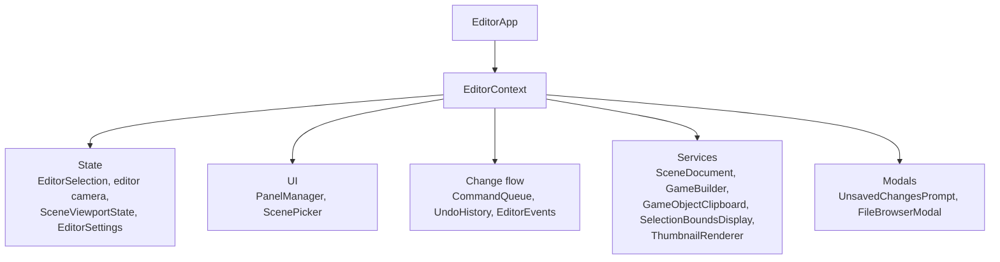
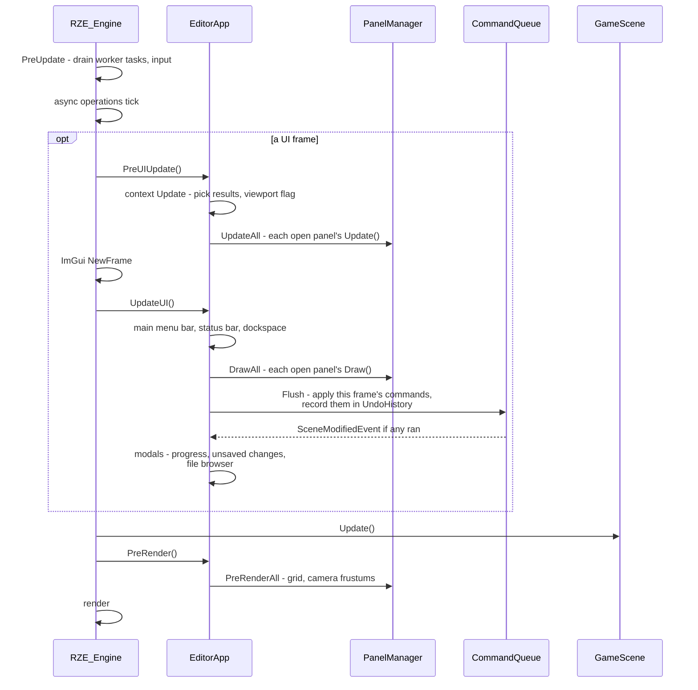
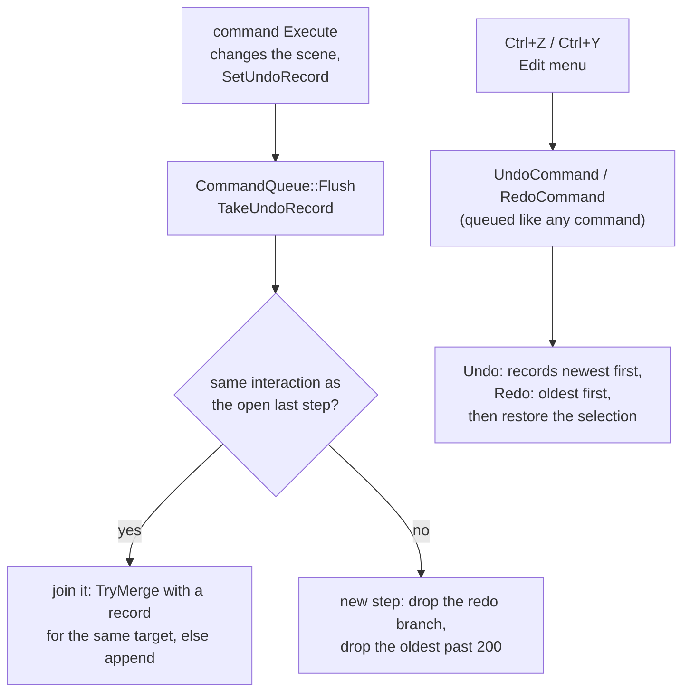

# Editor Framework: Context, Panels, Commands & Events

How the Editor's UI code is put together: what panels share, how a panel is written and registered, when it runs in the frame, how it changes the scene, and how those changes are undone. The framework lives in `Editor\Src\UI\Framework\`, `Editor\Src\Commands\` and `Editor\Src\Services\`. The panels built on it are described in [Editor-Panels.md](Editor-Panels.md), and the component inspector in [Object-Inspector-And-Properties.md](Object-Inspector-And-Properties.md).

The Editor uses **immediate-mode** Dear ImGui throughout. The framework adds structure around it rather than replacing it:

| Rule | Why |
|---|---|
| Panels share state through `EditorContext`, never through `EditorApp` or each other | Panels stay independent; any code can drive the selection or the scene document |
| Each panel has `Update()` (data, no ImGui) and `Draw()` (ImGui only) | Data work is testable without ImGui, and ImGui asserts if `Update()` calls it |
| Scene changes are pushed as **commands** and applied once per frame | No panel sees the scene change mid-draw; every change goes through one place, which is how undo sees it |
| Interested code subscribes to **events** instead of polling | Loading, saving, selection and modification changes reach whoever needs them |

## `EditorContext`: what panels share

`EditorApp` owns one `EditorContext` and hands it to every panel. It owns the editor's state and services:



| Member | What it is |
|---|---|
| `GetEvents()` → `EditorEvents` | The event bus (below). Declared first, so it's destroyed last. |
| `GetSettings()` → `EditorSettings` | Session-only preferences more than one place reads. Today: the snap size (0.25–1 m), used by the gizmo, the grid and paste, and the gizmo's rotate step (15–90°). The scene view's toolbar and the Settings window both edit them. |
| `GetSelection()` → `EditorSelection` | The selected GameObjects, in selection order. The **last** one is the **primary**: what the gizmo moves, the inspector shows first and the right-click menu acts on. Publishes `SelectionChangedEvent`. |
| `GetEditorCamera()` / `GetEditorCameraComponent()` | The `"EditorCam"` object. Null while a scene is loading. |
| `GetSceneViewport()` → `SceneViewportState` | Whether the SceneView is hovered (editor input only reaches the scene then) and its size in pixels. |
| `GetScenePicker()` → `ScenePicker` | GPU picking: `RequestPick(x, y, callback)` asks `PickRenderStage` what's at a pixel. A frame or two later the callback gets a `ScenePick`: the object (null for none), the world position of the surface there (unset where nothing is drawn) and the ray from the camera through the pixel. |
| `GetPanels()` → `PanelManager` | Every registered panel. `Find<T>()` exists for rare cases; prefer sharing state through the context. |
| `GetSceneDocument()` → `SceneDocument` | New, load, save and save-as for the scene, and whether it has unsaved changes (worked out from the undo history; see [Save point](#the-save-point-and-unsaved-changes)). `SaveWithPrompt(onDone)` saves straight away if the scene has a file; otherwise it opens the file browser in Save mode and calls `onDone(true)` once saved, or `onDone(false)` if the browser is cancelled. |
| `GetGameBuilder()` → `GameBuilder` | File > Build Game / Launch Game, on a worker thread. See [Editor-Camera-And-Build-Launch.md](Editor-Camera-And-Build-Launch.md). |
| `GetClipboard()` → `GameObjectClipboard` | Copy and paste of GameObjects, held in memory as `GameObjectSnapshot`s (see [Editor-Overview.md](Editor-Overview.md#edit-copy-paste-and-duplicate)). |
| `GetThumbnails()` → `ThumbnailRenderer` | Renders scene and mesh thumbnails in the background. `Request(asset, force)`, and `AddToBrowser(request)` to wire a file browser up to it. See [Thumbnails-And-File-Browser.md](Thumbnails-And-File-Browser.md). |
| `GetFileBrowser()` → `FileBrowserModal` | The thumbnail file browser for opening, saving and picking files (same page). |
| `GetCommands()` → `CommandQueue` | Where scene changes go (below). |
| `GetUndoHistory()` → `UndoHistory` | What the commands did, for undo and redo (below). |
| `GetUnsavedChangesPrompt()` → `UnsavedChangesPrompt` | Asks Save / Don't Save / Cancel before anything that would lose unsaved changes (below). |

`ResetSceneState()` runs before a scene unloads. It clears the selection, the editor camera, any pick in flight, pending commands and the undo history, then publishes `SceneUnloadingEvent`, which `PanelManager` turns into each panel's `OnSceneReset()`. UI state such as the viewport size carries over.

## Panels

A panel is an `EditorPanel` subclass that describes its window in a static `Describe()` and registers itself in its `.cpp`. That's all it takes; nothing else lists panels.

```cpp
class LogPanel : public EditorPanel
{
public:
    static PanelDesc Describe()
    {
        PanelDesc desc;
        desc.Name = "Log";                      // window title and ImGui ID; imgui.ini saves the layout under it
        desc.MenuPath = "View/Windows/Log";     // menu item that opens and closes it
        desc.DefaultDock = EPanelDock::Bottom;  // where it docks when there's no saved layout
        desc.WindowFlags = ImGuiWindowFlags_NoCollapse;
        return desc;
    }

private:
    void Update(EditorContext& context) override;   // before ImGui's frame: gather what Draw shows
    void Draw(EditorContext& context) override;     // the window's contents; PanelManager does Begin/End
};

REGISTER_EDITOR_PANEL(LogPanel);   // in LogPanel.cpp
```

`PanelDesc` fields:

| Field | Meaning |
|---|---|
| `Name` | Window title and ImGui ID. Renaming a panel loses its saved dock position. |
| `MenuPath` | Where its checkable menu item goes, starting with a main menu (`"View/Windows/Log"`, `"Help/ImGui Demo"`). Empty leaves it out of the menus. Items are sorted by name. |
| `DefaultDock` | `Left`, `Right`, `Bottom`, `Center` or `Floating`, for the generated layout, and where a panel added since `imgui.ini` was saved goes (see below). |
| `DefaultSize` | For a `Floating` panel: its size the first time it opens, centred in the editor (until `imgui.ini` has one). Zero leaves it to ImGui. |
| `DefaultOpen` | Open on first run. |
| `Closable` | Shows the close button. A panel that can't close is always open (the SceneView). |
| `WindowFlags` | Passed to `Begin`. Include `ImGuiWindowFlags_MenuBar` to get a `DrawMenuBar()` call. |
| `OwnsWindow` | `Draw()` does its own `Begin`/`End` (the ImGui demo). Use `GetOpenFlag()` for its close button. |

Optional hooks: `Initialize(context)` (once, after every panel exists), `DrawMenuBar(context)`, `OnSceneReset()`, `PushWindowStyle(style)` (style vars that cover the title bar and tab too), and `PreRender(context)`: every frame while the panel is open, after the scene's update and before the frame renders, for what goes into the scene every frame, such as debug lines, which are cleared after each render. No ImGui calls there; it's outside ImGui's frame. The SceneView draws the grid and camera frustums in it, but only while its last `Draw` showed the scene image.

`PanelManager` creates every registered panel at start-up, sorted by name. On each UI frame it updates and draws the open ones (`UpdateAll`, `DrawAll`), and every frame it calls their `PreRender` (`PreRenderAll`). It also builds the Edit, View and Help menu items from their `MenuPath`s, and docks panels:

- **Tab order.** Panels sharing a slot are tabs in a fixed order: the ones open at first (`DefaultOpen`), then the rest, each by name. So the Bottom slot is Content Browser, then Log.
- **No saved layout.** `BuildDefaultDockLayout` docks each panel into its `DefaultDock` slot in that order and shows each slot's first tab. It sets the tab order explicitly, since ImGui otherwise orders tabs that appear in the same frame as it likes.
- **A panel `imgui.ini` doesn't know**, e.g. one added since the layout was saved, would otherwise open floating. Before its first `Begin`, `PlaceUnsavedPanel` docks it into the node of a saved panel from the same slot. It takes the place of the first saved panel that comes after it in the tab order, and the tabs from there on move along one; with none after it, it goes last. Tabs the user has rearranged keep their order. It's shown as the selected tab, so a new panel gets noticed. From then on `imgui.ini` remembers it like any other. If no panel from its slot is saved, it's left to ImGui.

This uses ImGui's internal window settings and dock nodes (`imgui_internal.h`), as the DockBuilder calls already do.

> **Registration and linking.** `REGISTER_EDITOR_PANEL` (and `REGISTER_SETTINGS_PAGE`) register from static initializers that nothing else references. The Editor's code is built as the `EditorLib` static library (so [the unit tests](../01-GettingStarted/Building-And-Running.md#unit-tests) can link it), and a linker drops unreferenced objects from a library, so `Editor` links `EditorLib` with `/WHOLEARCHIVE` to keep them. Anything else that links `EditorLib`, such as `UnitTests`, gets no panels unless it does the same.

## When things run in a frame



`RZE_Application::PreUIUpdate()` is the engine hook that makes the split possible: it runs **before** `ImGui::NewFrame`, so an ImGui call in a panel's `Update()` hits ImGui's own "no frame" assert straight away. Commands are flushed after every panel has drawn and before the scene updates, so changes show in the same frame's render.

Everything in the `opt` box is the UI, which `FrameSettings::UIFrameRate` (the [Frame Rate settings page](Status-Bar-And-Settings.md#pages)) can run less often than the scene. The checked-in Engine.ini sets 15 a second (with no setting, every frame is a UI frame), and every frame is one anyway while the user interacts. A frame that skips the UI renders the last one again around this frame's scene, so per-frame scene overlays go in `PreRender`, not `Draw`. What ImGui itself draws over the scene (the gizmo, object icons, the marquee) only moves on UI frames. See [Engine-Startup-And-Frame-Loop.md](../02-Architecture/Engine-Startup-And-Frame-Loop.md#ui-frame-rate).

## Commands: how panels change the scene

**The rule:** every change the editor UI makes to the scene goes through a command, because undo only sees what commands record. A command that creates objects indirectly owns them, and records them for undo like any other change.

Panels never change the scene while drawing. They push an `EditorCommand` to the context's `CommandQueue`:

```cpp
context.GetCommands().Push<DeleteGameObjectCommand>(gameObject);
```

- `Flush()` runs the queue in push order once per frame, including commands pushed during the flush.
- Commands hold `GameObjectPtr` / `GameObjectComponentPtr` **handles**. A handle becomes invalid when its target is destroyed, but stays valid while undo has the object [parked](#parking-deleted-objects) out of the scene, so commands check `UndoTargets::IsInScene(handle)` rather than just for null. A command whose target is gone does nothing. See [Scene-And-GameObject-Model.md](../03-SceneAndGameObjects/Scene-And-GameObject-Model.md#handles-gameobjectptr-and-gameobjectcomponentptrt).
- `Execute` returns whether it changed the scene: false if its target is gone, there was nothing to change, or it only changed editor state (an [`EditorOnly`](Object-Inspector-And-Properties.md#metadata) property).
- While it runs, a command can hand over an `UndoRecord` (`SetUndoRecord`) describing how to undo it; `Flush` takes it (`TakeUndoRecord`) and adds it to the `UndoHistory`.
- `Push` and `Flush` are main-thread only. Workers marshal back with `MainThreadDispatcher` first.
- A flush in which a command changed the scene publishes `SceneModifiedEvent`. Editor state such as the selection is changed directly, not through commands.
- **Debug safety net.** `GameScene::SetObjectsChangedCallback` is a plain Engine hook, called whenever objects are added to or removed from the scene. In Debug, `EditorApp` installs a check that asserts unless a `CommandQueue::SceneEditScope` is open (`Flush` opens one, as does creating the editor camera) or a scene is loading, which catches UI code changing the scene outside a command.

| Command | File | Does | Undo record |
|---|---|---|---|
| `CreateGameObjectCommand` | `SceneCommands` | Adds a named GameObject | parks / restores the new object |
| `RenameGameObjectCommand` | `SceneCommands` | Sets its name; names don't have to be unique | old and new name |
| `DeleteGameObjectCommand` | `SceneCommands` | Parks it and its descendants, and takes them out of the selection | restores / parks them |
| `AddComponentCommand` | `SceneCommands` | Adds a component by type ID | removes it (`RemoveComponentByID`) / adds a new one |
| `AttachToParentCommand` | `SceneCommands` | Reparents; refuses to make a cycle | old parent and child index, new parent and index |
| `DetachFromParentCommand` | `SceneCommands` | Makes it a root object | old parent and child index |
| `PasteGameObjectsCommand` | `SceneCommands` | Creates new objects from `GameObjectSnapshot`s, offset beside the originals, and selects them | parks / restores the pasted objects |
| `SetTransformCommand` | `TransformCommands` | Sets local position, rotation and scale (the gizmo) | before and after; merges within a drag |
| `SetPropertyCommand` | `PropertyCommands` | Sets one described property through its setter (the inspector) | before and after; merges within a drag. `Exclusive` properties record who had it before |
| `UndoCommand` / `RedoCommand` | `HistoryCommands` | Steps through the history | not recorded |

### Interactions: one drag, many commands

A gizmo drag or a dragged number changes a value every frame, and each frame is a command. To let undo treat the whole drag as **one** step later, every command carries an `InteractionID`:

- `InteractionTracker` turns a control's per-frame "is it being used" into start and end edges and gives each interaction a unique ID. The gizmo's tracker follows `ImGuizmo::IsUsing()`, and `GizmoSnapper` uses the same edges to capture where a drag started.
- One-off edits (a checkbox, Enter in a text field, a file pick) get a fresh ID from `NewInteractionID()`.
- Widgets edit a **copy** of the value and push the result. The command is applied before the frame renders, so the round trip is invisible.

## Undo and redo

`UndoHistory` (`Services\UndoHistory`, owned by the context) is a list of **steps**. A step is everything one interaction did: a gizmo drag over three objects is one step holding three records, each with the transform from before the drag and from its end.



**Records.** An `UndoRecord` has `Undo(context)`, `Redo(context)`, `GetName()` (the Edit menu label, "Undo Rename"), and optionally:

- `TryMerge(newer)`: within one interaction, a later record of the same change to the same target folds in, keeping this one's "before" and taking the newer "after". Transform and property records merge on the same GUID (and component and property).
- `OnDropped()`: the step left the history for good. The parking records use it to destroy objects still parked.

Records find their targets by **`ObjectGUID`** through `UndoTargets::FindObject` / `FindComponent`, never by handle, so they still work on an object that was deleted and brought back.

**Steps.**

- A record from the same interaction as the open last step joins it. `k_noInteraction` always starts a new step, as does any record after the step is **closed**: by undo, redo, a save, or `CloseStep()`.
- A new step drops everything that could be redone (calling `OnDropped`).
- The history keeps **200 steps** (`k_maxSteps`); past that, the oldest is dropped.
- Each step stores the selection, as GUIDs, from before its first command and after its last. Undo selects the "before" set, redo the "after" set, leaving out objects that aren't in the scene. Undoing a delete selects the object again.
- `Clear()` (on scene unload) drops everything **without** `OnDropped`: the scene is about to unload and destroys parked objects itself.

**Shortcuts.** Ctrl+Z, Ctrl+Y and Ctrl+Shift+Z, and Edit > Undo / Redo with the step's name. They push `UndoCommand` / `RedoCommand`, so undo applies at flush time in order with other commands, and they're ignored while a widget or the gizmo is held, so a drag isn't half undone.

**What isn't recorded.** Properties marked `EditorOnly` (view settings such as the bounds toggles) are applied without a record and don't count as a scene change.

### Parking deleted objects

Deleting doesn't destroy anything. `ParkedSubtree` (`Commands\ParkedSubtree`) takes an object and its descendants **out of the scene** but keeps them alive, and undo puts back the very same objects:

- **Park:** remembers the parent's GUID and the object's index among its children, takes the subtree out of the selection, detaches it, and calls `OnRemoveFromScene` on each object. The objects stay in the scene's list (so root order and GUIDs come back unchanged) but are out of it: lookups, saving, updates and the Scene panel skip them (see [Scene-And-GameObject-Model.md](../03-SceneAndGameObjects/Scene-And-GameObject-Model.md#in-the-scene-and-out-of-it)).
- **Restore:** reattaches at the same index under the same parent and calls `OnAddToScene`. Meshes and other resources were never released, so nothing reloads.
- **Main camera:** if the scene's main camera was in the subtree, the scene hands the role to another camera while it's parked, and restoring gives it back.
- **Destroy:** when the step is dropped (past the cap, or undone and replaced), `OnDropped` calls `GameScene::RemoveGameObject` on anything still parked.

Delete, Create (undone) and Paste (undone) all park. Adding a component is undone with `GameObject::RemoveComponentByID`, and redone by adding a fresh one; edits made to it afterwards are later steps, which redo applies again.

### The save point and unsaved changes

The history also keeps a **save point**: its position at the last save or load. `SceneDocument::IsModified()` is whether the history is somewhere else, rechecked after every flush, so undoing back to the save clears the title's `*`.

- Saving closes the open step, so a drag that carries on past a save is a new change.
- The save point is lost (the scene stays modified until saved) when the saved state is in a redo branch that a new change replaces, when it's dropped past the cap, or when a command changes the scene **without** an undo record (`MarkUnrecordedChange`). Undo and redo don't count: they only move through the history (`EditorCommand::IsHistoryNavigation`).

### The unsaved-changes prompt

`UnsavedChangesPrompt` (`UI\Modals\`) guards anything that would lose unsaved changes, or that reads the scene's file (Launch Game):

```cpp
context.GetUnsavedChangesPrompt().Request(context, "loading another scene", [&scene]() { /* file browser, then Load */ });
```

- If the scene has no unsaved changes, the action runs straight away.
- Otherwise a modal asks *"Sponza.scene has unsaved changes. Save them before loading another scene?"*: **Save** (then the action), **Don't Save** (the action), **Cancel** or Escape (nothing). Choosing Save on a new scene opens the file browser in Save mode (`SaveWithPrompt`); cancelling it cancels the action too, so the changes aren't lost. The prompt stays pending (`IsOpen()`) while the browser is up.
- New, Load, Launch Game and Exit go through it, and so does closing the window: the engine turns the window's close button into `Window_CloseRequested`, and `EditorApp::OnCloseRequested()` returns false and opens the prompt while there are unsaved changes ([App-Shell-Pattern.md](../02-Architecture/App-Shell-Pattern.md)).

## Events

`EditorEvents` delivers typed events to subscribers, **synchronously** and on the main thread:

```cpp
m_subscription = context.GetEvents().Subscribe<SelectionChangedEvent>([this](const SelectionChangedEvent& event)
    {
        OnSelectionChanged(event.Selection.GetAll());
    });

context.GetEvents().Publish(SceneModifiedEvent{});
```

| Event | Published by | When |
|---|---|---|
| `SceneUnloadingEvent` | `EditorContext::ResetSceneState` | Before a scene unloads, while its objects can still be touched |
| `SceneLoadedEvent { Document }` | `SceneDocument` | A load (or New) succeeded and the editor camera is in |
| `SceneSavedEvent { Document }` | `SceneDocument` | After Save or Save As |
| `SceneModifiedEvent` | `CommandQueue::Flush` | A command in the flush changed the scene |
| `SceneModifiedStateChangedEvent { Document }` | `SceneDocument` | `IsModified()` flipped |
| `SelectionChangedEvent { Selection }` | `EditorSelection` | Once per call that actually changed it |
| `ThumbnailWrittenEvent { Image }` | `ThumbnailRenderJob` | A thumbnail PNG was written |

Current listeners:

| Listener | Listens for | Does |
|---|---|---|
| `PanelManager` | Scene unloading | Calls each panel's `OnSceneReset()` |
| `SceneDocument` | Scene modified | Sets `IsModified()` from the undo history's save point |
| `SelectionBoundsDisplay` | Selection changed | Turns mesh bounds on for newly selected objects and off for deselected ones, through `RenderComponent`'s own toggle so the inspector checkbox agrees |
| `EditorApp` | Loaded, saved, modified state | Sets the window title: `RZEStudio - <file>`, `*` while there are unsaved changes, `Untitled` for a new scene |
| `ThumbnailRenderer` | Loaded, saved | Renders the scene's thumbnail in the background: after a save always, after a load if it's missing or out of date |
| `EditorContext`, `ContentBrowserPanel` | Thumbnail written | Reload the tiles showing that image, in the file browser (the context forwards it to `FileBrowserModal::RefreshThumbnail`) and in the Content Browser |

Rules:

- `Subscribe` returns an `EventSubscription`. It's move-only and unsubscribes when destroyed, so keep it as a member of whatever owns the listener. It's safe to destroy after the bus itself.
- A listener added during a publish gets the next event, not the current one. One removed during a publish isn't called again.
- Events can be published in the middle of drawing (a click in the Scene panel changes the selection), so **listeners must not call ImGui**.
- `Publish` asserts it's on the main thread. `Subscribe` doesn't, because the context's members subscribe while it's constructed, before the engine has set up `MainThreadDispatcher`.

## Shared UI helpers (`EditorUI`)

`UI\Framework\EditorUI.h` keeps the same kinds of controls looking the same everywhere:

- `SectionHeading`, `ItemTooltip`, `RadioOption`.
- **Toolbars:** `ScopedToolbarSpacing` (tight spacing within a group) and `ToolbarGroupSeparator` (a separator with gaps), used by the SceneView's menu bar.
- **Property tables:** `BeginPropertyTable` / `PropertyRow` / `EndPropertyTable` and `CalcLabelColumnWidth`, the label/value layout of the Object Inspector. Labels too long for their column show in full on hover.

## Adding things

| To add | Do |
|---|---|
| A panel | Subclass `EditorPanel`, add `Describe()`, `Draw()` (and `Update()` if it has data to prepare), put `REGISTER_EDITOR_PANEL` in the `.cpp`, then run `GenerateSolutions.bat` |
| A scene change from the UI | Write an `EditorCommand` holding handles; check `UndoTargets::IsInScene` before changing anything, and give it an `UndoRecord` that finds its target by GUID. Push it from `Draw()`, with the interaction ID if it's part of a drag |
| Something that would lose unsaved changes | Run it through `UnsavedChangesPrompt::Request` |
| Something that reacts to loading, saving, selection or edits | Subscribe to the event, keeping the `EventSubscription` as a member |
| A shared preference | Add it to `EditorSettings`, and a control for it on a Settings page |
| A Settings page | Subclass `SettingsPage` (`GetName()`, `Draw(context)`), put `REGISTER_SETTINGS_PAGE` in the `.cpp`, then run `GenerateSolutions.bat`. See [Status-Bar-And-Settings.md](Status-Bar-And-Settings.md#the-settings-window) |
| Long-running work | An `AsyncOperation`: `Blocking` if the user must wait, `Background` if not. Visible ones show in the status bar, with what they log ([Asset-Import-Runtime.md](../05-AssetPipeline/Asset-Import-Runtime.md#async-operations)) |
| A component's inspector fields | Describe its properties; see [Object-Inspector-And-Properties.md](Object-Inspector-And-Properties.md) |

## Key files

- `Editor\Src\UI\Framework\EditorContext.h/.cpp`, `EditorSelection`, `EditorSettings`, `EditorEvents`, `ScenePicker`, `InteractionTracker`, `EditorUI`
- `Editor\Src\UI\Framework\EditorPanel.h/.cpp`, `PanelRegistry.h/.cpp`, `PanelManager.h/.cpp`
- `Editor\Src\Commands\EditorCommand.h`, `CommandQueue.h/.cpp`, `SceneCommands`, `TransformCommands`, `PropertyCommands`, `HistoryCommands`, `UndoRecord`, `ParkedSubtree`
- `Editor\Src\Services\SceneDocument`, `GameBuilder`, `GameObjectClipboard`, `GameObjectSnapshot`, `SelectionBoundsDisplay`, `UndoHistory`, `ThumbnailRenderer`
- `Editor\Src\UI\Modals\UnsavedChangesPrompt.h/.cpp`, `FileBrowserModal.h/.cpp`
- `Editor\Src\UI\Widgets\FileTileGrid.h/.cpp` — the tile grid the file browser and the Content Browser share
- `Editor\Src\UI\Settings\` — `SettingsPage`, `SettingsPageRegistry` and the pages
- `Editor\Src\UI\MainMenuBar.h/.cpp`, `Editor\Src\EditorApp.h/.cpp`
- `Engine\Src\EngineApp.h` (`PreUIUpdate`, `UpdateUI`, `Update`, `PreRender`), `Engine\Src\EngineCore\Engine.cpp` (frame order)
