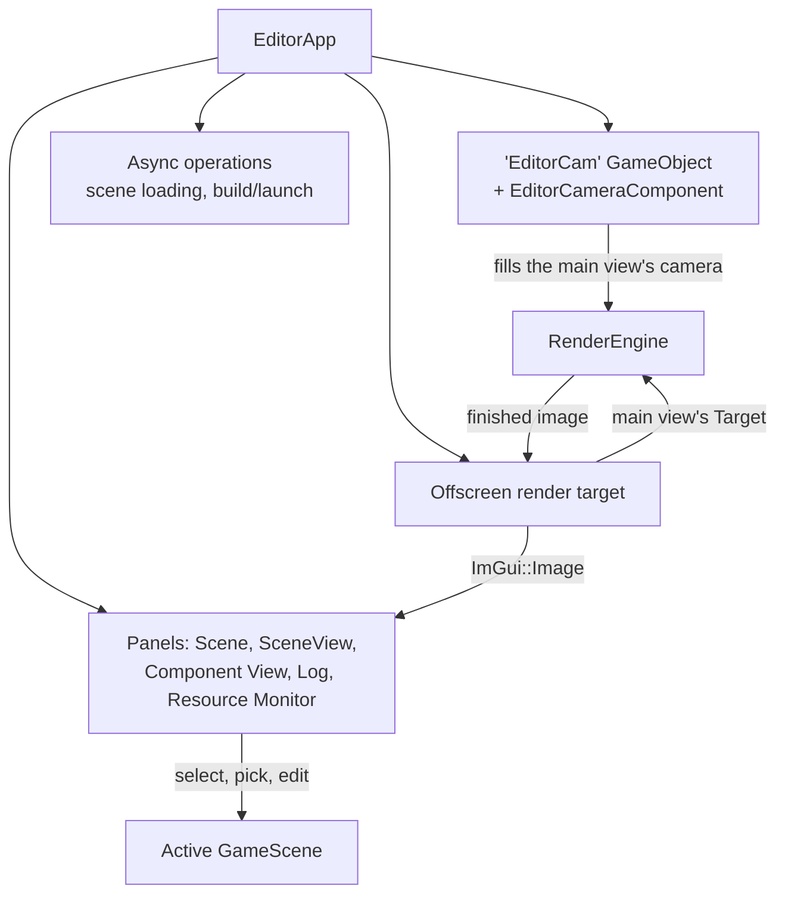
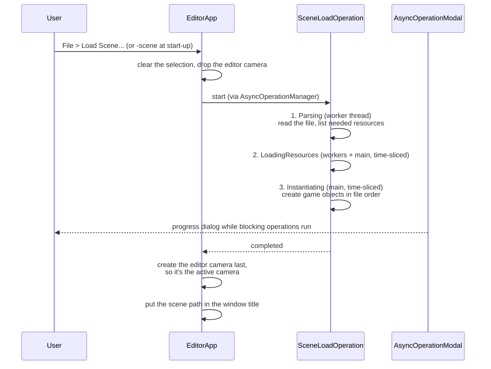
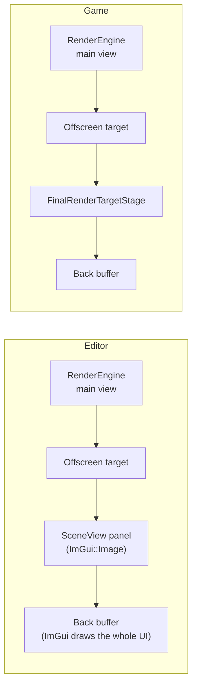

# Editor Overview

The Editor ("RZEStudio", `RZE\Editor\`) is the scene-authoring app. It's a Dear ImGui app built on exactly the same `Engine` and `Modules\Rendering` stack as the Game. It has no renderer or scene model of its own: `EditorApp` is just another `RZE_Application` (see [App-Shell-Pattern.md](../02-Architecture/App-Shell-Pattern.md)) that adds panels, an editor camera and some tooling.

## What you see

```
+---------------------------------------------------------------------------------+
| File  View  Help  | frame time | RenderCommand MemArena: 4 KB / 64 MB  Peak ...   |
+--------------+--------------------------------------------------+---------------+
| Scene        | SceneView  (Translate Rotate Scale | Local World)| Component View|
|              |                                                  |               |
|  Camera      |      3D viewport: the scene, gizmo, light and    | inspector for |
|  Directional |      camera icons, bounds boxes, marquee         | the primary   |
|  NeckMech    |                                                  | selection     |
|  M4          |                                                  |               |
+--------------+--------------------------------------------------+---------------+
| Log   (RZE_LOG output, resource loads, build output)                            |
+---------------------------------------------------------------------------------+
```

The layout is an ImGui dockspace, saved in `Config\imgui.ini`. Each panel is described in [Editor-Panels.md](Editor-Panels.md); the camera and the build/launch tools are in [Editor-Camera-And-Build-Launch.md](Editor-Camera-And-Build-Launch.md).

## Launching

`Editor\Src\EditorMain.cpp` sets `Filepath::SetDirectoryContext(EDirectoryContext::Tools)`, constructs `Editor::EditorApp`, and calls `Run()`. The Tools context means paths resolve against the **source tree** (`RZE\Assets\...`), not the copied assets in `_build\<config>`, so shader and asset edits show up on the next launch with no copy step.

| Argument | Effect |
|---|---|
| `-scene <file>` | Opens `Assets/Scenes/<file>` (e.g. `-scene Sponza.scene`). Without it, the Editor opens `Assets/Scenes/RenderTest.scene`. |
| `-launchMonitor <n>` | Opens the window on monitor *n*, overriding the config's launch monitor. Handled by the engine, so the Game accepts it too. |

`Editor\_project\Editor.args.json` holds presets for these in Visual Studio.

## How the Editor fits together



- **Offscreen viewport.** `CreateRenderTarget()` makes a `RenderTargetTexture` the size of the window and sets it as the main view's `Target`. The scene renders into it, and `SceneViewPanel` shows it with `ImGui::Image`, cropping the UVs to the panel's size. The Editor never draws the scene straight to the back buffer; ImGui owns the back buffer.
- **Render stages.** On top of the engine's stages, the Editor adds `ImGuiRenderStage(withEditor = true)`. The `PickRenderStage` that click selection uses is part of the engine and idle unless the Editor asks for a pick. See [Render-Stages.md](../04-Rendering/Render-Stages.md).
- **Editor camera.** `CreateAndInitializeEditorCamera()` adds an `"EditorCam"` object at `(-4, 10, 4)`, aimed at the scene's centre. It's excluded from saves (`SetIncludeInSave(false)`) and hidden from the Scene panel.
- **Input.** `ProcessInput()` forwards mouse and keyboard to ImGui (`ImGuiInput::SubmitInput`, including the wheel and text input) and returns whether the scene view is hovered. Engine input actions, including the camera controls, only fire while it is, so typing in a panel doesn't fly the camera.

## Loading a scene

Scene loading is **asynchronous**, so the Editor stays responsive and shows progress while big scenes like Sponza stream in.



- Only one load runs at a time; the File menu disables New/Load while one is in progress.
- If loading fails, the partial scene is unloaded, the error is logged, and the next Save prompts for a path rather than overwriting the file.
- `AsyncOperationModal` (`UI\Modals\`) is a generic progress dialog. It watches `AsyncOperationManager` and appears for any operation flagged `Blocking`.

## Menu bar

| Menu | Items |
|---|---|
| File | New Scene..., Load Scene..., Save Scene (prompts for a path if the scene is new; copies assets afterwards), Build Game..., Launch Game..., Exit |
| View | Windows: Scene, Resource Monitor |
| Help | Show ImGui Demo Window |

The right side of the menu bar shows the frame time and the render command arena's use (`RenderCommand MemArena: current / total`, plus the peak), colour-coded by pressure. It's a quick way to see what a change costs on the render path.

## Editor vs Game: where the picture goes



## Key files

- `Editor\Src\EditorMain.cpp`, `Editor\Src\EditorApp.h/.cpp`
- `Editor\Src\UI\Panels\` — see [Editor-Panels.md](Editor-Panels.md)
- `Editor\Src\UI\Modals\AsyncOperationModal.h/.cpp`
- `Editor\Src\Game\World\GameObjectComponents\EditorCameraComponent.h/.cpp` — see [Editor-Camera-And-Build-Launch.md](Editor-Camera-And-Build-Launch.md)
- `Engine\Src\Game\SceneLoadOperation.h/.cpp`
