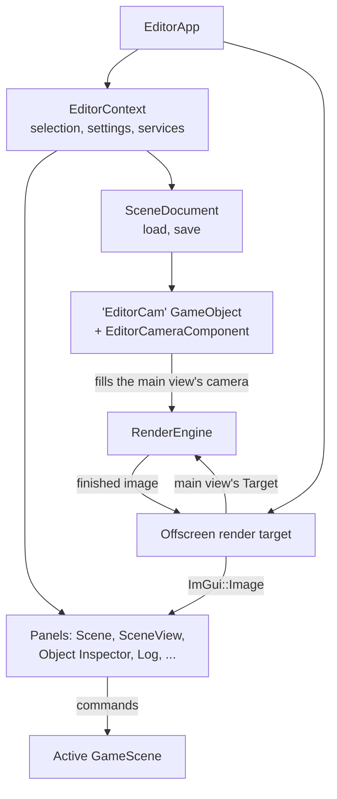
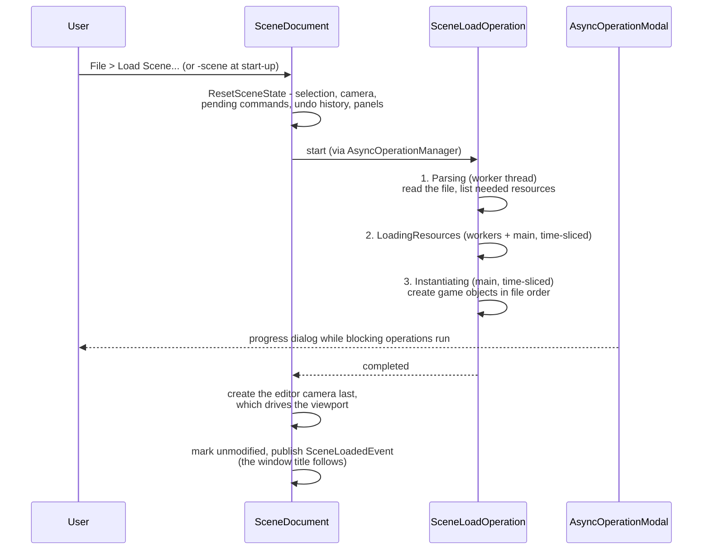
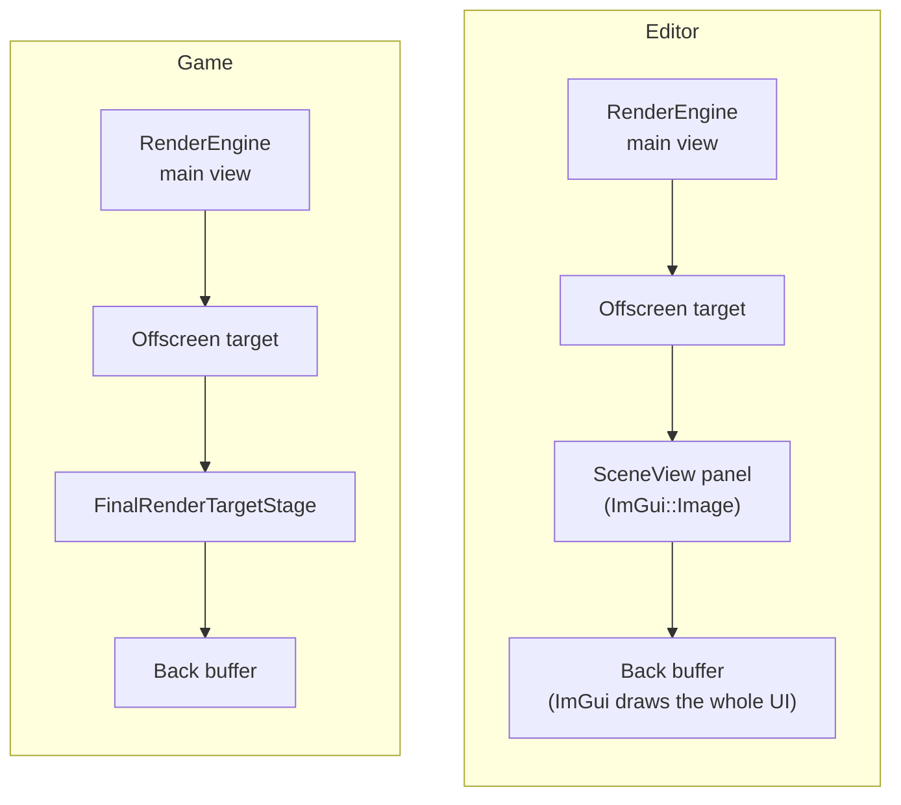

# Editor Overview

The Editor ("RZEStudio", `RZE\Editor\`) is the scene-authoring app. It's a Dear ImGui app built on exactly the same `Engine` and `Modules\Rendering` stack as the Game. It has no renderer or scene model of its own: `EditorApp` is just another `RZE_Application` (see [App-Shell-Pattern.md](../02-Architecture/App-Shell-Pattern.md)) that adds panels, an editor camera and some tooling.

Its UI code is organised around an `EditorContext` that panels share, self-registering panels with a separate data step and draw step, commands and events for changing the scene, and undo/redo built on the commands; see [Editor-Framework.md](Editor-Framework.md). The Editor's code is built as the `EditorLib` static library, which the `Editor` executable (just `EditorMain.cpp`) and the unit tests link.

## What you see

```
+---------------------------------------------------------------------------------+
| File Edit View Help | frame time | RenderCommand MemArena: 4 KB / 64 MB  Peak ... |
+--------------+--------------------------------------------------+---------------+
| Scene        | SceneView  (gizmo | snap | grid toolbar)        | Object        |
|              |                                                  | Inspector     |
|  Camera      |      3D viewport: the scene, gizmo, light and    |               |
|  Directional |      camera icons, bounds boxes, marquee         | the selected  |
|  NeckMech    |                                                  | objects'      |
|  M4          |      ground grid                                 | components    |
+--------------+--------------------------------------------------+---------------+
| Log   (RZE_LOG output, resource loads, build output)                            |
+---------------------------------------------------------------------------------+
```

The layout is an ImGui dockspace, saved in `Config\imgui.ini`; without one, each panel docks where its `PanelDesc::DefaultDock` says. Each panel is described in [Editor-Panels.md](Editor-Panels.md), and the inspector in [Object-Inspector-And-Properties.md](Object-Inspector-And-Properties.md); the camera and the build/launch tools are in [Editor-Camera-And-Build-Launch.md](Editor-Camera-And-Build-Launch.md); gizmo snapping and the ground grid are in [Gizmo-Snapping-And-Grid.md](Gizmo-Snapping-And-Grid.md). Every keyboard and mouse shortcut is in [Editor-Shortcuts.md](Editor-Shortcuts.md).

## Launching

`Editor\Src\EditorMain.cpp` sets `Filepath::SetDirectoryContext(EDirectoryContext::Tools)`, constructs `Editor::EditorApp`, and calls `Run()`. The Tools context means paths resolve against the **source tree** (`RZE\Assets\...`), not the copied assets in `_build\<config>`, so shader and asset edits show up on the next launch with no copy step.

| Argument | Effect |
|---|---|
| `-scene <file>` | Opens `Assets/Scenes/<file>` (e.g. `-scene Sponza.scene`). Without it, the Editor opens `Assets/Scenes/RenderTest.scene`. |
| `-launchMonitor <n>` | Opens the window on monitor *n*, overriding the config's launch monitor. Handled by the engine, so the Game accepts it too. |

`Editor\_project\Editor.args.json` holds presets for these in Visual Studio.

## How the Editor fits together



- **Offscreen viewport.** `CreateRenderTarget()` makes a `RenderTargetTexture` the size of the window and sets it as the main view's `Target`. The scene renders into it, and `SceneViewPanel` shows it with `ImGui::Image`, cropping the UVs to the panel's size. The Editor never draws the scene straight to the back buffer; ImGui owns the back buffer.
- **Render stages.** On top of the engine's stages, the Editor adds `ImGuiRenderStage(withEditor = true)`. The `PickRenderStage` that click selection uses is part of the engine and idle unless the Editor asks for a pick. See [Render-Stages.md](../04-Rendering/Render-Stages.md).
- **Editor camera.** After each load, `SceneDocument::CreateEditorCamera()` adds an `"EditorCam"` object at `(-4, 10, 4)`, aimed at the scene's centre, and hands it to the context (`EditorContext::GetEditorCamera`). It's excluded from saves (`SetIncludeInSave(false)`), hidden from the Scene panel and never copied. It drives the viewport: the scene's main camera is told not to (`GameScene::SetMainCameraDrivesView(false)`), though its exposure still applies.
- **Input.** `ProcessInput()` forwards mouse and keyboard to ImGui (`ImGuiInput::SubmitInput`, including the wheel and text input) and returns whether the scene view is hovered (`SceneViewportState::IsHovered`). Engine input actions, including the camera controls, only fire while it is, so typing in a panel doesn't fly the camera.
- **Window title.** `RZEStudio - <scene file>`, with a `*` while the scene has unsaved changes, or `RZEStudio - Untitled` for a new scene. `EditorApp` keeps it up to date from the scene document's events. Undoing back to the last save clears the `*`.
- **Unsaved changes.** New, Load, Exit and closing the window ask Save / Don't Save / Cancel first while there are unsaved changes ([Editor-Framework.md](Editor-Framework.md#the-unsaved-changes-prompt)).

## Loading a scene

Scene loading is **asynchronous**, so the Editor stays responsive and shows progress while big scenes like Sponza stream in.



- Only one load runs at a time; the File menu disables New/Load while one is in progress.
- If loading fails, the partial scene is unloaded, the error is logged, and the next Save prompts for a path rather than overwriting the file.
- Scene files are format version 2 (objects keyed by GUID); older files are converted as they load. See [Scene-And-GameObject-Model.md](../03-SceneAndGameObjects/Scene-And-GameObject-Model.md#scene-files).
- `AsyncOperationModal` (`UI\Modals\`) is a generic progress dialog. It watches `AsyncOperationManager` and appears for any operation flagged `Blocking`.

## Menu bar

| Menu | Items |
|---|---|
| File | New Scene..., Load Scene..., Save Scene (prompts for a path if the scene is new; copies assets afterwards), Build Game..., Launch Game..., Exit. New, Load and Exit ask about unsaved changes first. |
| Edit | Undo "<step>" (Ctrl+Z), Redo "<step>" (Ctrl+Y), Copy (Ctrl+C), Paste (Ctrl+V), Duplicate (Ctrl+D) |
| View | Windows: Log, Object Inspector, Resource Monitor, Scene (built from each panel's `MenuPath`, checked while open) |
| Help | ImGui Demo |

`MainMenuBar` (`UI\MainMenuBar.h/.cpp`) draws the menus and readouts and handles the Edit shortcuts. File items call `SceneDocument` and `GameBuilder`, through `UnsavedChangesPrompt` where changes could be lost; New and Load are disabled while a load runs, Build and Launch while a build does. Undo and Redo name the step they'd undo ("Undo Delete GameObject") and are greyed out when there's nothing to undo or redo.

The right side of the menu bar shows the frame time and the render command arena's use (`RenderCommand MemArena: current / total`, plus the peak), colour-coded by pressure. It's a quick way to see what a change costs on the render path.

## Edit: copy, paste and duplicate

Copy, paste and duplicate work on the selected GameObjects, with their components and children. Copies are taken **in memory**, not through the scene file format, so they include unsaved changes.

- **Copy** (`GameObjectClipboard::Copy`) takes a `GameObjectSnapshot` of each selected object, as it is at that moment, into the editor's own clipboard (not the system clipboard). Editing the original afterwards doesn't change what's pasted, and the clipboard survives loading another scene. An object whose ancestor is also selected is copied with that ancestor, and the editor camera is left out. It also records the copied objects' **width**: their combined world bounds along X, children included.
- **Paste** pushes a `PasteGameObjectsCommand`, which creates new objects from the snapshots and selects the top-level ones. Undo removes them again.
- **Duplicate** snapshots the selection straight into a paste, leaving the clipboard alone, and selects the copies.
- The shortcuts are routed globally, but a focused text field keeps its own Ctrl+C/V.

What a snapshot holds (`Services\GameObjectSnapshot`):

| | |
|---|---|
| **Components** | Which components the object has, and the value of every property with a setter, read through the [property descriptors](Object-Inspector-And-Properties.md). `ReadOnly` properties are copied; computed ones (no setter) aren't needed, since they follow from the rest. `Exclusive` properties aren't copied (a pasted camera is never the main one), and neither are `EditorOnly` view settings (bounds toggles). |
| **The object itself** | Its name and `IncludeInSave` (an object that isn't saved copies as one that isn't either), its parent's GUID, and its children in order. Each of the object's own fields is handled one by one, so a new `GameObject` field or `GameObjectStateFlags` flag needs a decision in `GameObjectSnapshot`. |

What a paste does to the copies:

| | |
|---|---|
| **Identity** | Each pasted object is new, with a new GUID. Copied children are created under their pasted parents in their original order, and a copied child whose original parent is still in the scene is pasted under that parent. |
| **Names** | Numbered so copies are easy to tell apart: "Tank" pastes as "Tank (1)", a copy of "Tank (1)" as "Tank (2)". Purely cosmetic; names don't have to be unique. |
| **Position** | The top-level copies move along world **+X** by the copied width **plus the snap size** (`EditorSettings`), so they sit beside the originals with a gap. Each further paste of the same clipboard goes one more step; Copy starts the count again. Duplicate always moves one step, and since the copies end up selected, duplicating again steps on from them. Objects with no mesh have no width, so they step by the snap size. |
| **Parents** | The offset is converted into each copy's parent space (the inverse of the parent's world matrix, applied as a direction, so only its rotation and scale count), so it's a world-space step whatever the parent. |

## Editor vs Game: where the picture goes



## Key files

- `Editor\Src\EditorMain.cpp`, `Editor\Src\EditorApp.h/.cpp`
- `Editor\Src\UI\Framework\`, `Editor\Src\Commands\`, `Editor\Src\Services\` — see [Editor-Framework.md](Editor-Framework.md)
- `Editor\Src\UI\MainMenuBar.h/.cpp`
- `Editor\Src\Services\GameObjectClipboard.h/.cpp`, `GameObjectSnapshot.h/.cpp`, `Editor\Src\Commands\SceneCommands.cpp` (`PasteGameObjectsCommand`)
- `Editor\Src\UI\Panels\` — see [Editor-Panels.md](Editor-Panels.md)
- `Editor\Src\UI\Modals\AsyncOperationModal.h/.cpp`, `UnsavedChangesPrompt.h/.cpp`
- `Editor\Src\Game\World\GameObjectComponents\EditorCameraComponent.h/.cpp` — see [Editor-Camera-And-Build-Launch.md](Editor-Camera-And-Build-Launch.md)
- `Engine\Src\Game\SceneLoadOperation.h/.cpp`
