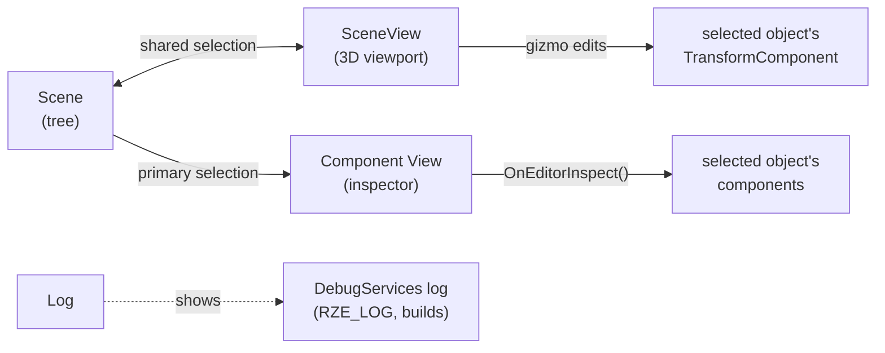
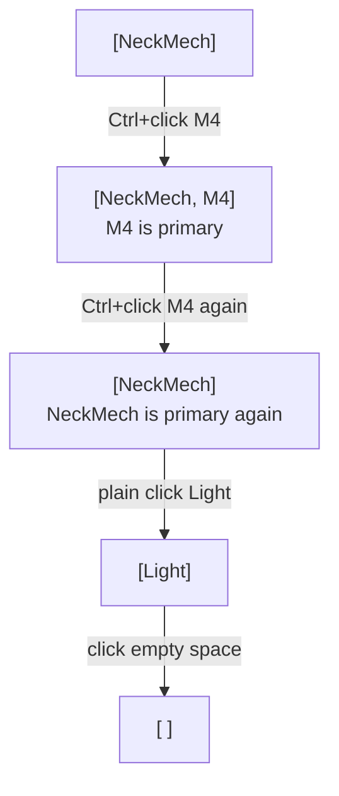
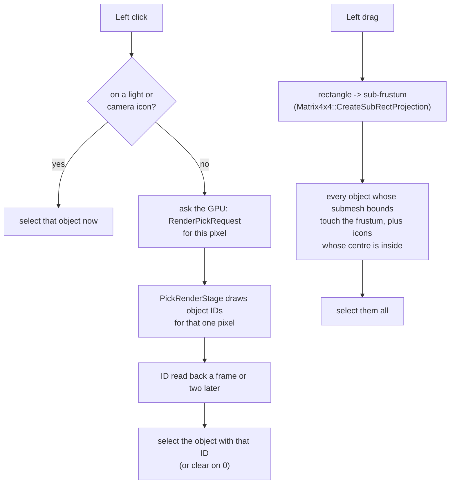

# Editor Panels

All Editor UI panels live under `Editor\Src\UI\Panels\`. `EditorApp` owns one of each and draws them every frame inside its dockspace.

## Selection: shared by every panel

The **selection** lives in `ScenePanel` as an ordered list, `std::vector<GameObjectPtr> m_selection`. Both the tree and the viewport edit it.

- The **last** object in the list is the **primary** selection. It's the one the transform gizmo moves, the Component View shows and the right-click menu acts on (`GetSelectedGameObject()` returns it).
- Every selected object draws its **mesh bounds** in yellow, through its `RenderComponent`'s "Draw Mesh Bounds" toggle, so the inspector checkbox stays in sync.
- API: `SelectGameObject` / `SetSelection` replace the selection, `ToggleSelected` / `AddToSelection` extend it, `ResetSelectedGameObject` clears it, and `IsSelected` tests one object.
- **Escape** (with the viewport hovered) clears it, and loading a scene resets it.

## `ScenePanel` (`ScenePanel.h/.cpp`)

Two ImGui windows.

**"Scene"**: a tree of the scene's root objects (the editor camera is hidden).
- **Click** selects; **Ctrl+click** adds an object to the selection or removes it.
- **Double-click** glides the editor camera to frame the object (`EditorCameraComponent::FocusOn`; see [Editor-Camera-And-Build-Launch.md](Editor-Camera-And-Build-Launch.md)).
- **Drag and drop** one object onto another to parent it.
- **Right-click** (on an object): Rename, Add Component (from `GameObjectComponentRegistry`), Detach From Parent, Delete. Right-click on empty space while nothing is selected: Create GameObject.
- Clicking empty space in the panel clears the selection.

**"Component View"**: the inspector for the primary selection. It lists the object's components, sorted by `EditorComponentCache::GetAllComponentsInfo()[id].Order` (default `0x0100`), and calls each one's `OnEditorInspect()`. The list is re-sorted only when the primary object or its component count changes. Useful bits from the built-in components:
- **TransformComponent:** position, rotation (degrees) and scale.
- **RenderComponent:** the mesh path, its **size in metres**, "Draw Mesh Bounds" / "Draw Sub-Mesh Bounds" (blue boxes per submesh), and each submesh's material, textures and shader.
- **CameraComponent:** FOV, near/far, exposure compensation, and a live "Camera View" preview.

## `SceneViewPanel` (`SceneViewPanel.h/.cpp`)

The 3D viewport ("SceneView"). It shows the main view's render target with `ImGui::Image` and draws editor overlays on top.

| Feature | How it works |
|---|---|
| **Viewport sizing** | When the panel resizes, it sets the main view's `ViewportSize` and the editor camera's aspect ratio. The render target stays window-sized, and the image's UVs are cropped to the panel. |
| **Transform gizmo** | ImGuizmo on the primary selection. Toolbar: Translate / Rotate / Scale, Local / World. Hotkeys **W / E / R** pick the mode and **Q** toggles local/world (ignored while the right mouse button is held, since that's flying the camera). |
| **Light and camera icons** | Each `DirectionalLightComponent` draws a sun icon and each `CameraComponent` a movie-camera icon at its position. The primary selection's icon fades to 40% so the gizmo's centre handle shows through. |
| **Camera frustums** | Each scene camera draws its view volume as debug lines, from the near plane out to its far plane or 10 m, whichever is closer, so it reads as a pyramid. |
| **Picking** | Click, Ctrl+click and marquee selection; see below. |

### Picking

| Input | Result |
|---|---|
| **Click** | Selects the object under the cursor; on nothing, clears the selection |
| **Ctrl+click** | Adds the object under the cursor, or removes it if already selected |
| **Drag** (more than 4 px) | **Marquee:** selects everything under the rectangle, **including objects hidden behind others** |
| **Ctrl+drag** | Marquee that adds to the selection |

Clicks on the gizmo, and clicks while the right or middle button (camera controls) is held, are left alone.

**Clicks and the marquee work differently**, each using what suits it:

- **Click → GPU, pixel-exact.** Icons draw on top of meshes, so their screen rects (recorded by `DrawObjectIcons()` each frame in `m_iconHits`) are tested first. Otherwise the panel puts a pick request on the main view and applies the result when `TexelReadback::IsReady` turns true. The pick respects occlusion and the exact silhouette: clicking the background inside an object's bounding box selects nothing, and a click goes to whichever object is in front. See [Render-Stages.md](../04-Rendering/Render-Stages.md#pickrenderstage).
- **Marquee → CPU, frustum test.** The rectangle becomes a frustum, and every object with a `RenderComponent` whose **submesh** bounds intersect it is selected. That's how it catches hidden objects; a GPU ID buffer only keeps the nearest object per pixel.

## `LogPanel` (`LogPanel.h/.cpp`)

The "Log" window shows `DebugServices`' log entries, coloured by channel, and scrolls to the bottom when new ones arrive. Anything can write to it:
- `RZE_LOG` / `RZE_LOG_ARGS` from engine and game code (enabled in Debug and Release, stripped in Retail);
- resource loads ("Creating resource [...]"), including ones loaded asynchronously;
- the render pipeline's stage order when it compiles;
- build and launch output, streamed line by line (`LogChannel::Build`).

See [Debug-Services-And-Logging.md](../06-Platform-And-Infrastructure/Debug-Services-And-Logging.md).

## `ResourceMonitorPanel` (`ResourceMonitorPanel.h/.cpp`)

A toggleable panel (View > Windows > Resource Monitor) with resource and asset statistics.

## Key files

- `Editor\Src\UI\Panels\ScenePanel.h/.cpp`
- `Editor\Src\UI\Panels\SceneViewPanel.h/.cpp`
- `Editor\Src\UI\Panels\LogPanel.h/.cpp`
- `Editor\Src\UI\Panels\ResourceMonitorPanel.h/.cpp`
- `Engine\Src\Graphics\RenderStages\PickRenderStage.h/.cpp` — the GPU side of click picking
