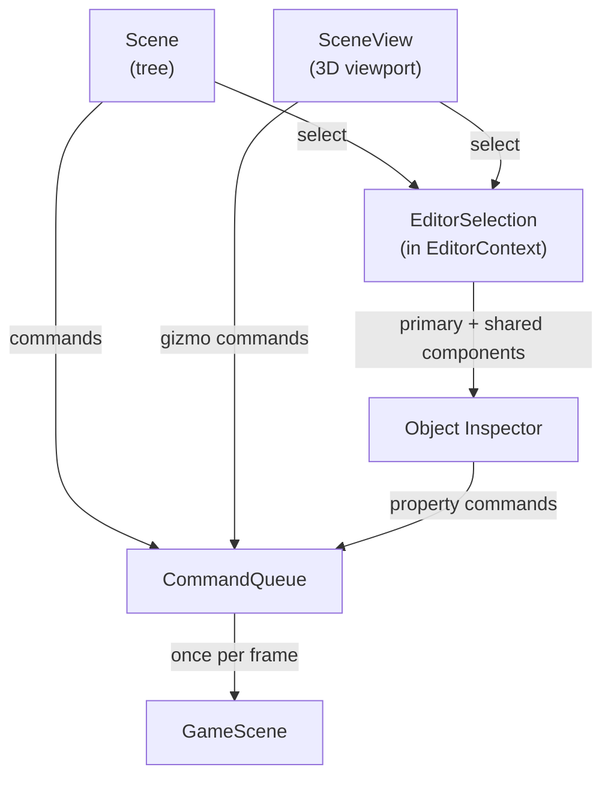
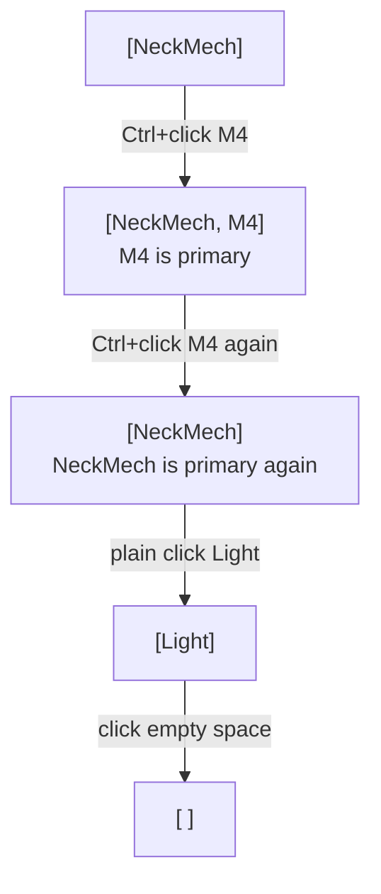
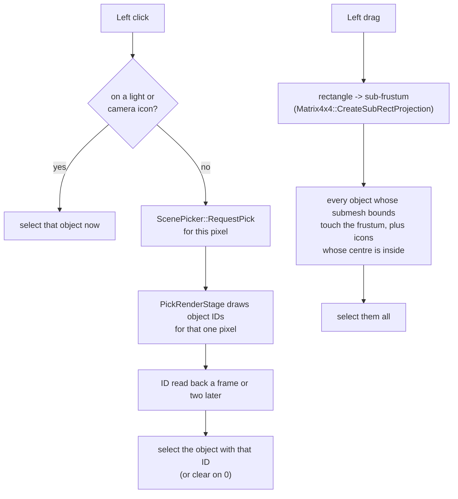

# Editor Panels

Every Editor window is an `EditorPanel` in `Editor\Src\UI\Panels\`, registered with `REGISTER_EDITOR_PANEL` and hosted by `PanelManager`. How panels are written, when they run and how they change the scene is in [Editor-Framework.md](Editor-Framework.md). Every shortcut is listed in [Editor-Shortcuts.md](Editor-Shortcuts.md).

| Panel (window name) | Class | Default dock | Menu | Closable |
|---|---|---|---|---|
| Scene | `ScenePanel` | RightTop | View > Windows > Scene | yes |
| SceneView | `SceneViewPanel` | Centre (nothing docks into it) | — | no |
| Object Inspector | `InspectorPanel` | RightBottom | View > Windows > Object Inspector | yes |
| Content Browser | `ContentBrowserPanel` | BottomLeft, in the [bottom dock area](Editor-Framework.md#the-bottom-dock-area) | View > Windows > Content Browser | yes |
| Log | `LogPanel` | BottomRight, in the bottom dock area (first tab) | View > Windows > Log | yes |
| Resource Monitor | `ResourceMonitorPanel` | BottomRight, after Log (closed at first) | View > Windows > Resource Monitor | yes |
| ImGui Demo | `ImGuiDemoPanel` | floating (closed at first) | Help > ImGui Demo | yes |
| Settings | `SettingsPanel` | floating, 760×460 (closed at first) | Edit > Settings | yes |
| Project Settings | `ProjectSettingsPanel` | floating, 560×300 (closed at first) | Edit > Project Settings | yes |
| Task History | `TaskHistoryPanel` | floating, 820×480 (closed at first) | View > Windows > Task History, or Full history in the status bar | yes |

## Selection

The selection is `EditorSelection`, in the `EditorContext`, so every panel reads and changes the same one. It's an ordered list of GameObjects:

- The **last** object is the **primary** selection. The transform gizmo is on it, the Object Inspector shows its values and the Scene panel's right-click menu acts on it.
- `Select` / `SetSelection` replace the selection, `Toggle` / `AddToSelection` extend it, `Clear` empties it, `IsSelected` tests one object.
- Each call that changes it publishes `SelectionChangedEvent`. `SelectionBoundsDisplay` listens and draws every selected object's **mesh bounds** in yellow, through its `RenderComponent`'s "Mesh Bounds" toggle (Debug Draw), so the inspector checkbox agrees.
- **Escape** (with the SceneView hovered) clears it, and loading or creating a scene clears it.

## Scene (`ScenePanel`)

A tree of the scene's objects (the editor camera is hidden).

- **Click** selects; **Ctrl+click** adds an object to the selection or removes it.
- **Shift+click** selects every row from the **anchor** to the clicked one, which becomes the primary; **Ctrl+Shift+click** adds that range to the selection. The anchor is the last row clicked without Shift and stays put, so further Shift+clicks re-range from it. Rows count in on-screen order, so a collapsed parent's children are left out. If the selection was changed elsewhere (e.g. picked in the SceneView), the range starts from the primary; if the anchor is hidden under a collapsed parent, Shift+click acts as a plain click. The range is applied after every row is drawn (`ScenePanel::SelectRange`), since it can end below the clicked row.
- **Double-click** glides the editor camera to frame the object (`EditorCameraComponent::FocusOn`; see [Editor-Camera-And-Build-Launch.md](Editor-Camera-And-Build-Launch.md)).
- **Drag and drop** one object onto another to parent it. It keeps its local transform, so it moves if the new parent isn't at the origin (see [10-KnownIssues](../10-KnownIssues/Architectural-Notes-And-TODOs.md)).
- **Right-click** an object for its menu. The first line is its name: **right-click the name** to rename it (Enter to apply). Then Add Component (every registered type), DetachFromParent (child objects only) and Delete. All of them, and drag-and-drop parenting, can be undone; Delete removes the object's children too, and undo brings them all back in the same order.
- **Right-click empty space** while nothing is selected: Create GameObject, which asks for a name.
- Clicking empty space in the panel clears the selection.
- Collapsed parents can be clicked, dragged and right-clicked like any other row.

Rows take their ImGui IDs from each object's GUID, not its name, so objects with the same name (allowed; see [Scene-And-GameObject-Model.md](../03-SceneAndGameObjects/Scene-And-GameObject-Model.md)) don't share open state or menus. Every change goes through a command (`CreateGameObjectCommand`, `RenameGameObjectCommand`, `AttachToParentCommand`, ...).

## Object Inspector (`InspectorPanel`)

Shows the primary selection's components, each under a `[ ComponentName ]` heading, and edits them. With several objects selected, it shows the components they all share ("3 objects selected; showing the components they share"), marks values that differ, and applies an edit to all of them. It's built entirely from the components' property descriptions; see [Object-Inspector-And-Properties.md](Object-Inspector-And-Properties.md). Files can be dropped onto its asset fields from the Content Browser, and a mesh, material or texture loads in the background before it's set ([Asset fields](Object-Inspector-And-Properties.md#asset-fields)).

## SceneView (`SceneViewPanel`)

The 3D viewport. It shows the main view's render target with `ImGui::Image` and draws editor overlays on top. It can't be closed.

| Feature | How it works |
|---|---|
| **Viewport sizing** | When the panel resizes (in `Draw()`, since the size comes from ImGui), it sets the main view's `ViewportSize`, the editor camera's aspect ratio and `SceneViewportState::Size`. The render target stays window-sized, and the image's UVs are cropped to the panel. |
| **Transform gizmo** | ImGuizmo on the primary selection. Toolbar: Translate / Rotate / Scale, Local / World (tooltips name the shortcut). Hotkeys **W / E / R** pick the mode and **Q** toggles local/world (ignored while the right mouse button is held, since that's flying the camera). Each frame of a drag pushes a `SetTransformCommand`; the whole drag shares one interaction. |
| **Several selected** | The gizmo moves all of them: each frame's change to the primary (move, turn, scale ratio) is applied to every other selected object, each turning about its own pivot. Objects whose parent is also selected are skipped, since they move with it. |
| **Snapping** | Snap (X) toggle, move step (0.25–1 m) and rotate step (15–90°) in the toolbar; holding Ctrl during a drag inverts the toggle. See [Gizmo-Snapping-And-Grid.md](Gizmo-Snapping-And-Grid.md). |
| **Grid** | A semi-transparent ground grid on Y = 0 whose squares match the move step and grow as the camera rises, fading with distance. See [Gizmo-Snapping-And-Grid.md](Gizmo-Snapping-And-Grid.md). |
| **Light and camera icons** | Each `DirectionalLightComponent` draws a sun icon and each `CameraComponent` a movie-camera icon at its position. The primary selection's icon fades to 40% so the gizmo's centre handle shows through. |
| **Camera frustums** | Each scene camera draws its view volume as debug lines, from the near plane out to its far plane or 1.5 m, whichever is closer, so it reads as a pyramid. Drawn every frame in `PreRender`, like the grid, while the scene image shows. |
| **Picking** | Click, Ctrl+click and marquee selection; see below. |
| **Dropping meshes** | A mesh dragged from the Content Browser loads in the background, then adds an object showing it where it's dropped; see below. |

The hovered flag in `SceneViewportState` decides whether editor input (camera, gizmo keys, Escape) reaches the scene. It's cleared at the start of each frame, so it stays false while the SceneView is hidden.

### Picking

| Input | Result |
|---|---|
| **Click** | Selects the object under the cursor; on nothing, clears the selection |
| **Ctrl+click** | Adds the object under the cursor, or removes it if already selected |
| **Drag** (more than 4 px) | **Marquee:** selects everything under the rectangle, **including objects hidden behind others** |
| **Ctrl+drag** | Marquee that adds to the selection |

Clicks on the gizmo, and clicks while the right or middle button (camera controls) is held, are left alone.

**Clicks and the marquee work differently**, each using what suits it:

- **Click → GPU, pixel-exact.** Icons draw on top of meshes, so their screen rects (recorded each frame in `m_iconHits`) are tested first. Otherwise the panel asks the context's `ScenePicker`, which puts a pick request on the main view and calls back when the readback is ready (`EditorContext::Update` checks each frame). The pick respects occlusion and the exact silhouette: clicking the background inside an object's bounding box selects nothing, and a click goes to whichever object is in front. A pick still in flight is cancelled when the scene unloads. See [Render-Stages.md](../04-Rendering/Render-Stages.md#pickrenderstage).
- **Marquee → CPU, frustum test.** The rectangle becomes a frustum, and every object with a `RenderComponent` whose **submesh** bounds intersect it is selected. That's how it catches hidden objects; a GPU ID buffer only keeps the nearest object per pixel.

### Dropping meshes

Dragging a `.meshasset` tile from the [Content Browser](#content-browser-contentbrowserpanel) over the scene image highlights it; other files can't be dropped. Letting go loads the mesh in the background, then adds an object named after it ("Panzer", then "Panzer (1)", ...) with a `RenderComponent` showing it, and selects it. It's one undo step.

Two things happen at once when it's dropped (`HandleAssetDrop`), and the object is added once both are done:

- **The mesh loads** with a [`PendingResource`](../05-AssetPipeline/Asset-Import-Runtime.md#one-resource-pendingresource), as "Loading Mountain.meshasset" in the [status bar](Status-Bar-And-Settings.md#the-status-bar), so the editor keeps running however large it is. One that's already loaded is taken straight away. One that can't be loaded logs "Couldn't load <file>, so nothing was added."
- **A GPU pick** at the cursor finds where it goes, a frame or two later:

1. **On the surface under the cursor**, of any object: the pick reads the depth there too, and `ScenePicker` turns it back into a world position. The mesh's pivot goes on that point.
2. With nothing drawn there, **on the ground** (the plane y = 0, where the grid is), where the ray through the cursor meets it (`Ray::Intersect`), if that's within 100 m.
3. Otherwise **10 m out** along that ray, e.g. when dropped on the sky.

Then `UpdateMeshDrops`, in the panel's `Update` (before the panels draw), pushes a `CreateMeshObjectCommand(mesh, position)` (`Commands\SceneCommands`), which adds the object, loads the mesh with `RenderComponent::LoadMesh` and records a `ParkRecord`, like Create GameObject. The command runs at the end of that UI frame, when the load is a cache hit; the panel holds the mesh until then.

- Several drops in a row each load and land on their own.
- Loading another scene (`OnSceneReset`) cancels the drops still loading, so nothing lands in the new scene.

The maths is in `Utils\Math`: `ViewProjection::Unproject` and `GetRay`, and `Ray` (see [Utils-Library-Reference.md](../06-Platform-And-Infrastructure/Utils-Library-Reference.md)).

## Content Browser (`ContentBrowserPanel`)

Browses the project's `Assets` and `ProjectData` folders: a folder tree beside a grid of tiles like the file browser's, with back, forward and up, search, and right-click actions. Double-clicking a folder opens it, and a scene loads it after asking about unsaved changes. Files and folders can be renamed (F2), deleted (Delete, to the editor's trash) and made (New Folder), all undoable, and changes on disk show as they happen. Meshes can be dragged into the SceneView (above), and any file onto an asset field that takes it. It's the first tab in the bottom dock, beside the Log. See [Thumbnails-And-File-Browser.md](Thumbnails-And-File-Browser.md#the-content-browser-contentbrowserpanel).

## Log (`LogPanel`)

Shows `DebugServices`' log entries, coloured by channel (Error red, Warning orange, Info white, Debug muted, Build grey), and keeps the newest in view while it's scrolled to the bottom. Anything can write to it:
- the `RZE_LOG` macros from engine, editor and game code, at their level (enabled in Debug and Release, stripped in Retail);
- resource loads ("Creating resource [...]"), at Debug, including ones loaded asynchronously;
- the render pipeline's stage order when it compiles, and shader compile warnings and errors;
- build and launch output, streamed line by line (`LogChannel::Build`).

### Filtering

A search box and a checkbox per channel sit in the panel's menu bar, on a lighter strip with a line under it (`PanelDesc::MenuBarSeparator`, and `ImGuiCol_MenuBarBg` pushed in `PushWindowStyle`), so they're set apart from the log and don't scroll with it. A line shows when its channel is ticked and it contains the search text, ignoring case. **Debug starts unticked**, since its per-resource lines are most of the log. The filter lasts for the session; editor settings aren't saved yet.

The filter is its own class, `LogFilter` (`Editor\Src\UI\Panels\LogFilter.h/.cpp`). The panel only calls its `Draw()` (from `DrawMenuBar`) and `IsShown(entry)` (for each entry in `Draw`), so a shared list filter can replace it without changing how the panel draws.

See [Debug-Services-And-Logging.md](../06-Platform-And-Infrastructure/Debug-Services-And-Logging.md).

## Resource Monitor (`ResourceMonitorPanel`)

A table of loaded resources and their reference counts. `Update()` copies the resource table into a sorted list at most every 250 ms (so it stays cheap in Debug), and `Draw()` only draws the visible rows (`ImGuiListClipper`).

## ImGui Demo (`ImGuiDemoPanel`)

Dear ImGui's own demo window, from Help > ImGui Demo. It draws its own window (`PanelDesc::OwnsWindow`).

## Settings (`SettingsPanel`)

The Settings window: registered settings pages (Background Tasks, Frame Rate, Scene View, Thumbnails) listed on the left, the chosen one on the right. See [Status-Bar-And-Settings.md](Status-Bar-And-Settings.md#the-settings-window).

## Project Settings (`ProjectSettingsPanel`)

What the game itself is, saved to `Config\Game.ini` (`GameConfig`, [Config-System.md](../06-Platform-And-Infrastructure/Config-System.md#gameconfig-gameconfighcpp-and-configgameini)) as soon as it changes. Settings, by contrast, are the editor's own and last until it closes. It's a property table with one section for now, **Game**:

- **Icon**: the game window's icon, a PNG under `Assets`. The row is the Object Inspector's [asset path drawer](Object-Inspector-And-Properties.md#asset-fields) (`PropertyDrawers::Find(EPropertyType::AssetPath)`) with a `PropertyDescriptor` the panel builds itself: a thumbnail, the file name, `...` for the file browser, Clear, and drops from the Content Browser.
- Under it are previews at 16, 32 and 48 px, made with `WindowIcon::MakeSquare` as the game makes its icon. Notes say when the image isn't square, is under 256 px, or can't be read. A failed save shows in red and goes to the log.

When it needs more than a few settings, it can take the Settings window's page list.

## Task History (`TaskHistoryPanel`)

Every background task's history in full: a row per run, newest first, that opens to list everything it did, with search, "Problems only", Copy and Clear. See [Status-Bar-And-Settings.md](Status-Bar-And-Settings.md#task-history).

## Key files

- `Editor\Src\UI\Panels\ScenePanel`, `SceneViewPanel`, `InspectorPanel`, `ContentBrowserPanel`, `LogPanel`, `ResourceMonitorPanel`, `ImGuiDemoPanel`, `SettingsPanel`, `ProjectSettingsPanel`, `TaskHistoryPanel` (`.h/.cpp`)
- `Editor\Src\UI\Framework\EditorSelection.h/.cpp`, `ScenePicker.h/.cpp`
- `Editor\Src\Commands\SceneCommands.h/.cpp` — `CreateMeshObjectCommand`
- `Editor\Src\Services\SelectionBoundsDisplay.h/.cpp`
- `Editor\Src\UI\Gizmo\GizmoSnapper.h/.cpp`, `EditorGrid.h/.cpp` — see [Gizmo-Snapping-And-Grid.md](Gizmo-Snapping-And-Grid.md)
- `Engine\Src\Graphics\RenderStages\PickRenderStage.h/.cpp` — the GPU side of picking
