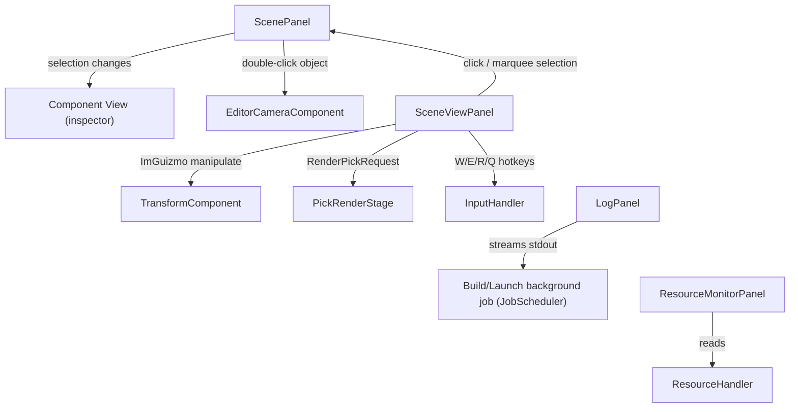

# Editor Panels

All Editor UI panels live under `Editor\Src\UI\Panels\`.

## `ScenePanel` (`ScenePanel.h/.cpp`)

Two ImGui windows:

**"Scene"** — a hierarchy tree of root `GameObject`s (excluding the editor-camera object). Features:
- Right-click "Create GameObject" with an inline name-entry popup → `RZE().GetActiveScene().AddGameObject(name)`.
- Recursive `DisplayObject()` renders each GameObject as an `ImGui::TreeNodeEx`; click selects it, Ctrl+click adds it to or removes it from the selection; double-click re-aims the editor camera at the object (computes a new forward vector from camera-to-object).
- **Selection** is an ordered `std::vector<GameObjectPtr> m_selection`. The last entry is the *primary* selection, which `GetSelectedGameObject()` returns and which the gizmo, inspector and context menu act on. `SelectGameObject` / `SetSelection` replace the selection, `ToggleSelected` / `AddToSelection` extend it, and `ResetSelectedGameObject` clears it. Every selected object shows its mesh bounds through `RenderComponent::SetDrawMeshBounds`.
- Drag-and-drop re-parenting via `ImGui::BeginDragDropSource`/`Target` with payload `"DraggedObjectName"`, calling `DetachFromParent()`/`AttachTo()`.
- Context menu: Rename, "Add Component" (enumerates `GameObjectComponentRegistry::GetAllComponentReflectData()` and calls `gameObject->AddComponentByID(componentID)`), Detach From Parent, Delete.

**"Component View"** — the inspector for the primary selection's components. Sorts the selected object's `GameObjectComponentBase*` list by `EditorComponentCache::GetAllComponentsInfo()[id].Order` (falls back to `kDefaultSortingOrder = 0x0100` if unspecified), then calls each component's virtual `OnEditorInspect()` in that order.

## `SceneViewPanel` (`SceneViewPanel.h/.cpp`)

The 3D viewport window ("SceneView"). Owns `TransformGizmoState { currentOpMode, transformationSpace }`, driving an embedded **ImGuizmo** translate/rotate/scale toolbar with local/world space toggle.

- On resize: updates `RZE().GetRenderEngine().SetViewportSize()` and the editor camera's aspect ratio.
- Renders the offscreen `RenderTargetTexture` via `ImGui::Image()`, reading `pRTT->GetTargetPlatformObject().GetTextureData()`, with UV coordinates clamped to the visible viewport fraction (handles the case where the RTT's actual size and the ImGui window's displayed size don't match exactly).
- Drives ImGuizmo's `Manipulate()`/matrix decomposition to write back into the selected object's `TransformComponent` (position/rotation/scale) whenever the gizmo is manipulated.
- Registers **W/E/R/Q** hotkeys directly with the global `InputHandler` (translate / rotate / scale / toggle local-world space).

### Picking

`HandleSelectionInput()` selects objects with the left mouse button. It ignores clicks on the gizmo (`ImGuizmo::IsOver()`) and while the right or middle button (camera controls) is held.

| Input | Result |
|---|---|
| Click | Selects the object under the cursor; on nothing, clears the selection |
| Ctrl+click | Adds the object under the cursor to the selection, or removes it |
| Drag (more than 4 px) | Marquee: selects every object under the rectangle, **including ones hidden behind others** |
| Ctrl+drag | Marquee that adds to the selection |

Clicks and the marquee use different mechanisms:

- **Click → GPU, pixel-exact.** The panel first tests the light and camera icon rects that `DrawObjectIcons()` records each frame (`m_iconHits`), since icons draw on top. If none is hit, it sets `RenderEngine::GetMainView().Pick` to a `RenderPickRequest` for the clicked pixel. `PickRenderStage` (see [Render-Stages.md](../04-Rendering/Render-Stages.md)) renders object IDs for that pixel and reads the result back; the panel polls the request's `TexelReadback` and applies the hit a frame or two later. Pick IDs are `GameObjectID + 1`, so 0 means nothing was hit.
- **Marquee → CPU, frustum test.** `GatherObjectsInRect()` builds a frustum covering only the rectangle (`Matrix4x4::CreateSubRectProjection(...) * projection * view`) and keeps every object with a `RenderComponent` whose submesh bounds intersect it, plus every icon whose centre is inside the rectangle. A depth-tested ID buffer only stores the nearest object per pixel, which is why the marquee isn't done on the GPU.

## `LogPanel` (`LogPanel.h/.cpp`)

A thin console/log panel — public API is just `Display()` and `AddEntry(msg)`, backed by an internal deque of strings. This is what streams stdout from the Editor's "Build Game..."/"Launch Game..." background jobs (see [Editor-Camera-And-Build-Launch.md](Editor-Camera-And-Build-Launch.md)) and general `DebugServices`/`RZE_LOG` output.

## `ResourceMonitorPanel` (`ResourceMonitorPanel.h/.cpp`)

A toggleable panel (public `IsEnabled` bool, driven directly by an ImGui checkbox) for resource/asset statistics.

## Diagram: panel interactions

## Key files

- `Editor\Src\UI\Panels\ScenePanel.h/.cpp`
- `Editor\Src\UI\Panels\SceneViewPanel.h/.cpp`
- `Editor\Src\UI\Panels\LogPanel.h/.cpp`
- `Editor\Src\UI\Panels\ResourceMonitorPanel.h/.cpp`
