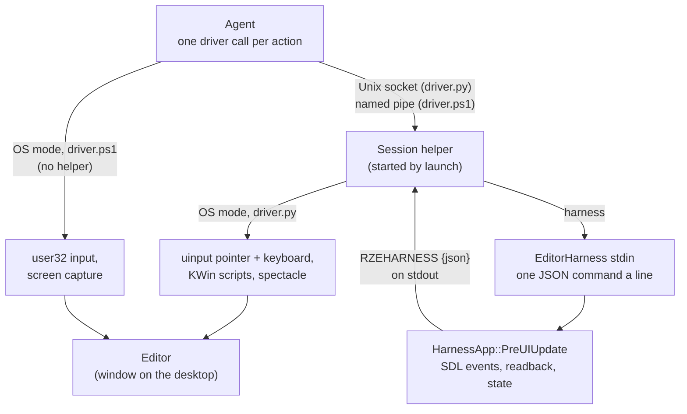
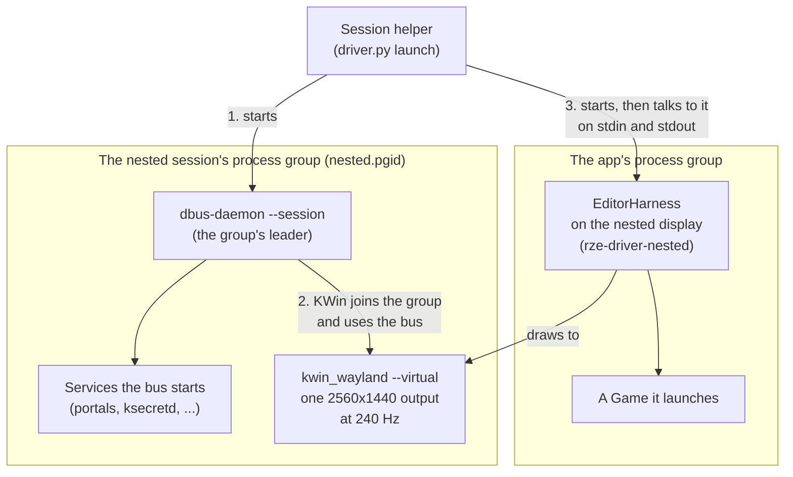

# EditorHarness and the Drivers

The `run-rze` skill (`.claude/skills/run-rze/`) lets an agent build, run and drive the Editor: click and type in it,
take screenshots, ask what it holds, and close it the way a user would. It works in two modes:
- **OS input:** a driver plays real mouse and keyboard input on the desktop and captures the screen. That's
  `driver.ps1` on Windows (user32) and `driver.py` on Linux (uinput and KWin).
- **The harness:** `driver.py launch --harness` (Linux) or `driver.ps1 launch -Harness` (Windows) runs
  **EditorHarness**, the Editor with a small automation channel beside it. Input, screenshots and questions go through
  the app itself, as JSON lines on its stdin, so the real cursor and focus are left alone.

The harness is a test harness, not an engine feature. It's its own executable beside the Editor, and it reaches the
Editor only through seams that already existed (see [Staying outside the engine](#staying-outside-the-engine)).

## Which mode to use

| | Harness (`--harness`) | OS input |
|---|---|---|
| Your mouse and focus | Untouched: no input devices, no focus changes. Real input to the Editor is dropped while it runs. | Moved and taken; don't use the machine while it acts |
| The window | May be covered, unfocused or on another desktop | Must be the active window; every input is checked against it first |
| Screenshots | The frame itself, read back from the back buffer | A capture of the window's client area |
| Questions | `state` and `object` answer from the Editor's data | Only what pixels and the log show |
| What it can't check | The compositor, window decorations, focus and activation, Snap Layouts, RenderDoc's capture key, the Game | Nothing the desktop does, but it's slower and fragile to coordinates |
| Where it runs | On the desktop, or off-screen in a compositor of its own (`--nested`, Linux) | On the desktop; `--output` picks the monitor (Linux) |
| Platforms | Both | Both |

Prefer the harness for anything inside the Editor, and a nested session for a smoke test while the machine is in use.
Use OS input for what needs the real desktop.

## EditorHarness

`EditorHarness/Src/` is an executable that links `EditorLib` the way the Editor does (`EditorLib.LinkWhole`, see
[Sharpmake-Project-Graph.md](../09-BuildSystem/Sharpmake-Project-Graph.md)), so it *is* the Editor, with every panel.
`HarnessMain.cpp` is `EditorMain.cpp` with a different app: `EditorHarness::HarnessApp`, which subclasses
`Editor::EditorApp` ([App-Shell-Pattern.md](../02-Architecture/App-Shell-Pattern.md)).

### The channel

`HarnessChannel` reads stdin on a thread of its own, a line at a time, and the main thread takes the lines each frame.
- **A command** is one JSON object a line: `{"cmd": "click", "id": 7, "x": 2317, "y": 123}`. `id` is the driver's,
  and is echoed back.
- **An answer** is one line on stdout, prefixed with `RZEHARNESS ` so it stands out from the log lines around it:
  `RZEHARNESS {"id":7,"ok":true}`, or `"ok":false` with an `"error"` that says why. Some answers carry fields, e.g.
  `info`'s `title`, `width`, `height`, `maximized`, `frame` and `realInputBlocked`.
- **stdin is read with the OS's own call** (`read`, `ReadFile`) in `HarnessStdin<Platform>.cpp`, not `std::cin`. A
  thread blocked in `std::getline` holds stdin's lock, and `exit()` flushes every stream, so the Editor hung on exit.
- **A UTF-8 byte order mark** before the first command is dropped. Windows PowerShell 5.1's `Process.Start` writes
  one to a redirected stdin, which made the first command "Not a command".
- When stdin closes, the harness stops reading and the Editor carries on. Closing it is up to `quit`.

### The commands

They run in `HarnessApp::PreUIUpdate`, after the Editor's own, on the main thread before the UI is built, so they act
on the frame as a user's input would.

| Command | Fields | Does |
|---|---|---|
| `ping` | | Answers at once |
| `info` | | The window's title, client size, whether it's maximized, the frame count, and whether real input is blocked |
| `move` | `x`, `y` | Moves the mouse (a hover) |
| `click`, `dblclick` | `x`, `y`, `button` (`left`, `right`, `middle`) | A move, a press and a release, a frame each |
| `drag` | `x`, `y`, `x2`, `y2` | A left-button press, 10 moves and a release |
| `scroll` | `x`, `y`, `notches` | Wheel notches; + is away from you |
| `key` | `keys` | `SendKeys` syntax (`^a45{ENTER}`, `{TAB 3}`, `%f`), US layout (`HarnessKeys`). Printable keys also send their text, as a keyboard would. |
| `shot` | `path` | Writes a PNG of the next presented frame: an absolute path, or one relative to the project |
| `state` | | The scene, whether it's modified or loading, the selection, the undo and redo steps, and every object with its parent and whether it's saved |
| `object` | `name` | One object, by the name the Scene panel shows: GUID, parent, components and transform |
| `realinput` | `on` | Whether the real mouse and keyboard reach the Editor (blocked by default) |
| `quit` | | As the window's close button: unsaved changes are asked about first |

Coordinates are client-area pixels, the same space as `shot`'s image.

### Input: SDL events, a frame at a time

`HarnessInput` makes input as **SDL events** (`SDL_PushEvent`), which go the way a real mouse and keyboard's do:
through `Window`, `InputHandler` and ImGui ([Windowing.md](../06-Platform-And-Infrastructure/Windowing.md)). Nothing
in the Editor knows the difference.
- **One step a frame.** A click is a move, then a press, then a release, so ImGui first sees what's under the mouse,
  then sees it pressed. Actions queue, and each plays after the one before it.
- **The answer waits for the action to land.** Two more frames pass after the last step: events pushed on one frame
  are pumped at the start of the next, and the UI acts on them during that one. A `state` sent after a `click`
  therefore sees the click's result.
- **Real input is dropped.** An SDL event filter lets mouse, key and text events through only while the harness is
  pushing, so a hand on the mouse can't disturb a run. `realinput on` turns that off.
- **Turning real input back on resyncs the mouse.** While blocked, the real mouse's moves are dropped, so the UI still
  has the mouse where the harness last put it, and a real click before any real move would land there. When
  `realinput on` arrives and the real cursor is over the window (`SDL_GetMouseFocus`), `SetRealInputBlocked` pushes a
  move to it (`SDL_GetMouseState`, which SDL keeps up to date before the filter runs), as a nudge of the mouse would.
- **Unfocused.** Input isn't gated on focus, so it works while another window is active; the Editor then runs at its
  unfocused frame rate (30 fps), and an action takes about 180–290 ms.

### Screenshots: the back buffer

`shot` asks for `Renderer::ReadBackBuffer`, and writes the PNG once the readback has arrived, a frame or two later.
The request is recorded just before the frame's present command, so every API reads the finished frame, ImGui and
all ([Low-Level-Renderer-Module.md](../04-Rendering/Low-Level-Renderer-Module.md#reading-back-from-the-gpu-readtexel-readtexture-and-readbackbuffer)).
It's the frame the Editor drew, whether or not the window is visible. Alpha is forced opaque. Encoding the PNG takes
about a second on the main thread ([known issue 38](../10-KnownIssues/Architectural-Notes-And-TODOs.md#38-an-editorharness-screenshot-stalls-the-editor-for-about-a-second)).

### State queries

`state` and `object` read the Editor's `EditorContext` (the scene document, selection and undo history) through
`EditorApp::GetContext()`, a protected accessor kept for an app built on the Editor
([Editor-Framework.md](Editor-Framework.md)). A check can then ask "did the rotation become 45, and is the scene
modified?" instead of reading it from pixels.

### Staying outside the engine

The harness touches nothing in the engine that exists only for it:

| Seam | Existed for | The harness uses it to |
|---|---|---|
| `EditorLib` as a library | The Editor and the unit tests | Be the Editor, in its own executable |
| `RZE_Application::PreUIUpdate` | Apps gathering what their UI shows | Run commands each frame |
| SDL's event queue and event filter | `Window`'s input | Play input, and drop the real one |
| `Renderer::ReadBackBuffer` | A generic readback, beside `ReadTexture` | Take screenshots |
| `EditorApp::GetContext()` (protected) | An app built on the Editor | Answer `state` and `object` |

The Editor and the Game behave the same whether the harness is built or not.

### Known limits

- **ImGui can follow the real mouse** while the harness's window is focused and the pointer is over no window of the
  app, on Windows and X11: `imgui_impl_sdl3` reads the global mouse there
  ([known issue 39](../10-KnownIssues/Architectural-Notes-And-TODOs.md#39-imgui-can-follow-the-real-mouse-in-a-focused-harness-window)).
  Windows' check (B6) didn't see it: with the real pointer over the taskbar, a harness click still landed where the
  harness put it.
- **A session that ends with unsaved changes stops at the prompt.** `quit` asks first, as the close button does, and
  the prompt is answered with a `click` on Don't Save, as a person would. A session left at the prompt with nothing to
  answer it (its driver gone) has to be stopped by hand.
- **The Game has no harness.** `GameApp` isn't in a library, so nothing can subclass it yet.

## The drivers

### `driver.py` (Linux)

Each call does one action and returns, usually in well under a second. `launch` starts a **session helper**, which
holds the Editor's process and, in OS mode, the input devices; every other command reaches it over a Unix socket.
- **OS mode** (KDE Plasma on Wayland):
  - input through virtual **uinput** devices, an absolute pointer (so a click lands on the exact pixel, across
    monitors) and a keyboard;
  - **KWin scripts over D-Bus** find the window by process, give its client area, focus and close it. Before each
    input, the driver checks that the Editor is the active window and the point is inside it.
  - **spectacle** captures the client area.
- **Harness mode** (`--harness`) writes commands to EditorHarness's stdin and matches the `RZEHARNESS` answers to
  them by id. Other output lines go to the session's log. `launch` waits for `info` to say the window is maximized.
- **Also:** `log` (the app's output, or the newest `RZELOG`), `clip` (the clipboard), `windows` and `close-window`
  (windows opened since `launch`, like the Game or a file manager), `optick` (a capture over Optick's network
  protocol, [ThirdParty-And-Externals.md](../09-BuildSystem/ThirdParty-And-Externals.md)), and `launch --renderdoc`
  with `renderdoc-capture` ([known issue 37](../10-KnownIssues/Architectural-Notes-And-TODOs.md#37-renderdoc-cant-capture-the-linux-build-as-it-runs-normally)).
- **The session is cleaned up.** The app runs in a process group of its own, so `close` and `quit` also end a Game it
  launched, or `renderdoccmd` around it.

### Picking the monitor: `--output` (Linux)

Wayland lets no app place its own windows, so the engine's `-launchMonitor` does nothing there: the compositor
chooses, usually the monitor with the pointer. `launch --output DP-2` asks KWin instead. `outputs` lists the names it
takes, with each monitor's place on the desktop (`DP-1\t2560,0 2560x1440`), and `launch` checks the name against KWin
before it starts anything.
- **The app runs under `Tools/Linux/LaunchOnOutput.py`.** It loads a KWin script that sends the app's windows, matched
  by PID, to that output, waits until KWin has it running, then `exec`s the app in its own process. The app keeps the
  PID the script matches, and the driver's process group is unchanged.
- **The main window, then 3 s.** The script moves each window the app opens until it has moved the main one: the first
  normal, resizable window (the splash isn't resizable). For 3 s after that, it sends back a window that leaves the
  output: on XWayland, under `--renderdoc`, SDL applies its own `-launchMonitor` placement after the window is shown.
  Later windows (the Game, a file manager) open wherever KWin puts them.
- **A watcher ends it.** KWin scripts have no timers, so a watcher process unloads the script those 3 s after the main
  window, after a timeout, or once the app has exited, whichever comes first. A script's `print()` is filtered out of
  KWin's log, so the script reports over D-Bus (`callDBus`) to a name the watcher owns. What it saw is in
  `$XDG_RUNTIME_DIR/rze-driver/launch-on-output.log`.

### Off-screen sessions: `--nested` (Linux)

`launch --harness --nested` runs a session nobody sees, for smoke tests while someone uses the machine. The helper
starts a compositor and a D-Bus of the session's own and runs the app there, so no window reaches the desktop, and
focus and the clipboard are left alone.

- **A bus, then a KWin.** The helper starts `dbus-daemon --session` in a new process group, then `kwin_wayland
  --virtual` (one 2560×1440 output, no lock screen, no global shortcuts, Wayland socket `rze-driver-nested`) in that
  group. Both run without the desktop's `WAYLAND_DISPLAY`, `DISPLAY`, `XAUTHORITY` and `DBUS_SESSION_BUS_ADDRESS`, so
  KWin can't find the desktop's compositor. KWin is up once it owns `org.kde.KWin` on that bus and its socket exists;
  it has 15 s, and its output is in `$XDG_RUNTIME_DIR/rze-driver/nested.log`. Then the driver registers that socket
  with the bus (`UpdateActivationEnvironment`, as Plasma's startup does for the desktop), so the services the bus
  starts, such as the portals a Qt client asks for, run on the nested display. Without it they'd fall back to
  `wayland-0` and abort.
- **The app sees only the nested session.** `WAYLAND_DISPLAY` and `DBUS_SESSION_BUS_ADDRESS` point there,
  `SDL_VIDEO_DRIVER` is `wayland`, and `DISPLAY`, `XAUTHORITY` and the activation tokens are dropped: with no X server
  in the session, SDL falling back to X11 would open its windows on the desktop's. Whatever the app opens, a Game or a
  file manager from Show in Explorer, opens in the nested session too.
- **The driver follows it.** Its KWin scripts (finding the window, `windows`, `close-window`) go to the nested bus, and
  `clip` runs `wl-copy` and `wl-paste` on the nested display.
- **240 Hz, as on the desktop.** KWin's virtual backend starts at 60 Hz. The driver adds a custom mode with
  `kscreen-doctor` and switches to it; KWin rounds it to a CVT timing, which `launch` reports (`2560x1440@239.88`).
  `--refresh HZ` picks another rate. The app is that KWin's only window, so it's focused and never drops to its
  unfocused frame rate: with vsync it runs at the output's rate, and a click takes about 80 ms, as on a focused
  desktop window.
- **Folders of its own.** KWin and the services its bus starts get fresh `XDG_CONFIG_HOME`, `XDG_DATA_HOME`,
  `XDG_STATE_HOME` and `XDG_CACHE_HOME` under `rze-driver/nested-home/`, removed when the session ends. With the
  desktop's, a nested KWin writes its virtual output into `~/.config/kwinoutputconfig.json`, beside the real
  monitors' layouts.
- **Ending it.** The bus daemon leads the group, and KWin and the services it and the bus start belong to it, so
  `close` and `quit` end the whole session once the app has gone. The group's id is kept in
  `$XDG_RUNTIME_DIR/rze-driver/nested.pgid`, and the next `launch` ends a group a dead helper left, and says so. It
  checks first that the leader is still a `dbus-daemon`, not a process that reused its PID.
- **Harness only, on KDE Plasma.** Nothing gives the nested KWin input devices, so a plain `launch` can't drive it, and
  `--nested` refuses without `--harness`. It has one output of its own, so it refuses `--output` too. It needs
  `kwin_wayland` and `kscreen-doctor`. Performance A/B runs stay on the desktop (CLAUDE.md).

#### A layout of its own

Where the panels sit depends on the dock layout, the client size and the monitor. A nested session fixes all three:
one 2560×1440 output, and `.claude/skills/run-rze/nested-imgui.ini` copied over `RZE/Config/imgui.ini` for the session,
once the user's file has been backed up (it's put back as usual). The coordinates in the skill's nested layout
reference (`SKILL.md`), each clicked through the harness and checked with `state`, `object` or before-and-after shots,
therefore hold however the user has arranged their own panels. `--keep-imgui-ini` runs with the user's layout instead,
as that run is meant to change it. To change the nested layout, copy a layout over `nested-imgui.ini` and measure the
table again.

### `driver.ps1` (Windows)

Each call is a process of its own, and does one action.
- **OS mode:** input through user32 (`SetCursorPos`, `mouse_event`, `SendKeys`), and `shot` captures the client area.
  Each call finds `Editor.exe`'s window and acts on it, so there's no helper. `close` sends `WM_CLOSE`, as the close
  button does; `quit` kills the process.
- **Harness mode** (`launch -Harness`) starts a hidden **helper** (`driver.ps1 helper`, a small C# class compiled with
  `Add-Type`). It holds EditorHarness's stdin and stdout, keeps the `RZEHARNESS` answers by id, and writes the app's
  other output to `%TEMP%\rze-driver\harness-app.log`. Every other call reaches it through the named pipe
  `rze-driver-harness`, one request and one answer a line; the session is in `%TEMP%\rze-driver\harness-session.json`.
  `launch` waits for `ready` and for `info` to say the window is maximized. The helper starts the harness with the
  console's input encoding set to UTF-8 without a byte order mark, and kills it if the helper itself ends.
- **The same commands in both:** `click`, `dblclick`, `drag`, `scroll`, `key`, `shot`, `info`, `alive`, `close` and
  `quit`; harness mode adds `state`, `object` and `realinput`. A click that makes the app exit (Don't Save) reports
  `the app exited`.
- **`close` in harness mode** sends `quit` and waits. With unsaved changes it stops at the prompt and leaves the session
  running, so it can be looked at (`shot`) and answered (`click` on Don't Save); `close` again ends the session.
- A process that has just exited is still listed by Windows for a moment, so a `launch` right after a `close` waits up
  to 5 s for it to go.

### `imgui.ini` is put back

Every Editor run rewrites `RZE/Config/imgui.ini`, which often holds a layout someone means to keep. Both drivers copy
it aside at `launch` and restore it once the app has exited, and the next `launch` restores a backup a dead session
left. `--keep-imgui-ini` (`-KeepImguiIni`) keeps a run's layout: nothing is backed up, but a dead session's backup is
still restored first, at `launch`. Left on disk, `close` would restore it over the layout being kept.
- **`driver.py`**: `close` and `quit` restore it, and so does the helper if the session ends any other way. A nested
  session runs with `nested-imgui.ini` in its place ([A layout of its own](#a-layout-of-its-own)).
- **`driver.ps1`**: the backup is a file, `%TEMP%\rze-driver\imgui.ini.backup`, since no process lasts the session in OS
  mode. `close` and `quit` restore it; a `close` that stops at the prompt keeps it until the app has exited.

## `WindowsChecks.md`

Work done on Linux can't be built or run on Windows there. `.claude/WindowsChecks.md` lists what a Windows machine
still has to check after it, in sections by area: building and the tests, the window and input, DX11 rendering,
Editor features and profiling, plus work items (Windows-only changes, started only when the user agrees) when there
are any. Checks that need someone at the machine are marked (person). It's kept up to date on Linux: a check is added
with each change that affects Windows, and removed, with its result, once the result is read; earlier results are in
the file's git history. On Windows, Claude follows it and records each result in its table, along with fixes made
there and what Linux should rerun.

## Key files

- `EditorHarness/Src/HarnessApp.h/.cpp` (the commands), `HarnessChannel.h/.cpp`, `HarnessInput.h/.cpp`,
  `HarnessKeys.h/.cpp`, `HarnessMain.cpp`, `HarnessStdin.h` with `Windows/` and `Linux/`
- `EditorHarness/EditorHarness.sharpmake.cs`
- `Editor/Src/EditorApp.h` (`GetContext`), `Modules/Rendering/Src/Rendering/Renderer.h` (`ReadBackBuffer`)
- `.claude/skills/run-rze/SKILL.md`, `driver.py`, `driver.ps1`, `nested-imgui.ini`
- `Tools/Linux/LaunchOnOutput.py` (`--output`)
- `.claude/WindowsChecks.md`
