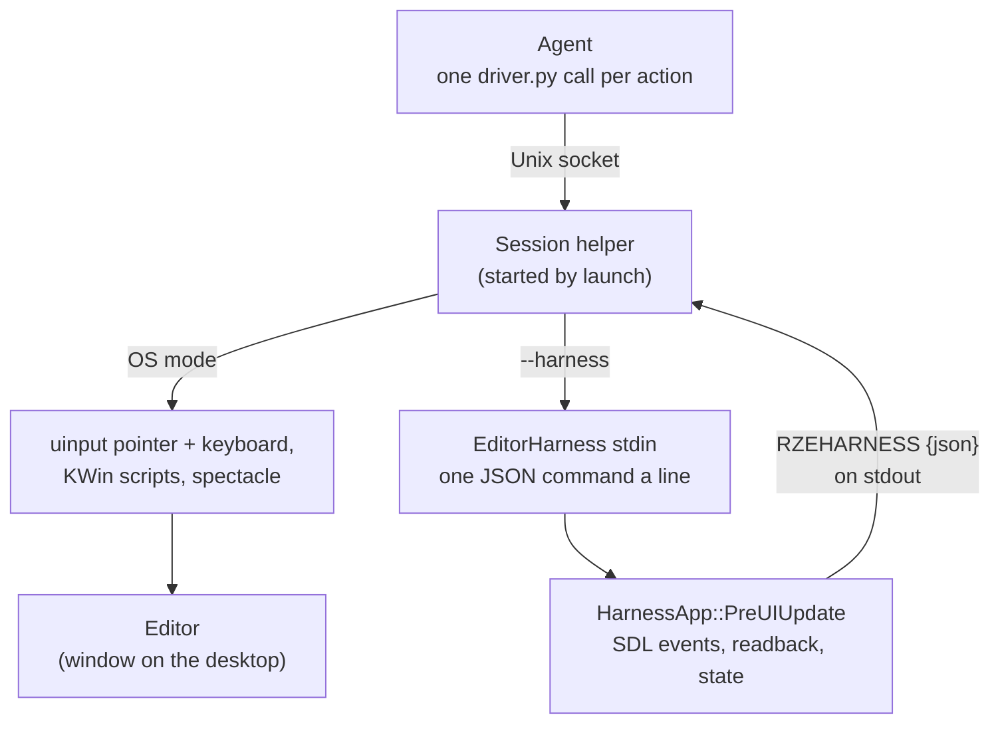

# EditorHarness and the Drivers

The `run-rze` skill (`.claude/skills/run-rze/`) lets an agent build, run and drive the Editor: click and type in it,
take screenshots, ask what it holds, and close it the way a user would. It works in two modes:
- **OS input:** a driver plays real mouse and keyboard input on the desktop and captures the screen. That's
  `driver.ps1` on Windows (user32) and `driver.py` on Linux (uinput and KWin).
- **The harness:** `driver.py launch --harness` runs **EditorHarness**, the Editor with a small automation channel
  beside it. Input, screenshots and questions go through the app itself, as JSON lines on its stdin, so the real cursor
  and focus are left alone.

The harness is a test harness, not an engine feature. It's its own executable beside the Editor, and it reaches the
Editor only through seams that already existed (see [Staying outside the engine](#staying-outside-the-engine)).

## Which mode to use

| | Harness (`--harness`) | OS input |
|---|---|---|
| Your mouse and focus | Untouched: no input devices, no focus changes. Real input to the Editor is dropped while it runs. | Moved and taken; don't use the machine while it acts |
| The window | May be covered, unfocused or on another desktop | Must be the active window; every input is checked against it first |
| Screenshots | The frame itself, read back from the back buffer | A capture of the window's client area |
| Questions | `state` and `object` answer from the Editor's data | Only what pixels and the log show |
| What it can't check | The compositor, window decorations, focus and activation, Snap Layouts, RenderDoc's capture key, the Game | Nothing the desktop does, but it's slower and fragile to coordinates |
| Platforms | Linux now. Windows has EditorHarness, but `driver.ps1` doesn't speak to it yet. | Both |

Prefer the harness for anything inside the Editor. Use OS input for what needs the real desktop.

## EditorHarness

`EditorHarness/Src/` is an executable that links `EditorLib` the way the Editor does (`EditorLib.LinkWhole`, see
[Sharpmake-Project-Graph.md](../09-BuildSystem/Sharpmake-Project-Graph.md)), so it *is* the Editor, with every panel.
`HarnessMain.cpp` is `EditorMain.cpp` with a different app: `EditorHarness::HarnessApp`, which subclasses
`Editor::EditorApp` ([App-Shell-Pattern.md](../02-Architecture/App-Shell-Pattern.md)).

### The channel

`HarnessChannel` reads stdin on a thread of its own, a line at a time, and the main thread takes the lines each frame.
- **A command** is one JSON object a line: `{"cmd": "click", "id": 7, "x": 2317, "y": 123}`. `id` is the driver's,
  and is echoed back.
- **An answer** is one line on stdout, prefixed with `RZEHARNESS ` so it stands out from the log lines around it:
  `RZEHARNESS {"id":7,"ok":true}`, or `"ok":false` with an `"error"` that says why. Some answers carry fields, e.g.
  `info`'s `title`, `width`, `height`, `maximized`, `frame` and `realInputBlocked`.
- **stdin is read with the OS's own call** (`read`, `ReadFile`) in `HarnessStdin<Platform>.cpp`, not `std::cin`. A
  thread blocked in `std::getline` holds stdin's lock, and `exit()` flushes every stream, so the Editor hung on exit.
- When stdin closes, the harness stops reading and the Editor carries on. Closing it is up to `quit`.

### The commands

They run in `HarnessApp::PreUIUpdate`, after the Editor's own, on the main thread before the UI is built, so they act
on the frame as a user's input would.

| Command | Fields | Does |
|---|---|---|
| `ping` | | Answers at once |
| `info` | | The window's title, client size, whether it's maximized, the frame count, and whether real input is blocked |
| `move` | `x`, `y` | Moves the mouse (a hover) |
| `click`, `dblclick` | `x`, `y`, `button` (`left`, `right`, `middle`) | A move, a press and a release, a frame each |
| `drag` | `x`, `y`, `x2`, `y2` | A left-button press, 10 moves and a release |
| `scroll` | `x`, `y`, `notches` | Wheel notches; + is away from you |
| `key` | `keys` | `SendKeys` syntax (`^a45{ENTER}`, `{TAB 3}`, `%f`), US layout (`HarnessKeys`). Printable keys also send their text, as a keyboard would. |
| `shot` | `path` | Writes a PNG of the next presented frame: an absolute path, or one relative to the project |
| `state` | | The scene, whether it's modified or loading, the selection, the undo and redo steps, and every object with its parent and whether it's saved |
| `object` | `name` | One object, by the name the Scene panel shows: GUID, parent, components and transform |
| `realinput` | `on` | Whether the real mouse and keyboard reach the Editor (blocked by default) |
| `quit` | | As the window's close button: unsaved changes are asked about first |

Coordinates are client-area pixels, the same space as `shot`'s image.

### Input: SDL events, a frame at a time

`HarnessInput` makes input as **SDL events** (`SDL_PushEvent`), which go the way a real mouse and keyboard's do:
through `Window`, `InputHandler` and ImGui ([Windowing.md](../06-Platform-And-Infrastructure/Windowing.md)). Nothing
in the Editor knows the difference.
- **One step a frame.** A click is a move, then a press, then a release, so ImGui first sees what's under the mouse,
  then sees it pressed. Actions queue, and each plays after the one before it.
- **The answer waits for the action to land.** Two more frames pass after the last step: events pushed on one frame
  are pumped at the start of the next, and the UI acts on them during that one. A `state` sent after a `click`
  therefore sees the click's result.
- **Real input is dropped.** An SDL event filter lets mouse, key and text events through only while the harness is
  pushing, so a hand on the mouse can't disturb a run. `realinput on` turns that off.
- **Unfocused.** Input isn't gated on focus, so it works while another window is active; the Editor then runs at its
  unfocused frame rate (30 fps), and an action takes about 180–290 ms.

### Screenshots: the back buffer

`shot` asks for `Renderer::ReadBackBuffer`, and writes the PNG once the readback has arrived, a frame or two later.
The request is recorded just before the frame's present command, so every API reads the finished frame, ImGui and
all ([Low-Level-Renderer-Module.md](../04-Rendering/Low-Level-Renderer-Module.md#reading-back-from-the-gpu-readtexel-readtexture-and-readbackbuffer)).
It's the frame the Editor drew, whether or not the window is visible. Alpha is forced opaque. Encoding the PNG takes
about a second on the main thread ([known issue 38](../10-KnownIssues/Architectural-Notes-And-TODOs.md#38-an-editorharness-screenshot-stalls-the-editor-for-about-a-second)).

### State queries

`state` and `object` read the Editor's `EditorContext` (the scene document, selection and undo history) through
`EditorApp::GetContext()`, a protected accessor kept for an app built on the Editor
([Editor-Framework.md](Editor-Framework.md)). A check can then ask "did the rotation become 45, and is the scene
modified?" instead of reading it from pixels.

### Staying outside the engine

The harness touches nothing in the engine that exists only for it:

| Seam | Existed for | The harness uses it to |
|---|---|---|
| `EditorLib` as a library | The Editor and the unit tests | Be the Editor, in its own executable |
| `RZE_Application::PreUIUpdate` | Apps gathering what their UI shows | Run commands each frame |
| SDL's event queue and event filter | `Window`'s input | Play input, and drop the real one |
| `Renderer::ReadBackBuffer` | A generic readback, beside `ReadTexture` | Take screenshots |
| `EditorApp::GetContext()` (protected) | An app built on the Editor | Answer `state` and `object` |

The Editor and the Game behave the same whether the harness is built or not.

### Known limits

- **ImGui can follow the real mouse** while the harness's window is focused and the pointer is over no window of the
  app, on Windows and X11: `imgui_impl_sdl3` reads the global mouse there
  ([known issue 39](../10-KnownIssues/Architectural-Notes-And-TODOs.md#39-imgui-can-follow-the-real-mouse-in-a-focused-harness-window)).
- **The Game has no harness.** `GameApp` isn't in a library, so nothing can subclass it yet.

## The drivers

### `driver.py` (Linux)

Each call does one action and returns, usually in well under a second. `launch` starts a **session helper**, which
holds the Editor's process and, in OS mode, the input devices; every other command reaches it over a Unix socket.
- **OS mode** (KDE Plasma on Wayland):
  - input through virtual **uinput** devices, an absolute pointer (so a click lands on the exact pixel, across
    monitors) and a keyboard;
  - **KWin scripts over D-Bus** find the window by process, give its client area, focus and close it. Before each
    input, the driver checks that the Editor is the active window and the point is inside it.
  - **spectacle** captures the client area.
- **Harness mode** (`--harness`) writes commands to EditorHarness's stdin and matches the `RZEHARNESS` answers to
  them by id. Other output lines go to the session's log. `launch` waits for `info` to say the window is maximized.
- **Also:** `log` (the app's output, or the newest `RZELOG`), `clip` (the clipboard), `windows` and `close-window`
  (windows opened since `launch`, like the Game or a file manager), `optick` (a capture over Optick's network
  protocol, [ThirdParty-And-Externals.md](../09-BuildSystem/ThirdParty-And-Externals.md)), and `launch --renderdoc`
  with `renderdoc-capture` ([known issue 37](../10-KnownIssues/Architectural-Notes-And-TODOs.md#37-renderdoc-cant-capture-the-linux-build-as-it-runs-normally)).
- **The session is cleaned up.** The app runs in a process group of its own, so `close` and `quit` also end a Game it
  launched, or `renderdoccmd` around it.

### `driver.ps1` (Windows)

The same commands in OS mode, with user32 input and screen captures. Two things it doesn't do yet, both listed in
`.claude/WindowsChecks.md`: back up `imgui.ini` around a session (H1), and a harness mode (H2).

### `imgui.ini` is put back

Every Editor run rewrites `RZE/Config/imgui.ini`, which often holds a layout someone means to keep. `driver.py launch`
copies it aside, and `close` and `quit` restore it once the app has exited; so does the helper if the session ends
any other way, and the next `launch` restores a backup a dead session left. `--keep-imgui-ini` keeps a run's layout.

## `WindowsChecks.md`

Work done on Linux can't be built or run on Windows there. `.claude/WindowsChecks.md` lists what a Windows machine
still has to check after it: building and the tests, EditorHarness on Windows, the window and input, DX11 rendering,
Editor features, profiling, CI, and work items for `driver.ps1`. It's kept up to date on Linux: a check is added with
each change that affects Windows, and removed once its result is in. On Windows, Claude follows it and records each
result in its table.

## Key files

- `EditorHarness/Src/HarnessApp.h/.cpp` (the commands), `HarnessChannel.h/.cpp`, `HarnessInput.h/.cpp`,
  `HarnessKeys.h/.cpp`, `HarnessMain.cpp`, `HarnessStdin.h` with `Windows/` and `Linux/`
- `EditorHarness/EditorHarness.sharpmake.cs`
- `Editor/Src/EditorApp.h` (`GetContext`), `Modules/Rendering/Src/Rendering/Renderer.h` (`ReadBackBuffer`)
- `.claude/skills/run-rze/SKILL.md`, `driver.py`, `driver.ps1`
- `.claude/WindowsChecks.md`
