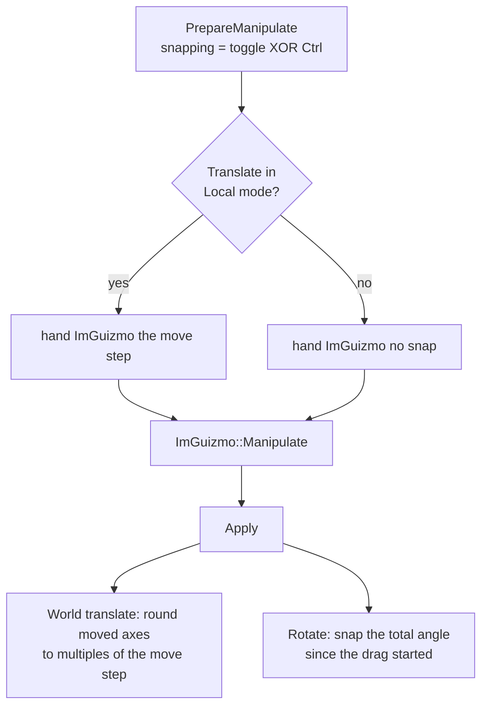
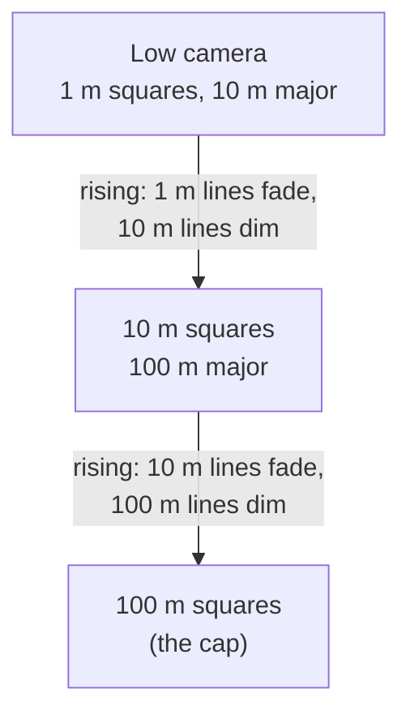

# Gizmo Snapping & the Editor Grid

The SceneView's transform gizmo can snap moves to a world grid and turn in fixed steps, and a ground grid that matches the snap size is drawn under the scene. Both live in `Editor\Src\UI\Gizmo\` as classes the `SceneViewPanel` owns: `GizmoSnapper` and `EditorGrid`. Their toolbar controls sit in the SceneView's menu bar (`SceneViewPanel::DrawMenuBar`), separated into groups by the `EditorUI` toolbar helpers (`ScopedToolbarSpacing`, `ToolbarGroupSeparator`).

The **move step** (snap size) and **rotate step** are shared: they live in `EditorSettings` on the `EditorContext`. The gizmo, the grid and paste all use the move step (paste leaves that gap between copies; see [Editor-Overview.md](Editor-Overview.md#edit-copy-paste-and-duplicate)), and both are also on the Settings window's **Scene View** page ([Status-Bar-And-Settings.md](Status-Bar-And-Settings.md#pages)). The toolbar and that page draw them with the same functions (`GizmoSnapper::DrawSnapSizeOptions` / `DrawRotationStepOptions`, over `EditorSettings::k_snapSizeOptions` / `k_rotationStepOptions`). `GizmoSnapper` keeps only the toggle, and reads both steps from the settings each frame (`PrepareManipulate`).

```
Translate Rotate Scale | Local World | [ ] Snap (X) | Move step: (o)0.25 m ( )0.5 m ( )0.75 m ( )1 m | Rotate step: (o)15° ( )30° ( )45° ( )90° | [x] Grid  1 m squares
```

All settings last for the session only. Defaults: snap off, 1 m move step, 15° rotate step, grid shown.

## Snapping (`GizmoSnapper`)

| Setting | Options | Applies to |
|---|---|---|
| **Snap (X)** | on / off; **X** toggles it, **holding Ctrl** during a drag inverts it for that drag | Translate and Rotate (Scale never snaps) |
| **Move step** | 0.25, 0.5, 0.75, 1 m (`EditorSettings::SetSnapSize` rounds to quarter metres and clamps to 0.25–1) | Translate |
| **Rotate step** | 15°, 30°, 45°, 90° | Rotate |

How each mode snaps:

| Gizmo mode | Behaviour |
|---|---|
| **Translate, World** | Positions snap to **absolute** multiples of the move step, so they land on grid lines whatever the starting position. Only the axes the drag has actually moved are snapped, so an axis or plane drag never nudges the other axes. |
| **Translate, Local** | Local axes don't line up with the world grid, so this uses ImGuizmo's own snap: steps of the move step along the local axis, counted from where the drag started. |
| **Rotate** (both spaces) | The **total** angle turned since the drag started snaps to whole steps. ImGuizmo's built-in rotation snap rounds the absolute ring angle instead, which drifts off-step (e.g. 45.028°), so `GizmoSnapper` does it itself: it keeps the unsnapped rotation as a quaternion, accumulates each frame's delta onto it, and snaps the angle between that and the drag's starting rotation. |

Per frame, `SceneViewPanel` calls `PrepareManipulate(settings, operation, mode, ctrlHeld)` before `ImGuizmo::Manipulate` (passing the result as the snap argument), then `Apply(drag, currentPosition, currentRotation, translation, rotation)` on the decomposed result. `drag` is the gizmo's `InteractionTracker`, following `ImGuizmo::IsUsing()`; its start edge is where the starting position and rotation are captured. The snapped result is pushed as a `SetTransformCommand` carrying the drag's interaction ID (see [Editor-Framework.md](Editor-Framework.md#interactions-one-drag-many-commands)). With several objects selected, the others get the same change; see [Editor-Panels.md](Editor-Panels.md#sceneview-sceneviewpanel).



## The grid (`EditorGrid`)

A semi-transparent grid on the **Y = 0** plane (+Y is up; see [World-Conventions.md](../02-Architecture/World-Conventions.md)), drawn every frame as debug lines around the editor camera.

- **Square size follows the move step**, so snapped objects always land on grid lines.
- **It grows as the camera rises.** Squares are 10× bigger per level, up to two levels (100× the move step). With a 1 m step: 1 m squares near the ground, 10 m from about 50 m up, 100 m from about 500 m up. The toolbar shows the current size ("1 m squares").
- Every 10th line is a brighter **major** line. The lines through the origin take axis colours: **X red, Z blue**.
- Lines are depth-tested, so the scene hides them.

### Fading

Two fades keep the grid from ever popping or showing an edge:

| Fade | How |
|---|---|
| **Between levels** | The level is computed as a continuous value from the camera height (`log10(height / (5 × move step))`). Through each level, minor lines fade out while major lines dim to minor brightness. When the level steps up, the old major lines become the new minor lines at the same brightness. |
| **With distance** | Each line carries a `DebugLineFade` (centre = the point under the camera, start/end radii). The line pixel shader fades alpha with each pixel's distance from the centre. The fade ends at 4× the camera height, kept between 40 move steps and 200 squares, so it widens smoothly as the camera rises; lines are fully visible out to 30% of that. |

Only lines out to the fade end are drawn, centred on the camera in whole major cells so they don't slide as it moves. New lines appear beyond the fade and fade in as the camera approaches.



## Rendering support

The grid needed two additions to the debug-line path, both usable by any debug drawing:

- **Alpha.** `RenderEngine::DrawLine` and `DrawWireBox` take an optional `alpha` (default 1). `DebugDrawRenderStage` switches to `EBlendState::AlphaBlend` around its draw and back to `Opaque` after. See [Low-Level-Renderer-Module.md](../04-Rendering/Low-Level-Renderer-Module.md).
- **Distance fade.** `DrawLine` takes an optional `DebugLineFade { centre, start, end }`. Lines without one (end = 0) don't fade. Fully faded pixels are clipped, so they don't write depth over lines behind them.

See [Render-Stages.md](../04-Rendering/Render-Stages.md#debugdrawrenderstage).

## Key files

- `Editor\Src\UI\Gizmo\GizmoSnapper.h/.cpp`
- `Editor\Src\UI\Gizmo\EditorGrid.h/.cpp`
- `Editor\Src\UI\Framework\EditorSettings.h/.cpp` — the shared move and rotate steps, and their options
- `Editor\Src\UI\Framework\EditorUI.h/.cpp` — spacing and separators for the SceneView toolbar groups
- `Editor\Src\UI\Panels\SceneViewPanel.h/.cpp` — owns both, wires them to ImGuizmo and the camera
- `Engine\Src\Graphics\RenderStages\DebugDrawRenderStage.h/.cpp`, `Assets\Shaders\Vertex_Line.hlsl`, `Pixel_Line.hlsl`
