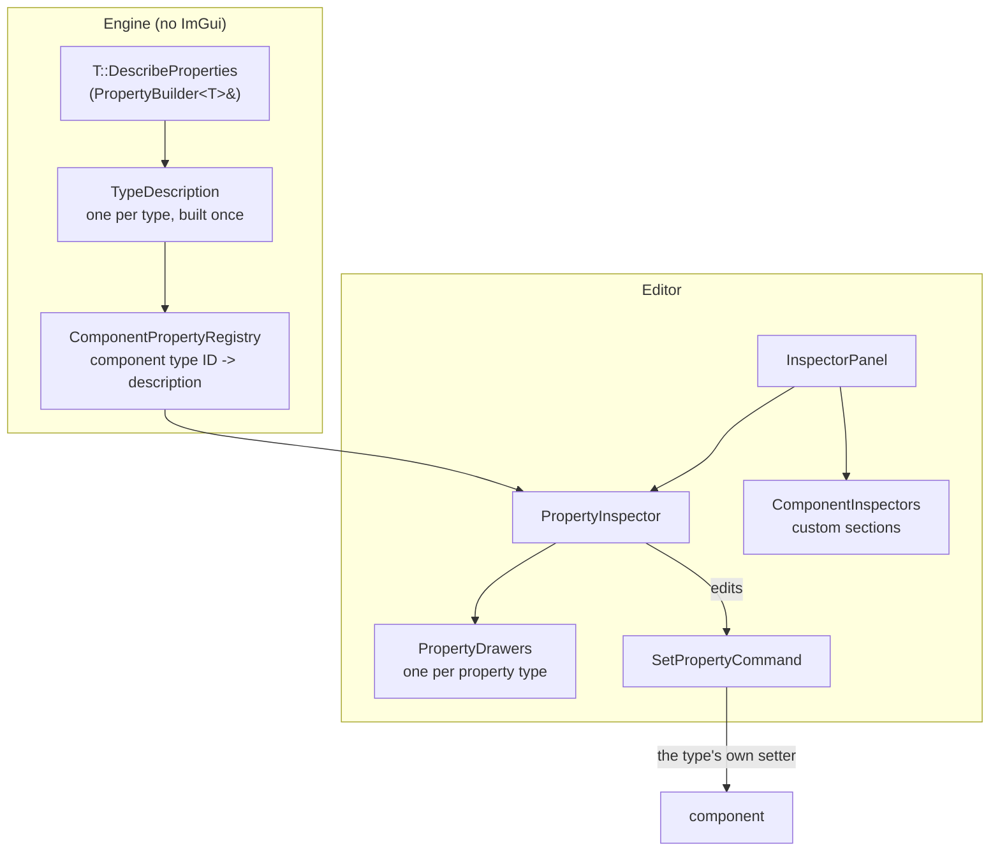

# Object Inspector & Property Descriptors

The Object Inspector shows and edits the selected GameObjects' components. It doesn't know about any component type: each type **describes its properties** in the Engine, with no ImGui, and the Editor draws whatever is described. Components and other types (materials, meshes, textures) describe themselves the same way, so they nest.



## Describing a type (Engine side)

A type describes itself in a static `DescribeProperties`, from its own getters and setters:

```cpp
void CameraComponent::DescribeProperties(PropertyBuilder<CameraComponent>& properties)
{
    properties.Bool("Main Camera", &CameraComponent::IsMainCamera, &CameraComponent::SetMainCamera).Exclusive()
        .ToolTip("The camera the game renders through. Only one camera in the scene can be the main one.");
    properties.Float("Field Of View", &CameraComponent::GetFOV, &CameraComponent::SetFOV)
        .Range(1.0f, 179.0f).StepSize(0.5f).DisplayFormat("%.2f").ToolTip("Vertical, in degrees");
    properties.Float("Exposure Compensation (EV)", &CameraComponent::GetExposureCompensation, &CameraComponent::SetExposureCompensation)
        .Range(-4.0f, 4.0f).StepSize(0.05f).DisplayFormat("%.2f").As(EPropertyWidget::Drag);
}
```

- **Edits go through the setter**, so whatever the setter does on a change still happens (`TransformComponent::SetPosition` marks the transform dirty, `RenderComponent::LoadMesh` loads the mesh through the resource system).
- **Leave the setter out** and the property is **computed**: worked out from other properties (a mesh's size, a material's textures), so tools show it but never write or copy it. State that tools mustn't edit but that belongs to the object keeps its setter and is marked [`.ReadOnly()`](#metadata) instead.
- The description is built once per type, the first time it's needed. For components, that's when `REGISTER_GAMEOBJECTCOMPONENT` registers the type: it calls `ComponentPropertyRegistry::Register<T>()`, which detects `DescribeProperties` at compile time and stores the description under the component's type ID. A type without one simply has no properties.
- The Engine side has no ImGui. Any tool can read and write properties as `PropertyValue`s.

### Builder methods

| Method | Value | Notes |
|---|---|---|
| `Bool`, `Int`, `Float` | the type | getter returns by value |
| `Vector3`, `Vector4` | `Vector3D`, `Vector4D` | getter returns by value or `const&` |
| `Colour` | `Vector4D` | RGBA in 0–1, drawn as a colour picker |
| `String` | `std::string` | |
| `AssetPath` | `Filepath` | picked with a file prompt; set what to pick with `.Asset(title, folder, filter)` |
| `Object<T>` | a nested described object | getter returns a reference, pointer or `shared_ptr`; read-only; drawn as a tree node |
| `Array` | a list of nested objects | getter returns `std::vector<ObjectRef>`, e.g. from `MakeObjectRefs(vector)`; read-only |
| `Value<T>` | a computed read-only value | getter is any callable taking the object, for values with no getter of their own |
| `DisplayName` | | what to call an instance in a tree, e.g. a sub-mesh's name |

Getter signatures are fixed rather than deduced, so an overloaded getter (const and non-const `GetPosition`) resolves to its const version without a cast.

### Metadata

Chained on any property:

| Method | Effect |
|---|---|
| `.Range(min, max)`, `.StepSize(step)`, `.DisplayFormat("%.2f m")` | How numbers are edited and shown |
| `.ToolTip("text")` | Shown when hovering the label (was `.Tip`) |
| `.As(EPropertyWidget::Drag \| Slider \| Colour)` | Widget hint |
| `.ReadOnly()` | Drawn disabled in the inspector, but keeps its setter, so it's still copied with the object. `IsEditable()` is true only for a property with a setter that isn't `ReadOnly`. |
| `.EditorOnly()` | A view setting rather than part of the scene (the bounds toggles). Applied without an undo record, doesn't mark the scene modified, and isn't copied. |
| `.Exclusive()` | For a `Bool` that at most one object of the type in the scene can have on (Main Camera). The setter keeps it that way, turning it off for the others. The inspector draws it as a disabled tick while it's on (tooltip: "Turn this on for another one to change it") and read-only with several objects selected, so it's turned off by turning it on elsewhere. Undo turns it back on for whichever object had it before. Not copied, so a pasted camera is never the main one. |

### What's described today

| Type | Properties |
|---|---|
| `TransformComponent` | Position (metres, relative to the parent), Rotation (Euler degrees), Scale |
| `RenderComponent` | Mesh (asset path; setting it loads the mesh), Size (computed, metres along the object's axes, including scale), Draw Mesh Bounds and Draw Sub-Mesh Bounds (`EditorOnly`), Sub-Meshes (array) |
| `MeshGeometry` (a sub-mesh) | named by the sub-mesh's name; Material (nested) |
| `MaterialInstance` | Shader (read-only), Textures (array, one per filled slot, labelled with the slot) |
| `Texture2D` | File (read-only path), Preview (the image) |
| `CameraComponent` | Main Camera (`Exclusive`), Field Of View, Near Cull, Far Cull, Exposure Compensation (EV) |
| `DirectionalLightComponent` | Colour (colour picker), Strength |
| `GifChatComponent` | Sub-Meshes (array), like `RenderComponent`'s |

## The inspector (Editor side)

`InspectorPanel` ("Object Inspector", docked right by default):

1. **`Update()`**, with no ImGui: gathers the primary selection's components, sorted by inspector order (`EditorComponentCache` order data registered in `EditorApp`, e.g. `TransformComponent` first; default `0x0100`). With several objects selected, it keeps only the component types **every** selected object has, and groups each primary component with its matches. This rebuilds every frame; it's cheap, and nothing goes stale when components change.
2. **`Draw()`**: for each group, a `[ ComponentName ]` heading, then `PropertyInspector::Draw`, then any custom section.

`PropertyInspector` draws a two-column label/value table (`EditorUI` property tables). The label column is sized to the widest label, and long labels show in full on hover. Each property's drawer comes from `PropertyDrawers`, by type:

- Numbers and vectors use input or drag widgets according to the descriptor's range, step, format and widget hint. Properties that aren't editable (computed or `ReadOnly`) are drawn disabled.
- `AssetPath` shows the path with a `...` button that opens the file prompt.
- `Texture` shows the image, scaled to fit.
- `Object` and `Array` properties are tree nodes, drawn by the inspector itself; their contents are read-only.

`PropertyDrawers::Register(type, drawer)` replaces or adds a drawer.

### Editing

- A drawer edits a copy of the value. On change, the inspector pushes a `SetPropertyCommand` (component handle, property index, new value) for each target. Each records the value from before for undo; a drag is one undo step (see [Editor-Framework.md](Editor-Framework.md#undo-and-redo)).
- **Drags and sliders** share one interaction for as long as they're held; a checkbox, Enter in a text field or a file pick is its own interaction (see [Editor-Framework.md](Editor-Framework.md#interactions-one-drag-many-commands)).
- **Several objects at once.** Values show the primary's; a value that differs between objects is drawn as mixed (ImGui's `MixedValue` flag). An edit goes to every selected component in one interaction. For vectors, only the **axes you changed** are written, so editing X on three objects keeps their own Y and Z.

### Custom sections

For what a description can't express, a component type can add an editor-side section, drawn after its properties when one object is selected:

```cpp
void DrawCameraPreview(Editor::EditorContext& context, CameraComponent& camera) { ... }
REGISTER_COMPONENT_INSPECTOR(CameraComponent, DrawCameraPreview);
```

The only one today is the **camera preview**: `CameraComponent::RenderPreview()` renders the camera's view into its preview target with its own local projection (the camera itself isn't touched), and the section shows it with `PropertyDrawers::DrawTexture`. It's a custom section rather than a property because showing it means rendering, not reading a value.

## Adding properties to a component

1. Give the component getters (and setters for editable values). Setters should do whatever a change needs, such as marking state dirty.
2. Add `static void DescribeProperties(PropertyBuilder<YourComponent>& properties);` and list the properties.
3. That's all. Registration picks it up, and the inspector, multi-select editing, undo and copy/paste work without editor changes.

Whatever the editor can change should be a property with a setter: undo and copy reach state through properties, so state that isn't one is lost when an object is copied.

To nest another type, describe that type the same way and use `Object` or `Array`.

## Key files

- `Engine\Src\Game\World\GameObject\Properties\PropertyDescriptor.h` — `PropertyValue`, `EPropertyType`, `EPropertyWidget`, `PropertyDescriptor`, `TypeDescription`, `ObjectRef`, `PropertyTexture`
- `Engine\Src\Game\World\GameObject\Properties\PropertyBuilder.h` — `PropertyBuilder<T>`, `DescribeType<T>()`, `MakeObjectRef(s)`
- `Engine\Src\Game\World\GameObject\Properties\ComponentPropertyRegistry.h/.cpp`
- `Editor\Src\UI\Panels\InspectorPanel.h/.cpp`
- `Editor\Src\UI\Inspector\PropertyInspector`, `PropertyDrawers`, `ComponentInspectors`, `BuiltInComponentInspectors.cpp`
- `Editor\Src\Commands\PropertyCommands.h/.cpp`
