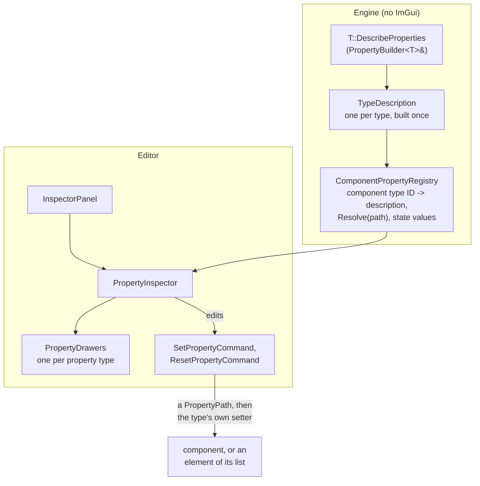

# Object Inspector & Property Descriptors

The Object Inspector shows and edits the selected GameObjects' components. It doesn't know about any component type: each component type **describes its properties** in the Engine, with no ImGui, and the Editor draws whatever is described. A component can also describe the elements of a list it owns (a mesh's material slots), so they're edited the same way.



## Describing a component (Engine side)

A component describes itself in a static `DescribeProperties`, from its own getters and setters:

```cpp
void CameraComponent::DescribeProperties(PropertyBuilder<CameraComponent>& properties)
{
    properties.Bool("Main Camera", &CameraComponent::IsMainCamera, &CameraComponent::SetMainCamera).Exclusive()
        .ToolTip("The camera the game renders through. Only one camera in the scene can be the main one.");
    properties.Float("Field Of View", &CameraComponent::GetFOV, &CameraComponent::SetFOV)
        .Range(1.0f, 179.0f).StepSize(0.5f).DisplayFormat("%.2f").ToolTip("Vertical, in degrees")
        .InGroup("Projection");
    // ...
    properties.Preview("Preview", [](CameraComponent& camera) { camera.RenderPreview(); /* ... */ return preview; });
}
```

- **Edits go through the setter**, so whatever the setter does on a change still happens. For example, `TransformComponent::SetPosition` marks the transform dirty, and `RenderComponent::LoadMesh` loads the mesh through the resource system.
- **Leave the setter out** and the property is **computed**: worked out from other properties (a mesh's size), so tools show it but never write or copy it. State that tools mustn't edit but that belongs to the object keeps its setter and is marked [`.ReadOnly()`](#metadata) instead.
- **Only components describe properties.** They're what the inspector draws, so a nested type (a material slot) is described by the component that owns it, through `Array<TElement>` below. `MaterialInstance` and `Texture2D` still describe themselves for `GifChatComponent`'s read-only list; moving those to the component is a [known follow-up](../10-KnownIssues/Architectural-Notes-And-TODOs.md).
- **When the description is built:** once per type, the first time it's needed. For components, that's when `REGISTER_GAMEOBJECTCOMPONENT` registers the type. It calls `ComponentPropertyRegistry::Register<T>()`, which detects `DescribeProperties` at compile time and stores the description under the component's type ID. A type without one simply has no properties.
- **No ImGui on the Engine side.** Any tool can read and write properties as `PropertyValue`s.

### Builder methods

| Method | Value | Notes |
|---|---|---|
| `Bool`, `Int`, `Float` | the type | getter returns by value |
| `Vector3`, `Vector4` | `Vector3D`, `Vector4D` | getter returns by value or `const&` |
| `Colour` | `Vector4D` | RGBA in 0–1, drawn as a colour picker (`.As(EPropertyWidget::Colour)` on a `Vector3` gives RGB) |
| `String` | `std::string` | |
| `AssetPath` | `Filepath` | picked in the file browser; set what to pick with `.Asset(title, folder, filter)` |
| `Enum<E>(name, names, getter, setter)` | an option, stored as its index | drawn as a drop-down of `names` |
| `Value<T>(name, getter[, setter])` | any of the above | callables taking the object, for values with no getter or setter of their own (e.g. one worked out from a base and an override) |
| `Object<T>` | a nested described object | getter returns a reference, pointer or `shared_ptr`; read-only; drawn as a tree node |
| `Array(name, getter)` | a list of nested objects | getter returns `std::vector<ObjectRef>`; read-only |
| `Array<TElement>(name, getter, mutableGetter, keyOf, describe)` | an **editable** list | the elements' properties are described by `describe` (on the component) and edited through paths; `keyOf` names each element so a path finds it after the list changes |
| `Preview(name, maker)` | an image made each time it's shown | `maker` takes the object non-const (making it can render, as the camera does) and returns a `PropertyTexture`; no value, so nothing to copy, undo or save |
| `DisplayName`, `Icon` | | what to call an instance in a tree, and a small image beside it (a material slot's diffuse texture) |

Getter signatures are fixed rather than deduced, so an overloaded getter (const and non-const `GetPosition`) resolves to its const version without a cast.

### Metadata

Chained on any property:

| Method | Effect |
|---|---|
| `.Range(min, max)`, `.StepSize(step)`, `.DisplayFormat("%.2f m")` | How numbers are edited and shown |
| `.ToolTip("text")` | Shown when hovering the label |
| `.As(EPropertyWidget::Drag \| Slider \| Colour)` | Widget hint |
| `.InGroup("Textures")` | Drawn under a section of that name, with the properties next to it that share it |
| `.ReadOnly()` | Drawn disabled in the inspector, but keeps its setter, so it's still copied with the object. `IsEditable()` is true only for a property with a setter that isn't `ReadOnly`. |
| `.EditorOnly()` | A view setting rather than part of the scene (the bounds toggles). Applied without an undo record, doesn't mark the scene modified, and isn't copied. |
| `.Exclusive()` | For a `Bool` that at most one object of the type in the scene can have on (Main Camera). The setter keeps it that way, turning it off for the others. The inspector draws it as a disabled tick while it's on (tooltip: "Turn this on for another one to change it") and read-only with several objects selected, so it's turned off by turning it on elsewhere. Undo turns it back on for whichever object had it before. Not copied, so a pasted camera is never the main one. |
| `.Overridable<T>(isOverridden, reset)` | A value that comes from a base unless the object overrides it (a material slot's values over the shared material's). Overridden values are marked and can be reset, undo can return to "not overridden", and copies only take overridden values. |
| `.EnabledIf<T>(isEnabled, reason)` | Shown read-only, with `reason` as its tooltip, while `isEnabled` says no (opacity only matters for blended materials) |
| `.Thumbnail<T>(getter)` | For an `AssetPath`: a small image of the asset beside the path (a texture row's loaded texture) |
| `.Clearable()` | For an `AssetPath`: a button that empties it |

### Paths into lists

A property of a component is addressed by a `PropertyPath`: its index, or, for an element of an editable `Array`, the array's index, the element's key and the element's property index (and so on, nested). Keys rather than positions mean a path still finds the same element after the list changes, and leads nowhere once it's gone.

`ComponentPropertyRegistry::Resolve(component, path)` follows one. The registry also works out a component's **state values**: the values copies take and undo puts back.
- A property's value counts if it has a setter, isn't `Exclusive` or `EditorOnly`, and, if overridable, is overridden.
- `GetElementStateValues` collects the elements' state values by path, and `SetValues` applies them, skipping paths that lead nowhere.

### What's described today

| Component | Properties |
|---|---|
| `TransformComponent` | Position (metres, relative to the parent), Rotation (Euler degrees), Scale |
| `RenderComponent` | Mesh (asset path, clearable; setting it loads the mesh), Size (computed, metres along the object's axes, including scale), **Debug Draw**: Mesh Bounds, Sub-Mesh Bounds (`EditorOnly`), then Materials (editable list, below) |
| `CameraComponent` | Main Camera (`Exclusive`), **Projection**: Field Of View, Near Cull, Far Cull, **Exposure**: Compensation (EV), then **Preview** |
| `DirectionalLightComponent` | Colour (colour picker), Strength |
| `GifChatComponent` | Materials (read-only list of its materials) |

`RenderComponent`'s **Materials** are its mesh instance's material slots, keyed by slot name, each with its diffuse texture as its icon. Every row but Shader is overridable for this object only ([Materials-Meshes-Shaders.md](../04-Rendering/Materials-Meshes-Shaders.md#values-overrides-and-slots)):

| Section | Rows |
|---|---|
| | Material (the `.materialasset` it draws; swapping it is an override), Shader (read-only) |
| Surface | Tint (colour), Blend (drop-down), Opacity (slider, only for blended modes), Shininess |
| Textures | Diffuse, Specular, Normal, Opacity, Height (each with a thumbnail and a clear button) |
| Opacity Mask | Invert, From Alpha (only with an opacity texture) |

## The inspector (Editor side)

`InspectorPanel` ("Object Inspector", docked right by default):

1. **`Update()`**, with no ImGui:
   - It gathers the primary selection's components, sorted by inspector order. The order data is registered in `EditorApp` (`EditorComponentCache`); `TransformComponent` comes first, and the default is `0x0100`.
   - With several objects selected, it keeps only the component types **every** selected object has, and groups each primary component with its matches.
   - It rebuilds every frame. It's cheap, and nothing goes stale when components change.
2. **`Draw()`**: for each group, a `[ ComponentName ]` heading, then `PropertyInspector::Draw`.

`PropertyInspector` draws a two-column label/value table (`EditorUI` property tables):
- **The label column** is sized to the component's widest label. Labels are drawn in a softer colour than values, and long ones show in full on hover.
- **Groups:** each group starts with a section row (`EditorUI::PropertySectionRow`), its title followed by a thin rule across the row. Ungrouped rows after a group get a bare rule.
- **Each property's drawer** comes from `PropertyDrawers`, by type:
  - **Numbers and vectors** use input, drag or slider widgets according to the descriptor's range, step, format and widget hint. Properties that can't be changed (computed, `ReadOnly`, or disabled by `EnabledIf`) are drawn disabled.
  - **`AssetPath`** shows the file's name, with its relative path in a popup above the cursor on hover, and a thumbnail when it has one.
    - Hovering a thumbnail shows the image at up to 320 px, with its size, below and to the left of the cursor.
    - `...` opens the [file browser](Thumbnails-And-File-Browser.md) on the property's folder and extensions. The choice comes back through `FileBrowserModal::ConsumeResult` with the button's ImGui ID, so it's an ordinary, undoable property change.
  - **`Enum`** is a drop-down.
  - **`Texture`** shows the image, scaled to fit.
  - **`Object` and `Array`** are tree nodes, drawn by the inspector itself, with a filter beside a list longer than 8 elements.
- **Elements:** an editable `Array`'s elements are edited like the component's own properties. An element with overridden values shows "N overridden" and a reset-all button on its heading.
- **`Preview`** gets a section of its own and is drawn across the row, at its own size or scaled down to fit. It's made from the primary component, every frame it's shown.
- **Overridden values** have their label in the accent colour and a reset button beside them (a `ResetPropertyCommand`).

`PropertyDrawers::Register(type, drawer)` replaces or adds a drawer.

### Editing

- **Each edit is a command.** A drawer edits a copy of the value. On change, the inspector pushes a `SetPropertyCommand` (component handle, `PropertyPath`, new value) for each target. Each records the value from before for undo, including whether an overridable value was overridden; a drag is one undo step (see [Editor-Framework.md](Editor-Framework.md#undo-and-redo)).
- **Changing a component's own property also records its list elements' state values**, which undo puts back. Clearing the mesh replaces its material slots, so undo has to bring their overrides back too.
- **Drags and sliders** share one interaction for as long as they're held. A checkbox, Enter in a text field or a file pick is its own interaction (see [Editor-Framework.md](Editor-Framework.md#interactions-one-drag-many-commands)).
- **Several objects at once.**
  - Values show the primary's, and a value that differs between objects is drawn as mixed (ImGui's `MixedValue` flag).
  - An edit goes to every selected component in one interaction. A path that leads nowhere on another object (it hasn't got that slot) is skipped.
  - For vectors, only the **axes you changed** are written, so editing X on three objects keeps their own Y and Z.

## Adding properties to a component

1. Give the component getters (and setters for editable values). Setters should do whatever a change needs, such as marking state dirty.
2. Add `static void DescribeProperties(PropertyBuilder<YourComponent>& properties);` and list the properties.
3. That's all. Registration picks it up, and the inspector, multi-select editing, undo and copy/paste work without editor changes.

Whatever the editor can change should be a property with a setter: undo and copy reach state through properties, so state that isn't one is lost when an object is copied.

To edit a list the component owns, use `Array<TElement>` and describe the elements' properties in the `describe` callable. Something the inspector should show by making it (an image rendered on demand) is a `Preview`.

## Key files

- `Engine\Src\Game\World\GameObject\Properties\PropertyDescriptor.h` — `PropertyValue`, `EPropertyType`, `EPropertyWidget`, `PropertyDescriptor`, `TypeDescription`, `ObjectRef`, `PropertyTexture`
- `Engine\Src\Game\World\GameObject\Properties\PropertyBuilder.h` — `PropertyBuilder<T>`, `DescribeType<T>()`, `MakeObjectRef(s)`
- `Engine\Src\Game\World\GameObject\Properties\PropertyPath.h/.cpp`
- `Engine\Src\Game\World\GameObject\Properties\ComponentPropertyRegistry.h/.cpp`
- `Editor\Src\UI\Panels\InspectorPanel.h/.cpp`
- `Editor\Src\UI\Inspector\PropertyInspector`, `PropertyDrawers`
- `Editor\Src\UI\Framework\EditorUI.h/.cpp` — property tables, section rows, wide rows, icon buttons
- `Editor\Src\Commands\PropertyCommands.h/.cpp`
