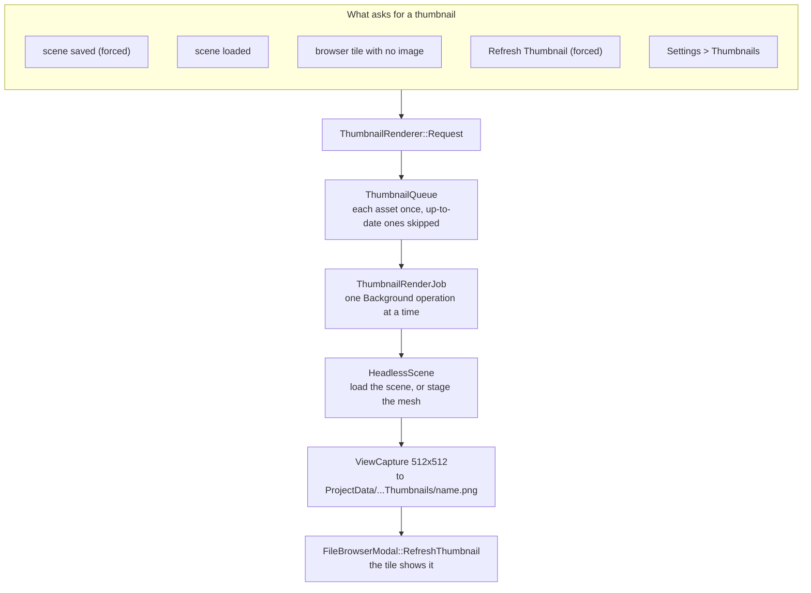
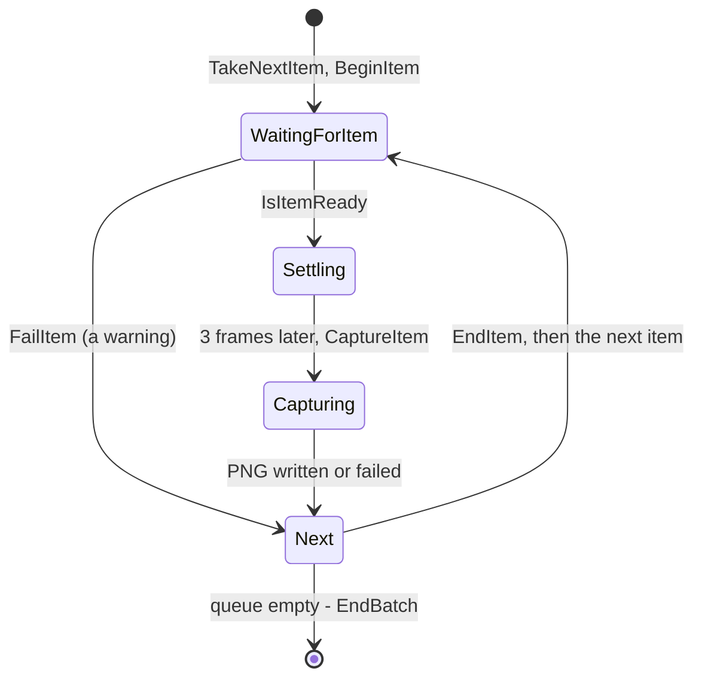

# Thumbnails & the File Browser

The Editor opens, saves and picks files in its own **file browser**: a modal grid of large tiles, each showing the file's thumbnail. Scene and mesh thumbnails are rendered by the Editor itself, **in the background**, in a scene of their own, so the scene you're editing is never touched and nothing waits on them.



## The file browser (`FileBrowserModal`)

`UI\Modals\FileBrowserModal.h/.cpp`, owned by `EditorContext` (`GetFileBrowser()`) and displayed by `EditorApp` after the panels, beside the other modals.

| Used for | Opens on | Mode |
|---|---|---|
| File > Load Scene... | `Assets\Scenes`, `.scene`, scene thumbnails | Open |
| Save Scene on a new scene, and Save in the unsaved-changes prompt (`SceneDocument::SaveWithPrompt`) | `Assets\Scenes`, `.scene` | Save |
| An asset path in the Object Inspector (`PropertyDrawers::DrawAssetPath`, e.g. RenderComponent's Mesh) | the property's `AssetDirectory`, with extensions from its `AssetFilter` (`*.meshasset` gives `.meshasset`), mesh thumbnails | Open |

The Win32 Open/Save dialogs it replaced have been removed.

### What it looks like

```
+------------------------------------------------------------------------+
| Load Scene                                     [==o==]  [ Search     ] |
| Scenes / Levels                                                        |
| +----------+  +----------+  +----------+  +----------+                 |
| |          |  |          |  |  .scene  |  |  folder  |                 |
| |  image   |  |  image   |  | (no image|  |          |                 |
| +----------+  +----------+  +----------+  +----------+                 |
|  Sponza        Mountain      NewLevel      Levels                      |
|  5 minutes ago 3 days ago    Just now      Folder                      |
|                                                                        |
| Assets\Scenes\Sponza.scene                          [Cancel]  [ Open ] |
+------------------------------------------------------------------------+
```

- **Header:** the title, a tile-size slider (95–234 px) and a search box that keeps the files whose name contains the text, ignoring case.
- **Breadcrumb:** each folder from the request's `RootFolder` down is a button that goes back up to it. Browsing never leaves the root.
- **Tiles:** subfolders first, then files, each sorted by name. A file's tile shows its image fitted into a square with rounded corners, its name and how long ago it changed. A file with no image shows a gradient with its extension. Right-clicking a file shows the request's tile actions, e.g. **Refresh Thumbnail**.
- **Footer:** the selected file's path, then Cancel and the confirm button (disabled with nothing selected).
- **Save mode** adds a file name field, prefilled with the selection or "Untitled". Clicking a tile copies its name in. The name goes through `ResolveSaveName`, which trims it, adds the extension if it's missing and rejects empty names or characters Windows can't use; the reason shows above the footer. Choosing an existing file asks *"Sponza.scene already exists. Replace it?"* in the footer, rather than in a second popup.

| Key | Does |
|---|---|
| Double-click, Enter | Opens a folder, or chooses the file (Save mode: saves to the typed name) |
| Arrow keys | Move the selection through the grid |
| Backspace | Up a folder, until the root |
| Escape | Backs out of the replace question, then closes without choosing. In a text field, it only leaves the field. |

### Asking for a file

```cpp
FileBrowserRequest request;
request.Title = "Load Scene";
request.RootFolder = AssetPaths::GetSceneFolder();
request.Extensions = { AssetPaths::k_sceneExtension };
request.InitialSelection = scene.GetFilePath();
request.ThumbnailFor = [](const Filepath& file) { return Thumbnails::Scenes().GetPathFor(file); };
request.OnChosen = [&scene](const Filepath& file) { scene.Load(file); };
context.GetThumbnails().AddToBrowser(request);   // render missing thumbnails, add Refresh Thumbnail
context.GetFileBrowser().Open(std::move(request));
```

| `FileBrowserRequest` field | Meaning |
|---|---|
| `Mode` | `Open` (pick an existing file) or `Save` (a typed name, or a file to replace after asking) |
| `Title`, `ConfirmLabel` | The heading and the confirm button ("Open") |
| `RootFolder` | Where browsing starts; it can't go above it |
| `Extensions` | The files listed, e.g. `.scene`; empty lists every file |
| `InitialSelection` | Selected on open. In Save mode it also names the file. `DefaultFileName` ("Untitled") is used when there isn't one. |
| `ThumbnailFor` | The image a file's tile shows. No function, or an image that doesn't exist, shows the placeholder. |
| `OnThumbnailMissing` | Called once per file each time the browser opens, for a tile whose image doesn't exist yet |
| `TileActions` | Label and callback pairs for a file's right-click menu |
| `OnChosen` *or* `RequesterID` | Where the choice goes. An immediate-mode widget, which has nowhere to keep a callback's result, sets `RequesterID` to its ImGui ID and calls `ConsumeResult(id, outFile)` each frame; it returns true once, with the file. That's how the inspector's asset picker turns a choice into an undoable `SetPropertyCommand`. |
| `OnCancelled` | Closed without a choice, including when another request replaces it |

Opening while a request is showing replaces it, and the old one is cancelled.

- **Images** load as `Texture2D` through the `ResourceHandler` as tiles are drawn. Loads are synchronous, so only two happen a frame and a big folder fills in over a few frames. They're released when the browser closes. `RefreshThumbnail(image)` reloads the tiles that show an image once it has been written again, so a thumbnail that finishes rendering appears while the browser is open.
- **The listing** is a set of pure functions in `Services\FolderListing.h/.cpp`, covered by the unit tests: `ListFolder(folder, extensions, search)`, `FindFiles(folder, extension)` (recursive), `ParseExtensionFilter`, `ResolveSaveName` and `FormatTimeAgo` ("Just now", "5 minutes ago", a date once it's months old).

## Thumbnails

`Services\Thumbnails.h/.cpp`:

- `Thumbnails::Scenes()` is `ProjectData\SceneThumbnails` and `Thumbnails::Meshes()` is `ProjectData\MeshThumbnails`. Each asset has one PNG, named after its file: `Sponza.scene` → `Sponza.png`. They're 512×512 (`Thumbnails::k_size`).
- `FindFor(asset)` picks the image by extension: a scene's or mesh's thumbnail, or the file itself for an image.
- A thumbnail is **up to date** when it was written no earlier than its asset last changed (`IsUpToDate`). `Survey(assets, folder)` counts how many are up to date, out of date and missing.
- **Thumbnails aren't tracked in git.** Like the rest of `ProjectData`, they're made locally, and the editor renders whichever are missing as they're needed.

### When one is rendered

| What happens | Thumbnail |
|---|---|
| A scene is saved | Rendered, **forced**: it's rendered even if the file looks up to date |
| A scene is loaded | Rendered if it's missing or out of date |
| The file browser shows a tile with no image | Rendered (`OnThumbnailMissing`, set by `AddToBrowser`) |
| **Refresh Thumbnail** on a tile | Rendered, forced |
| Settings > Thumbnails > **Update** | Every missing or out-of-date one, for scenes or meshes |
| Settings > Thumbnails > **Regenerate All** | Every one, forced |

`AddToBrowser` only changes a browser of scenes or meshes; others are left alone.

### `ThumbnailRenderer` and its queue

`ThumbnailRenderer` (`Services\ThumbnailRenderer.h/.cpp`), owned by `EditorContext` (`GetThumbnails()`), owns a `ThumbnailQueue`, a [`HeadlessScene`](../03-SceneAndGameObjects/Scene-And-GameObject-Model.md#headlessscene-a-scene-rendered-off-screen) and a 512×512 [`ViewCapture`](../04-Rendering/Engine-Graphics-Layer.md#capturing-a-view-to-a-file). These outlive each run; a run works through them.

`ThumbnailQueue` (`Services\ThumbnailQueue.h/.cpp`, no rendering, so it's unit tested):

- Each asset is queued **once**, in the order asked for, compared by path ignoring case. Asking again for one that's queued only carries `force` over.
- `TakeNext` skips assets whose thumbnail is up to date, unless they were forced, and counts the skips for the run's log ("4 already up to date").
- An asset asked for **while it's being rendered** goes back on the queue, forced, once it's done, since it may have changed in the meantime (e.g. saved again).

`Request(asset, force)` ignores anything that isn't a scene or mesh, and anything up to date unless forced, so a run doesn't start just to skip it. Otherwise it queues the asset and starts a **`ThumbnailRenderJob`** if none is running. Only one runs at a time. When it finishes, another starts if more were asked for meanwhile.

### A run

`ThumbnailRenderJob` is an `AsyncOperation` flagged **`Background`** and named "Rendering thumbnails". It doesn't block, it shows in the [status bar](Status-Bar-And-Settings.md#the-status-bar) where it can be cancelled, and its loads use the background job lane. It's a `ThumbnailBatchOperation`: a base class that takes each item through the same steps, while the subclass says where items come from and how each is set up and captured.



For each item:

| | Scene | Mesh |
|---|---|---|
| Set up | `HeadlessScene::Load(scene)` | `Default.scene` is loaded as a stage (its camera and light), once for each run of meshes in a row, then `Preload<StaticMeshResource>(mesh)` loads the mesh on workers |
| Ready when | The load has finished | The preload has finished. Then a `ThumbnailMesh` object with a `RenderComponent` is added; `LoadMesh` is a cache hit. |
| Camera | The scene's **main camera** (`CameraComponent::CreateRenderCamera` at 512×512, with its exposure). With no camera, framed from the scene's bounds at a 50° field of view. | `MeshFraming::FrameBounds(bounds, 40°)`: from the front right and a little above (yaw 35°, pitch 20°), as close as it can be with the bounds' sphere still in view, near and far planes just around it |
| Afterwards | | The mesh object is removed and the preload released |

- The 3 **settle frames** let a newly loaded item's first frames of work (uploads, the shadow map) finish before the capture.
- The capture is written to `<name>.png.tmp` and moved over the old file, so a cancelled or failed run never leaves half an image.
- Each thumbnail written refreshes its tile in an open browser.
- **What it reports:** "Sponza (3 of 12)" with the progress; a logged step per thumbnail ("Rendered Sponza"); a warning per one that couldn't be ("Couldn't render X: it has no camera and nothing to frame"), after which the run carries on; and at the end "11 rendered, 1 couldn't be". All of it lands in the status bar's history.
- **Cancelling** (from the status bar) clears the queue. When a run ends, it unloads its headless scene, so nothing stays loaded between runs.
- **Shutdown:** `EditorApp::ShutDown` calls `ThumbnailRenderer::ShutDown()`, which cancels the run and unloads the scene while the renderer is still up.

**Cost:** rendering every scene and mesh (7 + 12) from SpaceHangar, Release, took 4.7 s, against 6.6 s for the earlier blocking batch it replaced. The worst frame dropped from 962 ms to 167 ms, and frame time with nothing rendering was unchanged.

## Key files

- `Editor\Src\UI\Modals\FileBrowserModal.h/.cpp`
- `Editor\Src\Services\FolderListing.h/.cpp` — listing, search, save names
- `Editor\Src\Services\Thumbnails.h/.cpp` — folders, `FindFor`, `IsUpToDate`, `Survey`
- `Editor\Src\Services\ThumbnailRenderer.h/.cpp` (with `ThumbnailRenderJob`), `ThumbnailQueue.h/.cpp`, `ThumbnailBatchOperation.h/.cpp`, `MeshFraming.h/.cpp`
- `Editor\Src\UI\Inspector\PropertyDrawers.cpp` — `DrawAssetPath`
- `Engine\Src\Game\HeadlessScene.h/.cpp`, `Engine\Src\Graphics\ViewCapture.h/.cpp`, `TextureFile.h/.cpp`
- `UnitTests\Src\Editor\FolderListingTests.cpp`, `ThumbnailQueueTests.cpp`, `ThumbnailsTests.cpp`, `MeshFramingTests.cpp`
