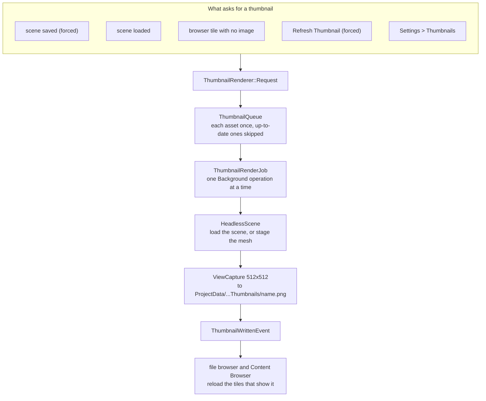
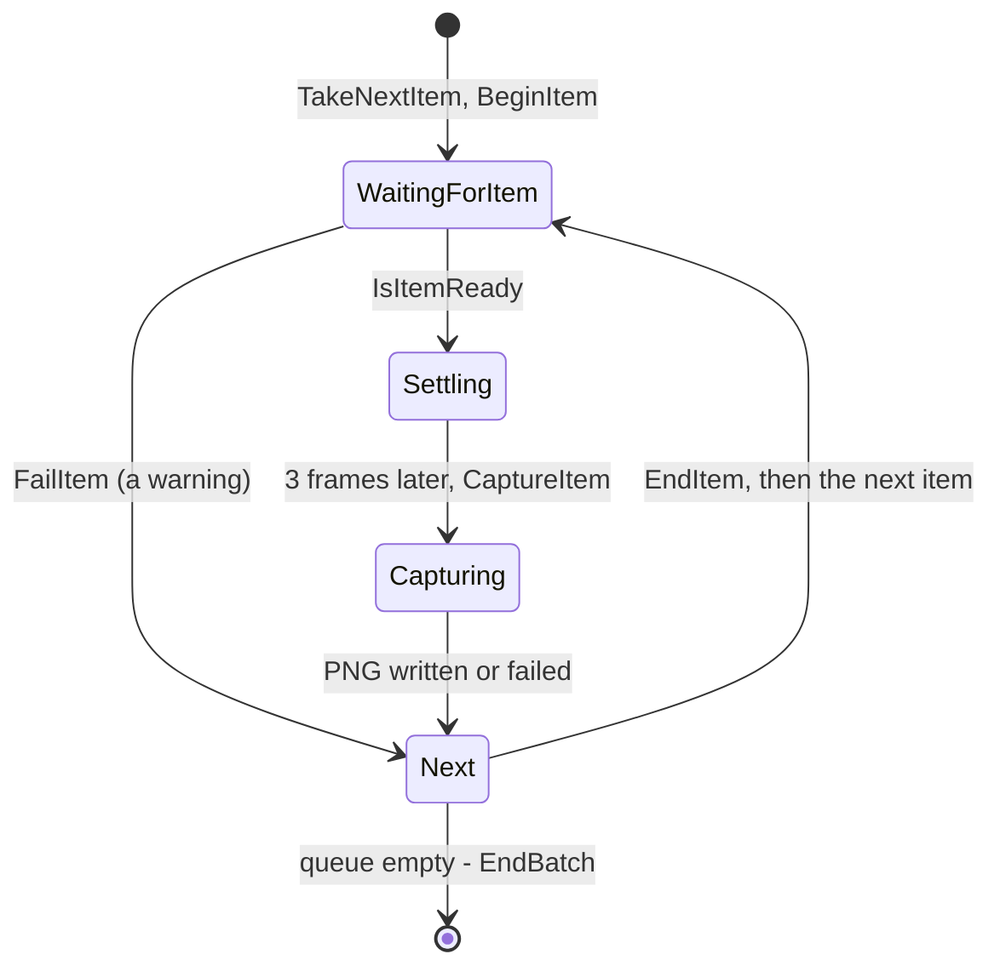

# Thumbnails, the File Browser & the Content Browser

The Editor opens, saves and picks files in its own **file browser**: a modal grid of large tiles, each showing the file's thumbnail. The **Content Browser** panel shows the same tiles all the time, for browsing the project, loading scenes, renaming, deleting and making folders (all undoable), and dragging files into the scene or onto the Object Inspector's asset fields. Both draw their tiles with one widget, `FileTileGrid`. Scene and mesh thumbnails are rendered by the Editor itself, **in the background**, in a scene of their own, so the scene you're editing is never touched and nothing waits on them.



## The file browser (`FileBrowserModal`)

`UI\Modals\FileBrowserModal.h/.cpp`, owned by `EditorContext` (`GetFileBrowser()`) and displayed by `EditorApp` after the panels, beside the other modals.

| Used for | Opens on | Mode |
|---|---|---|
| File > Load Scene... | `Assets\Scenes`, `.scene`, scene thumbnails | Open |
| Save Scene (or Ctrl+S) on a new scene, and Save in the unsaved-changes prompt (`SceneDocument::SaveWithPrompt`) | `Assets\Scenes`, `.scene` | Save |
| An asset path in the Object Inspector (`PropertyDrawers::DrawAssetPath`, e.g. RenderComponent's Mesh) | the property's `AssetDirectory`, with extensions from its `AssetFilter` (`*.meshasset` gives `.meshasset`), mesh thumbnails | Open |

The Win32 Open/Save dialogs it replaced have been removed.

### What it looks like

```
+------------------------------------------------------------------------+
| Load Scene                                     [==o==]  [ Search     ] |
| Scenes / Levels                                                        |
| +----------+  +----------+  +----------+  +----------+                 |
| |          |  |          |  |  .scene  |  |  folder  |                 |
| |  image   |  |  image   |  | (no image|  |          |                 |
| +----------+  +----------+  +----------+  +----------+                 |
|  Sponza        Mountain      NewLevel      Levels                      |
|  5 minutes ago 3 days ago    Just now      Folder                      |
|                                                                        |
| Assets\Scenes\Sponza.scene                          [Cancel]  [ Open ] |
+------------------------------------------------------------------------+
```

It opens in the middle of the editor, sized to it, and can be moved by dragging an empty part of the header or footer; the tile area doesn't move it. It stays where it's put until it's opened again.

- **Header:** the title, a tile-size slider (95–234 px) and a search box that keeps the files whose name contains the text, ignoring case.
- **Breadcrumb:** each folder from the request's `RootFolder` down is a button that goes back up to it. Browsing never leaves the root.
- **Tiles:** subfolders first, then files, each sorted by name. A file's tile shows its image fitted into a square with rounded corners, its name and how long ago it changed. A file with no image shows a gradient with its extension. Right-clicking a file shows the request's tile actions, e.g. **Refresh Thumbnail**.
- **Footer:** the selected file's path, then Cancel and the confirm button (disabled with nothing selected).
- **Save mode** adds a file name field, prefilled with the selection or "Untitled". Clicking a tile copies its name in. The name goes through `ResolveSaveName`, which trims it, adds the extension if it's missing and rejects empty names or characters Windows can't use; the reason shows above the footer. Choosing an existing file asks *"Sponza.scene already exists. Replace it?"* in the footer, rather than in a second popup.

| Key | Does |
|---|---|
| Double-click, Enter | Opens a folder, or chooses the file (Save mode: saves to the typed name) |
| Arrow keys | Move the selection through the grid |
| Backspace | Up a folder, until the root |
| Escape | Backs out of the replace question, then closes without choosing. In a text field, it only leaves the field. |

### Asking for a file

```cpp
FileBrowserRequest request;
request.Title = "Load Scene";
request.RootFolder = AssetPaths::GetSceneFolder();
request.Extensions = { AssetPaths::k_sceneExtension };
request.InitialSelection = scene.GetFilePath();
request.ThumbnailFor = [](const Filepath& file) { return Thumbnails::Scenes().GetPathFor(file); };
request.OnChosen = [&scene](const Filepath& file) { scene.Load(file); };
context.GetThumbnails().AddToBrowser(request);   // render missing thumbnails, add Refresh Thumbnail
context.GetFileBrowser().Open(std::move(request));
```

| `FileBrowserRequest` field | Meaning |
|---|---|
| `Mode` | `Open` (pick an existing file) or `Save` (a typed name, or a file to replace after asking) |
| `Title`, `ConfirmLabel` | The heading and the confirm button ("Open") |
| `RootFolder` | Where browsing starts; it can't go above it |
| `Extensions` | The files listed, e.g. `.scene`; empty lists every file |
| `InitialSelection` | Selected on open. In Save mode it also names the file. `DefaultFileName` ("Untitled") is used when there isn't one. |
| `ThumbnailFor` | The image a file's tile shows. No function, or an image that doesn't exist, shows the placeholder. |
| `OnThumbnailMissing` | Called once per file each time the browser opens, for a tile whose image doesn't exist yet |
| `TileActions` | Label and callback pairs for a file's right-click menu |
| `OnChosen` *or* `RequesterID` | Where the choice goes. An immediate-mode widget, which has nowhere to keep a callback's result, sets `RequesterID` to its ImGui ID and calls `ConsumeResult(id, outFile)` each frame; it returns true once, with the file. That's how the inspector's asset picker turns a choice into an undoable `SetPropertyCommand`. |
| `OnCancelled` | Closed without a choice, including when another request replaces it |

Opening while a request is showing replaces it, and the old one is cancelled.

- **The tiles** are a [`FileTileGrid`](#the-tile-grid-filetilegrid), which loads their images in the background. The browser releases them when it closes. `RefreshThumbnail(image)` reloads the tiles that show an image once it has been written again; `EditorContext` calls it on each `ThumbnailWrittenEvent`, so a thumbnail that finishes rendering appears while the browser is open.
- **The listing** is `ListFolder(folder, extensions, search)` in `Services\FolderListing.h/.cpp`, unit tested: a folder's `FolderEntry`s, subfolders first, without names starting with a dot (like the trash). What it builds on is general and lives in Utils ([Utils-Library-Reference.md](../06-Platform-And-Infrastructure/Utils-Library-Reference.md)): `FileNames` for the naming rules (`GetError`, `ResolveSave`, `ResolveRename`, `MakeUnique`, `ParseExtensionFilter`, `MatchesExtensions`), `Folders::ListSubfolders` for the tree, and `TimeUtils::FormatTimeAgo` ("Just now", "5 minutes ago", a date once it's months old).
- **Changes on disk** show while it's open: it reads its folder again on each `ProjectFilesChangedEvent` ([below](#refreshing)).

## The tile grid (`FileTileGrid`)

`UI\Widgets\FileTileGrid.h/.cpp`: the scrolling grid of tiles that the file browser and the Content Browser each own one of. `Draw(entries, tileSize, size, emptyText)` draws a `FolderListing` in a child window, clipped to the visible rows, and returns what happened that frame: the tile `Clicked` (now the selection) and the one `Activated` (double-clicked). What to do about them is up to the owner.

- **Selection:** `GetSelected` / `SetSelected(file, scrollTo)`. The arrow keys move it while the grid's window is focused and no widget is active.
- **Images** load as `Texture2D` the first time a tile shows them, each through a [`PendingResource`](../05-AssetPipeline/Asset-Import-Runtime.md#one-resource-pendingresource). One that's already loaded (e.g. a texture the open scene uses) is taken straight away. Otherwise it loads in the background on its own, so it's let go of as soon as it's in: decoded on a worker and uploaded in time slices, from the background budget and the frame's idle time. The tile shows its placeholder until then.
- **One task per folder:** the image loads are `SubStep`s of a single `AsyncOperationGroup` called **"Loading thumbnails"**, so the [status bar](Status-Bar-And-Settings.md#the-status-bar) shows one task ("39 of 65 done", the image it's on, a percentage that moves) rather than one per image, and Task History lists every image it loaded. Leaving the folder ends the group: the images still loading are cancelled and it finishes with e.g. "17 done, 48 cancelled". Another starts when more images load.
- `ReleaseThumbnails()` drops the images and cancels loads still running; `RefreshThumbnail(image)` reloads the tiles showing one.
- `DrawBreadcrumb(root, folder)`, beside it, draws the breadcrumb both use and returns the folder clicked.

| `FileTileGridOptions` field | Meaning |
|---|---|
| `ThumbnailFor` | The image a file's tile shows. No function, or an image that doesn't exist, shows the placeholder. |
| `OnThumbnailMissing` | Called once per file, until the images are released, for a tile whose image doesn't exist yet |
| `TileActions` | A file's or folder's right-click menu: `FileTileAction { Label, Run, AppliesTo, Shortcut, Tooltip, WhyDisabled }`. `AppliesTo` limits an action to some files (e.g. scenes); empty means every file. `Shortcut` shows at the menu's right edge (the owner handles the key). An action whose `WhyDisabled` returns a reason for a file is greyed out, with the reason on hover. Actions run after the tiles are drawn, since they can change what the owner shows. |
| `DrawBackgroundMenu` | The items of the right-click menu on the grid's empty space; none if it's empty |
| `CanDrag` | Which files' tiles can be dragged. A dragged tile carries a `k_assetPathPayload` ImGui payload: the file's relative path, null-terminated. Empty means none can. |
| `ValidateName`, `Rename` | Renaming in place (`BeginRename(file)`): the tile's name becomes a text box holding a file's stem or a folder's whole name. `ValidateName` says why a typed name can't be used, shown under the tile; Enter calls `Rename` if the name changed, Escape or clicking elsewhere cancels. Tiles can be renamed only when both are set. |

## The Content Browser (`ContentBrowserPanel`)

`UI\Panels\ContentBrowserPanel.h/.cpp`: a panel, open from the start in the left half of the [bottom dock area](Editor-Framework.md#the-bottom-dock-area), beside the Log (View > Windows > Content Browser).

```
+---------------------------------------------------------------------------------+
| < > ^  ProjectData / Mesh                          [=o=]  [ Search    ]  (R)    |
+---------------+-----------------------------------------------------------------+
| v Assets      |  +------+ +------+ +------+ +------+ +------+                   |
|   > 2D        |  |      | |      | |      | |      | |      |                   |
|   > 3D        |  +------+ +------+ +------+ +------+ +------+                   |
|     Scenes    |  Cube     FW190    Hangar   M4A1     Panzer                     |
| v ProjectData |  2 days   2 days   Yesterday ...                                |
|     Mesh      |                                                                 |
+---------------+-----------------------------------------------------------------+
```

- **Roots:** `Assets` and `ProjectData`, each the top of the tree. The breadcrumb starts at whichever holds the current folder, and Up stops there.
- **Toolbar:** Back, Forward and Up (each greyed out when there's nowhere to go), the breadcrumb, then on the right a tile-size slider (64–234 px, 96 to start), a search box and Refresh.
- **Folder tree:** the left column, 200 px wide to start and resizable. Clicking a folder goes there, and the arrow opens it. The current folder is highlighted; going somewhere from the tiles opens the tree down to it and scrolls it into view. Each folder's subfolders are read the first time the tree needs them and kept until a refresh.
- **Tiles:** every file and subfolder, with the thumbnail for scenes and meshes and the image itself for images. A scene or mesh without a thumbnail has one rendered. Leaving a folder releases its images, so browsing doesn't keep them all.

### Refreshing

The folder is read again on going there, on a search edit and on Refresh. Changes made outside the editor turn up as they happen: `ProjectWatcher` (`Services\ProjectWatcher.h/.cpp`, owned by `EditorContext`) watches `Assets` and `ProjectData` with a `FolderWatcher` and publishes `ProjectFilesChangedEvent`, at most every 250 ms, so a burst (SourceAssetBurner, a thumbnail run) is told once or twice. Then:

- The Content Browser reads its folder and tree again on its next draw. If the folder it shows is gone, it moves to the nearest one that's still there and forgets the gone ones in Back/Forward.
- A scene's or mesh's thumbnail older than its file (e.g. a mesh burned again) is rendered again.
- A thumbnail rendered again reloads its tile (`ThumbnailWrittenEvent`).

### Renaming, deleting and new folders

- **Rename** (menu or F2): the tile's name becomes a text box; Enter renames, Escape or clicking elsewhere cancels. A name Windows can't use (characters, device names like `CON`), or one that's taken, shows why under the tile. Files keep their extension.
- **Delete** (menu or Delete) asks first, then moves the file or folder into the editor's **trash**, `ProjectData\.Trash`.
- **New Folder** (the empty-space menu) makes "New Folder", numbered if that's taken, and starts renaming it.
- A scene's or mesh's **thumbnail** is renamed and deleted with it.
- The **open scene**, and folders holding it, can't be renamed or deleted; the greyed-out items say why.

Each is a command (`Commands\AssetFileCommands.h/.cpp`: `RenameAssetCommand`, `DeleteAssetCommand`, `CreateFolderCommand`), so it's an [undo](Editor-Framework.md#undo-and-redo) step like a scene edit ("Undo Rename File"). The records check the files before acting, e.g. that the old name is still free, and say in the Log why when they can't. Undoing a delete restores the file and its thumbnails from the trash. A deleted file goes on to the Recycle Bin once the history drops its step, and the trash is emptied to the Recycle Bin when the editor starts and closes (`AssetFiles::EmptyTrash`). The commands publish `AssetFileChangedEvent`, which the Content Browser uses to re-read the folder, follow a renamed or removed folder in its history, keep the selection on what changed, and start renaming a new folder.

| Input | Does |
|---|---|
| Double-click, Enter | Opens a folder; loads a scene (asking about unsaved changes first, like File > Load Scene). Other files are just selected. |
| Backspace | Up a folder |
| Mouse back / forward buttons (4 / 5), toolbar arrows | Back / Forward through the folders visited |
| Arrow keys | Move the selection |
| F2, Delete | Rename, delete the selected file or folder |
| Right-click a file or folder | **Load Scene** (scenes), **Show in Explorer**, **Copy Path** (the relative path), **Refresh Thumbnail** (scenes and meshes), **Rename**, **Delete** |
| Right-click empty space | **New Folder**, **Show in Explorer** for the folder, **Refresh** |
| Drag a mesh onto the SceneView | Loads it in the background, then adds an object showing it where it's dropped; see [Editor-Panels.md](Editor-Panels.md#dropping-meshes) |
| Drag a file onto an asset field in the Object Inspector | Sets it, if the field takes that kind of file; see [Object-Inspector-And-Properties.md](Object-Inspector-And-Properties.md#asset-fields) |

The keys work while the panel is focused and no text field is active; the mouse buttons while it's hovered. Show in Explorer goes through `Shell::ShowInFileBrowser` (`Utils\Platform\Shell.h`), which keeps the Win32 call out of the Editor: it opens Explorer with the file selected, or the folder open. The mouse's side buttons reach ImGui through the engine's input as `EMouseButton::MouseButton_Back` / `MouseButton_Forward`.

## Thumbnails

`Services\Thumbnails.h/.cpp`:

- `Thumbnails::Scenes()` is `ProjectData\SceneThumbnails` and `Thumbnails::Meshes()` is `ProjectData\MeshThumbnails`. Each asset has one PNG, named after its file: `Sponza.scene` → `Sponza.png`. They're 512×512 (`Thumbnails::k_size`).
- `FindFor(asset)` picks the image by extension: a scene's or mesh's thumbnail, or the file itself for an image.
- A thumbnail is **up to date** when it was written no earlier than its asset last changed (`IsUpToDate`). `Survey(assets, folder)` counts how many are up to date, out of date and missing.
- **Thumbnails aren't tracked in git.** Like the rest of `ProjectData`, they're made locally, and the editor renders whichever are missing as they're needed.

### When one is rendered

| What happens | Thumbnail |
|---|---|
| A scene is saved | Rendered, **forced**: it's rendered even if the file looks up to date |
| A scene is loaded | Rendered if it's missing or out of date |
| The file browser shows a tile with no image | Rendered (`OnThumbnailMissing`, set by `AddToBrowser`) |
| **Refresh Thumbnail** on a tile | Rendered, forced |
| Settings > Thumbnails > **Update** | Every missing or out-of-date one, for scenes or meshes |
| Settings > Thumbnails > **Regenerate All** | Every one, forced |

`AddToBrowser` only changes a browser of scenes or meshes; others are left alone.

### `ThumbnailRenderer` and its queue

`ThumbnailRenderer` (`Services\ThumbnailRenderer.h/.cpp`), owned by `EditorContext` (`GetThumbnails()`), owns a `ThumbnailQueue`, a [`HeadlessScene`](../03-SceneAndGameObjects/Scene-And-GameObject-Model.md#headlessscene-a-scene-rendered-off-screen) and a 512×512 [`ViewCapture`](../04-Rendering/Engine-Graphics-Layer.md#capturing-a-view-to-a-file). These outlive each run; a run works through them.

`ThumbnailQueue` (`Services\ThumbnailQueue.h/.cpp`, no rendering, so it's unit tested):

- Each asset is queued **once**, in the order asked for, compared by path ignoring case. Asking again for one that's queued only carries `force` over.
- `TakeNext` skips assets whose thumbnail is up to date, unless they were forced, and counts the skips for the run's log ("4 already up to date").
- An asset asked for **while it's being rendered** goes back on the queue, forced, once it's done, since it may have changed in the meantime (e.g. saved again).

`Request(asset, force)` ignores anything that isn't a scene or mesh, and anything up to date unless forced, so a run doesn't start just to skip it. Otherwise it queues the asset and starts a **`ThumbnailRenderJob`** if none is running. Only one runs at a time. When it finishes, another starts if more were asked for meanwhile.

### A run

`ThumbnailRenderJob` is an `AsyncOperation` flagged **`Background`**, of kind `Rendering`, named "Rendering thumbnails". It doesn't block, it shows in the [status bar](Status-Bar-And-Settings.md#the-status-bar) where it can be cancelled, and its loads use the background job lane. It's a **`CaptureBatchOperation`** (`Engine\Src\Game\CaptureBatchOperation.h/.cpp`): an engine base class that captures a batch of items off-screen, taking each through the same steps, while the subclass says where items come from and how each is set up and captured.



For each item:

| | Scene | Mesh |
|---|---|---|
| Set up | `HeadlessScene::Load(scene)` | `Default.scene` is loaded as a stage, once for each run of meshes in a row (its camera and light aren't used), and the job's own `PendingResource` loads the mesh on workers, as a `SubStep` of the run |
| Ready when | The load has finished | The stage and the mesh have loaded. Then a `ThumbnailMesh` object with a `RenderComponent` is added; `LoadMesh` is a cache hit. A mesh that can't be loaded fails with "it couldn't be loaded". |
| Camera | The scene's **main camera** (`CameraComponent::CreateRenderCamera` at 512×512, with its exposure). With no camera, framed from the scene's bounds at a 50° field of view. | `MeshFraming::FrameBounds(bounds, 40°)`: from the front right and a little above (yaw 35°, pitch 20°), as close as it can be with the bounds' sphere still in view, near and far planes just around it |
| Lighting | The scene's own: its light and shadows, auto-exposed | `Uniform` lighting, so every side the camera sees is lit, at a fixed exposure with auto-exposure off, so a mesh's own colours set its brightness ([Render-Stages.md](../04-Rendering/Render-Stages.md#forwardrenderstage)) |
| Afterwards | | The mesh object is removed and the job lets go of the mesh |

- The 3 **settle frames** let a newly loaded item's first frames of work (uploads, the shadow map) finish before the capture.
- The capture is written to `<name>.png.tmp` and moved over the old file, so a cancelled or failed run never leaves half an image.
- Each thumbnail written publishes `ThumbnailWrittenEvent { Image }`, which reloads its tiles in the file browser and the Content Browser.
- **What it reports:** "Sponza (3 of 12)" with the progress; a logged step per thumbnail ("Rendered Sponza"); a warning per one that couldn't be ("Couldn't render X: it has no camera and nothing to frame"), after which the run carries on; and at the end "11 rendered, 1 couldn't be". All of it lands in the status bar's history and [Task History](Status-Bar-And-Settings.md#task-history). The headless scene's loads and the PNG saves are `SubStep`s, shown only if Settings > Background Tasks asks for steps.
- **Cancelling** (from the status bar) clears the queue. When a run ends, it unloads its headless scene, so nothing stays loaded between runs.
- **Shutdown:** `EditorApp::ShutDown` calls `ThumbnailRenderer::ShutDown()`, which cancels the run and unloads the scene while the renderer is still up.

**Cost:** rendering every scene and mesh (7 + 12) from SpaceHangar, Release, took 4.7 s, against 6.6 s for the earlier blocking batch it replaced. The worst frame dropped from 962 ms to 167 ms, and frame time with nothing rendering was unchanged.

## Key files

- `Editor\Src\UI\Modals\FileBrowserModal.h/.cpp`
- `Editor\Src\UI\Widgets\FileTileGrid.h/.cpp` — the shared tile grid and breadcrumb
- `Editor\Src\UI\Panels\ContentBrowserPanel.h/.cpp`
- `Editor\Src\Commands\AssetFileCommands.h/.cpp`, `Editor\Src\Services\AssetFiles.h/.cpp` — rename, delete, new folder, the trash
- `Editor\Src\Services\ProjectWatcher.h/.cpp`, `Utils\Src\Utils\Platform\FolderWatcher.h/.cpp` — changes on disk
- `Utils\Src\Utils\Platform\Shell.h/.cpp` — `ShowInFileBrowser`, `MoveToRecycleBin`
- `Editor\Src\Services\FolderListing.h/.cpp` — `ListFolder`; `Utils\Src\Utils\Platform\FileNames.h/.cpp`, `Folders.h/.cpp` — naming rules, subfolders
- `Editor\Src\Services\Thumbnails.h/.cpp` — folders, `FindFor`, `IsUpToDate`, `Survey`
- `Editor\Src\Services\ThumbnailRenderer.h/.cpp` (with `ThumbnailRenderJob`), `ThumbnailQueue.h/.cpp`, `MeshFraming.h/.cpp`
- `Engine\Src\Game\CaptureBatchOperation.h/.cpp`, `Engine\Src\EngineCore\Resources\PendingResource.h/.cpp`, `Engine\Src\EngineCore\Async\AsyncOperationGroup.h/.cpp`
- `Editor\Src\UI\Inspector\PropertyDrawers.cpp` — `DrawAssetPath`
- `Engine\Src\Game\HeadlessScene.h/.cpp`, `Engine\Src\Graphics\ViewCapture.h/.cpp`, `TextureFile.h/.cpp`
- `UnitTests\Src\Editor\FolderListingTests.cpp`, `ThumbnailQueueTests.cpp`, `ThumbnailsTests.cpp`, `MeshFramingTests.cpp`, `AssetFilesTests.cpp`, `AssetFileCommandsTests.cpp`; `UnitTests\Src\Engine\CaptureBatchOperationTests.cpp`
