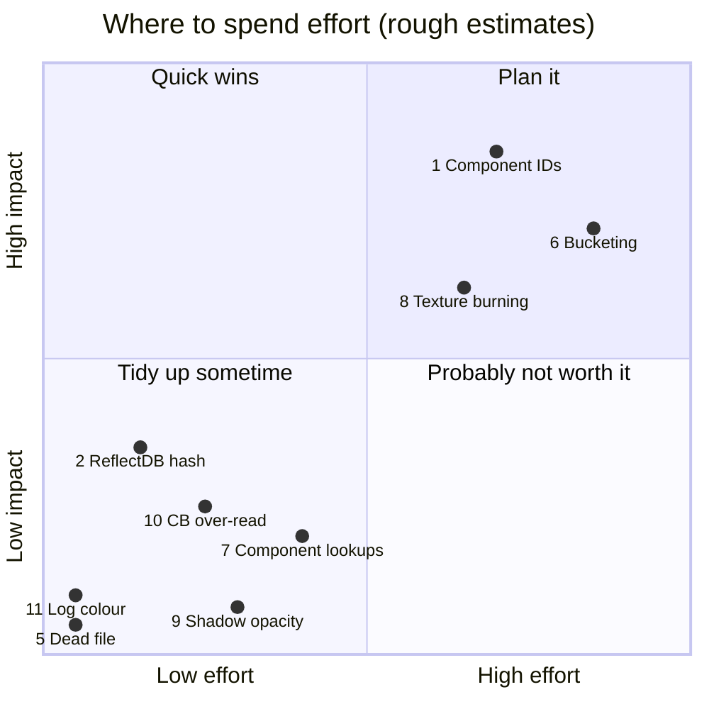

# Known Architectural Issues & TODOs

Rough edges the codebase is candid about (source comments, `#TODO`s), plus a few found while working in it. None of them break normal use today; they're worth knowing before you extend the systems involved.

## At a glance

| # | Issue | Area | Severity | Status |
|---|---|---|---|---|
| 1 | Component subclasses share their parent's type ID | Scene / components | **High** | Open |
| 2 | `ReflectDB` hashes string *pointers* | Utils / reflection | Low | Open |
| 3 | `BlockAllocator` exists but isn't used | Memory | Low | Open |
| 4 | Job system was underused, busy-waited and couldn't return results | Threading | — | **Fixed** (10-09: async loading) |
| 5 | Dead `old_RenderCommands.h` | Renderer | Cosmetic | Open |
| 6 | No culling or bucketing | Rendering | Medium | **Culling fixed** (10-09); bucketing open |
| 7 | Linear-scan component lookups | Scene | Low | Open |
| 8 | Textures aren't burned | Asset pipeline | Medium | Open |
| 9 | Shadow map misses runtime opacity-map changes | Rendering | Low | Open, noted in source |
| 10 | Constant-buffer uploads read past small structs | Renderer | Low | Open |
| 11 | `LogChannel::Debug`'s colour is out of range | Debug services | Cosmetic | Open |
| 12 | Camera previews change the camera temporarily | Components | Low | Open, noted in source |
| 13 | An incremental build once missed a header change | Build | Low | Observed once |

## 1. Component subclasses share their parent's type ID

`GameObjectComponent.h` says it directly:

> "This stuff doesn't support class hierarchies, and will only ever use the first registered component in any hierarchy... things like `CameraComponent` are broken because I refactored `EditorCameraComponent` to inherit from `CameraComponent`; this means we can't have both a `CameraComponent` and `EditorCameraComponent` reflected because the ID will be the same..."

**Impact:** a component that derives from another component gets no ID, factory entry or serialisation identity of its own. **Fix:** assign IDs per concrete leaf type, independent of inheritance. See [Component-System.md](../03-SceneAndGameObjects/Component-System.md).

## 2. `ReflectDB` hashes string pointers

`ReflectDB.cpp` makes `ReflectTypeID`s with `std::hash<const char*>`, which hashes the **pointer**, not the text. Two copies of the same type name at different addresses would get different IDs. Today this only affects Editor inspector ordering; fix it (hash a `std::string_view`) before relying on it for anything else.

## 3. `BlockAllocator` isn't used

`Engine\Src\EngineCore\Platform\Memory\BlockAllocator.h/.cpp` calls itself a buddy allocator, but behaves like a bump allocator over 64 KB, with a member commented "tmp for testing". Engine code uses plain `new`/`delete` (`RZE_NEW`/`RZE_DEL` are thin wrappers). See [Memory-Management.md](../06-Platform-And-Infrastructure/Memory-Management.md).

## 4. Job system (fixed)

This entry used to say the job system was only used by the Editor's build, busy-spun in `Wait()`, contended on one `try_lock` mutex, and couldn't hand results back. Since the async loading work:
- `PushJob` returns a `JobHandle`, and `Wait` / `WaitForIdle` block on condition variables instead of spinning;
- `MainThreadDispatcher` hands results back to the main thread;
- scene loading parses and decodes on the workers.

Still true: there's one shared queue, and `MAX_WORKER_THREADS` is a fixed 4 rather than based on the core count. See [Threading-And-Jobs.md](../06-Platform-And-Infrastructure/Threading-And-Jobs.md).

## 5. Dead code: `old_RenderCommands.h`

Command structs from an earlier design, referenced by nothing. Safe to delete.

## 6. Culling (fixed) and bucketing (open)

The 2020 design notes called for both. **Culling** is implemented: objects and then submeshes are tested against the view frustum in the forward pass, and against the pixel's frustum in the pick pass. **Bucketing** isn't: every stage walks the whole render-object list, and every submesh is its own draw call. A commented-out bucket API sketch is still in `RenderEngine.h`. This is the main performance ceiling as scenes grow. See [Rendering-Overview.md](../04-Rendering/Rendering-Overview.md).

## 7. Linear-scan component lookups

`GameObject::AddComponent<T>` / `GetComponent<T>` / `RemoveComponent<T>` are `std::find_if` scans, marked `// #TODO Slow function`. Fine at current component counts; an ID→component index would fix it.

## 8. Textures aren't burned

`AssimpSourceImporter::WriteTextureAsset()` returns `false`. Materials reference textures by path in `Assets\`, and they're decoded at load time rather than conditioned offline (no compression, no pre-built mips). See [Asset-Burning-Pipeline.md](../05-AssetPipeline/Asset-Burning-Pipeline.md).

## 9. Shadow map misses runtime opacity-map changes

`ShadowRenderStage` only re-renders when `SceneData::revision` changes, and changing a material's opacity map at runtime doesn't bump it. The source notes this gap: the shadow picks up the change at the next scene change. Bump the revision from `MaterialInstance::SetTexture` if it ever matters.

## 10. Constant-buffer uploads read past small structs

`Renderer::UploadDataToBuffer<T>` copies the buffer's **aligned** size from the source pointer. For `RenderCamera` (84 bytes, in a 128-byte-aligned buffer), the shadow and pick stages pass a local, so 44 bytes past the struct are copied from the stack into unused padding. It works in practice, but it's undefined behaviour. Fix: copy `sizeof(T)` and zero the rest, or pad the struct to the alignment.

## 11. `LogChannel::Debug`'s colour is out of range

`DebugServices::Initialize()` sets it to (255, 255, 1). Colours are 0–1, so it shows as white like `Info`; yellow was probably intended (1, 1, 0).

## 12. Camera previews change the camera temporarily

`CameraComponent::OnEditorInspect()` swaps its aspect ratio to render the "Camera View" preview, then restores it. The source warns this "could leak state eventually". A preview-specific projection would avoid touching the camera.

## 13. An incremental build once missed a header change

While adding multi-selection, `ScenePanel.h` changed layout but MSBuild didn't recompile `EditorApp.cpp`, which holds a `ScenePanel` by value. The Editor then crashed on start-up with an access violation in a `std::vector` call. Touching the `.cpp` fixed it. The cause wasn't found. If the Editor crashes oddly right after a header change, rebuild before debugging.

## Key files

- `Engine\Src\Game\World\GameObject\GameObjectComponent.h` (1), `GameObject.h` (7)
- `Utils\Src\Utils\Reflect\ReflectDB.cpp` (2)
- `Engine\Src\EngineCore\Platform\Memory\BlockAllocator.h` (3)
- `Modules\Rendering\Src\Rendering\old_RenderCommands.h` (5), `Renderer.h` (10)
- `Engine\Src\Graphics\RenderEngine.h` (6), `RenderStages\ShadowRenderStage.cpp` (9)
- `SourceAssetBurner\Src\SourceAssetBurner\Importers\AssimpSourceImporter.cpp` (8)
- `Engine\Src\DebugUtils\DebugServices.cpp` (11)
- `Engine\Src\Game\World\GameObjectComponents\CameraComponent.cpp` (12)
