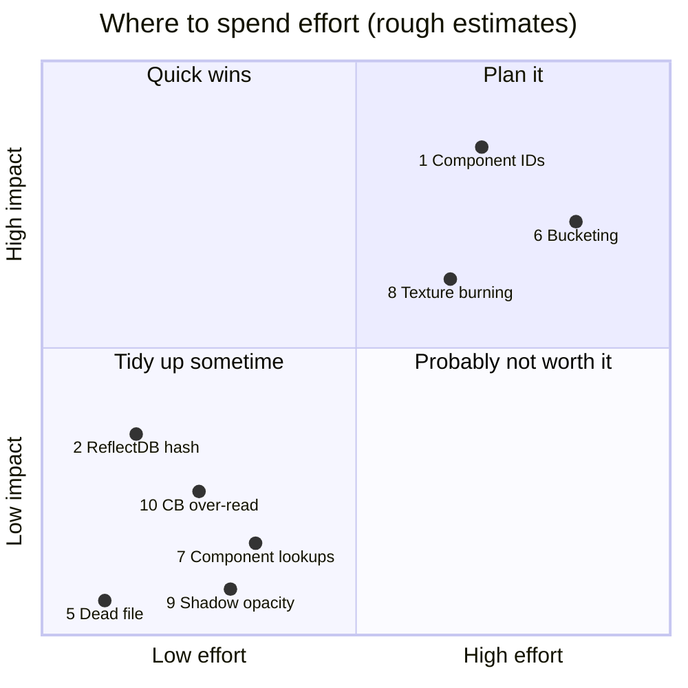

# Known Architectural Issues & TODOs

Rough edges the codebase is candid about (source comments, `#TODO`s), plus a few found while working in it. None of them break normal use today; they're worth knowing before you extend the systems involved.

## At a glance

| # | Issue | Area | Severity | Status |
|---|---|---|---|---|
| 1 | Component subclasses share their parent's type ID | Scene / components | **High** | Open |
| 2 | `ReflectDB` hashes string *pointers* | Utils / reflection | Low | Open |
| 3 | `BlockAllocator` exists but isn't used | Memory | Low | Open |
| 4 | Job system was underused, busy-waited and couldn't return results | Threading | — | **Fixed** (10-09: async loading) |
| 5 | Dead `old_RenderCommands.h` | Renderer | Cosmetic | **Fixed** (10-26: deleted) |
| 6 | No culling or bucketing | Rendering | Medium | **Culling fixed** (10-09); bucketing open |
| 7 | Linear-scan component lookups | Scene | Low | Open |
| 8 | Textures aren't burned | Asset pipeline | Medium | Open |
| 9 | Shadow maps miss runtime material changes | Rendering | Low | Open, noted in source |
| 10 | Constant-buffer uploads read past small structs | Renderer | Low | Open |
| 11 | `LogChannel::Debug`'s colour was out of range | Debug services | — | **Fixed** (10-21: log levels) |
| 12 | Camera previews changed the camera temporarily | Components | — | **Fixed** (10-11: editor UI rework) |
| 13 | An incremental build once missed a header change | Build | Low | Observed once |
| 14 | Reparenting in the Object Browser keeps the local transform | Editor | Low | Open |
| 15 | No prompt about unsaved changes | Editor | — | **Fixed** (10-12: undo/redo) |
| 16 | Undoing Add Component brings back a new component | Editor | Low | Open |
| 17 | Duplicate's undo step is named "Paste" | Editor | Cosmetic | Open |
| 18 | `GifChatComponent`'s GIF paths resolved against the build folder | Components | — | **Fixed** (10-15: source tree context) |
| 19 | `ResourceHandler` reads the renderer's frame counter | Resources | — | **Fixed** (10-20: resources destroyed straight away) |
| 20 | Every component has `GetLocalBounds`, though few take up space | Components | Low | Open |
| 21 | `RenderObjectPtr` / `LightObjectPtr` could be copied, and dangled | Rendering | — | **Fixed** (10-13: move-only, lifetime-checked) |
| 22 | A few long frames remain while thumbnails render | Editor | Low | Open |
| 23 | Nested types can still describe their own properties | Properties | Low | Open |
| 24 | `StaticMeshResource` keeps its load state in pending lists | Resources | Low | Open |
| 25 | Undoing a cleared mesh reloads it synchronously | Editor | Low | Open |
| 26 | A swapped-in material that's missing is tried twice on scene load | Resources | Cosmetic | Open |
| 27 | A frame rate cap that doesn't divide the refresh rate paces unevenly under vsync | Frame pacing | Low | Open |
| 28 | An idle tick can put two big units of async work in one frame | Async | Low | Open |
| 29 | The D3D device leaked at exit | Renderer | — | **Fixed** (11-10: everything is released before the device shuts down, and the Debug smoke test checks it) |
| 30 | In Debug, the game's key bindings never fire | Game | Medium | Open |
| 31 | `RenderThread::Shutdown` could race | Renderer | — | **Fixed** (11-04: the flag is set with the signal, under the lock) |
| 32 | A shader that doesn't compile crashes the app | Renderer | — | **Fixed** (11-05: the failed compile logs and leaves the shader null) |
| 33 | The lit pixel shaders compile with an uninitialised-variable warning | Shaders | — | **Fixed** (10-24: single returns) |
| 34 | Any light change re-renders every shadow map | Rendering | — | **Fixed** (10-25: per-light shadow caching) |
| 35 | The sun's shadow map re-renders whenever any object changes | Rendering | — | **Fixed** (10-29: fitted to Static casters, Movable ones drawn over a copy) |
| 36 | Wayland limits the custom title bar and the window | Windowing (Linux) | Low | Open, by design of Wayland |
| 37 | RenderDoc can't capture the Linux build as it runs normally | Renderer (Linux) | Low | Open, worked around |
| 38 | An EditorHarness screenshot stalls the Editor for about a second | Harness | Low | Open |
| 39 | ImGui can follow the real mouse in a focused harness window | Harness | Low | Open; not seen on Windows (B6) |
| 40 | A file restored from the Recycle Bin landed in the Editor's trash folder | Editor (Content Browser) | — | **Fixed** (11-06: sent from its own folder; Windows to confirm, E4) |
| 41 | Scene View picks, icons and the gizmo were 40 px high | Editor (Scene View) | — | **Fixed** (11-05: the panel's position is taken every frame) |

## 1. Component subclasses share their parent's type ID

`GameObjectComponent.h` says it directly:

> "This stuff doesn't support class hierarchies, and will only ever use the first registered component in any hierarchy... things like `CameraComponent` are broken because I refactored `EditorCameraComponent` to inherit from `CameraComponent`; this means we can't have both a `CameraComponent` and `EditorCameraComponent` reflected because the ID will be the same..."

**Impact:** a component that derives from another component gets no ID, factory entry or serialisation identity of its own. **Fix:** assign IDs per concrete leaf type, independent of inheritance. See [Component-System.md](../03-SceneAndGameObjects/Component-System.md).

## 2. `ReflectDB` hashes string pointers

`ReflectDB.cpp` makes `ReflectTypeID`s with `std::hash<const char*>`, which hashes the **pointer**, not the text. Two copies of the same type name at different addresses would get different IDs. Today this only affects Editor inspector ordering; fix it (hash a `std::string_view`) before relying on it for anything else.

## 3. `BlockAllocator` isn't used

`Engine\Src\EngineCore\Platform\Memory\BlockAllocator.h/.cpp` calls itself a buddy allocator, but behaves like a bump allocator over 64 KB, with a member commented "tmp for testing". Engine code uses plain `new`/`delete` (`RZE_NEW`/`RZE_DEL` are thin wrappers). See [Memory-Management.md](../06-Platform-And-Infrastructure/Memory-Management.md).

## 4. Job system (fixed)

This entry used to say the job system was only used by the Editor's build, busy-spun in `Wait()`, contended on one `try_lock` mutex, and couldn't hand results back. Since the async loading work:
- `PushJob` returns a `JobHandle`, and `Wait` / `WaitForIdle` block on condition variables instead of spinning;
- `MainThreadDispatcher` hands results back to the main thread;
- scene loading parses and decodes on the workers.

Still true: `MAX_WORKER_THREADS` is a fixed 4 rather than based on the core count. See [Threading-And-Jobs.md](../06-Platform-And-Infrastructure/Threading-And-Jobs.md).

## 5. Dead code: `old_RenderCommands.h` (fixed)

Command structs from an earlier design, referenced by nothing. Deleted on 10-26.

## 6. Culling (fixed) and bucketing (open)

The 2020 design notes called for both. **Culling** is implemented: objects and then submeshes are tested against the view frustum in the forward pass, and against the pixel's frustum in the pick pass. **Bucketing** isn't: every stage walks the whole render-object list, and every submesh is its own draw call. A commented-out bucket API sketch is still in `RenderEngine.h`. This is the main performance ceiling as scenes grow. See [Rendering-Overview.md](../04-Rendering/Rendering-Overview.md).

## 7. Linear-scan component lookups

`GameObject::AddComponent<T>` / `GetComponent<T>` / `RemoveComponent<T>` are `std::find_if` scans, marked `// #TODO Slow function`. Fine at current component counts; an ID→component index would fix it.

## 8. Textures aren't burned

`AssimpSourceImporter::WriteTextureAsset()` returns `false`. Materials reference textures by path in `Assets\`, and they're decoded at load time rather than conditioned offline (no compression, no pre-built mips). See [Asset-Burning-Pipeline.md](../05-AssetPipeline/Asset-Burning-Pipeline.md).

## 9. Shadow maps miss runtime material changes

`ShadowRenderStage` only re-renders its maps when the scene's revision (`RenderScene::GetRevision`) changes, and changing a material at runtime doesn't bump it: its opacity map, or a slot's overrides (`MaterialSlot::SetOverrides`), such as a new blend mode that stops it casting a shadow. The source notes this gap: the shadows pick up the change at the next scene change. Bump the revision when a material or slot changes if it ever matters.

## 10. Constant-buffer uploads read past small structs

`Renderer::UploadDataToBuffer<T>` copies the buffer's **aligned** size from the source pointer. For `RenderCamera` (76 bytes, in a 128-byte-aligned buffer), the shadow and pick stages pass a local, so 52 bytes past the struct are copied from the stack into unused padding. It works in practice, but it's undefined behaviour. Fix: copy `sizeof(T)` and zero the rest, or pad the struct to the alignment.

## 11. `LogChannel::Debug`'s colour was out of range (fixed)

`DebugServices::Initialize()` set it to (255, 255, 1). Colours are 0–1, so Debug lines showed white like `Info`. With the log levels (Debug, Info, Warning, Error), Debug is now the high-volume channel and gets a muted blue-grey; see [Debug-Services-And-Logging.md](../06-Platform-And-Infrastructure/Debug-Services-And-Logging.md).

## 12. Camera previews changed the camera temporarily (fixed)

The old `CameraComponent::OnEditorInspect()` swapped the camera's aspect ratio to render the "Camera View" preview, then restored it. `CameraComponent::RenderPreview()` now builds its own projection and view for the preview and leaves the camera alone; the editor shows the result through the camera's `Preview` property.

## 13. An incremental build once missed a header change

While adding multi-selection, `ScenePanel.h` (now `ObjectBrowserPanel.h`) changed layout but MSBuild didn't recompile `EditorApp.cpp`, which held a `ScenePanel` by value. The Editor then crashed on start-up with an access violation in a `std::vector` call. Touching the `.cpp` fixed it. The cause wasn't found. If the Editor crashes oddly right after a header change, rebuild before debugging.

## 14. Reparenting in the Object Browser keeps the local transform

Dragging an object onto another in the Object Browser (`AttachToParentCommand`) keeps its local position, rotation and scale, so it jumps if the new parent isn't at the origin with no rotation and unit scale. Keeping its world transform would mean converting the local values through the inverse of the parent's world matrix as it's attached (paste already does this for its offset).

## 15. No prompt about unsaved changes (fixed)

New, Load, Exit and closing the window now ask Save / Don't Save / Cancel while there are unsaved changes (`UnsavedChangesPrompt`), and undoing back to the last save clears the `*`. See [Editor-Framework.md](../07-Editor/Editor-Framework.md#the-unsaved-changes-prompt).

## 16. Undoing Add Component brings back a new component

Undo removes an added component (`RemoveComponentByID`) and redo adds a fresh one. Edits made to it afterwards are later undo steps, so redoing them restores its properties, but any state a component keeps that isn't a property (or isn't recorded, like `EditorOnly` view settings) comes back at its default. Deleted objects don't have this problem: they're parked, not rebuilt.

## 17. Duplicate's undo step is named "Paste"

Duplicate runs a `PasteGameObjectsCommand`, so Edit > Undo reads "Undo Paste" after a duplicate. Cosmetic; the command could take the step's name.

## 18. `GifChatComponent`'s GIF paths resolved against the build folder (fixed)

`GifChatComponent`'s GIF paths were global `Filepath`s, built during static initialisation, before `main` set the directory context, so in the Editor they pointed at `_build\<config>\Assets\...` and a fresh clone asserted on `RenderTest.scene`. They're built when used now, and every app reads the source tree (`EDirectoryContext::Source`), so there's no build-folder copy to go stale. The rule stands: don't build a `Filepath` during static initialisation.

## 19. `ResourceHandler` reads the renderer's frame counter (fixed)

`ResourceHandler` used to destroy a released resource only once the render thread was done with it, by reading `Rendering::Renderer::GetRecordingFrame` and `IsFrameProcessed`, so the resource system knew a renderer detail. Rather than a frame fence, what the render thread uses now lives in its commands: uploaded texels in a `TexelBuffer`, GPU objects by handle, and the textures the UI draws with that UI's frame data. So a resource is destroyed as soon as its last handle goes, and the frame tracking is gone ([Asset-Import-Runtime.md](../05-AssetPipeline/Asset-Import-Runtime.md#releasing-resources)). `AsyncOperationManager`'s two-frame wait before cleaning up a finished operation went for the same reason.

## 20. Every component has `GetLocalBounds`, though few take up space

`GameObject` builds its hierarchy bounds from each component's `GetLocalBounds()`, which is a virtual on `GameObjectComponentBase` returning an empty box. Only `RenderComponent` overrides it, so most components carry an API that means nothing for them. An `IBoundedComponent` interface that only space-taking components inherit would fit better.

## 21. `RenderObjectPtr` / `LightObjectPtr` could be copied, and dangled (fixed)

The handles into a `RenderScene` could be copied, so two holders could end up destroying the same object. A handle was also a bare pointer, so it dangled once its object went some other way (`ClearObjects`, or the scene being destroyed), and destroying through it searched by address, which could destroy a newer object at the same address. The handles are now move-only and lifetime-checked like `GameObjectPtr`; see [Engine-Graphics-Layer.md](../04-Rendering/Engine-Graphics-Layer.md#handles).

## 22. A few long frames remain while thumbnails render

Background thumbnail runs keep frames short almost all the time. Over a full run in Release (now Development), 3 frames went over 100 ms, the worst at 167 ms, against 962 ms with the old blocking batch. Likely causes are each capture's GPU readback (the render thread waits on the GPU) and resources that don't load asynchronously falling back to a synchronous load. They haven't been profiled yet.

## 23. Nested types can still describe their own properties

Only components should describe properties, since they're what the inspector draws: a nested type is described by the component that owns it (`PropertyBuilder::Array<TElement>`, as `RenderComponent` does for material slots). Nothing enforces it yet. `MaterialInstance` and `Texture2D` still have a `DescribeProperties`, for `GifChatComponent`'s read-only list of its materials. Moving that to the component and making the builder only accept components would close it.

## 24. `StaticMeshResource` keeps its load state in pending lists

Between `LoadCPU` and the last `FinalizeStep`, `StaticMeshResource` holds parallel `m_pending...` vectors (submeshes, materials, placements, finalized submeshes) plus a cursor, and clears them at the end. It works, but the state of a half-loaded mesh is spread over the resource. A small load-state object, created by `LoadCPU` and consumed by finalizing, would make that lifetime explicit.

## 25. Undoing a cleared mesh reloads it synchronously

Clearing a `RenderComponent`'s mesh releases it. Undo sets the path back, which loads it with `RenderComponent::LoadMesh`, synchronously: New Sponza took about 15 s, with the editor not responding. Undo could keep the instance it replaced, or reload through a preload.

## 26. A swapped-in material that's missing is tried twice on scene load

A scene whose material overrides swap in a missing `.materialasset` logs the failure twice: once when the scene load preloads it, then again when the slot applies its override and loads it synchronously. Nothing breaks (the slot draws the mesh's own material), but the log is noisy. The slot could skip a path the preload already failed on.

## 27. A frame rate cap that doesn't divide the refresh rate paces unevenly under vsync

With vsync on, a `MaxFrameRate` below the refresh rate that doesn't divide it (e.g. 50 on 60 Hz) can only present on refreshes, so frames alternate between one and two refresh periods. When the cap divides the rate, presenting every Nth refresh (sync interval N) would pace evenly. See [Engine-Startup-And-Frame-Loop.md](../02-Architecture/Engine-Startup-And-Frame-Loop.md#frame-pacing).

## 28. An idle tick can put two big units of async work in one frame

The first unit of work in any budget always runs, even when it's bigger than the budget, and idle ticks get a budget of their own. So a frame's tick and its idle tick can each run one large unit, e.g. an extra ~55 ms frame when a thumbnail run starts. Estimating unit times, or giving idle budgets no free first unit, would avoid it. See [Asset-Import-Runtime.md](../05-AssetPipeline/Asset-Import-Runtime.md#async-operations).

## 29. The D3D device leaked at exit (fixed)

**Fixed (11-10, `9bad1239`).** The debug layer reported the device still alive as the process ended (`Process is terminating. Using simple reporting`), with a refcount of 60. `-gfxliveobjects` (`469f87db`), which logs what's alive once the device has shut down, listed 237 objects on DrawLineTest and 280 on Sponza. Five causes:
- `DX11ConstantBuffer` had no destructor, so a constant buffer whose handle went was never released.
- Render commands pushed after the last frame, such as the shader releases from shutting the scene and stages down, stayed in the producer queue, never run or destroyed, holding their handles. `RenderThread::Shutdown` now runs them as one last batch.
- The main view's stage state, its targets among them, lived until the render engine was deleted, after the device. `ReleaseRenderStages` now releases it with the main scene's.
- The application's render target, and `Renderer`'s copy of the last UI frame with its textures, were let go after the device. `RZE_Application::ShutDown` and `Renderer::Shutdown` now release them first.

- The thumbnail renderer's `ViewCapture` kept its target and its view's stage state until the EditorApp was destroyed, after the device. Only a run that renders a thumbnail has them, and every local check above had its thumbnails cached, so CI's Debug smoke test, from a fresh checkout, was the first to see it: 169 objects. `ThumbnailRenderer::ShutDown` now calls `ViewCapture::Release` (fixed the same day).

Since then no object outlives shutdown on DrawLineTest, Sponza, RenderPerfTest, RenderTest, after New Scene, in the Game, or in the Debug smoke test with no thumbnails cached, and the process-exit report is gone. The Debug smoke test runs with `-gfxliveobjects` and fails on Windows if any object is listed. A check of shutdown should include a run with the thumbnail folders (`ProjectData/MeshThumbnails`, `SceneThumbnails`) moved aside. See [Engine-Startup-And-Frame-Loop.md](../02-Architecture/Engine-Startup-And-Frame-Loop.md#shutdown).

This entry used to say render targets leak too, with the Editor leaking its scene view target on every resize, because `RenderTargetTexture`'s destructor is empty. They don't: the target's handles hold `shared_ptr`s to the driver textures, and `~DX11TextureBuffer2D` calls `Release()`. On 11-08, 20 maximize/restore resizes of the Editor left its GPU memory at 488 MB, unchanged.

## 30. The game's key bindings never fired with ImGui on (fixed)

**Fixed (11-08, `a9812074`).** `GameApp::ProcessInput` returned `false` in `IMGUI_ENABLED` builds (then Debug only), so the engine reset input every frame instead of raising events, and Escape, F1–F3 and the player controller's bindings never fired. Apps now return an `InputGate` with a flag per device, and the Game keeps a device from the game only while ImGui wants it. That matters more now that Development, the default build, has the Game's ImGui too. See [Game-App.md](../08-Game/Game-App.md).

## 31. `RenderThread::Shutdown` could race (fixed)

**Fixed (11-04).** `Shutdown` used to signal the render thread before it set `m_shuttingDown`, with no lock, so the thread could finish the woken pass, miss the flag and wait again, leaving `join()` waiting for good. It was never seen to hang by itself, but a 200 ms sleep in that gap made it hang every time. `Shutdown` now sets the flag with the signal, under `m_updateMutex`, and `Update()` checks it under the same lock right after waking, returning `false` to end the thread's loop. That relies on `Shutdown` and `RunWhileIdle` running on the same thread, so no idle task is pending when the shutdown signal arrives; both assert they run on the thread that called `Initialize`. See [Low-Level-Renderer-Module.md](../04-Rendering/Low-Level-Renderer-Module.md).

## 32. A shader that doesn't compile crashes the app (fixed)

**Fixed (11-05, `ce15cced`).** On DX11, `DX11VertexShader::Create` and `DX11PixelShader::Create` used to pass the compiled blob straight to `CreateVertexShader` / `CreatePixelShader`, so a failed compile, whose blob is null, crashed with an access violation. They now log fxc's errors (`[Error] Couldn't compile shader [...]`, through `LogCompileMessages`) and return, leaving the shader null, as `DX11ComputeShader` and the OpenGL backend do. On 11-08 four SMAA shaders failing at once (their includes) were logged and the Editor ran on and closed cleanly. Still open: the resource load doesn't fail, so a pass drawn with the null shader just writes no colour. With SMAA the default anti-aliasing, that left the whole scene view blank with nothing on screen saying why. On the other branch, `53a037bb` (10-27) made the same fix for both APIs, and also left empty a vertex shader whose inputs don't match its layout. The render thread now skips draws while the bound vertex shader is empty and dispatches while the bound compute shader is, since drivers can hang on them.

## 33. The lit pixel shaders compile with an uninitialised-variable warning

**Fixed (10-24).** `Pixel_NewRenderer`, `Pixel_NewRenderer_DiffuseOnly` and `Pixel_Default_NewRenderer` logged `warning X4000: use of potentially uninitialized variable (ComputeLighting)` at start-up, from the early `return` in `ComputeLighting`'s uniform-lighting branch. FXC raises X4000 for a `return` inside a branch of a function that loops when it can't prove every path sets the result: a false alarm, since the shaders rendered correctly. The light loop added a second one, in `LightShadow`. Both now write the result to a local and return it once, at the end.

## 34. Any light change re-renders every shadow map (fixed)

**Fixed (10-25).** `ShadowRenderStage` used to re-render all of a scene's shadow maps whenever its revision changed, so moving one point light cost every shadowed light's passes. Each map now remembers the light and revision it was rendered at, and is rendered again only when its light's shadows move (`LightObject::GetShadowRevision`), its slot goes to another light, or a render object changes where it can see (from the scene's `SceneChangeLog`s; since 10-29, only the cube faces a change is in front of, with Static casters cached apart). See [Render-Stages.md](../04-Rendering/Render-Stages.md#shadowrenderstage). The limits are by design for now: only the first directional light and the first 8 point lights cast shadows, at 512² per cube face.

## 35. The sun's shadow map re-renders whenever any object changes (fixed)

**Fixed (10-29, `c395acde`).** The directional map was fitted around every render object as seen from the light, so `ShadowRenderStage` refitted it and redrew it with every caster whenever any object was added, removed, moved or re-meshed, wherever it was. It's now fitted to the **Static** casters alone (`ERenderMobility`), with 5% of their extent to spare, and kept until the light turns or a Static change leaves the fit (`BoundingBox::Contains`). A second map holds the Static casters, redrawn only when a Static change lands in the fit; the published map is that one copied, with the Movable casters drawn on top. In `RenderPerfTest` with its Movable Nanosuit swinging, no sun map is redrawn: 52 shadow draws a frame instead of 993, and the stage records in 0.42 ms instead of 6.71 (Debug). See [Render-Stages.md](../04-Rendering/Render-Stages.md#shadowrenderstage).

**Limit, by design:** a Movable caster outside the Static fit casts no sun shadow. Cascades, each caching its own region, would lift it.

## 36. Wayland limits the custom title bar and the window

On Linux under Wayland, a few things the window does on Windows and X11 can't be done:
- **double-clicking the custom title bar doesn't maximize**, since SDL takes the press on a draggable region for the move;
- **the window can't place itself** on the launch monitor's work area, and neither can the splash screen centre itself; the compositor decides;
- **`IsMinimised()` is always false**, since xdg-shell never reports it (it only throttles frames, and an unfocused window is already throttled);
- GNOME ignores per-window icons (KDE shows them).

The maximize button still works, and `SDL_VIDEO_DRIVER=x11` (XWayland) restores placement. See [Windowing.md](../06-Platform-And-Infrastructure/Windowing.md#custom-title-bar).

## 37. RenderDoc can't capture the Linux build as it runs normally

RenderDoc turns capturing off for the whole process ("captures disabled") once anything calls GL it doesn't support. SDL draws window surfaces, the splash screen's among them, with its OpenGL renderer when it can, through fixed-function calls (`glMatrixMode`, `glOrtho`, ...). The RenderDoc 1.45 build Fedora packages also reads its capture key only through xlib. `driver.py launch --renderdoc` works around both: it runs the app on XWayland (`SDL_VIDEO_DRIVER=x11`) with SDL's accelerated window surfaces off (`SDL_FRAMEBUFFER_ACCELERATION=0`); a capture started from RenderDoc's own UI needs the same two variables. A fix in the engine would draw the splash screen without SDL's window surface.

## 38. An EditorHarness screenshot stalls the Editor for about a second

The harness's `shot` encodes the 2560×1398 PNG on the main thread (`stbi_write_png`), so that frame takes about a second. Fine for checks; it could upset something timing-sensitive, such as a double-click spread across it. Encoding on a worker would fix it.

## 39. ImGui can follow the real mouse in a focused harness window

`imgui_impl_sdl3` gives ImGui the real global mouse position when the app is focused and the real pointer is over no SDL window, on drivers that support global mouse state (Windows and X11, never Wayland). EditorHarness's mouse input doesn't move the real pointer, so in that case ImGui could see the real pointer instead. Keep the harness's window unfocused, or the real mouse over it. Windows' check (`.claude/WindowsChecks.md`, B6) didn't see it: with the harness's window focused and the real pointer over the taskbar, a harness click still landed where the harness put it.

## 40. A file restored from the Recycle Bin landed in the Editor's trash folder (fixed)

Deleting in the Content Browser moves the file to `ProjectData/.Trash/<n>/Item/`, so undo can put it back, and sends it to the system trash (the Recycle Bin, or `~/.local/share/Trash`) once it drops out of the undo history or the Editor closes. The system trash recorded `ProjectData/.Trash/<n>/Item` as where it came from, not its folder under `Assets`, so restoring it from there put it in a trash folder the Editor had already emptied, the Content Browser didn't show it, and the next start sent it to the trash again. Seen on Windows (`WindowsChecks.md`, E4) and on Linux.

**Fixed (11-06).** Each trash entry records the original path in an `Original` file, and `AssetFiles::Recycle` and `EmptyTrash` move the file back there just before sending it on, so the system records its own folder. If the name is taken by then, or the folder has gone, it's sent from the trash as before. Verified on Linux (the `.trashinfo` names `Assets/`, and a restore puts it back); Windows' Recycle Bin is checked by E4. See [Thumbnails-And-File-Browser.md](../07-Editor/Thumbnails-And-File-Browser.md).

## 41. Scene View picks, icons and the gizmo were 40 px high (fixed)

**Fixed (11-05).** `SceneViewPanel` cached the panel's position only when its x **and** y both changed. A Scene View docked at x = 0, which moved only down (under the 40 px title bar), kept y = 0, while the image was drawn 40 px lower. Picks, marquee selection, object icons, mesh drops and the gizmo's rect are all placed from that position, so clicks on the lower part of a mesh missed, and icons and the gizmo sat above their objects. Not specific to a graphics API: plain ImGui screen coordinates. The position is now taken every frame. See [Editor-Panels.md](../07-Editor/Editor-Panels.md).

## Key files

- `Engine\Src\Game\World\GameObject\GameObjectComponent.h` (1), `GameObject.h` (7)
- `Utils\Src\Utils\Reflect\ReflectDB.cpp` (2)
- `Engine\Src\EngineCore\Platform\Memory\BlockAllocator.h` (3)
- `Modules\Rendering\Src\Rendering\Renderer.h` (10)
- `Engine\Src\Graphics\RenderEngine.h` (6), `RenderStages\ShadowRenderStage.cpp` (9, 34), `Assets\Shaders\Common\Lighting.hlsli` (33)
- `SourceAssetBurner\Src\SourceAssetBurner\Importers\AssimpSourceImporter.cpp` (8)
- `Engine\Src\DebugUtils\DebugServices.cpp` (11)
- `Engine\Src\Game\World\GameObjectComponents\CameraComponent.cpp` (12)
- `Editor\Src\Commands\SceneCommands.cpp` (14), `Editor\Src\Services\SceneDocument.cpp` (15)
- `Engine\Src\Game\World\GameObjectComponents\GifChatComponent.cpp` (18), `Engine\Src\EngineCore\Resources\ResourceHandler.cpp` (19)
- `Engine\Src\Game\World\GameObject\GameObjectComponent.h` (20), `Engine\Src\Graphics\GraphicsDefines.h` (21)
- `Editor\Src\Services\ThumbnailRenderer.cpp`, `Engine\Src\Graphics\TextureFile.cpp` (22)
- `Engine\Src\Game\World\GameObject\Properties\PropertyBuilder.h`, `Engine\Src\Graphics\Material.cpp`, `Texture2D.cpp` (23)
- `Engine\Src\Game\StaticMeshResource.h/.cpp` (24), `Engine\Src\Game\World\GameObjectComponents\RenderComponent.cpp` (25)
- `Engine\Src\Graphics\MaterialSlot.cpp` (26)
- `Modules\Rendering\Src\Rendering\Driver\DX11\DX11ShaderTypes.cpp` (32), `Assets\Shaders\Common\Lighting.hlsli` (33)
- `Engine/Src/Windowing/Linux/WindowNativeLinux.cpp` (36), `.claude/skills/run-rze/driver.py` (37), `EditorHarness/Src/HarnessApp.cpp` (38), `HarnessInput.cpp`, `Externals/Src/imgui/imgui_impl_sdl3.cpp` (39)
- `Editor/Src/UI/Panels/ContentBrowserPanel.cpp`, `Utils/Src/Utils/Platform/Windows/ShellWindows.cpp` (40), `Editor/Src/UI/Panels/SceneViewPanel.cpp` (41)
