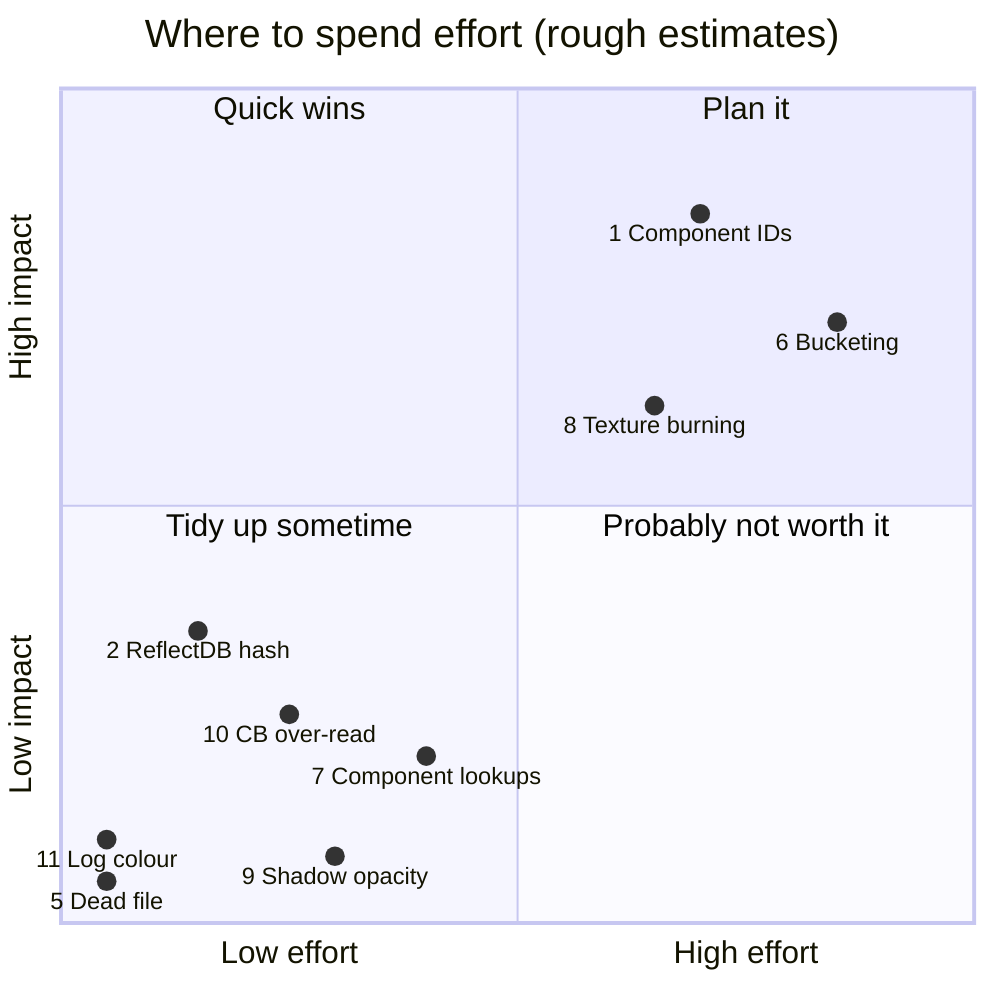

# Known Architectural Issues & TODOs

Rough edges the codebase is candid about (source comments, `#TODO`s), plus a few found while working in it. None of them break normal use today; they're worth knowing before you extend the systems involved.

## At a glance

| # | Issue | Area | Severity | Status |
|---|---|---|---|---|
| 1 | Component subclasses share their parent's type ID | Scene / components | **High** | Open |
| 2 | `ReflectDB` hashes string *pointers* | Utils / reflection | Low | Open |
| 3 | `BlockAllocator` exists but isn't used | Memory | Low | Open |
| 4 | Job system was underused, busy-waited and couldn't return results | Threading | — | **Fixed** (10-09: async loading) |
| 5 | Dead `old_RenderCommands.h` | Renderer | Cosmetic | Open |
| 6 | No culling or bucketing | Rendering | Medium | **Culling fixed** (10-09); bucketing open |
| 7 | Linear-scan component lookups | Scene | Low | Open |
| 8 | Textures aren't burned | Asset pipeline | Medium | Open |
| 9 | Shadow map misses runtime material changes | Rendering | Low | Open, noted in source |
| 10 | Constant-buffer uploads read past small structs | Renderer | Low | Open |
| 11 | `LogChannel::Debug`'s colour is out of range | Debug services | Cosmetic | Open |
| 12 | Camera previews changed the camera temporarily | Components | — | **Fixed** (10-11: editor UI rework) |
| 13 | An incremental build once missed a header change | Build | Low | Observed once |
| 14 | Reparenting in the Scene panel keeps the local transform | Editor | Low | Open |
| 15 | No prompt about unsaved changes | Editor | — | **Fixed** (10-12: undo/redo) |
| 16 | Undoing Add Component brings back a new component | Editor | Low | Open |
| 17 | Duplicate's undo step is named "Paste" | Editor | Cosmetic | Open |
| 18 | `GifChatComponent`'s GIF paths resolved against the build folder | Components | — | **Fixed** (10-15: source tree context) |
| 19 | `ResourceHandler` reads the renderer's frame counter | Resources | — | **Fixed** (10-20: resources destroyed straight away) |
| 20 | Every component has `GetLocalBounds`, though few take up space | Components | Low | Open |
| 21 | `RenderObjectPtr` / `LightObjectPtr` could be copied, and dangled | Rendering | — | **Fixed** (10-13: move-only, lifetime-checked) |
| 22 | A few long frames remain while thumbnails render | Editor | Low | Open |
| 23 | Nested types can still describe their own properties | Properties | Low | Open |
| 24 | `StaticMeshResource` keeps its load state in pending lists | Resources | Low | Open |
| 25 | Undoing a cleared mesh reloads it synchronously | Editor | Low | Open |
| 26 | A swapped-in material that's missing is tried twice on scene load | Resources | Cosmetic | Open |
| 27 | A frame rate cap that doesn't divide the refresh rate paces unevenly under vsync | Frame pacing | Low | Open |
| 28 | An idle tick can put two big units of async work in one frame | Async | Low | Open |
| 29 | GPU render targets leak, and the D3D device leaks at exit | Renderer | Medium | Open |
| 30 | In Debug, the game's key bindings never fire | Game | Medium | Open |
| 31 | `RenderThread::Shutdown` can race | Renderer | Low | Open |

## 1. Component subclasses share their parent's type ID

`GameObjectComponent.h` says it directly:

> "This stuff doesn't support class hierarchies, and will only ever use the first registered component in any hierarchy... things like `CameraComponent` are broken because I refactored `EditorCameraComponent` to inherit from `CameraComponent`; this means we can't have both a `CameraComponent` and `EditorCameraComponent` reflected because the ID will be the same..."

**Impact:** a component that derives from another component gets no ID, factory entry or serialisation identity of its own. **Fix:** assign IDs per concrete leaf type, independent of inheritance. See [Component-System.md](../03-SceneAndGameObjects/Component-System.md).

## 2. `ReflectDB` hashes string pointers

`ReflectDB.cpp` makes `ReflectTypeID`s with `std::hash<const char*>`, which hashes the **pointer**, not the text. Two copies of the same type name at different addresses would get different IDs. Today this only affects Editor inspector ordering; fix it (hash a `std::string_view`) before relying on it for anything else.

## 3. `BlockAllocator` isn't used

`Engine\Src\EngineCore\Platform\Memory\BlockAllocator.h/.cpp` calls itself a buddy allocator, but behaves like a bump allocator over 64 KB, with a member commented "tmp for testing". Engine code uses plain `new`/`delete` (`RZE_NEW`/`RZE_DEL` are thin wrappers). See [Memory-Management.md](../06-Platform-And-Infrastructure/Memory-Management.md).

## 4. Job system (fixed)

This entry used to say the job system was only used by the Editor's build, busy-spun in `Wait()`, contended on one `try_lock` mutex, and couldn't hand results back. Since the async loading work:
- `PushJob` returns a `JobHandle`, and `Wait` / `WaitForIdle` block on condition variables instead of spinning;
- `MainThreadDispatcher` hands results back to the main thread;
- scene loading parses and decodes on the workers.

Still true: `MAX_WORKER_THREADS` is a fixed 4 rather than based on the core count. See [Threading-And-Jobs.md](../06-Platform-And-Infrastructure/Threading-And-Jobs.md).

## 5. Dead code: `old_RenderCommands.h`

Command structs from an earlier design, referenced by nothing. Safe to delete.

## 6. Culling (fixed) and bucketing (open)

The 2020 design notes called for both. **Culling** is implemented: objects and then submeshes are tested against the view frustum in the forward pass, and against the pixel's frustum in the pick pass. **Bucketing** isn't: every stage walks the whole render-object list, and every submesh is its own draw call. A commented-out bucket API sketch is still in `RenderEngine.h`. This is the main performance ceiling as scenes grow. See [Rendering-Overview.md](../04-Rendering/Rendering-Overview.md).

## 7. Linear-scan component lookups

`GameObject::AddComponent<T>` / `GetComponent<T>` / `RemoveComponent<T>` are `std::find_if` scans, marked `// #TODO Slow function`. Fine at current component counts; an ID→component index would fix it.

## 8. Textures aren't burned

`AssimpSourceImporter::WriteTextureAsset()` returns `false`. Materials reference textures by path in `Assets\`, and they're decoded at load time rather than conditioned offline (no compression, no pre-built mips). See [Asset-Burning-Pipeline.md](../05-AssetPipeline/Asset-Burning-Pipeline.md).

## 9. Shadow map misses runtime material changes

`ShadowRenderStage` only re-renders when the scene's revision (`RenderScene::GetRevision`) changes, and changing a material at runtime doesn't bump it: its opacity map, or a slot's overrides (`MaterialSlot::SetOverrides`), such as a new blend mode that stops it casting a shadow. The source notes this gap: the shadow picks up the change at the next scene change. Bump the revision when a material or slot changes if it ever matters.

## 10. Constant-buffer uploads read past small structs

`Renderer::UploadDataToBuffer<T>` copies the buffer's **aligned** size from the source pointer. For `RenderCamera` (84 bytes, in a 128-byte-aligned buffer), the shadow and pick stages pass a local, so 44 bytes past the struct are copied from the stack into unused padding. It works in practice, but it's undefined behaviour. Fix: copy `sizeof(T)` and zero the rest, or pad the struct to the alignment.

## 11. `LogChannel::Debug`'s colour is out of range

`DebugServices::Initialize()` sets it to (255, 255, 1). Colours are 0–1, so it shows as white like `Info`; yellow was probably intended (1, 1, 0).

## 12. Camera previews changed the camera temporarily (fixed)

The old `CameraComponent::OnEditorInspect()` swapped the camera's aspect ratio to render the "Camera View" preview, then restored it. `CameraComponent::RenderPreview()` now builds its own projection and view for the preview and leaves the camera alone; the editor shows the result through the camera's `Preview` property.

## 13. An incremental build once missed a header change

While adding multi-selection, `ScenePanel.h` changed layout but MSBuild didn't recompile `EditorApp.cpp`, which holds a `ScenePanel` by value. The Editor then crashed on start-up with an access violation in a `std::vector` call. Touching the `.cpp` fixed it. The cause wasn't found. If the Editor crashes oddly right after a header change, rebuild before debugging.

## 14. Reparenting in the Scene panel keeps the local transform

Dragging an object onto another in the Scene panel (`AttachToParentCommand`) keeps its local position, rotation and scale, so it jumps if the new parent isn't at the origin with no rotation and unit scale. Keeping its world transform would mean converting the local values through the inverse of the parent's world matrix as it's attached (paste already does this for its offset).

## 15. No prompt about unsaved changes (fixed)

New, Load, Exit and closing the window now ask Save / Don't Save / Cancel while there are unsaved changes (`UnsavedChangesPrompt`), and undoing back to the last save clears the `*`. See [Editor-Framework.md](../07-Editor/Editor-Framework.md#the-unsaved-changes-prompt).

## 16. Undoing Add Component brings back a new component

Undo removes an added component (`RemoveComponentByID`) and redo adds a fresh one. Edits made to it afterwards are later undo steps, so redoing them restores its properties, but any state a component keeps that isn't a property (or isn't recorded, like `EditorOnly` view settings) comes back at its default. Deleted objects don't have this problem: they're parked, not rebuilt.

## 17. Duplicate's undo step is named "Paste"

Duplicate runs a `PasteGameObjectsCommand`, so Edit > Undo reads "Undo Paste" after a duplicate. Cosmetic; the command could take the step's name.

## 18. `GifChatComponent`'s GIF paths resolved against the build folder (fixed)

`GifChatComponent`'s GIF paths were global `Filepath`s, built during static initialisation, before `main` set the directory context, so in the Editor they pointed at `_build\<config>\Assets\...` and a fresh clone asserted on `RenderTest.scene`. They're built when used now, and every app reads the source tree (`EDirectoryContext::Source`), so there's no build-folder copy to go stale. The rule stands: don't build a `Filepath` during static initialisation.

## 19. `ResourceHandler` reads the renderer's frame counter (fixed)

`ResourceHandler` used to destroy a released resource only once the render thread was done with it, by reading `Rendering::Renderer::GetRecordingFrame` and `IsFrameProcessed`, so the resource system knew a renderer detail. Rather than a frame fence, what the render thread uses now lives in its commands: uploaded texels in a `TexelBuffer`, GPU objects by handle, and the textures the UI draws with that UI's frame data. So a resource is destroyed as soon as its last handle goes, and the frame tracking is gone ([Asset-Import-Runtime.md](../05-AssetPipeline/Asset-Import-Runtime.md#releasing-resources)). `AsyncOperationManager`'s two-frame wait before cleaning up a finished operation went for the same reason.

## 20. Every component has `GetLocalBounds`, though few take up space

`GameObject` builds its hierarchy bounds from each component's `GetLocalBounds()`, which is a virtual on `GameObjectComponentBase` returning an empty box. Only `RenderComponent` overrides it, so most components carry an API that means nothing for them. An `IBoundedComponent` interface that only space-taking components inherit would fit better.

## 21. `RenderObjectPtr` / `LightObjectPtr` could be copied, and dangled (fixed)

The handles into a `RenderScene` could be copied, so two holders could end up destroying the same object. A handle was also a bare pointer, so it dangled once its object went some other way (`ClearObjects`, or the scene being destroyed), and destroying through it searched by address, which could destroy a newer object at the same address. The handles are now move-only and lifetime-checked like `GameObjectPtr`; see [Engine-Graphics-Layer.md](../04-Rendering/Engine-Graphics-Layer.md#handles).

## 22. A few long frames remain while thumbnails render

Background thumbnail runs keep frames short almost all the time. Over a full run in Release, 3 frames went over 100 ms, the worst at 167 ms, against 962 ms with the old blocking batch. Likely causes are each capture's GPU readback (the render thread waits on the GPU) and resources that don't load asynchronously falling back to a synchronous load. They haven't been profiled yet.

## 23. Nested types can still describe their own properties

Only components should describe properties, since they're what the inspector draws: a nested type is described by the component that owns it (`PropertyBuilder::Array<TElement>`, as `RenderComponent` does for material slots). Nothing enforces it yet. `MaterialInstance` and `Texture2D` still have a `DescribeProperties`, for `GifChatComponent`'s read-only list of its materials. Moving that to the component and making the builder only accept components would close it.

## 24. `StaticMeshResource` keeps its load state in pending lists

Between `LoadCPU` and the last `FinalizeStep`, `StaticMeshResource` holds parallel `m_pending...` vectors (submeshes, materials, placements, finalized submeshes) plus a cursor, and clears them at the end. It works, but the state of a half-loaded mesh is spread over the resource. A small load-state object, created by `LoadCPU` and consumed by finalizing, would make that lifetime explicit.

## 25. Undoing a cleared mesh reloads it synchronously

Clearing a `RenderComponent`'s mesh releases it. Undo sets the path back, which loads it with `RenderComponent::LoadMesh`, synchronously: New Sponza took about 15 s, with the editor not responding. Undo could keep the instance it replaced, or reload through a preload.

## 26. A swapped-in material that's missing is tried twice on scene load

A scene whose material overrides swap in a missing `.materialasset` logs the failure twice: once when the scene load preloads it, then again when the slot applies its override and loads it synchronously. Nothing breaks (the slot draws the mesh's own material), but the log is noisy. The slot could skip a path the preload already failed on.

## 27. A frame rate cap that doesn't divide the refresh rate paces unevenly under vsync

With vsync on, a `MaxFrameRate` below the refresh rate that doesn't divide it (e.g. 50 on 60 Hz) can only present on refreshes, so frames alternate between one and two refresh periods. When the cap divides the rate, presenting every Nth refresh (sync interval N) would pace evenly. See [Engine-Startup-And-Frame-Loop.md](../02-Architecture/Engine-Startup-And-Frame-Loop.md#frame-pacing).

## 28. An idle tick can put two big units of async work in one frame

The first unit of work in any budget always runs, even when it's bigger than the budget, and idle ticks get a budget of their own. So a frame's tick and its idle tick can each run one large unit, e.g. an extra ~55 ms frame when a thumbnail run starts. Estimating unit times, or giving idle budgets no free first unit, would avoid it. See [Asset-Import-Runtime.md](../05-AssetPipeline/Asset-Import-Runtime.md#async-operations).

## 29. GPU render targets leak, and the D3D device leaks at exit

`RenderTargetTexture`'s destructor is empty, so its GPU textures are never released; the Editor leaks its scene view target on every resize. The D3D debug layer also reports about 390 live objects at exit, probably the same cause.

## 30. In Debug, the game's key bindings never fire

`GameApp::ProcessInput` returns `false` in `IMGUI_ENABLED` (Debug) builds, so the engine resets input every frame instead of raising events, and Escape, F1–F3 and the player controller's bindings never fire. See [Game-App.md](../08-Game/Game-App.md).

## 31. `RenderThread::Shutdown` can race

`Shutdown` signals the render thread before it sets `m_shuttingDown`, so the thread can finish a pass and wait again before seeing the flag, leaving `join()` waiting on it. It's a narrow window and hasn't been seen to hang.

## Key files

- `Engine\Src\Game\World\GameObject\GameObjectComponent.h` (1), `GameObject.h` (7)
- `Utils\Src\Utils\Reflect\ReflectDB.cpp` (2)
- `Engine\Src\EngineCore\Platform\Memory\BlockAllocator.h` (3)
- `Modules\Rendering\Src\Rendering\old_RenderCommands.h` (5), `Renderer.h` (10)
- `Engine\Src\Graphics\RenderEngine.h` (6), `RenderStages\ShadowRenderStage.cpp` (9)
- `SourceAssetBurner\Src\SourceAssetBurner\Importers\AssimpSourceImporter.cpp` (8)
- `Engine\Src\DebugUtils\DebugServices.cpp` (11)
- `Engine\Src\Game\World\GameObjectComponents\CameraComponent.cpp` (12)
- `Editor\Src\Commands\SceneCommands.cpp` (14), `Editor\Src\Services\SceneDocument.cpp` (15)
- `Engine\Src\Game\World\GameObjectComponents\GifChatComponent.cpp` (18), `Engine\Src\EngineCore\Resources\ResourceHandler.cpp` (19)
- `Engine\Src\Game\World\GameObject\GameObjectComponent.h` (20), `Engine\Src\Graphics\GraphicsDefines.h` (21)
- `Editor\Src\Services\ThumbnailRenderer.cpp`, `Engine\Src\Graphics\TextureFile.cpp` (22)
- `Engine\Src\Game\World\GameObject\Properties\PropertyBuilder.h`, `Engine\Src\Graphics\Material.cpp`, `Texture2D.cpp` (23)
- `Engine\Src\Game\StaticMeshResource.h/.cpp` (24), `Engine\Src\Game\World\GameObjectComponents\RenderComponent.cpp` (25)
- `Engine\Src\Graphics\MaterialSlot.cpp` (26)
