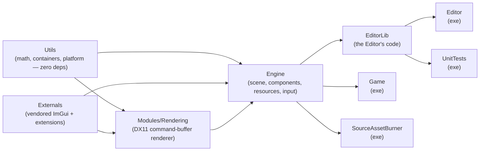
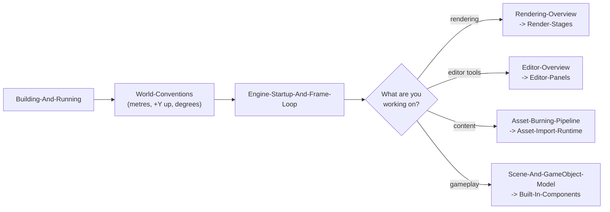
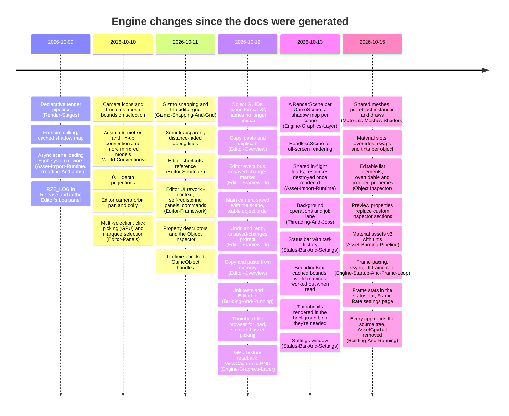

# RZE Engine Knowledgebase

RZE is a custom C++ game engine built with a hand-rolled entity/component scene model, a command-buffer DirectX 11 renderer running on its own thread, and an offline "asset burning" content pipeline. This knowledgebase documents how it works, organized by system.

This documentation is generated from a point-in-time read of the codebase. File paths are given relative to `C:\dev\RZE\RZE\` unless stated otherwise. When code and docs disagree, trust the code — grep the cited path to confirm before relying on a claim here.

## How the repo is laid out

```
RZE/                    (repo root, C:\dev\RZE)
  RZE/                  (all source + build config)
    Engine/              — core engine library (this is the "Engine" module, not this knowledgebase)
    Modules/Rendering/   — low-level DX11 renderer, independent of Engine
    Editor/              — level/scene editor application (exe)
    Game/                — shippable game application (exe)
    Utils/               — foundational library (math, containers, platform, no engine deps)
    Externals/           — vendored source (ImGui + extensions)
    SourceAssetBurner/   — offline asset conditioning tool (exe)
    ThirdParty/          — vendored prebuilt libs (Assimp, DirectXTK, GLM, RapidJSON, ...)
    Config/, ProjectData/, Assets/, Make/, _project/, _build/
  Docs/                  — hand-written design notes + this generated knowledgebase
  DrawIO/                — original architecture diagrams (source for several diagrams reproduced here)
  Tools/                 — RZEHub.exe, Sharpmake, Assimp, Optick binaries
```

## Module dependency graph

Everything is wired together by Sharpmake (`RZE.sharpmake.cs`), and dependencies flow strictly one way — nothing later in this list is depended on by anything earlier:



Only the solid edges shown above are declared directly in Sharpmake (`AddPublicDependency<T>`). `EditorLib`, `Game`, and `SourceAssetBurner` each declare a *single* explicit dependency — on `Engine` (and `Editor` and `UnitTests` on `EditorLib`) — and receive `Utils`/`Externals`/`Rendering` transitively, because Sharpmake propagates a project's *public* dependencies to everything that depends on it. See [02-Architecture/Module-Dependency-Graph.md](02-Architecture/Module-Dependency-Graph.md) for the exact declarations and this transitivity mechanic.

## Navigating this knowledgebase

| Folder | Covers |
|---|---|
| [01-GettingStarted](01-GettingStarted/Building-And-Running.md) | How to build and run RZE end-to-end |
| [02-Architecture](02-Architecture/Module-Dependency-Graph.md) | Module graph, engine startup/frame loop, app-shell pattern, [world conventions](02-Architecture/World-Conventions.md) (metres, axes, angles) |
| [03-SceneAndGameObjects](03-SceneAndGameObjects/Scene-And-GameObject-Model.md) | GameScene, GameObject, the component system, built-in components |
| [04-Rendering](04-Rendering/Rendering-Overview.md) | RenderEngine, render stages, materials/meshes/shaders, the low-level renderer module |
| [05-AssetPipeline](05-AssetPipeline/Asset-Burning-Pipeline.md) | Offline asset burning (SourceAssetBurner) and runtime asset loading |
| [06-Platform-And-Infrastructure](06-Platform-And-Infrastructure/Input-System.md) | Input, events, windowing, config, threading, memory, debug services, Utils reference |
| [07-Editor](07-Editor/Editor-Overview.md) | The ImGui-based scene editor: its [framework](07-Editor/Editor-Framework.md) (context, panels, commands, undo, events), panels, [Object Inspector and property descriptors](07-Editor/Object-Inspector-And-Properties.md), gizmo snapping and grid, the [file browser and thumbnails](07-Editor/Thumbnails-And-File-Browser.md), the [status bar and Settings window](07-Editor/Status-Bar-And-Settings.md), and [every shortcut](07-Editor/Editor-Shortcuts.md) |
| [08-Game](08-Game/Game-App.md) | The playable game application shell |
| [09-BuildSystem](09-BuildSystem/Sharpmake-Project-Graph.md) | Sharpmake project definitions, third-party dependencies |
| [10-KnownIssues](10-KnownIssues/Architectural-Notes-And-TODOs.md) | Documented rough edges and TODOs found in the source |

## Where to start



## What's changed recently

The knowledgebase was first generated on 2026-07-09. These are the larger changes since, and where they're documented:



| Area | What changed | Read |
|---|---|---|
| Rendering | Stages declare the data they read and write; the pipeline orders them. Main and secondary views. Culling, shadow caching, eye adaptation + ACES. GPU picking stage. | [Render-Stages](04-Rendering/Render-Stages.md), [Engine-Graphics-Layer](04-Rendering/Engine-Graphics-Layer.md) |
| Loading | Scenes load asynchronously: parsing on workers, GPU uploads time-sliced on the main thread. | [Asset-Import-Runtime](05-AssetPipeline/Asset-Import-Runtime.md), [Threading-And-Jobs](06-Platform-And-Infrastructure/Threading-And-Jobs.md) |
| Content | Assimp 6.0.5, units converted to metres, models no longer mirrored, deterministic burns. **Re-burn after pulling.** | [Asset-Burning-Pipeline](05-AssetPipeline/Asset-Burning-Pipeline.md), [World-Conventions](02-Architecture/World-Conventions.md) |
| Editor | Orbit/pan/dolly camera, glide-to-frame, light and camera icons, multi-select, click and marquee picking. Gizmo snapping (X, Ctrl to invert) and a fading ground grid. All shortcuts in one table. | [Editor-Panels](07-Editor/Editor-Panels.md), [Editor-Camera-And-Build-Launch](07-Editor/Editor-Camera-And-Build-Launch.md), [Gizmo-Snapping-And-Grid](07-Editor/Gizmo-Snapping-And-Grid.md), [Editor-Shortcuts](07-Editor/Editor-Shortcuts.md) |
| Diagnostics | `RZE_LOG` in Release and in the Log panel, clearer assert dialogs, PIX markers only when a profiler is attached. `-perfcapture` frame-time recording for A/B comparisons. | [Debug-Services-And-Logging](06-Platform-And-Infrastructure/Debug-Services-And-Logging.md) |
| Editor framework | Panels share an `EditorContext` and register themselves; each has a data step (`Update`, before ImGui's frame) and a draw step. Scene changes are commands applied once per frame; an event bus reports loads, saves, edits and selection changes. Window title shows unsaved changes. | [Editor-Framework](07-Editor/Editor-Framework.md) |
| Inspector | Components describe their properties in the Engine with no ImGui; the "Object Inspector" (was "Component View") draws them, nests materials, meshes and textures, and edits several selected objects at once. `OnEditorInspect` is gone. | [Object-Inspector-And-Properties](07-Editor/Object-Inspector-And-Properties.md), [Component-System](03-SceneAndGameObjects/Component-System.md) |
| Scene model | `GameObjectPtr` / `GameObjectComponentPtr` know when their target is destroyed. Objects have a saved GUID; names can repeat. Scene files are version 2 (an array keyed by GUID); version 1 files convert on load. **Resave scenes to update them.** | [Scene-And-GameObject-Model](03-SceneAndGameObjects/Scene-And-GameObject-Model.md) |
| Editing | Copy, paste and duplicate (Ctrl+C/V/D), pasted beside the originals. The gizmo and inspector edit every selected object. | [Editor-Overview](07-Editor/Editor-Overview.md#edit-copy-paste-and-duplicate), [Editor-Panels](07-Editor/Editor-Panels.md) |
| Undo | Undo and redo (Ctrl+Z/Y) for every edit, a whole drag as one step, 200 steps. Deleted objects are parked and put back as the same objects. The selection comes back too, and undoing to the last save clears the `*`. New, Load, Exit and closing the window ask about unsaved changes. | [Editor-Framework](07-Editor/Editor-Framework.md#undo-and-redo) |
| Copy and paste | Copies are taken in memory through the property descriptors, not the scene format, so they include unsaved edits. Properties can be `ReadOnly` (kept, copied), `EditorOnly` (not recorded or copied) or `Exclusive` (one per scene). | [Editor-Overview](07-Editor/Editor-Overview.md#edit-copy-paste-and-duplicate), [Object-Inspector-And-Properties](07-Editor/Object-Inspector-And-Properties.md#metadata) |
| Scene | The main camera is saved with the scene (`"MainCamera"`); there can be several cameras, and another takes over if it goes. Deleting removes children too, and removal keeps the scene's order. Objects can be out of the scene but kept alive. | [Scene-And-GameObject-Model](03-SceneAndGameObjects/Scene-And-GameObject-Model.md#the-main-camera) |
| Build | Editor's code is the `EditorLib` library; `UnitTests` (doctest) covers Editor and Engine code and runs in CI. | [Building-And-Running](01-GettingStarted/Building-And-Running.md#unit-tests), [Sharpmake-Project-Graph](09-BuildSystem/Sharpmake-Project-Graph.md) |
| File browser | Load Scene, Save on a new scene and the inspector's asset paths open a modal browser of thumbnail tiles, with search and subfolders. The Win32 file dialogs are gone. | [Thumbnails-And-File-Browser](07-Editor/Thumbnails-And-File-Browser.md) |
| Thumbnails | Scene and mesh thumbnails render **in the background** in a `HeadlessScene`: on save, on load, for a tile with none, or from Settings. They're in `ProjectData` and aren't tracked. | [Thumbnails-And-File-Browser](07-Editor/Thumbnails-And-File-Browser.md) |
| Render scenes | Each `GameScene` owns a `RenderScene` (objects, lights, debug lines, shadow map); any view can render any scene. `ViewCapture` renders one to a PNG through `Renderer::ReadTexture`. | [Engine-Graphics-Layer](04-Rendering/Engine-Graphics-Layer.md#scene-data), [Low-Level-Renderer-Module](04-Rendering/Low-Level-Renderer-Module.md#reading-back-from-the-gpu-readtexel-and-readtexture) |
| Background work | `Background` async operations tick after foreground ones with their own small budget, and their jobs never take every worker. `Hidden` ones stay out of progress displays. Operations can log steps and warnings. | [Threading-And-Jobs](06-Platform-And-Infrastructure/Threading-And-Jobs.md#background-work), [Asset-Import-Runtime](05-AssetPipeline/Asset-Import-Runtime.md#async-operations) |
| Resources | Loads in flight are shared between batches, and every resource is destroyed only once the render thread is done with it, including at shutdown. | [Asset-Import-Runtime](05-AssetPipeline/Asset-Import-Runtime.md#releasing-resources) |
| Bounds & transforms | `BoundingBox`; render objects, render scenes and object hierarchies cache their bounds, and moving doesn't rebuild them. World matrices are worked out when read, so they're right without an update. | [Scene-And-GameObject-Model](03-SceneAndGameObjects/Scene-And-GameObject-Model.md#bounds), [Built-In-Components](03-SceneAndGameObjects/Built-In-Components.md#transformcomponent) |
| Editor chrome | A status bar with background tasks, a status circle, and a history of every step. Edit > Settings opens a window of settings pages (Scene View, Thumbnails). | [Status-Bar-And-Settings](07-Editor/Status-Bar-And-Settings.md) |
| Meshes & materials | A loaded mesh is one shared `StaticMesh`; each object draws it through its own `StaticMeshInstance`, whose material slots can override any value, swap in another material asset, or tint it, saved with the scene. Meshes free their CPU geometry once uploaded. Meshes swap at runtime through a preload and `SetMeshInstance`. **Re-burn after pulling** for tints (older assets still load as they drew). | [Materials-Meshes-Shaders](04-Rendering/Materials-Meshes-Shaders.md), [Asset-Burning-Pipeline](05-AssetPipeline/Asset-Burning-Pipeline.md) |
| Inspector, part 2 | Components describe their lists' elements, edited through property paths with undo and multi-select. Properties can be overridable, enums, grouped into sections, disabled for a reason, or previews. A Materials list edits each slot; asset paths show file names with thumbnails and hover previews. | [Object-Inspector-And-Properties](07-Editor/Object-Inspector-And-Properties.md) |
| Frame pacing | The main loop is paced: frame rate caps, a slower rate while unfocused, a steadier delta time and real vsync on a flip-model swap chain. Spare frame time goes to async operations. The UI can update less often than the scene (every frame while you interact). Every queued window message is handled each frame, and input is let go when the window loses focus. The status bar shows frame stats; Settings has a Frame Rate page. | [Engine-Startup-And-Frame-Loop](02-Architecture/Engine-Startup-And-Frame-Loop.md#frame-pacing), [Low-Level-Renderer-Module](04-Rendering/Low-Level-Renderer-Module.md#the-swap-chain-and-vsync), [Input-System](06-Platform-And-Infrastructure/Input-System.md#interaction-and-focus), [Status-Bar-And-Settings](07-Editor/Status-Bar-And-Settings.md) |
| Data location | The Editor, the Game and `SourceAssetBurner` all read `Assets`, `Config` and `ProjectData` from the source tree (`EDirectoryContext::Source`, was `Tools`); nothing is copied into `_build`, and `AssetCpy.bat` is gone. `BuildGame.bat` finds MSBuild itself; Launch Game starts `_build\debug\Game.exe`. | [Building-And-Running](01-GettingStarted/Building-And-Running.md) |

## Key architectural themes (read this before diving into a section)

1. **Singleton/service-locator core.** `RZE()` (a free function returning a global `RZE_Engine&`) is the hub nearly everything reaches through — `RZE().GetResourceHandler()`, `RZE().GetRenderEngine()`, etc. There is no dependency injection; see [Engine-Startup-And-Frame-Loop.md](02-Architecture/Engine-Startup-And-Frame-Loop.md).
2. **Entity + component composition, not a data-oriented ECS.** `GameObject` owns a `std::vector<GameObjectComponentBase*>` of polymorphic components — classic OOP composition. Component type IDs are assigned via a CRTP static counter and a manual registration macro, not real reflection. See [Component-System.md](03-SceneAndGameObjects/Component-System.md).
3. **Engine and low-level Renderer are separate libraries.** `Modules/Rendering` has zero dependency on `Engine` — it's a standalone DX11 abstraction with its own render thread and command queue. `Engine/Graphics` sits on top of it. See [Low-Level-Renderer-Module.md](04-Rendering/Low-Level-Renderer-Module.md).
4. **Assets are "burned" offline, not loaded from source formats at runtime.** A separate tool, `SourceAssetBurner`, converts `.obj`/`.fbx` (via Assimp) into RZE's own binary `.meshasset`/`.materialasset` formats ahead of time; the runtime only ever reads the burned format, and loads scenes asynchronously. See [Asset-Burning-Pipeline.md](05-AssetPipeline/Asset-Burning-Pipeline.md).
5. **Render passes are declarative.** Each render stage says what data it writes, reads or modifies, and the pipeline works out the order and checks it. Stages never call each other. See [Render-Stages.md](04-Rendering/Render-Stages.md).
6. **The Editor and Game are thin shells over the same Engine.** Both subclass `RZE_Application` and mostly just configure render targets/stages and scene loading; nearly all logic lives in `Engine`. See [App-Shell-Pattern.md](02-Architecture/App-Shell-Pattern.md).
7. **The codebase is candid about its own rough edges** — component-inheritance IDs, an unwired custom allocator, and more are called out directly in source comments. These are collected in [10-KnownIssues](10-KnownIssues/Architectural-Notes-And-TODOs.md) rather than glossed over.
